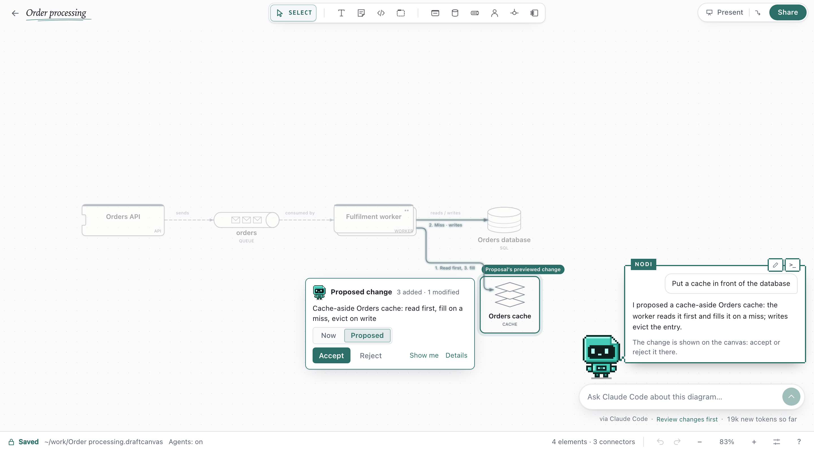
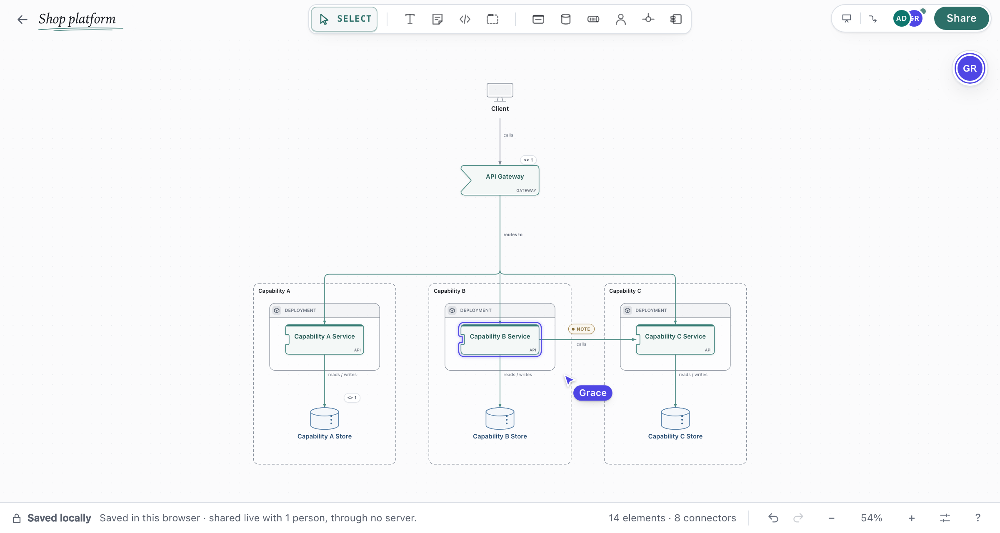

<div align="center">


# Draft Canvas

### Draw software. Explain how it works.

A local-first canvas for turning software architecture into a clear visual story.

**Your architecture, your agents, your decisions.** ([Principles](docs/reference/principles.md))

**[draftcanvas.dev](https://draftcanvas.dev/)** ·
**[Try it in your browser](https://app.draftcanvas.dev/)** ·
**[Download for macOS & Windows](https://github.com/acltabontabon/draft-canvas/releases/latest)** ·
[Documentation](https://draftcanvas.dev/docs/)

</div>

| Ask Nodi on the canvas · Desktop | Draw together · Web and desktop |
| --- | --- |
|  |  |

- **Draw architecture with meaning:** services, stores, queues and relationships, from the overview
  down to detail inside a shape.
- **Explain it:** present flows step by step, write rich-text notes and mark open questions.
- **Work together:** share a live session, approve who joins and control who can edit. Your copy
  hosts and saves the diagram; no account or diagram server.
- **Think with your agent:** ask Nodi to run your own Claude Code or Codex, or connect any MCP client.
  Review proposed changes before accepting them.
- **Keep your work:** import Mermaid; export images, editable files and architecture source;
  share passphrase-protected read-only links.

[What's new in 1.16](https://github.com/acltabontabon/draft-canvas/releases/tag/v1.16.0) ·
[All guides](docs/index.md) · [Privacy and security](SECURITY.md)

## Get started

- **Web:** open [app.draftcanvas.dev](https://app.draftcanvas.dev/). Nothing to install.
- **macOS and Windows:** download from the [latest release](https://github.com/acltabontabon/draft-canvas/releases/latest),
  or on a Mac:

  ```bash
  brew install --cask acltabontabon/tap/draft-canvas
  ```

First launch: [desktop guide](docs/guides/desktop.md#installing). Build from source: [Contributing](CONTRIBUTING.md).

## Draw a repository with your agent

Works with Claude Code, Codex, Cursor, Gemini CLI, Junie or any MCP client.

1. Open your project folder in Draft Canvas Desktop.
2. In **Settings → AI agents**, turn on **Allow agent access** and tick the folder.
3. Click **Add to…** for your agent, then **Install skill**. Start a new agent session.
4. Ask:

   > Use the Draft Canvas skill to diagram this repository as C4 views. Read the code, cite sources,
   > show the main request path as a flow and mark open questions. Render each view and fix readability.

Ask again to refresh the same diagram when the code changes.
[Setup and troubleshooting](docs/guides/connect-an-ai-agent.md)

## Contribute

[Build and contribute](CONTRIBUTING.md) · [Architecture](docs/reference/architecture.md) ·
[Credits](docs/reference/third-party.md) · [Licences](THIRD_PARTY_LICENSES.txt)

---

<div align="center">

Free and open source · [Apache 2.0](LICENSE) · [Feedback & ideas](https://github.com/acltabontabon/draft-canvas/issues/new/choose)

</div>
