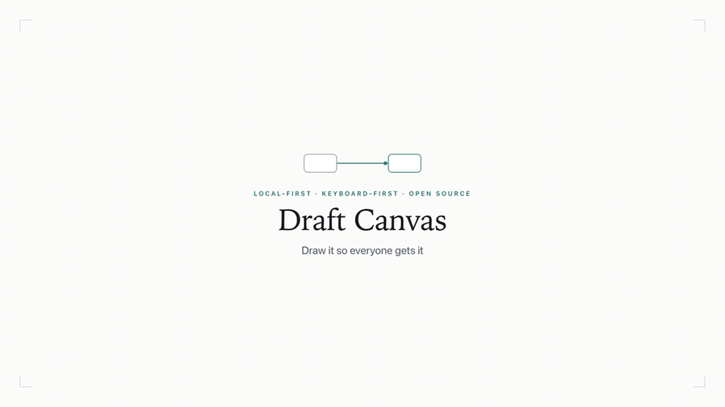

<div align="center">


# Draft Canvas

### Draw software. Explain how it works.

A local-first canvas for turning software architecture into a clear visual story.

**[draftcanvas.dev](https://draftcanvas.dev/)** ·
**[Try it in your browser](https://app.draftcanvas.dev/)** ·
**[Download for macOS & Windows](https://github.com/acltabontabon/draft-canvas/releases/latest)** ·
[Documentation](https://draftcanvas.dev/docs/)

</div>



## Features

- **Draw with meaning.** Services, data stores and queues, with connectors that say how they relate.
- **Keep the overview clear.** Put detail inside a shape, from system overview down to components.
- **Tell the story.** Present flows step by step. Attach notes and mark open questions.
- **Draw together, live.** Share a link and edit with others in real time. Your copy hosts the
  session: no account, and the diagram never passes through a server.
- **Move fast.** Draw from the keyboard, accept suggestions, or start from an architecture starter.
- **Take it with you.** Import Mermaid flowcharts. Export images, editable files, and Mermaid,
  PlantUML, Structurizr or draw.io source. Share read-only links.
- **Draw with your coding agent.** Connect an MCP agent to the desktop app to draw or revise a diagram.

## Install

- **Web:** open [app.draftcanvas.dev](https://app.draftcanvas.dev/). Nothing to install.
- **macOS and Windows:** download from the [latest release](https://github.com/acltabontabon/draft-canvas/releases/latest),
  or on a Mac:

  ```bash
  brew install --cask acltabontabon/tap/draft-canvas
  ```

First launch: [desktop guide](docs/guides/desktop.md#installing). Build from source: [Contributing](CONTRIBUTING.md).

## Draw your own repo

Works with Claude Code, Codex, Cursor, Gemini CLI, Junie or any MCP client.

1. Open your project folder in Draft Canvas Desktop.
2. In **Settings → AI agents**, turn on **Allow agent access** and tick the folder.
3. Click **Add to…** for your agent, then **Install skill**. Start a new agent session.
4. Ask:

   > Use the Draft Canvas skill to diagram this repository's architecture as C4 views, down to
   > components where the code has real logic. Read the code before you draw, cite source files
   > and mark anything inferred. Make the main request path a presentation flow, with variants for
   > the failure paths the code handles, and leave open questions as notes. Render every view and
   > fix what reads badly before you finish.

Ask again to refresh the same diagram when the code changes.
[Setup and troubleshooting](docs/guides/connect-an-ai-agent.md)

## Built with

[React](https://github.com/react/react), [React Flow](https://github.com/xyflow/xyflow),
[Tauri](https://github.com/tauri-apps/tauri), [Simple Icons](https://github.com/simple-icons/simple-icons)
and more: [credits](docs/reference/third-party.md) and [licences](THIRD_PARTY_LICENSES.txt).

---

<div align="center">

Free and open source · [Apache 2.0](LICENSE) · [Feedback & ideas](https://github.com/acltabontabon/draft-canvas/issues/new/choose)

</div>
