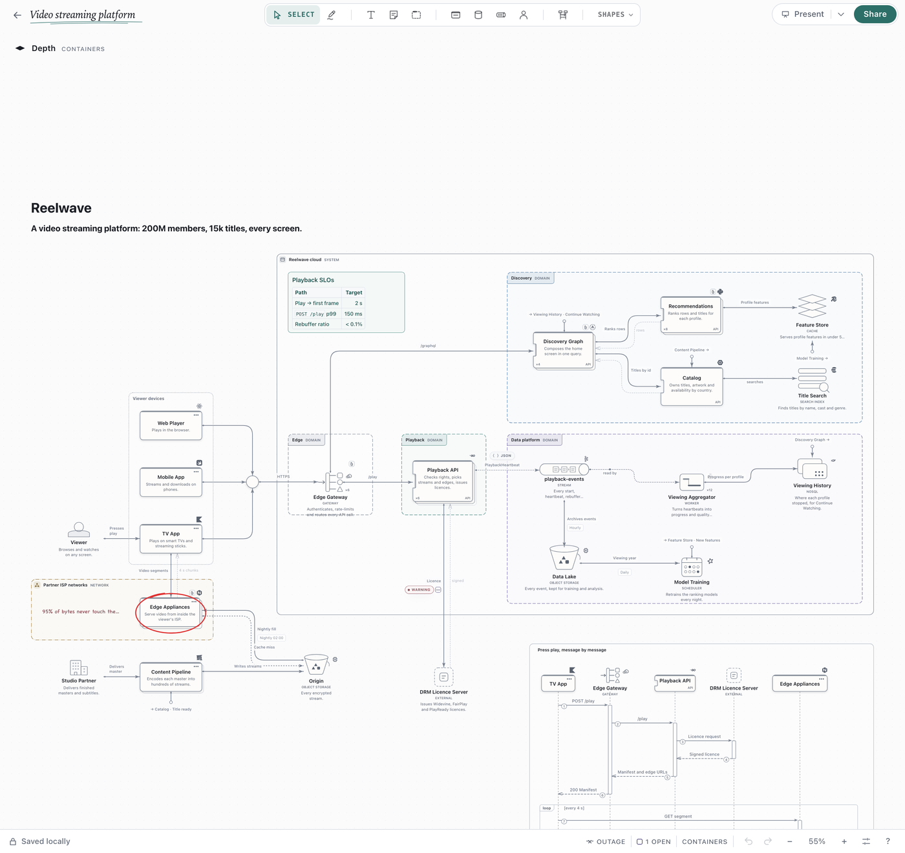

<h1 align="center">&nbsp;Draft Canvas</h1>

<p align="center">
A diagramming tool for developers to explain how a system works.<br>
Free, open source and local-first: your diagrams stay on your device.
</p>

<!-- release-badges:start -->
<p align="center">
<a href="https://github.com/acltabontabon/draft-canvas/releases/tag/v1.22.0"></a>
<a href="https://github.com/acltabontabon/draft-canvas/actions/workflows/ci.yml?query=branch%3Amain"></a>
<a href="https://github.com/acltabontabon/draft-canvas/blob/main/LICENSE"></a>
</p>
<!-- release-badges:end -->


## Why Draft Canvas

- **It knows software architecture.** Services, APIs, queues, stores and actors are shapes with meaning,
  and C4 views nest inside each other, from system context down to components.
- **Diagrams you can walk through.** Present a request's path step by step, draw sequence diagrams
  beside the architecture, or take a shape down to see what fails.
- **Your files, on your device.** No account, nothing uploaded. Share a live session when you choose.
- **Your agent, your decisions.** Connect the coding agent you already use. It proposes changes on the
  canvas, and you accept or reject each one.

## Examples

Whole systems from the [starters gallery](https://github.com/acltabontabon/draft-canvas-starters). Open
one from **Starters** in the app, present its flows and step inside its services.

<table>
<tr>
<td colspan="2">
<a href="https://github.com/acltabontabon/draft-canvas-starters/tree/main/starters/examples/food-delivery">
<picture>
  <source media="(prefers-color-scheme: dark)" srcset="docs/media/starter-food-delivery-dark.png">
  
</picture>
</a>
<p align="center"><b>Food delivery</b><br><sub>An order saga with refunds, an outbox, a dead-letter queue and eight flows to present.</sub></p>
</td>
</tr>
<tr>
<td width="50%" valign="top">
<a href="https://github.com/acltabontabon/draft-canvas-starters/tree/main/starters/examples/video-streaming">
<picture>
  <source media="(prefers-color-scheme: dark)" srcset="docs/media/starter-video-streaming-dark.png">
  
</picture>
</a>
<p align="center"><b>Video streaming</b><br><sub>An edge inside ISPs, DRM, and a sequence diagram for pressing play.</sub></p>
</td>
<td width="50%" valign="top">
<a href="https://github.com/acltabontabon/draft-canvas-starters/tree/main/starters/examples/ride-hailing">
<picture>
  <source media="(prefers-color-scheme: dark)" srcset="docs/media/starter-ride-hailing-dark.png">
  
</picture>
</a>
<p align="center"><b>Ride-hailing</b><br><sub>Live driver locations, dispatch, surge pricing and payouts.</sub></p>
</td>
</tr>
</table>

## Get started

Open the [web app](https://app.draftcanvas.dev/): there's nothing to install. For your project folders
and coding agents, [download the desktop app](https://github.com/acltabontabon/draft-canvas/releases/latest)
for macOS or Windows, or install it with Homebrew:

```bash
brew install --cask acltabontabon/tap/draft-canvas
```

Then follow [Getting started](https://draftcanvas.dev/docs/getting-started/), or browse the
[documentation](https://draftcanvas.dev/docs/).

## Map a repository with your agent

In the desktop app, open your project folder, then in **Settings → AI agents** turn on **Allow agent
access**, tick the folder, and click **Add to…** and **Install skill** for your agent (Claude Code,
Codex, Cursor, OpenCode or any MCP client). Start a new agent session and ask:

> Use the Draft Canvas skill to map this repository’s runtime architecture. Verify boundaries and
> connections in source, cite evidence, and mark inferences. Add component views where they explain
> real logic, and presentation flows for verified requests and handled failures. Don’t turn
> dependencies or concurrent effects into an invented execution order. Inspect every view and fix
> readability before finishing; tell me the scope and any unresolved questions.

Ask again when the code changes, and the agent updates the same diagram. See
[Bring your own agent](https://draftcanvas.dev/docs/connect-an-ai-agent/).

## Contributing

Contributions are welcome: start with [CONTRIBUTING.md](CONTRIBUTING.md). Report security issues
privately, as described in [SECURITY.md](SECURITY.md). Ideas and feedback go to
[issues](https://github.com/acltabontabon/draft-canvas/issues/new/choose).

Draft Canvas is licensed under [Apache 2.0](LICENSE).
