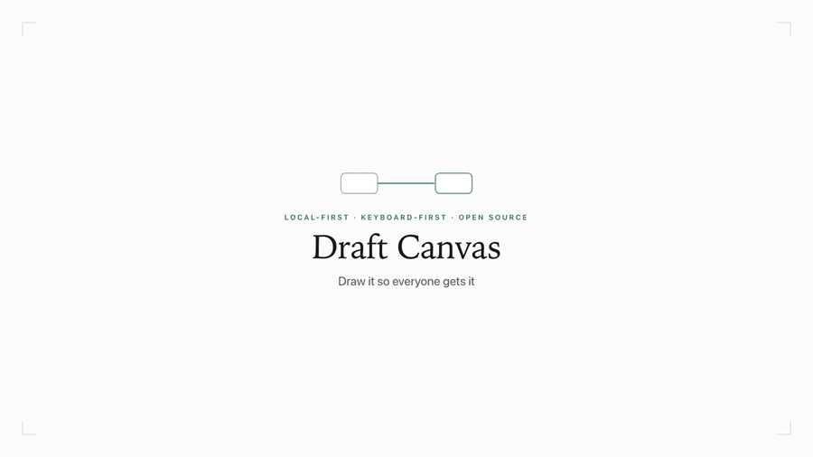

<div align="center">


# Draft Canvas

Draft Canvas is a local-first architecture canvas for developers. Spend more time explaining how
software works and less time making diagrams accurate and tidy. Map systems, trace request flows,
and decide what to build next—with your team.

**Your architecture. Your decisions.** Your diagrams stay on your device, and every proposed change
is yours to review.

</div>



## What it can do

- **C4-aware.** System Context, Containers, Components, and nested views.
- **Tech-aware shapes.** Services, APIs, workers, stores, queues, actors, and boundaries.
- **Presentation flows.** Trace and present happy or failure paths.
- **Bring your own agent.** Connect Claude Code, Codex, Cursor, or any MCP client.
- **Live collaboration.** Share, manage access, and follow presentations.
- **Context for decisions.** Notes, code, sources, and open questions.
- **Import and export.** Import Mermaid and editable files; export images, editable files, Mermaid, PlantUML, Structurizr, and draw.io.

## Get started

Start in the [Draft Canvas web app](https://app.draftcanvas.dev/)—nothing to install—or [download
the desktop app for macOS or Windows](https://github.com/acltabontabon/draft-canvas/releases/latest)
for desktop use and repository access. On macOS, you can also use Homebrew:

```bash
brew install --cask acltabontabon/tap/draft-canvas
```

## Put your repository on the canvas

Open your project folder in Draft Canvas Desktop. In **Settings → AI agents**, turn on **Allow agent
access** and tick the folder. Click **Add to…** for your agent, then **Install skill**. Start a new
agent session and ask:

   > Use the Draft Canvas skill to map this repository’s runtime architecture. Verify boundaries
   > and connections in source, cite evidence, and mark inferences. Add component views where
   > they explain real logic, and presentation flows for verified requests and handled failures.
   > Don’t turn dependencies or concurrent effects into an invented execution order. Inspect every
   > view and fix readability before finishing; tell me the scope and any unresolved questions.

Ask again to refresh the same diagram when the code changes.

---

<div align="center">

[Documentation](https://draftcanvas.dev/docs/) · [Apache 2.0](LICENSE) ·
[Feedback & ideas](https://github.com/acltabontabon/draft-canvas/issues/new/choose)

</div>
