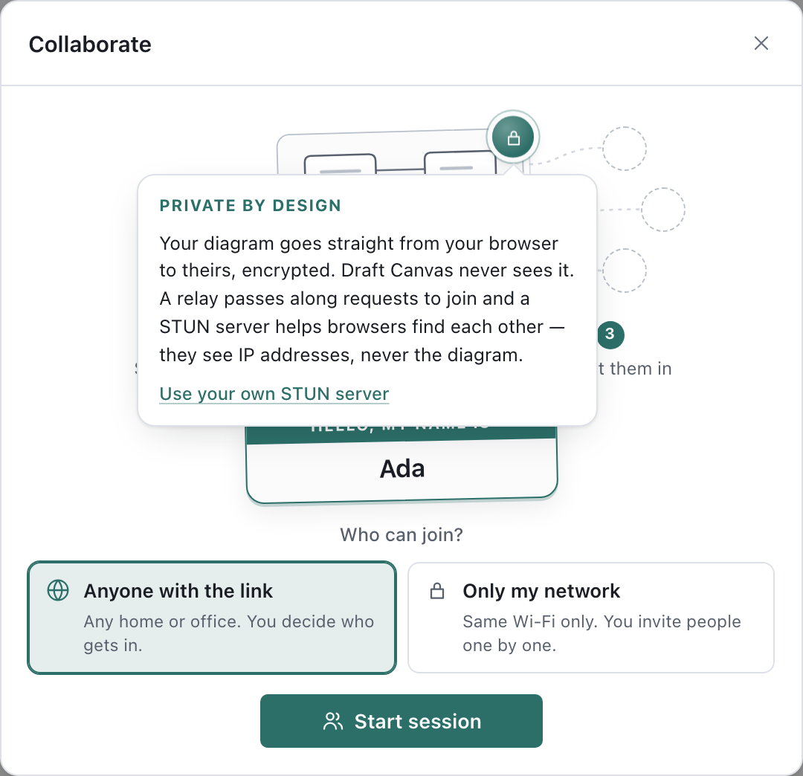
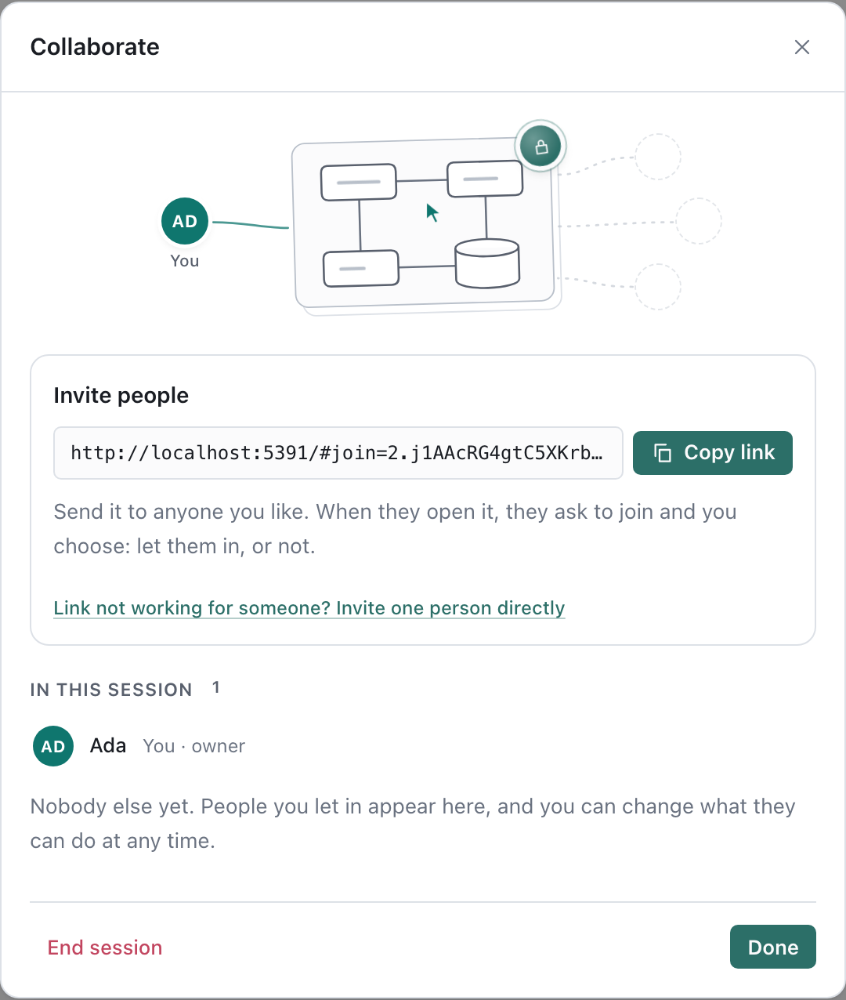

# Collaborating live

Edit one canvas with other people at the same time. Everyone sees each other's changes as they make
them, along with where the others are pointing and what they have selected.

There is still no account, and **Draft Canvas never receives your diagram**. The person who starts the
session — the **owner** — hosts it from their own browser tab or desktop app. Collaborators connect
straight to the owner, and the owner's copy stays the one that is saved. When the session ends, the
canvas is theirs alone again.

## Start a session

1. Open the canvas and press **Collaborate** (the people icon in the toolbar), or run
   **Collaborate…** from the command palette (`⌘K`).
2. Write your name on the name tag — it's shown next to your cursor — and choose **who can join**:
   - **Anyone with the link** (the default) works between different homes and offices. A public
     STUN server helps your browsers find a route to each other, and Draft Canvas's relay lets people
     ask to join (below). Both see IP addresses; neither ever sees the diagram.
   - **Only my network** contacts nothing outside your network — no STUN server and no relay, for
     you or anyone who joins. There is no session link then: you invite people directly, one at a
     time, and they must be on the same network as you.
3. Press **Start session**. With **Anyone with the link**, your **session link** is ready a moment
   later.

Collaborators don't choose: their browser follows yours, asking a STUN server only if you did.

**What stays private** is one click away: press the lock on the sketched canvas, in the Collaborate
and Join dialogs alike. Your own STUN server, if you'd rather not use the default, is set there too.

The toolbar now shows **Live** and how many people are in the session, and the people themselves
appear in a column at the top right of the canvas.

## Invite people

Send everyone the same **session link** — **Copy link**, or **Share** it where your device has a
share sheet. Whoever opens it types their own name and asks to join. They appear at the top of the
people column, ringed and waiting, with a card that says who wants to join: choose **Can edit** or
**Can view** and press **Let in**, or **Deny**. The same question waits at the top of the
Collaborate dialog, and if you're presenting, a notice with **Let in** pops up too.

Only people with the link can ask, and only the people you let in get in. The link stops working
when the session ends; a new session gets a new link.

### What the relay does — and doesn't

Letting someone in takes a few small messages between their browser and yours before the two can
connect directly. A small relay run by Draft Canvas passes those along. It is **not** where your
diagram goes:

- **Your diagram never passes through the relay.** Once you let someone in, the diagram travels
  directly between your browsers, encrypted end to end.
- **The relay can't read what it passes along.** Those messages — a name, connection details — are
  encrypted with a key that exists only in the session link, after the `#`, which browsers never send
  to any server. The relay sees a random room number, scrambled text, and — like any server you
  connect to — the IP addresses and timing of the connections.
- **Nothing of yours is stored.** The relay keeps no messages, no diagrams and no names. The one
  thing it remembers about a room is a fingerprint of a secret only the owner's browser has, so that
  nobody else holding the link can take the owner's place — and it forgets that too within 12 hours.

If the relay can't be reached — you're offline, or a network blocks it — the Collaborate dialog
switches to inviting one person directly, which needs no relay at all (you can also pick
**Invite one person directly** under the link yourself): you send a one-time link, and they
send you back a reply code to paste.

## Join a session

Open the link you were sent. Write your name on the name tag — the one others will see — and press **Ask to join**.
Keep the page open: it says when the owner has seen you, and the canvas opens as soon as they let
you in.

If you were sent a direct invite instead, you get a reply code, already copied to your
clipboard where your browser allows it; send it back to the person who invited you.

Your copy is never saved in your browser. To keep the diagram after the session, use **Make an
editable copy** when the session ends, or ask the owner to export it.

## Working together

- **Edits** land for everyone as they are committed — a shape dropped, a name typed, a connector
  drawn. While you are in the middle of dragging or resizing, other people's edits wait and arrive
  the moment you let go, so nothing jumps out from under your pointer.
- **Undo** takes back only what *you* did. If someone has changed the same thing since, it stays as
  they left it; if someone has built on your edit — a connector to the shape you added, a shape inside
  it — undo leaves your edit in place and says why.
- **Who's here.** The people column at the top right of the canvas shows everyone in the session,
  each in their own colour, with a small mark when they are typing, presenting or looking inside
  another shape. Hover or focus a face to see where they are, and press **Find** to go there.
- **Cursors and selections.** On the canvas you see each person's pointer with their name, and a soft
  outline around what they have selected — in the room you are both looking at.
- **Follow the presenter.** When the owner presents, collaborators are offered **Follow**: their view
  moves through the presentation with the owner's. Moving the canvas yourself stops following.
- **Two people, one shape.** If two people change the same shape at the same moment, the last change
  to reach the owner wins for that shape. Everything else each of you did is kept.

## What the owner controls

Hover a face in the people column, or open **Live** in the toolbar, to manage each person.

- **Can edit / Can view** changes what each person may do, at once. A viewer sees every change live
  but can't make any.
- **Undo changes** takes back everything one person changed this session, and nobody else's work.
  It appears beside anyone who has changed something. Your own undo only ever takes back your own
  edits, so this is the way back when a collaborator's edits went wrong. Anything someone else has
  changed or built on since stays as it is, and the take-back is one edit that undo can reverse.
- **Remove** takes someone out of the session. Their copy stops updating and tells them why. If
  they had changed the canvas, the notice offers **Undo their changes** too.
- **Coming back.** If someone's connection drops, their page knocks again on its own and they are back
  in their place — same colour, same role — without you being asked twice. For someone who joined by a
  direct invite, **Re-invite** beside their name creates an invite that gives them back their place.
- **End session** disconnects everyone. Closing the tab, opening another canvas or reloading also ends
  it. Your canvas is saved as usual throughout.

A session holds the owner and up to 10 collaborators.

## Desktop: share on your local network

The desktop app can also share over the local network, for a room where everyone is on the same
Wi-Fi. While a session runs, open it from the toolbar and turn on **Also share on this network**. You
get a single link like `http://192.168.1.20:52814/#join=lan.…` that people on the network open in a
browser — no reply code, and no relay: the desktop app serves the editor to them itself. Each person
who opens it asks to join and waits at the door like anyone else, until you let them in or not.

Traffic over the local network link is **not encrypted** — anyone on the same network who can watch
traffic could read the diagram. Use it on a network you trust, or through a VPN such as Tailscale.
The link stops working when you turn sharing off or end the session. Invite links work from the
desktop app too: they open in the collaborator's browser at app.draftcanvas.dev.

## If something goes wrong

| What you see | What to do |
| --- | --- |
| **Couldn't connect** | You may be on networks that block direct connections (some offices and hotels do). Make sure the owner chose **Anyone with the link** (collaborators follow the owner's choice), try another network, or use the desktop app's local network link in the same room. |
| **Couldn't reach the owner automatically** | The relay can't be reached from here. Ask the owner for a direct invite: **Collaborate → Invite one person directly**. |
| **The owner isn't in the session right now** | Keep the page open; it asks again as soon as they're back. |
| **This invite has expired** | Ask for a new link. |
| **Reconnecting…** | The connection dropped. Your edits wait and are sent when it recovers. If it doesn't, ask the owner to **Re-invite** you. |
| **Your copy of Draft Canvas and the owner's don't match** | Whoever is behind updates (reload the web app, or update the desktop app). |
| **This diagram is too large to share live** | The diagram is past what a session carries (16 MB). Share an export instead. |

## Privacy

What you draw travels only between the people in the session, encrypted end to end on WebRTC
connections. Nothing is uploaded to Draft Canvas, and Draft Canvas collects no diagrams: the relay
that lets people knock only ever passes along encrypted introductions, as above. A STUN server sees
the IP addresses of the people connecting; direct invite links and reply codes contain them too, so
send links only to the people you mean to invite. The desktop local network link is the exception to encryption, as above. See
[Privacy](../reference/privacy.md#live-collaboration) and the
[security notes](../../SECURITY.md#live-collaboration).
