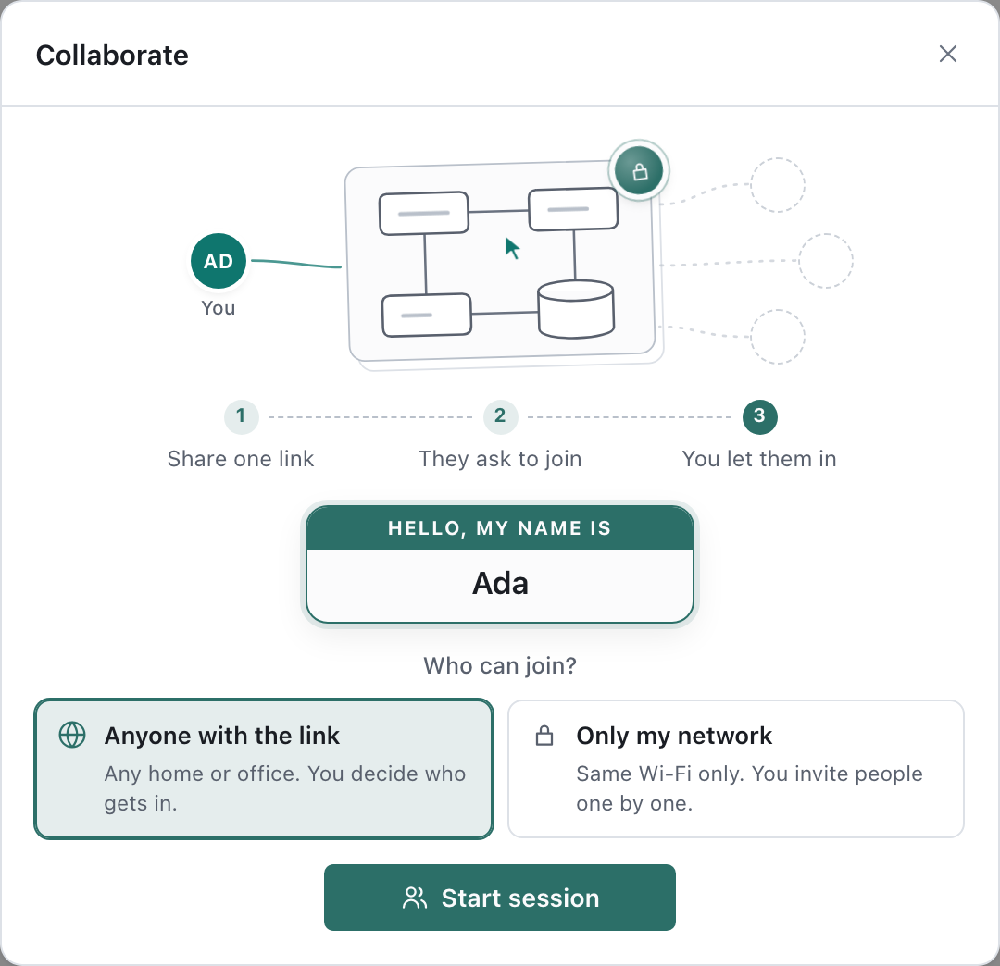
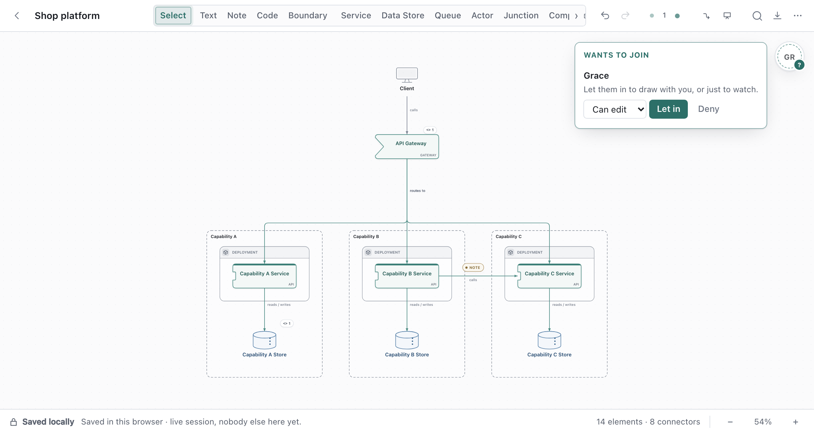
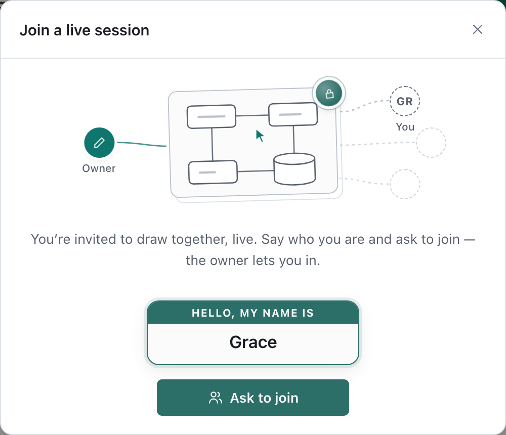
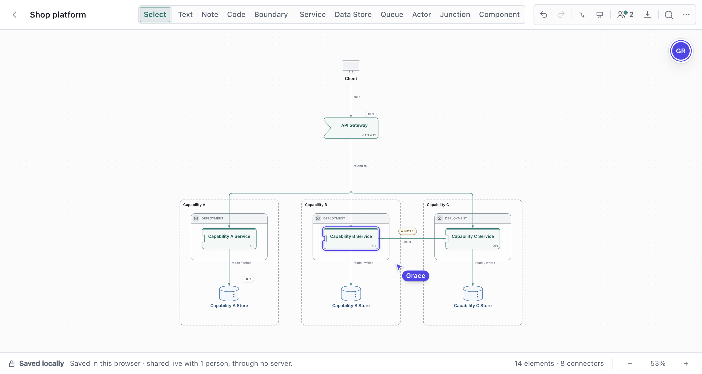

# Collaborating live

Edit one canvas together and see each other's changes, pointers and selections as they happen.

- No account. **Draft Canvas never receives your diagram.**
- The person who starts the session, the **owner**, hosts it from their own tab or desktop app.
  Their copy is the one that is saved.
- A session holds the owner and up to 10 collaborators.

## Start a session

1. Choose **Share → Draw together, live**, or run **Collaborate…** in `⌘K`.
2. Write your name on the name tag. Others see it beside your pointer.
3. Choose who can join:
   - **Anyone with the link** (default): works across different networks. You get a session link,
     and people ask to join.
   - **Only my network**: nothing outside your network is contacted. There is no session link; you
     invite people one at a time, and they must be on your network.
4. Choose **Start session**.

The lock on the dialog's sketch explains what stays private, and lets you set your own STUN server.

## Invite people

Send the **session link** (**Copy link**). Each person opens it, writes their name and asks to join.

Their request appears at the top of the people column on your canvas, and in the Collaborate
dialog. Choose **Can edit** or **Can view**, then **Let in**, or **Deny**.

The link stops working when the session ends. A new session gets a new link.

If the link does not work for someone, choose **Invite one person directly** under it. You send
them a one-time link; they send back a reply code for you to paste.

## Join a session

1. Open the link you were sent.
2. Write your name and choose **Ask to join**.
3. Keep the page open. The canvas opens when the owner lets you in.

With a direct invite, you get a reply code instead (copied for you where the browser allows). Send
it back to the owner.

Your copy is never saved. To keep the diagram afterwards, choose **Make an editable copy** when the
session ends, or ask the owner for an export.

## Working together

- **Edits** reach everyone when committed. Changes from others wait while you drag or resize.
- **Undo** takes back only your own edits. If someone changed or built on the same thing since,
  their work stays and Draft Canvas says why.
- **People column** (top right): everyone in the session, each in a colour. Hover a face to see
  where they are; **Find** takes you there.
- **Pointers and selections** show for people in the same room as you.
- **Follow**: when the owner presents, collaborators can follow along. Moving the canvas, or stepping into
  or out of a shape, stops following.
- **Same shape, same moment**: the last change to reach the owner wins for that shape.

## Owner controls

Hover a face in the people column, or open the faces beside **Share** in the toolbar.

| Control | Does |
| --- | --- |
| **Can edit** / **Can view** | Changes what that person may do, at once |
| **Undo changes** | Takes back everything that person changed this session, even after they leave; one undo reverses it |
| **Remove** | Takes them out of the session; offers **Undo their changes** if they edited |
| **Re-invite** | Makes a new direct invite for someone who joined by one |
| **End session** | Disconnects everyone |

Closing the canvas or the tab, reloading or opening another canvas also ends the session. Your canvas keeps
saving as usual. A collaborator whose connection drops rejoins on their own, in the same role —
except over the desktop local network link, where they ask to join again and you let them back in.

## Desktop: share on your local network

For a room on the same Wi-Fi, the desktop app can serve the editor itself:

1. During a session, open the faces beside **Share**.
2. Turn on **Also share on this network**.
3. Send the `http://…` link. People open it in a browser and ask to join as usual.

**Local network traffic is not encrypted.** Use it only on a network you trust, or over a VPN.
The link stops when you turn it off or end the session.

## If something goes wrong

| Message | What to do |
| --- | --- |
| **Couldn't connect** | Some networks block direct connections. Make sure the owner chose **Anyone with the link**, try another network, or use the desktop app's local network link. |
| **Couldn't reach the owner automatically** | Ask the owner for a direct invite: **Collaborate → Invite one person directly**. |
| **The owner isn't in the session right now** | Keep the page open; it asks again when they return. |
| **This invite has expired** | Ask for a new link. |
| **Reconnecting…** | Your edits are sent when the connection recovers. If it does not, ask the owner to **Re-invite** you. |
| **Your copy of Draft Canvas and the owner's don't match** | Whoever is behind updates the app. |
| **This diagram is too large to share live** | The limit is 16 MB. Share an export instead. |

## Privacy

- The diagram travels directly between browsers, encrypted end to end.
- With **Anyone with the link**, a small Draft Canvas relay passes along encrypted join requests
  and a public STUN server helps browsers find each other. Both see IP addresses, never the diagram.
- Direct invite links and reply codes contain IP addresses: send them only to the people you mean.
- The desktop local network link is the one unencrypted option.

Details: [Privacy](../reference/privacy.md#live-collaboration) and
[Security](../../SECURITY.md#live-collaboration).
