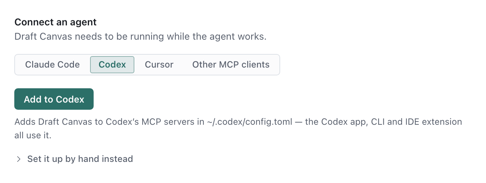
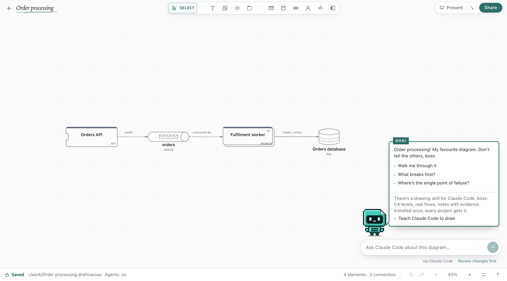
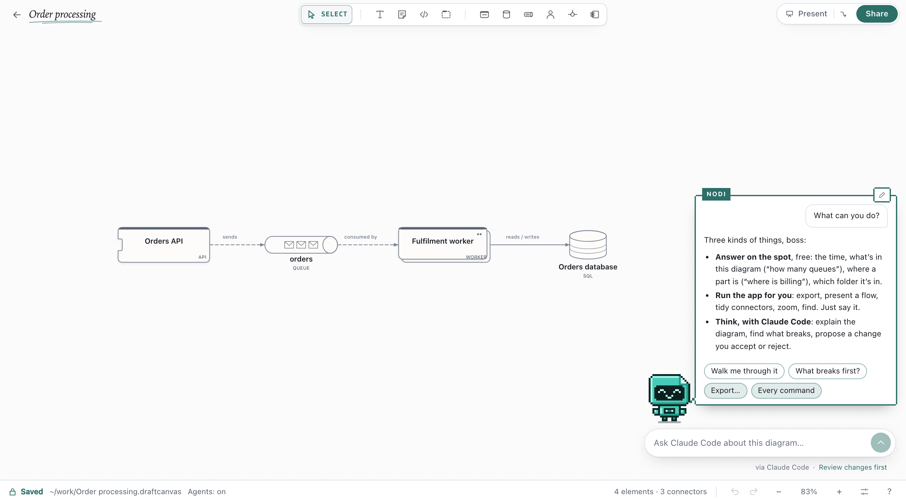
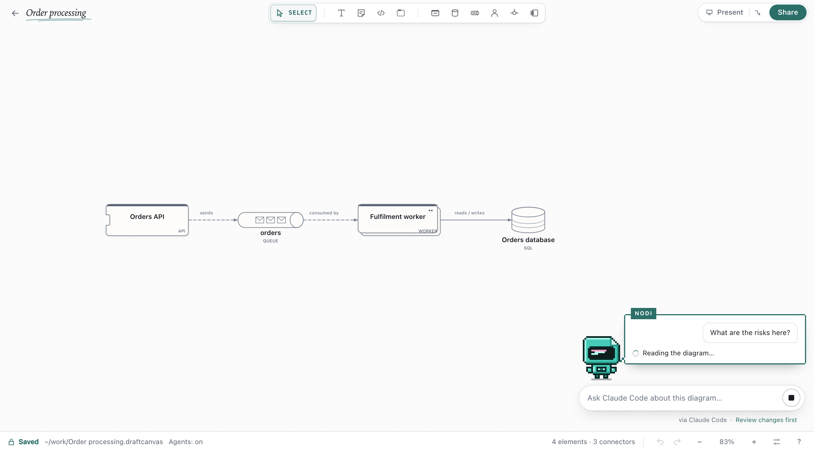
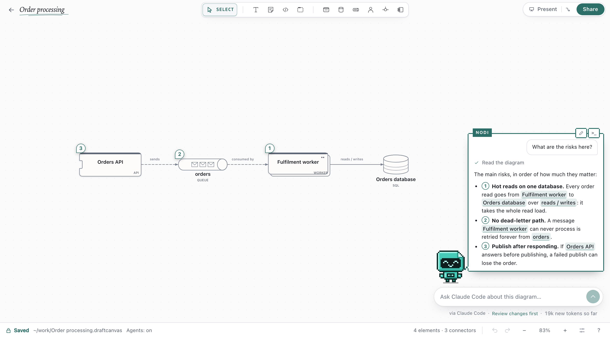
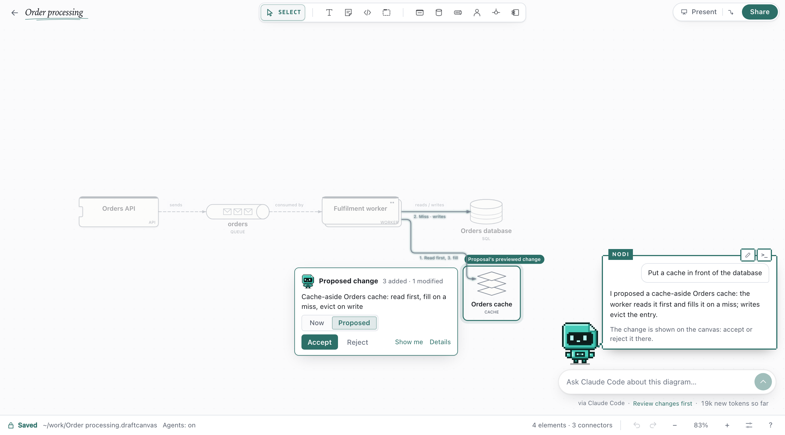
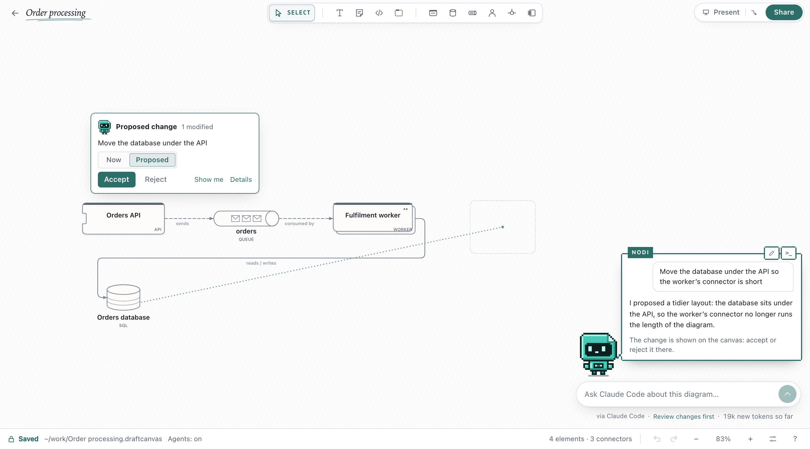
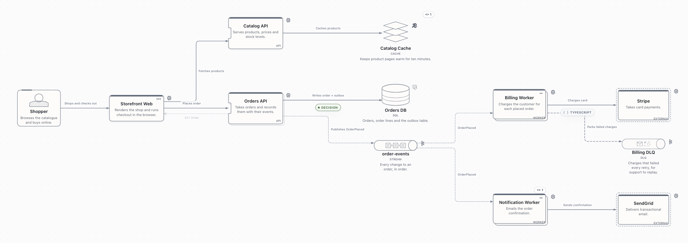

# Connect an AI agent

Let a coding agent, such as Claude Code, Codex, Cursor, Gemini CLI or Junie, draw and update diagrams
in Draft Canvas Desktop on macOS or Windows. Agents reach only the folders you allow. Your agent may
send diagram content to its AI provider, as it does with code.

## Turn it on

1. Open **Connect an agent…** on Home, or **Settings → AI agents**.
2. Turn on **Allow agent access**.
3. Under **Allowed folders**, tick the folders the agent may use. Subfolders are included. A folder
   is listed once you have opened it in Draft Canvas.
4. Under **Connect an agent**, choose your agent and click its button.
5. Optional: under **Agent skill**, click **Install skill**. It teaches the agent to draw a repository.
6. Start a new agent session. Keep Draft Canvas running while the agent works.

| Agent | Button |
| --- | --- |
| Claude Code | **Add to Claude Code** (every project) |
| Codex | **Add to Codex** |
| Cursor | **Add to Cursor** (opens Cursor) |
| Gemini CLI | **Add to Gemini CLI**; start sessions in a trusted folder |
| Junie | **Add to Junie** |
| Other MCP clients | Copy the `mcpServers` entry into the client's configuration |

If Draft Canvas cannot find `claude` or `gemini`, Settings shows a terminal command instead. To
configure by hand, open **Set it up by hand instead** (Cursor: **Copy the config instead**).

The skill installs in `~/.claude/skills` (Claude Code) or `~/.agents/skills` (other agents) and
updates with Draft Canvas. An edited copy is kept until you click **Replace skill**.

## Ask Nodi, on the canvas

Nodi is the desktop app's companion: ask your own Claude Code or Codex about the diagram you are
looking at, without leaving it for a terminal. It appears in the canvas corner once Draft Canvas finds
one of them installed, and needs agent access on and the diagram saved in an allowed folder. Until
then it says what is missing and offers the fix: **Let Nodi in** turns agent access on, and
**Allow** *folder* opens the folder the diagram is in, both from Nodi's box without opening Settings.

1. Click Nodi, its speech bubble, or press ⌘J (Ctrl+J). Select shapes first to ask about them; the
   selection shows in the message box, and × asks about the whole view instead.
2. Pick one of Nodi's suggestions (**Walk me through it**, **What breaks first?**, …) or type. What
   needs no agent, Nodi answers itself, at no token cost: small talk, the time, what is in the view
   ("how many queues?", "where is billing?"), where the file is saved, which folders agents can use, and
   the app's own commands ("export", "present", "tidy connectors"), offered as buttons. Ask "what can
   you do?" for the list.

   

3. While the agent works, one line says what it is doing, and Nodi's screen shows what it watches
   meanwhile.

   

4. Read the answer in the bubble, which holds the whole conversation; past two turns, the earlier
   ones fold behind one line. On its top edge, the pencil starts a new conversation and `>_` copies a
   command that continues it in your agent's own terminal UI.

When your agent could do more outside Nodi's box, Nodi offers it under its suggestions, one click
each: **Connect** *agent* **everywhere** adds Draft Canvas to that agent's own MCP servers (so a
conversation you continue in its terminal still reaches the diagram), and **Teach** *agent* **to
draw** installs the drawing skill. They are the same as the buttons in **Settings → AI agents**.
To hide Nodi, turn off **Show Nodi on the canvas** there.

Nodi also points the way inside: it mentions a shape that holds a diagram of its own, offers
**Take me inside…** when an answer names one, and offers to draw the inside of a selected service
that has none yet.

Answers point at the diagram: a shape or connector Nodi talks about shows as its name, which lights
it on the canvas, and each point gets a numbered pin on the part it is about. Click a pin to read
that point.

A question gets an answer and changes nothing; Nodi offers to make the change, or to record the risks
it found as open points. A change comes back as a proposal on the canvas, drawn solid with what changes in teal; a change that
moves shapes is shown on a tracing sheet over the diagram. **Now / Proposed** compares, and **Accept**
applies it as one undo step. Ask Nodi to adjust it ("keep the cache, but use Redis") and it revises
the same proposal; the chip lists earlier versions. **Review changes first** under the message box
switches to **Apply changes directly**, where changes land at once and Undo takes them back.

- **What runs:** your own CLI, signed in as you, in the background. It gets the Draft Canvas tools for
  this one diagram and nothing else: no shell, no file access, no other MCP servers, no hooks.
  For Codex, Nodi ignores `config.toml` to keep other configured tools out. It keeps your sign-in and
  sessions, but uses Codex's default model, provider and credential-store settings.
- **Reading your code:** when a question needs the code ("how are retries done?"), Nodi asks in the
  chat before anything is read: **Just for now** (until you quit), **Always for this folder**, or
  **No**. **Another folder…** picks the project when it isn't the repository the diagram is saved in.
  Draft Canvas reads that one folder for the agent, read-only, leaving out `.git`, dependency and
  build folders and secrets such as `.env` and keys. Folders allowed always are listed under
  **Settings → AI agents → Code Nodi may read**, where **Stop** takes one back.
- **Two agents:** with both installed, the name under the message box switches between them. Each
  diagram keeps one conversation per agent; the pencil starts over.
- **Stopping:** **Stop** closes the run's access to diagram tools immediately, even while the agent
  is starting. Oversized agent output ends the run with an error; ask for a smaller answer and retry.
- **What it uses:** the line under the message box shows the conversation's new tokens, and with an
  API key its cost. Hover it to see what the agent also re-sent from its provider's cache each step:
  billed at a discount (about a tenth of the usual price with Claude), not free.
- **Where conversations are kept:** the agent's own sessions (`~/.claude/projects`,
  `~/.codex/sessions`). Draft Canvas keeps the conversation shown only while the app runs.

## Draw a repository

Open your agent in the repository and ask:

> Use the Draft Canvas skill to diagram this repository's architecture as C4 views, down to
> components where the code has real logic. Read the code before you draw, cite source files and
> mark anything inferred. Make the main request path a presentation flow, with variants for the
> failure paths the code handles, and leave open questions as notes. Render every view and fix what
> reads badly before you finish.

The skill picks the C4 levels from the size of the system: a context view with the containers
inside once there are more than about eight, and a component view for the container that does the
main path's work. Draft Canvas shows source evidence but does not check it, so read the inferred
parts and open questions first.

Follow-ups change the same diagram:

- "Add a billing dead-letter queue and explain the retry policy in a note."
- "Show the components inside Orders API."
- "Refresh this diagram from the changed code; keep my notes and arrangement."

To limit a change, select shapes first and say so: "Add a retry path around this selection." The
agent changes only what was selected when it read the selection.

Agents use ordinary shapes, connectors, notes, flows and [rich text](shapes-and-connectors.md#write-rich-text).

## Watch and undo

- Longer requests show progress above the status bar, with **Show** for a new diagram.
- **Cancel** works until the line says *Applying…*. After that, use Undo. Each change is one undo step.
- A change saves automatically if you had no unsaved edits. Otherwise you save it.

## Review a proposal

To check changes before they are applied, ask for a proposal:

> Compare this pull request with the diagram. Propose the architectural changes without applying them.

1. Click **1 proposal to review** above the diagram.
2. Read the changes. **Focus changes** shows them on the canvas.
3. Click **Accept** to apply the whole proposal, or **Reject** or **Dismiss**.

To accept only part, ask the agent to revise it. If something the proposal is about has changed,
**Accept** stays disabled until the agent revises it.

## While the window is hidden

- **macOS 14 or later:** agents keep working. Restart once if Settings asks.
- **macOS 12–13 and Windows:** keep the window open.

## Stop an agent

In **Settings → AI agents**:

- **Disconnect agents** › **Disconnect** ends connections. Set-up agents reconnect on their next request.
- Untick a folder to remove access. A ticked parent folder still includes it.
- Turn off **Allow agent access** to stop everything. Folder choices are kept.

## Troubleshooting

| Problem | Fix |
| --- | --- |
| Draft Canvas not running or not responding | Open it, check access is on, and keep the window open where required. |
| Folder not allowed | Tick it under **Allowed folders**. |
| Layout refused | Ask for a smaller diagram, or put detail inside services. |
| Version mismatch, or Settings shows **Update** *agent* | Click it to point the agent at this copy of Draft Canvas. |
| Claude Code finds Draft Canvas in one folder only | Use **Add to Claude Code**, which sets it up for every project. |
| No Nodi in the canvas corner | Install Claude Code (2.1.295 or later) or Codex (0.163.0 or later), then reopen the diagram. |
| Nodi says the agent isn't signed in | Run `claude` or `codex` once in Terminal to sign in, then try again. |

Tools, limits and error codes: [Agent integration](../reference/agent-integration.md).
