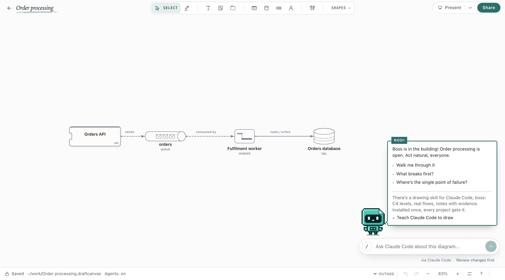
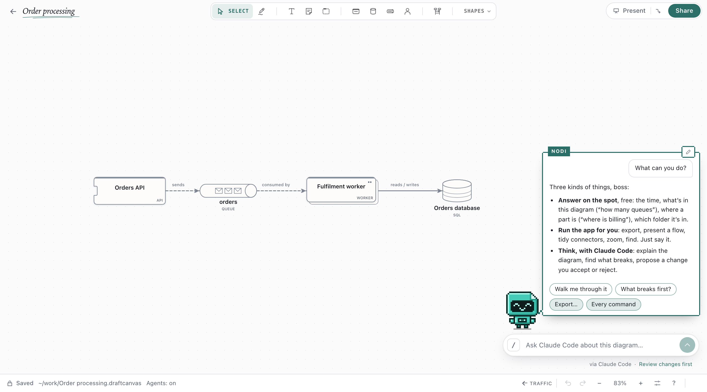
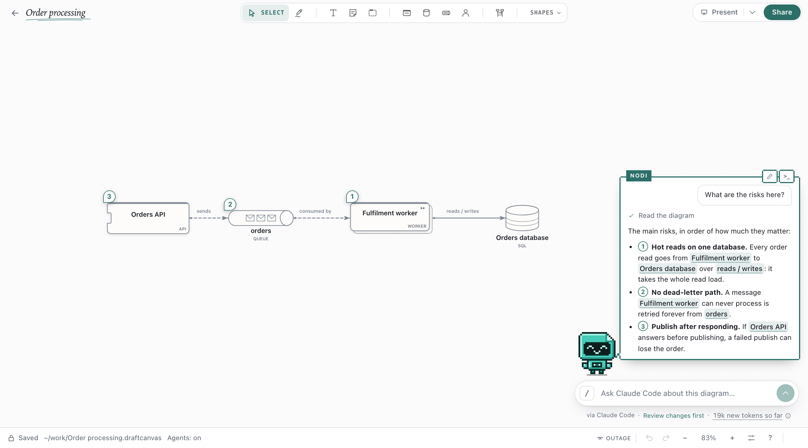
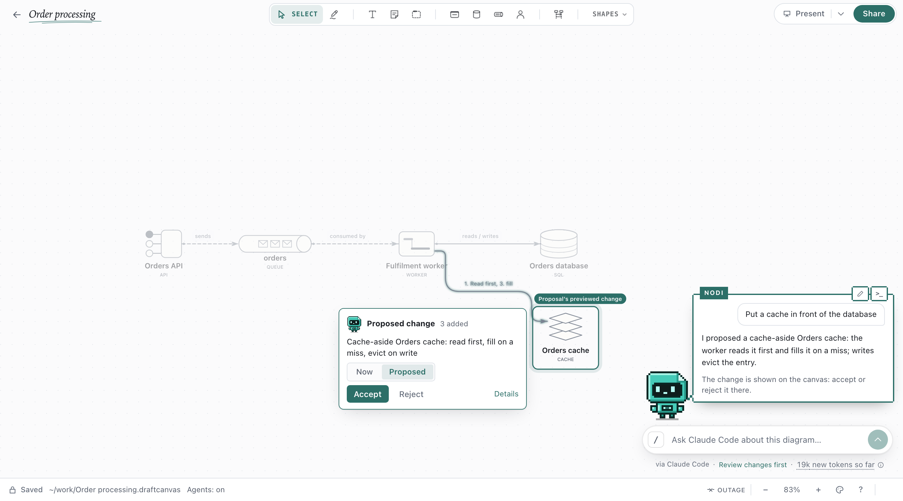
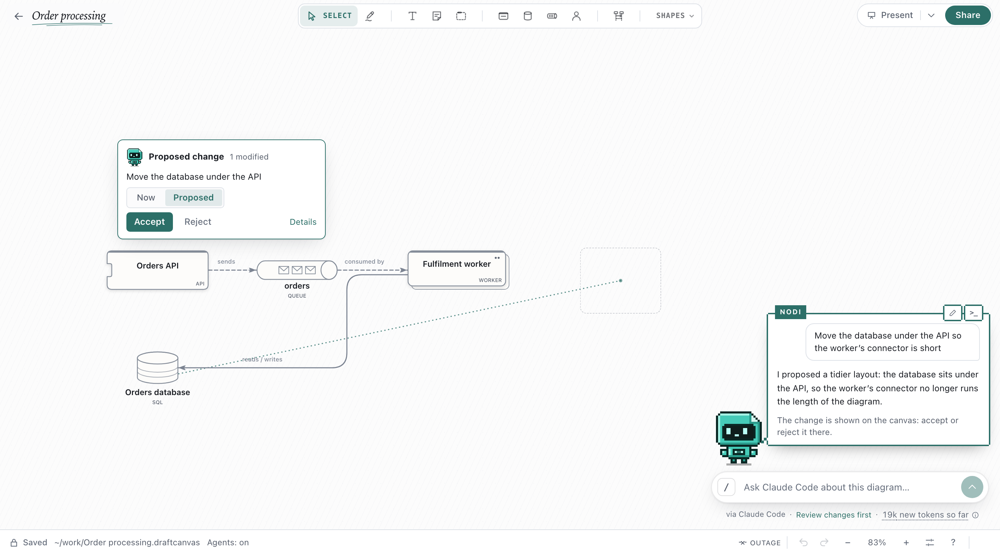

# Connect an AI agent

Let a coding agent, such as Claude Code, Codex, Cursor, Gemini CLI or Junie, draw and update diagrams
in Draft Canvas Desktop on macOS or Windows. Agents reach only the folders you allow. Your agent may
send diagram content to its AI provider, as it does with code.

## Turn it on

1. Open **Connect an agent…** on Home, or **Settings → AI agents**.
2. Turn on **Allow agent access**.
3. Under **Allowed folders**, tick the folders the agent may use. Subfolders are included. A folder
   is listed once you have opened it in Draft Canvas.
4. Under **Connect an agent**, choose your agent and click its button.
5. Optional: under **Agent skill**, click **Install skill**. It teaches the agent to draw a repository.
6. Start a new agent session. Keep Draft Canvas running while the agent works.

| Agent | Button |
| --- | --- |
| Claude Code | **Add to Claude Code** (every project) |
| Codex | **Add to Codex** |
| Cursor | **Add to Cursor** (opens Cursor) |
| Gemini CLI | **Add to Gemini CLI**; start sessions in a trusted folder |
| Junie | **Add to Junie** |
| Other MCP clients | Copy the `mcpServers` entry into the client's configuration |

If Draft Canvas cannot find `claude` or `gemini`, Settings shows a terminal command to run instead.
To configure by hand, open **Set it up by hand instead** (Cursor: **Copy the config instead**).

The skill installs in `~/.claude/skills` (Claude Code) or `~/.agents/skills` (other agents) and
updates with Draft Canvas. If you edit your copy, updates leave it alone until you click **Replace
skill**; the old copy is backed up first.

## Ask Nodi, on the canvas

Nodi is the desktop app's companion. It asks your own Claude Code or Codex about the diagram you are
looking at, so you don't leave for a terminal. It appears at the end of the status bar once one of
them is installed.

Nodi needs agent access on and the diagram saved in an allowed folder. Until then it says what is
missing and offers the fix from its own box: **Let Nodi in** turns agent access on, **Add project…**
picks the folder, and **Allow** *folder* lets agents use it.

1. Click Nodi or press `⌘J` (`Ctrl+J`). Select shapes first to ask about them; `×` in the message
   box asks about the whole view instead.
2. Pick a suggestion (**Walk me through it**, **What breaks first?**) or type. Nodi answers some
   things itself, at no token cost: what is in the view ("how many queues?"), where the file is
   saved, which folders agents can use, and the app's own commands ("export", "present", "tidy
   connectors"), offered as buttons. Ask "what can you do?" for the list.
3. While the agent works, one line says what it is doing. The bubble holds the whole conversation;
   past two turns, earlier ones fold away. The pencil starts a new conversation, and `>_` copies a
   command that continues it in your agent's own terminal.

Answers point at the diagram. A shape or connector Nodi names shows as its name, which lights it on
the canvas, and each point gets a numbered pin on the part it concerns; click a pin to read it. Nodi also offers **Take
me inside…** when an answer names a shape that holds its own diagram.

### Skills

Type `/` in Nodi's box, or click the **/** button, to list what Nodi can do in one go. Highlighting a
skill previews it; `↑` and `↓` choose, `Enter` runs, `Esc` closes.

- **Arrange:** `/across` (**Left to right**), `/down` (**Top down**), `/follow-…` (**Along** one of
  the first three flows), `/roomy` (**Give it room**) and `/snug` (**Snug**). Nodi lays these out
  itself, with no agent and no tokens. Each is one undo step. `/tidy` runs **Straighten
  connectors**, which nudges shapes a few pixels so nearly straight connectors run straight.
- **Ask:** `/explain` and `/risks` send the question to your agent.
- **Show:** `/present` plays the first flow that has steps.

A shared, read-only diagram offers none of the arrange skills.

### Changes come back as proposals

A question gets an answer and changes nothing. Nodi can offer to make a change, or to record the
risks it found as [open points](open-points.md).

A change comes back as a proposal on the canvas, drawn solid with what changes in teal. A change
that moves shapes is shown on a tracing sheet over the diagram. **Now / Proposed** compares, and
**Accept** applies it as one undo step. If you pan away, **Show me** on the chip brings the change
back into view. Ask Nodi to adjust it ("keep the cache, but use Redis") and it revises the same
proposal.

**Review changes first** under the message box can switch to **Apply changes directly**: changes
then land at once, and Undo takes them back. Either way an edit is refused if the diagram changed
while the agent was thinking, and an ambiguous name ("Orders" when two shapes have it) is sent
back for clarification. The reply says whether an edit was saved, unsaved or failed.

Some requests are best phrased exactly. For a tidy row, ask for "all shapes in one horizontal row".
To insert a starter, name it ("start CDC"); starters are available once you have loaded the
[starters gallery](examples.md). Short replies such as **yes** continue the agent's conversation.

When your agent could do more outside Nodi's box, Nodi offers **Connect** *agent* **everywhere**
(adds Draft Canvas to the agent's MCP servers, so a conversation continued in its terminal still
reaches the diagram) and **Teach** *agent* **to draw** (installs the skill). These match the buttons
in **Settings → AI agents**, where **Show Nodi on the canvas** hides it.

Nodi and external agents share the canvas's connector routing. Ends attach automatically when that
simplifies the picture, and follow shapes when moved. Explicit sides and hand-placed bends stay
fixed; an agent can set `route.from` and `route.to` to `"auto"` to release the ends, or `route:
null` to clear pins and bends together.

### What Nodi can reach

- **What runs:** your own CLI, signed in as you, in the background. It gets the Draft Canvas tools
  for this one diagram and nothing else: no shell, no file access, no other MCP servers, no hooks.
  For Codex, Nodi ignores `config.toml` to keep other tools out; it keeps your sign-in but uses
  Codex's default model and provider.
- **Reading your code:** when a question needs the code ("how are retries done?"), Nodi asks first:
  **Just for now**, **Always for this folder** or **No**. **Another folder…** picks a different
  project. The folder is read-only for the agent, without `.git`, dependency and build folders, or
  secrets such as `.env` and keys. Folders allowed always are listed under **Settings → AI agents →
  Code Nodi may read**, where **Stop** takes one back.
- **Two agents:** with both installed, the name under the message box switches between them. Each
  diagram keeps one conversation per agent.
- **Stopping:** **Stop** cuts the run off from the diagram tools at once. Oversized output ends the
  run with an error; ask for a smaller answer and retry.
- **Cost:** the line under the message box shows the conversation's new tokens, and with an API key
  its cost. Hover the dotted count for a breakdown. Plan limits and pricing are the provider's.
- **Where conversations are kept:** in the agent's own sessions (`~/.claude/projects`,
  `~/.codex/sessions`). Draft Canvas keeps up to 128 turns or 64 KiB of requests and outcomes per
  diagram and agent in its private settings, so follow-ups can refer back. That context survives
  restart, expires after 30 days unused and is never stored in a diagram. Follow-ups that depend on
  earlier choices read it, which can cost more than a self-contained edit.

## Draw a repository

Open your agent in the repository and ask:

> Use the Draft Canvas skill to map this repository’s runtime architecture. Verify boundaries
> and connections in source, cite evidence, and mark inferences. Add component views where
> they explain real logic, and presentation flows for verified requests and handled failures.
> Don’t turn dependencies or concurrent effects into an invented execution order. Inspect every
> view and fix readability before finishing; tell me the scope and any unresolved questions.

The skill picks C4 levels by the size of the system: a context view with the containers inside once
there are more than about eight, and a component view for the container that does the main path's
work. Draft Canvas shows source evidence but does not check it, so read the inferred parts and open
questions first.

For small edits the skill reads only the affected views and keeps existing ids and placement.
Refreshes compare the diagram with the changed source, and review-only requests become proposals.

Follow-ups change the same diagram:

- "Add a billing dead-letter queue and explain the retry policy in a note."
- "Show the components inside Orders API."
- "Refresh this diagram from the changed code; keep my notes and arrangement."
- "What happens if Payments goes down? Check the open questions against the code."

The last one reads the same [outage](outage.md#with-your-agent) the canvas shows: what fails, what
absorbs it and what the drawing leaves open. A shape the agent draws takes its kind from its
technology, as it does when you type it: a database with `Redis` arrives as a Cache.

To limit a change, select shapes first and say so: "Add a retry path around this selection." The
agent changes only what was selected when it read the selection.

Agents use ordinary shapes, connectors, notes, flows, [sequences](sequence-diagrams.md) and
[rich text](shapes-and-connectors.md#write-rich-text). Ask for one by what it shows: "Add a sequence
for placing an order, with the payment-declined branch."

## Watch and undo

- Longer requests show progress above the status bar, with **Show** for a new diagram.
- **Cancel** works until the line says *Applying…*. After that, use Undo. Each change is one undo step.
- A change saves automatically if you had no unsaved edits. Otherwise you save it.

## Review a proposal

To check changes before they are applied, ask for a proposal:

> Compare this pull request with the diagram. Propose the architectural changes without applying them.

1. Click **1 proposal to review** above the diagram.
2. Read the changes. **Focus changes** shows them on the canvas.
3. Click **Accept** to apply the whole proposal, or **Reject** or **Dismiss**.

To accept only part, ask the agent to revise it. If something the proposal is about has changed,
**Accept** stays disabled until the agent revises it.

## While the window is hidden

- **macOS 14 or later:** agents keep working. Restart once if Settings asks.
- **macOS 12–13 and Windows:** keep the window open.

## Stop an agent

In **Settings → AI agents**:

- **Disconnect agents** › **Disconnect** ends connections. Set-up agents reconnect on their next request.
- Untick a folder to remove access. A ticked parent folder still includes it.
- Turn off **Allow agent access** to stop everything. Folder choices are kept.

## Troubleshooting

| Problem | Fix |
| --- | --- |
| Draft Canvas not running or not responding | Open it, check access is on, and keep the window open where required. |
| Folder not allowed | Tick it under **Allowed folders**. |
| Layout refused | Ask for a smaller diagram, or put detail inside services. |
| Version mismatch, or Settings shows **Update** *agent* | Click it to point the agent at this copy of Draft Canvas. |
| Claude Code finds Draft Canvas in one folder only | Use **Add to Claude Code**, which sets it up for every project. |
| No Nodi in the status bar | Install Claude Code (2.1.295 or later) or Codex (0.163.0 or later), then reopen the diagram. |
| Nodi says the agent isn't signed in | Run `claude` or `codex` once in Terminal to sign in, then try again. A desktop app does not see an `ANTHROPIC_API_KEY` set only in a shell profile; sign in with the CLI instead. |
