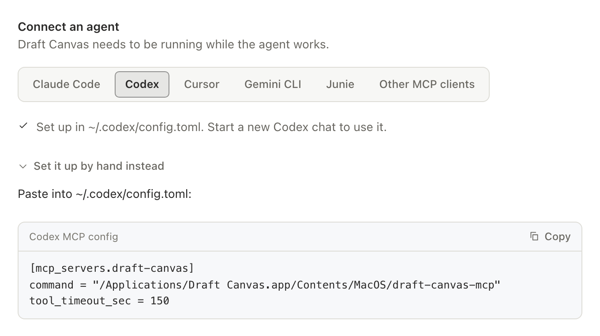
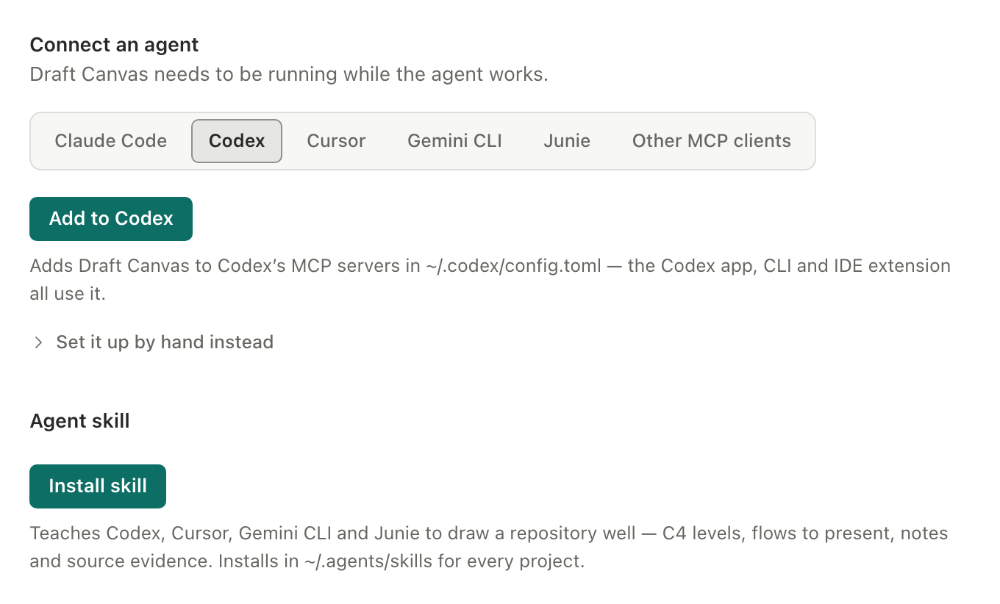
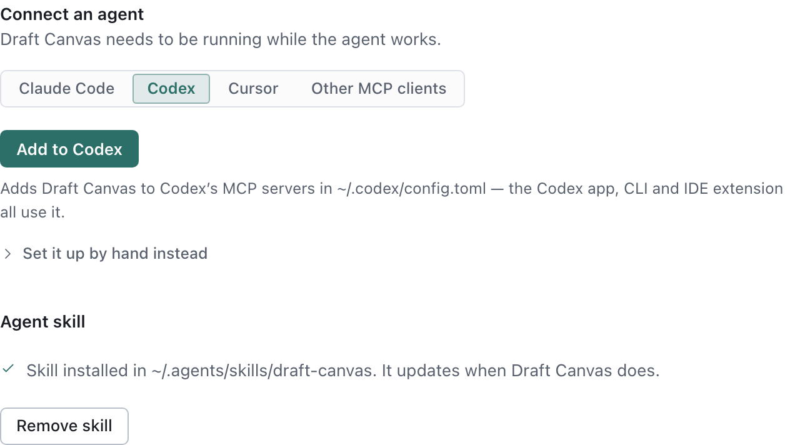

# Connect an AI agent

Draft Canvas Desktop can let a coding agent on your computer — Claude Code, Codex, Cursor, Gemini CLI,
Junie, or any other agent that speaks MCP (the Model Context Protocol) — draw diagrams for you. Ask your agent to "draw
how orders flow through this service". It reads your code, then hands Draft Canvas a description:
the parts, how they connect, the flows. Draft Canvas lays it out and draws it as an ordinary diagram
you can edit, move, present and export like one you drew yourself.

By default the agent leaves the layout to Draft Canvas; when you want something in an exact spot, it
can put it there (see below). Look-inside views arrange around their own main flow and choose their
own reading direction when none was requested. Automatic connectors also shed unnecessary bends
where doing so keeps neighbouring lines clear.

It never touches a file outside the folders you allow. Draft Canvas doesn't send your diagrams anywhere. Your agent does send what it reads and
writes to its own AI provider, as it does with your code.

This needs the desktop app, on macOS or Windows. The web app opens the diagrams it makes, but agents
can't reach it.

## Turn it on

1. On Home, choose **Connect an agent…** under *More ways in* — or open **Settings** (`⌘,` / `Ctrl+,`,
   or from the tray menu) and choose **AI agents**. While access is on, the status bar says so and
   how many agents are connected; off, nothing about agents is on screen.
2. Turn on **Allow agent access**.
3. Tick each project folder an agent may use. A folder appears here once you have opened it in Draft
   Canvas. Agents can list, read, create and change diagrams only in the folders you tick — and in
   everything inside them, so a ticked folder already covers the folders listed under it.
4. Under **Connect an agent**, pick your agent and follow its setup:
   - **Claude Code**: click **Add to Claude Code**. Draft Canvas runs Claude Code's own
     `claude mcp add --scope user` for you, so every project can use it. If Draft Canvas can't find
     the `claude` command, it shows the command to run in a terminal instead, for example
     `claude mcp add --scope user draft-canvas -- "/Applications/Draft Canvas.app/Contents/MacOS/draft-canvas-mcp"`.
   - **Codex**: click **Add to Codex**. Draft Canvas adds a `draft-canvas` server to Codex's
     `config.toml` (`~/.codex/config.toml`, or the folder `CODEX_HOME` names), which the Codex app,
     CLI and IDE extension all read. Only that entry changes; the rest of the file, comments
     included, stays as it was, and a file with a mistake in it is left alone. The entry also gives
     tools 150 seconds instead of Codex's default 60, so a large layout isn't cut off. Start a new
     Codex chat afterwards. **Set it up by hand instead** shows the same entry to paste.

     

     

   - **Cursor**: click **Add to Cursor** — it opens Cursor and adds Draft Canvas to its MCP
     configuration for you. If nothing opens (no `cursor://` links registered, or you'd rather add it
     to a project's own configuration first), use **Copy the config instead** and paste it into
     `~/.cursor/mcp.json`, or a project's `.cursor/mcp.json`.
   - **Gemini CLI**: click **Add to Gemini CLI**. Draft Canvas runs Gemini CLI's own
     `gemini mcp add --scope user` for you, which adds the server to `~/.gemini/settings.json` for
     every project. If Draft Canvas can't find the `gemini` command, it shows the command to run in a
     terminal instead. Gemini CLI turns every MCP server off in a folder you haven't trusted, so start
     a new session in a trusted folder.
   - **Junie**: click **Add to Junie**. Draft Canvas adds a `draft-canvas` server to
     `~/.junie/mcp/mcp.json`, which Junie in JetBrains IDEs and the Junie CLI both read. Only that
     entry changes; your other servers stay as they were, and a file with a mistake in it is left
     alone. Start a new Junie session afterwards. **Set it up by hand instead** shows the same entry
     to paste.
   - **Other MCP clients**: add the copied `mcpServers` entry to the agent's MCP configuration.

   For Claude Code, Codex, Gemini CLI and Junie, Settings also says when the agent is already set up, or is set up for
   a different copy of Draft Canvas (after moving or reinstalling the app) — then the button reads
   **Update** and points it at this one.
5. Under **Agent skill**, click **Install skill** to teach the agent to
   [draw a whole repository](#draw-a-repository) well. It's optional; the agent can draw without it.

Draft Canvas must be running while the agent works: the connector talks to the running app. It
doesn't start the app for you, and it says so if the app isn't open.

## Draw a repository

The **Draft Canvas skill** teaches your agent how to turn a codebase into a diagram worth
presenting, not a pile of boxes. Install it from **Settings → AI agents → Agent skill**, then open
your agent in a repository and ask:

> Draw the architecture of this repository in Draft Canvas.

With the skill, the agent:

1. **Drafts the diagram in one command.** The skill's script surveys the repository in one pass —
   deployable units and their frameworks; docker-compose, Kubernetes, Nomad and Terraform services; the
   databases, brokers and external services the dependencies and configuration name; HTTP routes;
   queue and topic names; API contracts; architecture notes and ADRs; and which services call which —
   and writes a first request from it, with a placeholder wherever only the code can say. Environment
   variable *values* are never read. The agent then reads only the files that matter, and the request
   isn't accepted until every placeholder is filled.
2. **Picks the C4 levels.** A small system is one container view; a larger one opens on a context
   view with its containers one level down. The services with real logic get a component view
   inside, so you can [look inside](depth.md) them.
3. **Draws the main request path as a flow**, in the order the code runs it, with a caption on
   every step, plus a separate flow for each failure path the code has (a retry and dead-letter
   queue, a compensation). Present them as they are.
4. **Adds what a reader needs**: decisions it found (an outbox, idempotency keys), warnings,
   questions it couldn't answer from the code, short code snippets, and the source files behind each
   shape under **Source evidence** in **Details**.
5. **Checks the request before sending it**, reads Draft Canvas's own readability review and looks at
   the rendered diagram before telling you it's done.

Ask again later — "the code changed, refresh the diagram" — and it updates the same diagram in
place, keeping your arrangement, notes and flows.

### Where the skill lives

| Agent | Folder | Read by |
| --- | --- | --- |
| Claude Code | `~/.claude/skills/draft-canvas` | Claude Code (and Cursor) |
| Codex, Cursor, Gemini CLI, Junie, other agents | `~/.agents/skills/draft-canvas` | Codex, Cursor, Gemini CLI and Junie |

Both are folders every project on your computer sees. Choose the agent in **Connect an agent** to see
and install its copy; Codex, Cursor, Gemini CLI and Junie share one. Start a new agent session after installing.

### Updates

The skill is built into Draft Canvas and updates with it — it is never downloaded on its own. When
an update to Draft Canvas brings a newer skill, the copy it installed is replaced the next time it
starts, whole, so nothing stale is left behind. A small `.draft-canvas-skill.json` it writes beside
the skill tells it whether a copy is exactly what it installed:

- **You edited the skill** — Draft Canvas leaves it alone, and Settings says so. **Replace skill**
  installs this version and keeps your edited copy in Draft Canvas's own data folder (never in the
  skills folder, where the agent would load both).
- **A newer Draft Canvas installed it** — it's left as it is; an older app never downgrades it.
- **Remove skill** takes it out again; an edited copy is kept, as on a replace.

## What the agent can do

- **Create a diagram**. It is written as a new file in an allowed folder, laid out automatically, and
  checked for readability before it's saved. It never replaces an existing file, and an agent that
  tries to create a second diagram with a title you already have is told to change that one instead.
  It opens by itself if nothing else is open, or when you asked to see it and have nothing unsaved.
- **Keep working on the same diagram.** Follow-ups — "add a dead-letter queue", "rename that
  service", "explain the retry in a note", "add a flow for the normal path" — change the diagram the
  agent made, not a new one, whether or not it is open. The rules:
  - What you arranged by hand stays where you put it. New parts are placed beside what they connect to.
  - Ask for something to go somewhere exact — "put the cache under the database", "move the
    external systems to the right", "make the gateway wider" — and the agent places it there: at a
    position, or beside another shape with a gap and an alignment. A boundary moves with what's in it,
    a note sitting right beside a shape moves with the shape, and boundaries grow to hold what moved
    in. Shapes on top of each other are still refused.
  - Each change is **one undo step** (`⌘Z` / `Ctrl+Z`). A change to a diagram that isn't open is
    saved to its file without switching what you're looking at; a notice offers **Show**, and opening
    it then has the change as its undo step.
  - "Clean up the arrows and spacing" re-arranges the diagram in place — the same shapes, notes and
    flows, laid out again. You can ask for just one boundary, or just a tidier connector or two
    without moving anything.
  - Shapes that play the same role — a row of actors, a row of external systems — come out one
    consistent size automatically, without an unusually long description enlarging the rest of them.
  - If two diagrams have the name you mention, the agent asks you which.
- **Add notes, code snippets and labels.** Each can sit beside a shape or inside a boundary, or be
  attached to a shape, a connector or a boundary so it moves with it — and the agent can attach a
  loose one, or take one off again, the way you would drag it. Code keeps its language and
  indentation. A label is [rich text](shapes-and-connectors.md#write-rich-text): the agent can write a
  table of endpoints, a checklist, a highlighted snippet or a warning callout, and give it a font,
  colour and background.
- **Set up a presentation.** Flows walk through the connectors that are already there and play in
  presentation mode. The agent writes what each step says, lights extra shapes with a step (as
  **+ Selection** does), and can open on a step that shows just a part of the diagram — "start with the
  whole Orders system, then follow the order". Pinning a camera on a step stays yours; the agent can
  only clear one. Presenting is yours too.
- **Adjust connectors** the way the connector inspector does: colour, Stepped / Curved / Straight,
  the reply line of a call with its label, and delivery attempts before a dead-letter route. It can
  also re-point or reverse a connector without losing its place in your flows.
- **Route connectors by hand**, the way you [bend one](shapes-and-connectors.md#bend-a-connector-by-hand):
  choose which side each end leaves from and the points the line passes through — "take the retry
  around the top", "bring the audit line in from below". It reads where every line runs first, so
  it can move one point rather than redraw the route. You can drag its bends afterwards, and **Reset
  route** hands a line back to automatic routing. If a line it routed crosses a shape or a caption,
  it is told so, but the line is kept as asked.
- **Read a diagram**, including what is inside a shape, a boundary or a flow on its own — or read its
  flows as Mermaid or PlantUML sequence-diagram source, the same text **Export** writes
  (`read_diagram` with `format: "mermaid"` or `"plantuml"`).
- **Look at a diagram** the way you see it: `render_diagram` draws one view as a PNG (handed to the
  agent as an image) or as SVG text, in either theme, at 1×, 2× or 3×. It is the same renderer the
  export uses, so what the agent sees is what you would export. An image larger than Draft Canvas
  can draw, or over 8 MB, is refused with the scale that would fit — never quietly shrunk.
- **Edit only what you selected.** Select a service and the thing downstream of it, then ask for "a
  retry path around this selection, preserve everything else" — the agent reads exactly those ids and
  a few neighbours for orientation, and edits only them, even if you click something else on screen
  while it's working.
- **Propose a change for you to review**, instead of applying it directly — the way it handles "review
  this pull request against the diagram, show me the architectural impact, don't apply it yet." See
  [Reviewing a proposal](#reviewing-a-proposal) below.
- **Use a diagram as context for implementing something**, reading a flow's steps in the order they
  actually happen, the notes and decisions around them, and the boundaries involved — for a request
  like "use the selected flow as the design for implementing this in the repository."
- **Walk through what happens if a step fails**, as a separately named flow built from the shapes
  already there — "using the payment flow, show what happens if the charge times out after the order
  was placed" — switchable against the normal flow without leaving presentation (`Shift+F`).
- **Use C4.** Describe systems at context, container and component level, with a technology and a
  one-line description on each element; they appear under its name. You can edit both from
  **Edit details…** in the element's **⋯** menu. The agent can draw what's inside an existing
  service or component — "show the components inside the Orders API" — the same view **Look
  inside** opens, and move shapes a level down into one or back up out of it.
- **Start from an Architecture Starter**, renamed and extended.

## Inspect before applying

Ask an agent to “prepare this change, look at the result, and apply it only if it reads clearly.”
It can prepare a temporary candidate, inspect its image and field diff, and revise it before applying
that exact candidate as one undo step. Candidates are never saved and expire after ten minutes;
a change you make meanwhile makes the old candidate inapplicable.

Ask for “just this selection and its immediate neighbours” when a full diagram is too large to
inspect. An agent can render selected shapes, a boundary or a flow on its own.

For diagrams based on code, ask the agent to cite each important claim with a source path, symbol,
line or commit and distinguish what it observed from what it inferred. **Source evidence** in
an element's details (**⋯** › **Edit details…**) or a connector's options shows those references. Draft Canvas does not read
the repository itself or verify the author's claim.

Ask an agent to move existing detail inside its service when an overview becomes crowded. It keeps
identities, notes and complete flows. If a flow spans both levels, the agent must explicitly split
that story first; Draft Canvas refuses to discard its steps automatically.

## An example

> **You:** Draw this architecture: a web storefront calls the Orders API, which writes to Postgres
> and publishes OrderPlaced to a topic feeding a billing queue and a notifications queue.
>
> *The agent creates one diagram and keeps its id.*
>
> **You:** Add a dead-letter queue for billing and explain the retry behaviour in a note.
>
> *Same diagram: the queue is placed beside billing, the note beside the queue.*
>
> **You:** Add a flow for the normal processing path.
>
> *Same diagram: a flow over the connectors already there.*
>
> **You:** Clean up the arrows and spacing.
>
> *Same diagram, re-arranged in place: the main path straight, the dead-letter path off to the side.*

## Watching it work

A request that takes more than a moment shows a line above the status bar — "AI agent Drawing
*Checkout* — Routing connections…" — with **Cancel**. Quick ones just appear finished.

- A **new diagram** can be watched as it is arranged, in a view marked *Not saved yet*. It appears by
  itself when nothing else is open; otherwise click **Show**. Drag and scroll to look around;
  **Follow** keeps the whole diagram in view as it changes, **Hide** puts it away.
- A **change to the diagram you have open** is drawn faintly on top of it, tagged *Agent's proposed
  change*, until it is applied. You can keep working; if you edit something meanwhile, your edit wins
  and the agent is told to look again.
- **Cancel** stops a change before it is applied, and nothing changes. Once the line says
  *Applying…*, it's too late to cancel — use Undo.

Nothing you see while an agent works is saved or undoable until it is actually applied.

## Reviewing a proposal

When you ask an agent to review a change against a diagram rather than apply it directly, it submits
a **proposal** instead — Draft Canvas never fetches or reads the pull request itself, only the
structured description of the change the agent sends. A small **N proposal(s) to review** button
appears over the diagram; click it to open the review panel.

The panel leads with the agent's summary, a status, and how many things it adds, changes and removes;
its reasoning, assumptions and open questions sit underneath, collapsed until you want them. The
proposed change also appears right on the canvas — additions and modifications as a dashed outline,
removals crossed out where they stand — with a legend, a toggle to hide it without losing your place,
and a **Focus changes** button that pans to it. The panel still lists every addition, modification and
removal on its own, apart from each other, and for a modification the actual before and after values,
not just a highlighted shape — a canvas outline alone can't show a renamed relationship or a changed
label. **Accept** applies the whole thing as one ordinary undo step (`⌘Z` / `Ctrl+Z` reverts it exactly
like any other edit); **Reject** and **Dismiss** leave the diagram untouched. There is no partial
accept — if you want a smaller change, ask the agent to revise the proposal, which updates the same
one in place rather than creating a second.

If the diagram changed elsewhere since the proposal was written, a note says so but doesn't block
Accept; if something the proposal is specifically *about* changed — a renamed element, a moved
connector — Accept is disabled until the agent revises it. A proposal survives a restart: if Draft
Canvas quit mid-accept, the next time you look at it either picks up where it left off (offering
Accept again) or, if it can tell the change already landed, offers **Mark as applied** instead — a
record-keeping click, not a second attempt to apply it.

## Saving

An agent's change is saved for you only when the document had no unsaved changes of your own. If you
were in the middle of something, the change is applied in the editor and left for you to save with
yours; the recovery copy keeps it safe meanwhile. The agent is told which of the two happened.

If you edit while an agent is preparing a change, your edit wins: the agent is told the diagram
changed, and has to read it again before retrying.

## While the window is hidden

On macOS 14 and later, agents can keep working while Draft Canvas sits in the menu bar with its
window closed. If you turn access on while the app is running, **restart it once** for that to take
effect; Settings says so.

On macOS 12 and 13, and on Windows, keep the Draft Canvas window open while an agent works. A hidden
window may be paused by the system, and the agent is then told the app isn't responding. Nothing is
changed in that case.

## Stopping an agent

- **Disconnect agents** in Settings ends every open connection and replaces the connection secret.
  Agents you have set up reconnect on their next request.
- Untick a folder to put it out of reach at once, including any retry of an earlier request.
- Turn off **Allow agent access** to turn access off completely. Nothing can connect until you turn
  it on again; your folder choices are kept.

## When something goes wrong

- **The agent says Draft Canvas isn't running.** Open Draft Canvas, and check that access is on.
- **"Not in a folder agents may use."** Tick the folder under **AI agents**, or ask the agent to use
  one you allowed.
- **The agent says the layout wasn't readable.** Very large diagrams at once (about 50 or more
  elements) are hard to lay out cleanly. Ask for the diagram in steps, or as an overview with the
  detail drawn inside its shapes.
- **The agent's connector is a different version.** Point the agent at the connector inside the Draft
  Canvas you are running: for Claude Code, Codex, Gemini CLI and Junie, click **Update** under
  **Connect an agent**; for
  other agents, copy the setup from Settings again.
- **Claude Code only finds Draft Canvas in one folder.** An older setup command added it to the
  folder the terminal was in. Click **Add to Claude Code** to add it for every project.

## For agent authors

The tool definitions an agent sees are generated from the app's own source, so they say exactly what
the app accepts:

- `update_diagram.ops` (and `submit_proposal.ops`, the very same schema) is one closed shape per op —
  `add`, `update`, `remove`, `setLevel`, `arrange` — each listing only the fields that op reads. A field
  that belongs to another op (`ids` on an `update`, `set` on a `remove`) is a schema error, as it is
  a validation error in the app.
- An element's `inside` view is typed to the depth the app allows (three rooms down), through local
  `$defs` in each tool's schema; a misspelt field three levels deep is caught like one at the top.
- `read_diagram` takes `format`: `draft` (the default, the structured read), `mermaid` or `plantuml`
  (the flows as sequence-diagram source, every view included, with the revision), or `c4` (the
  architecture as C4-PlantUML — containers, components, boundaries and relationships, every view).
- `render_diagram({diagramId, view?, format?: "png" | "svg", scale?: 1 | 2 | 3, theme?: "light" |
  "dark"})` returns a PNG as MCP image content (its id, revision and pixel size as structured content
  beside it) or the SVG as text. It is read-only and refuses, rather than shrinks, a picture past
  the app's canvas limits or 8 MB.
- A receipt lists at most ten advisories on a create and five on an update; when more were found,
  `advisoriesDropped` says how many were left out.
- A create receipt's `legibility` (crossings, detours, connectors through boundaries) is the top
  view's, with every inside view's under `legibility.views`, each named by its `view` path; advice
  about an inside view starts `Inside <path>:`. An update receipt reports the view it changed.

For how it works — the protocol, the guarantees about retries, what is and isn't supported — see
[Agent integration](../reference/agent-integration.md).

## What was actually tested

Claude Code on macOS is exercised end-to-end for the create/update/read tool path (the existing agent
test suite, `e2e/agent-conversations.ts`/`e2e/agent-scenarios.ts` against a real sidecar and a real
client). The proposal review panel's own round of fixes — the canvas ghost, the legend and visibility
toggle, "Focus changes", the crash-recovery "Mark as applied" path, and the nested-view review fix —
were verified as real browser exercises of the actual rendering, store and commit code
(`e2e/desktop/proposal-review.spec.ts`), driven by fixture proposals injected directly into the review
store rather than by a live `submit_proposal` MCP call from an agent. That is a deliberate substitute,
not an oversight — it reaches the same panel, ghost-rendering and `applyToFile` code a real proposal
would — but a genuine agent-driven `submit_proposal` → review → Accept round trip through a real
sidecar has not been run in this environment; treat the review UI as verified in isolation, the
MCP plumbing it's fed by as verified separately (Rust and TypeScript unit tests for validation,
staleness, conflicts and the crash-recovery state machine), and the two joined together as the one
remaining gap. Cursor's setup is verified for correctness — the deeplink's config payload and
the pasted-config fallback are unit-tested to decode to the exact same server definition, and the
`cursor://` URL and `~/.cursor/mcp.json` shape match Cursor's own published format — but connecting a
real Cursor install to Draft Canvas has not been run in this environment; treat it as
configuration-verified, not as a tested connection, until it's been tried against an actual Cursor.
Codex's and Claude Code's one-click setup is verified against the real tools on macOS, each in a
throwaway configuration folder: the Codex CLI bundled with the ChatGPT app (0.162) reads the entry
Draft Canvas writes, including its tool timeout, and a copy of a real, populated `config.toml` comes
back unchanged apart from the new table; `claude mcp add --scope user` writes the user-scope entry
Settings reads back. A full Codex conversation drawing a diagram has not been run in this
environment. Gemini CLI's and Junie's one-click setup ran the same way, in a throwaway home folder:
Gemini CLI 0.65 wrote the entry through `gemini mcp add`, kept a comment already in
`settings.json`, and `gemini mcp list` reported the connector connected from a trusted folder; Junie's
`mcp.json` came back with its existing server untouched and the new one in Junie's documented shape,
but Junie (CLI 26.9.7) wouldn't start a task without a JetBrains sign-in, so Junie launching the
connector has not been seen. Windows and Linux are untested for every client, as before.

The agent skill's installer is covered by Rust tests against real folders (a fresh install, an
untouched older copy replaced whole, an edited copy kept as a backup, a newer copy left alone,
removal), and the Settings flow by a browser test against the mocked shell. Its example request is
part of the layout gallery, held to the same readability checks as every other case. Following the
skill end to end was tried on open-source repositories with the skill's own scripts and the app's
layout pipeline; a full conversation with any agent through a running Draft Canvas has
not been run in this environment.

Contract 3 adds `npm run e2e:mcp` (after `npm run desktop:check`): a real stdio MCP client and
compiled sidecar issue reads, candidate previews, image renders, commits and a semantic proposal
against the browser editor, then review and Accept it through the UI and verify its fields and undo.
Only the OS broker and disk are faked in this journey; native access, admission and journaling remain
covered by Rust tests. The macOS Rust CI lane runs it in Chromium and WebKit. This closes the joined
sidecar/editor regression gap without claiming a real Cursor connection or Windows GUI acceptance.
