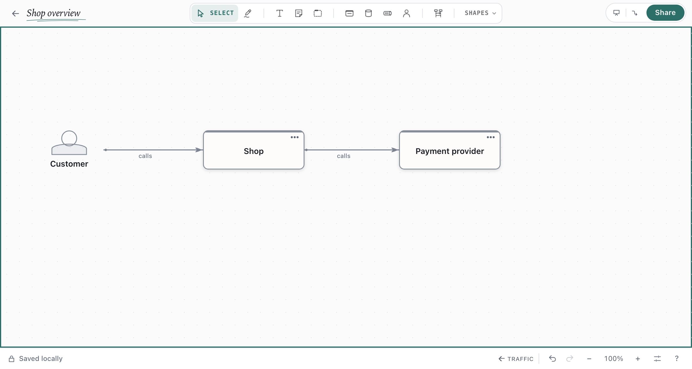
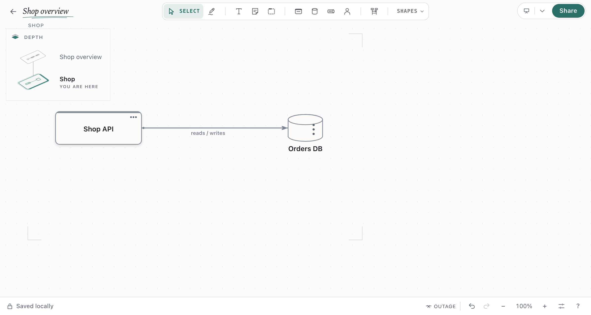

# Explain a system at different levels

Keep the overview small, and draw each part's detail in a **room** inside its Service or Component.

Shortcuts use Mac keys. On Windows and Linux, use `Ctrl` for `⌘`.

## Look inside a shape

1. Select a Service or Component and press `⌘↓`, or right-click → **Look inside**.
2. Draw its detail on the empty canvas.
3. Press `⌘↑` to go back out, or `Esc` with nothing selected.

Rooms nest three levels deep. A Port has no room. A room exists only while it holds a shape:
deleting its last shape removes the room with its sketches and flows, and undo brings them back.

## Move between rooms

Once any room exists, **Depth** appears at the top left of the canvas. Click a plane to go up,
across to a sibling room, or down.

## Set the view level

Run **View level…** from `⌘K`, or click the level chip in the status bar. A level only shapes
suggestions; it never blocks anything.

| Level | Shows |
| --- | --- |
| **System context** | People, this system and external systems |
| **Containers** | Apps, services and data stores |
| **Components** | Parts inside a container |
| **Nothing in particular** | No level-specific suggestions |

A room is one level finer than the canvas outside it unless you set its own.

## Present and export

- `⌘↓` and `⌘↑` work while presenting.
- Inside a room, an image export offers the room or **The whole canvas**.
- A `.draftcanvas` file holds every room. Copying or deleting a shape takes its room with it, and
  diagram size limits count across all rooms.
