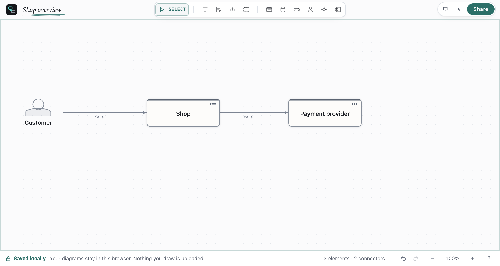
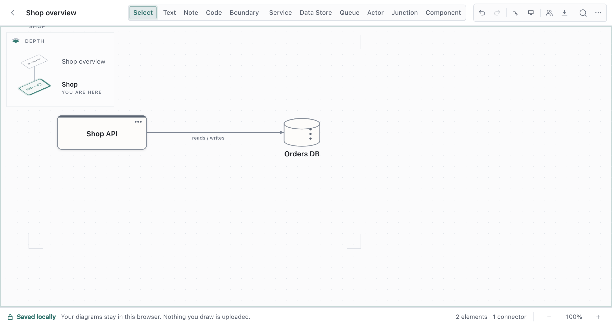

# Explain a system at different levels

Keep the overview small and draw detail in a **room** inside a Service or Component.

Shortcuts use Mac keys. On Windows and Linux, use `Ctrl` for `⌘`.

## Look inside a shape

1. Select a Service or Component and press `⌘↓`, or right-click → **Look inside**.
2. Draw its detail on the empty canvas.
3. Press `⌘↑` to go back out. `Esc` also works when nothing is selected.

Rooms nest three levels deep. A Port has no room. A room disappears with its last shape.

## Set the view level

Run **View level…** from `⌘K`, or click the level chip in the status bar:

| Level | Shows |
| --- | --- |
| **System context** | People, this system and external systems |
| **Containers** | Apps, services and data stores |
| **Components** | Parts inside a container |
| **Nothing in particular** | No level-specific suggestions |

A room defaults to one level finer than the canvas outside it (System context → Containers →
Components) unless you set its own. Levels only shape suggestions; they never block anything.

## Move between rooms

Open **Depth** at the top left of the canvas and click a plane: up, across to a sibling room, or
down. It appears once any room exists.

## Present and export

- `⌘↓` and `⌘↑` work while presenting.
- Inside a room, **Image** and **Source** exports offer the room or **The whole canvas**.
- A `.draftcanvas` file holds every room; copying or deleting a shape includes its room.
  [Limits](../reference/schema.md) count across all rooms.
