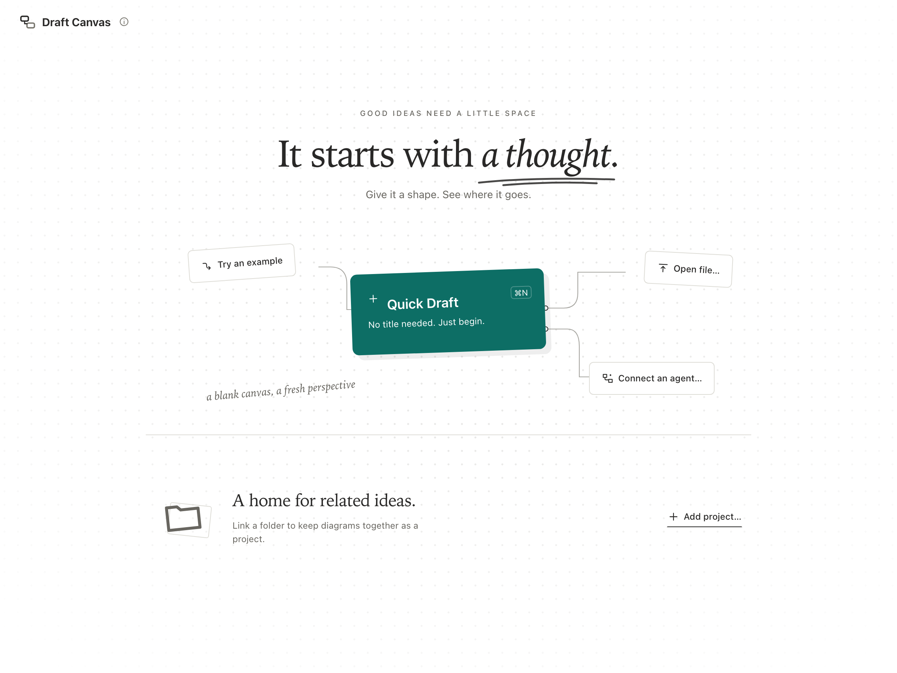
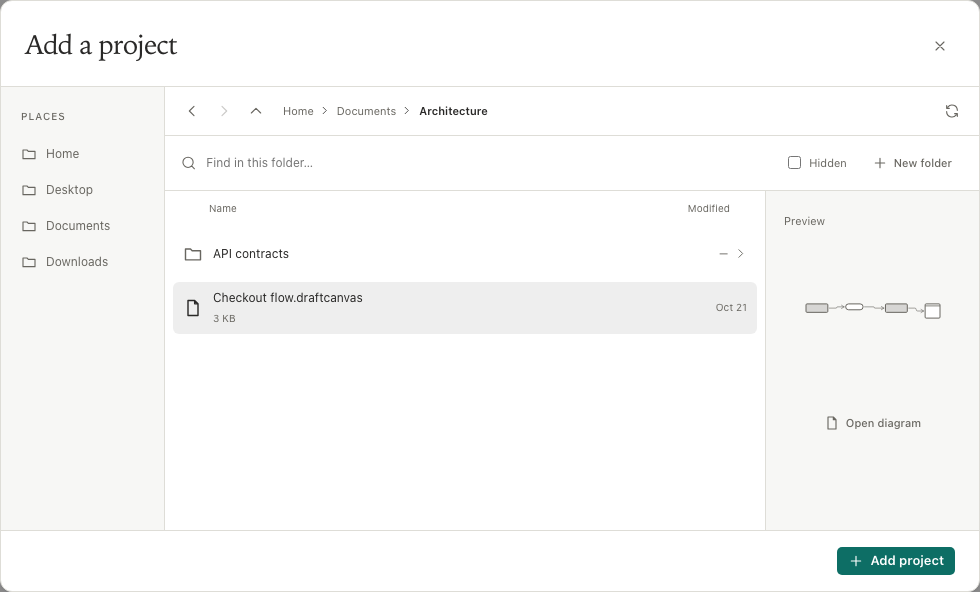
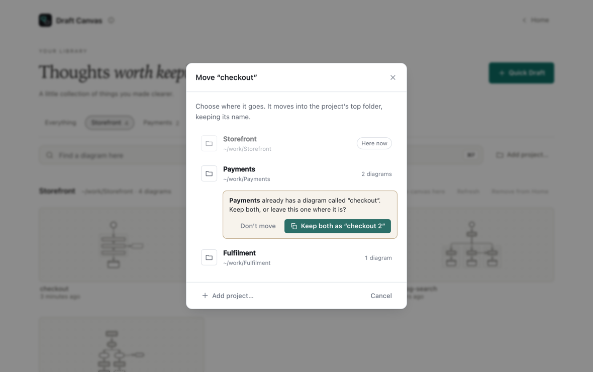
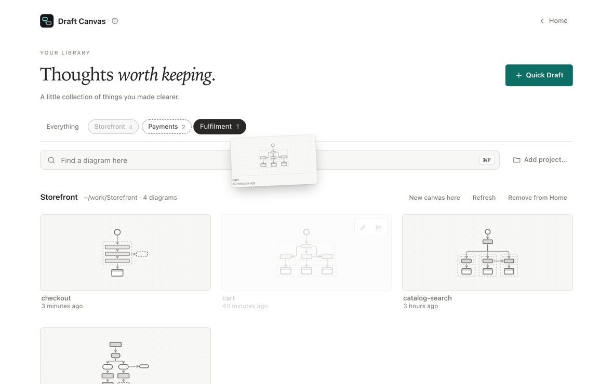
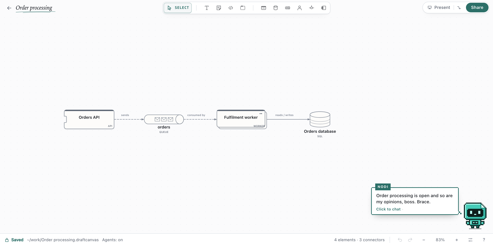

# Draft Canvas Desktop

The editor as an app for macOS (Apple Silicon and Intel) and Windows (x64), with local files,
project folders and Quick Drafts. No account needed.

## Installing

Download an installer from the [latest release](https://github.com/acltabontabon/draft-canvas/releases/latest),
or on macOS 12 or later:

```bash
brew install --cask acltabontabon/tap/draft-canvas
```

If the first launch is blocked, use **System Settings → Privacy & Security → Open Anyway** on macOS,
or **More info → Run anyway** in Windows SmartScreen.

## Quick Draft

Choose **Quick Draft** on Home (`⌘N`) and start drawing; no name or folder needed.



- Quick Drafts stay under **Drafts** on Home, across restarts, until you save or discard them.
  An untouched blank draft leaves nothing behind.
- **Try an example** opens a ready-made Quick Draft.
- **View all** browses every draft, recent file and project.

## Files

| Action | How |
| --- | --- |
| Open | `⌘O`, drop a file on the window, or double-click it |
| Save | `⌘S`; a Quick Draft asks where the first time |
| Save a copy | **Save As…** (`⌘⇧S`) |
| New named file | **New File…** (`⌘⇧N`) |
| Rename, revert, find on disk | **File → Rename File…**, **Revert to Saved…**, **Reveal in Finder** / **File Explorer** |

- The file changes only when you save. Unsaved work has a recovery copy, and closing asks first.
- If another app changes the file, it reloads when you have no unsaved edits; otherwise Draft Canvas
  asks before overwriting.

## Folders as projects

1. On Home, choose **Add project…** (`⌘⇧O`).
2. Pick a folder, or make one with **New folder**.
3. Choose **Add project**.



A project is an ordinary folder of `.draftcanvas` files. **New canvas here** adds a diagram to the
current folder. **Find a diagram** (`⌘F` on Home) searches projects, recent files and drafts.
**Remove from Home** forgets a project; its files stay.

To move a diagram to another project, point at its tile on Home or in **Find a diagram** and choose
**Move to a project**, or drag the tile onto a project's name above the grid. For the open diagram,
use **File → Move to Project…**. The diagram moves into the project's top folder with its name and
background image. If that project already has a diagram with the same name, Draft Canvas asks first:
**Keep both** adds a number to the moved diagram's name, and nothing is replaced.





To bring a browser diagram here, use **Export → Document → Editable** and open the file. Encrypted
`.dcenc` files open only in the web app.

## Menu bar and system tray

The first time you close the window, Draft Canvas keeps running in the menu bar (macOS) or system
tray (Windows) and asks whether to keep doing that. Change it in **Settings → General**.

For coding agents, see [Connect an AI agent](connect-an-ai-agent.md).

## Nodi

Nodi, in the canvas corner, asks your own Claude Code or Codex about the open diagram: explain it, find
its risks, or propose a change you review on the canvas. It shows up once one of them is installed;
⌘J opens it. See [Ask Nodi, on the canvas](connect-an-ai-agent.md#ask-nodi-on-the-canvas).



## Settings

**Settings…** (`⌘,`) has five pages: **General** (closing the window), **Canvas** (drawing style,
next-shape suggestions and the open diagram's background), **AI agents**, **Updates** and **Support**
(a diagnostic report with no diagram content or file paths, never sent automatically).
**Canvas Settings…** in the menu bar and the sliders button in the status bar open it at **Canvas**. Licences are under **About Draft Canvas**.

## Updates

The app checks for updates daily; turn this off in **Settings → Updates**. When one is found, choose
**Download**, then **Update and restart**, or **Later**. Updates are signature-checked.

With Homebrew, quit the app first, then:

```bash
brew upgrade --cask --greedy acltabontabon/tap/draft-canvas
```

Uninstalling keeps your diagrams and recovery data.

## Keyboard

| Mac | Action |
| --- | --- |
| `⌘N` / `⌘⇧N` | New Quick Draft / New File |
| `⌘O` / `⌘⇧O` | Open / Add project |
| `⌘S` / `⌘⇧S` | Save / Save As |
| `⌘F` on Home | Find a diagram |
| `⌘W` / `⌘Q` | Close window / quit |
| `⌘,` | Settings |

On Windows, use `Ctrl`. Editor keys: [keyboard shortcuts](keyboard-and-commands.md).

## Building it yourself

Install Node 22.22+, [Rust](https://www.rust-lang.org/tools/install) and
[Tauri's prerequisites](https://v2.tauri.app/start/prerequisites/), then:

```bash
npm ci
npm run desktop:dev      # development app
npm run desktop:build    # installer in src-tauri/target/release/bundle/
npm run desktop:check    # desktop build, Rust and version checks
```

Maintainers: [desktop updates](../reference/desktop-updates.md) covers releases, signing and Homebrew.
