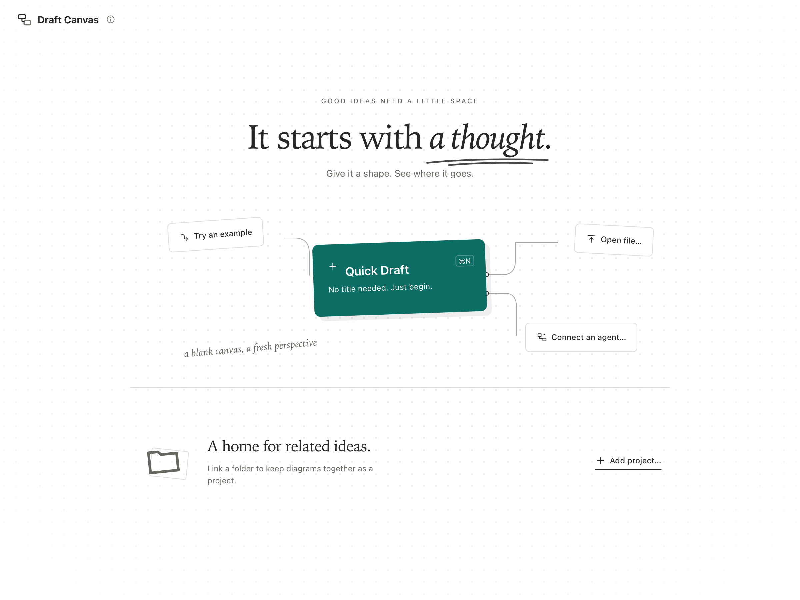
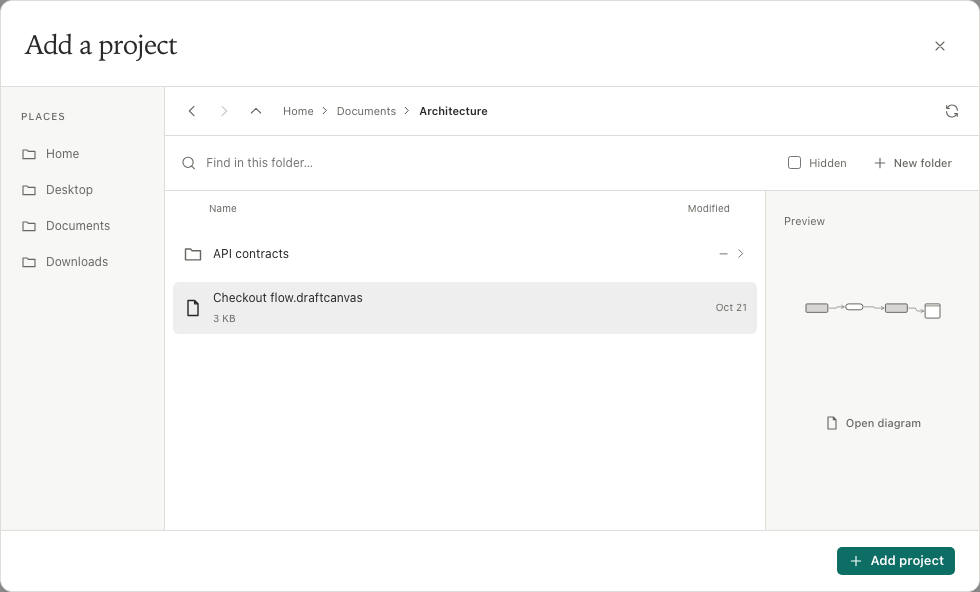
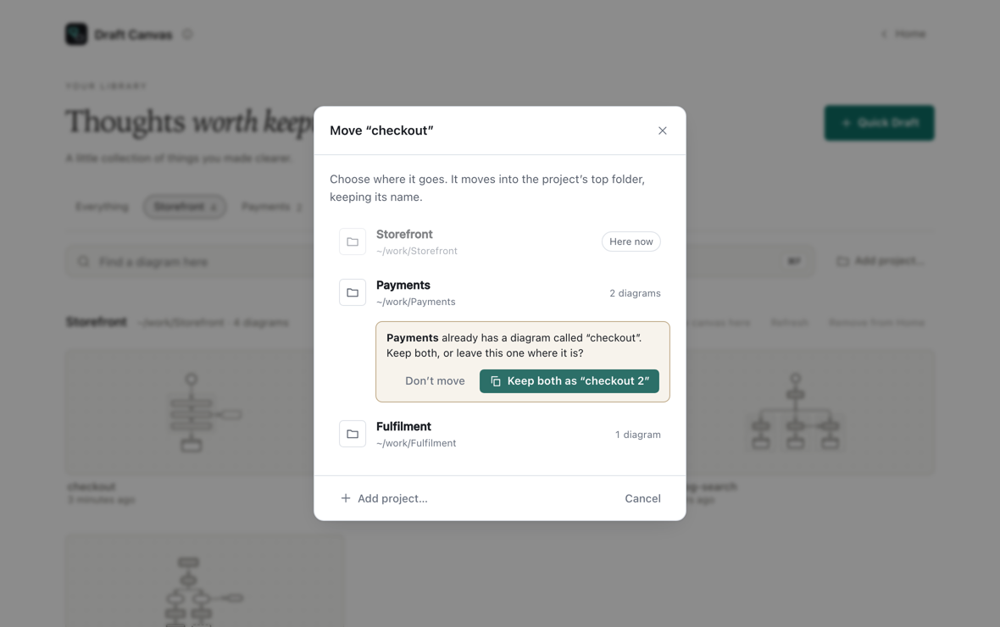
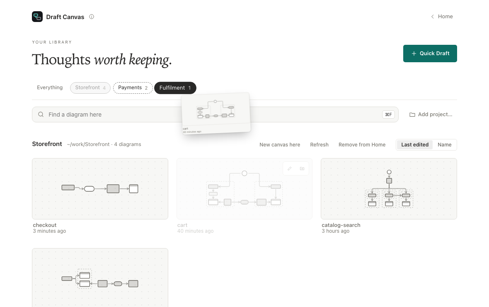

# Draft Canvas Desktop

Draft Canvas Desktop is the editor as an app for macOS (Apple Silicon and Intel) and Windows (x64),
with local files, project folders and Quick Drafts. No account needed.

## Installing

Download an installer from the [latest release](https://github.com/acltabontabon/draft-canvas/releases/latest),
or on macOS 12 or later:

```bash
brew install --cask acltabontabon/tap/draft-canvas
```

If the first launch is blocked, use **System Settings → Privacy & Security → Open Anyway** on macOS,
or **More info → Run anyway** in Windows SmartScreen.

## Quick Draft

Choose **Quick Draft** on Home (`⌘N`) and start drawing, with no name or folder. Quick Drafts stay
under **Drafts** on Home, across restarts, until you save or discard them. **Try an example** opens a
ready-made one.



## Files

| Action | How |
| --- | --- |
| Open | `⌘O`, drop a file on the window, or double-click it |
| Save | `⌘S`; a Quick Draft asks where the first time |
| Save a copy | **Save As…** (`⌘⇧S`) |
| New named file | **New File…** (`⌘⇧N`) |
| Rename, revert, find on disk | **File → Rename File…**, **Revert to Saved…**, **Reveal in Finder** / **File Explorer** |

- The file changes only when you save. Unsaved work has a recovery copy, and closing asks first.
- If the original file can't be opened, its recovery copy opens as a Quick Draft from Home.
- If another app changes the file, it reloads when you have no unsaved edits; otherwise Draft Canvas
  asks before overwriting.

To bring a diagram over from the web app, export it with **Save an editable file → Editable** and
open the file. Encrypted `.dcenc` files open only in the web app.

## Folders as projects

1. On Home, choose **Add project…** (`⌘⇧O`).
2. Pick a folder, or make one with **New folder**.
3. Choose **Add project**.



A project is an ordinary folder of `.draftcanvas` files. **New canvas here** adds a diagram to the
current folder, and **Find a diagram** (`⌘F` on Home) searches projects, recent files and drafts.
**Remove from Home** forgets a project; its files stay.

To move a diagram to another project, point at its tile on Home or in **Find a diagram** and choose
**Move to a project**, or drag the tile onto a project's name. For the open diagram, use **File →
Move to Project…**. It lands in the project's top folder. If the project has a diagram with that
name, Draft Canvas asks first: **Keep both** numbers the moved one, and nothing is replaced.





## Menu bar and system tray

The first time you close the window, Draft Canvas keeps running in the menu bar (macOS) or system
tray (Windows) and asks whether to keep doing that. Change it in **Settings → General**.

## Your coding agent

Draft Canvas has no assistant of its own. Your own coding agent (Claude Code, Codex, Cursor and
others) reads and changes diagrams through the app, in the folders you allow, and you review what it
proposes on the canvas. Set it up in **Settings → AI agents**: see
[Connect an AI agent](connect-an-ai-agent.md).

## Settings

**Settings…** (`⌘,`) has seven pages:

| Page | Holds |
| --- | --- |
| **General** | What closing the window does |
| **Appearance** | Your style, and using it in the open diagram |
| **Canvas** | Next-shape suggestions. **Canvas Settings…** in the menu bar and the sliders button in the status bar open this page |
| **History** | Recording and publishing each diagram's history; see [Diagram history](history.md#settings) |
| **AI agents** | Agent access; see [Connect an AI agent](connect-an-ai-agent.md) |
| **Updates** | Update checks |
| **Support** | A [diagnostic report](saving-and-sharing.md#if-something-looks-wrong) for bug reports |

Licences are under **About Draft Canvas**.

## Updates

The app checks for updates daily; turn this off in **Settings → Updates**. When one is found, choose
**Download**, then **Update and restart**, or **Later**. Updates are signature-checked.

With Homebrew, quit the app first, then:

```bash
brew upgrade --cask --greedy acltabontabon/tap/draft-canvas
```

Uninstalling keeps your diagrams and recovery data.

## Keyboard

| Mac | Action |
| --- | --- |
| `⌘N` / `⌘⇧N` | New Quick Draft / New File |
| `⌘O` / `⌘⇧O` | Open / Add project |
| `⌘S` / `⌘⇧S` | Save / Save As |
| `⌘F` on Home | Find a diagram |
| `⌘W` / `⌘Q` | Close window / quit |
| `⌘,` | Settings |

On Windows, use `Ctrl`. Editor keys: [keyboard shortcuts](keyboard-and-commands.md).

## Building it yourself

Install Node 22.22.2+, [Rust](https://www.rust-lang.org/tools/install) and
[Tauri's prerequisites](https://v2.tauri.app/start/prerequisites/), then:

```bash
npm ci
npm run desktop:dev      # development app
npm run desktop:build    # installer in src-tauri/target/release/bundle/
npm run desktop:check    # desktop build, Rust and version checks
```

Maintainers: [Releases](../reference/releases.md#desktop-updates) covers desktop updates, signing and
Homebrew.
