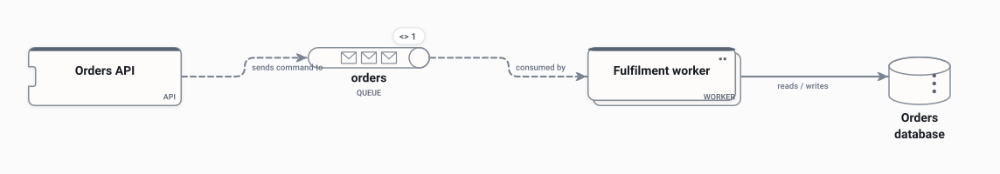
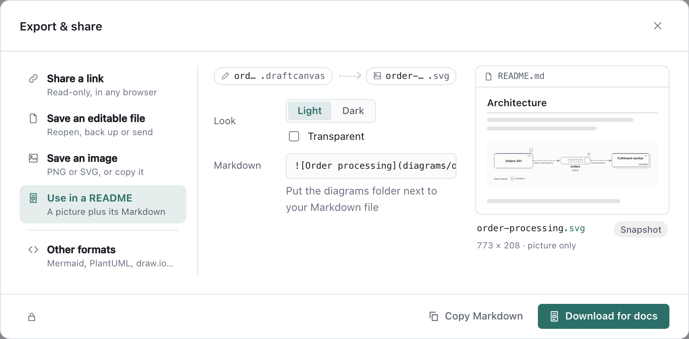
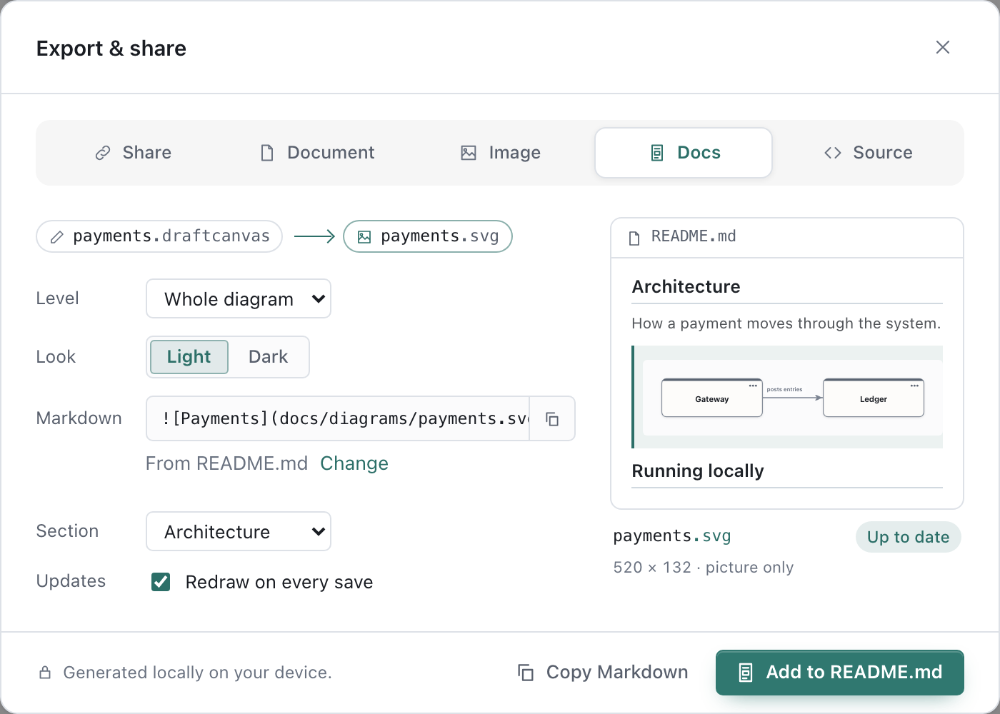
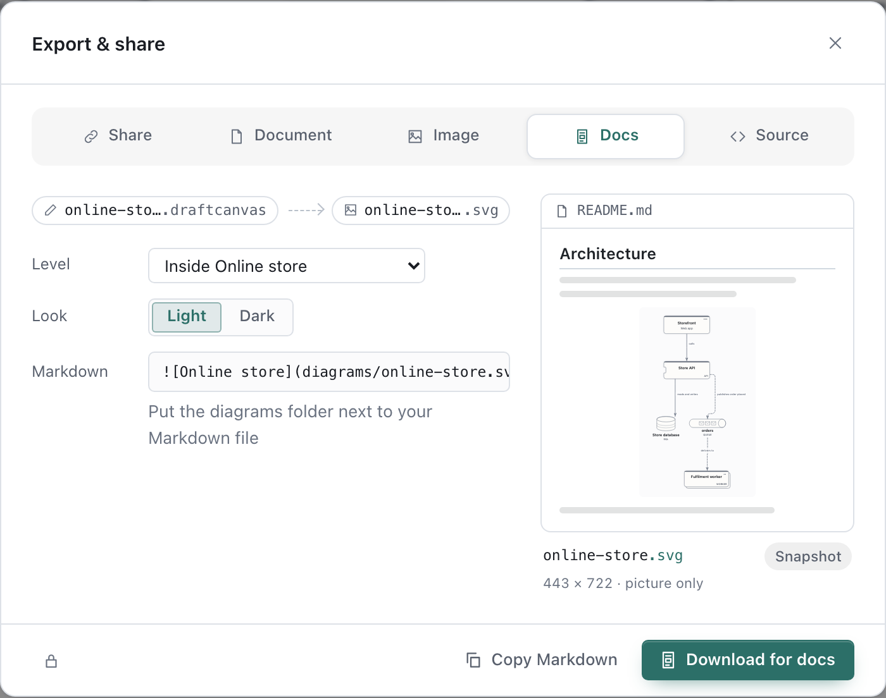
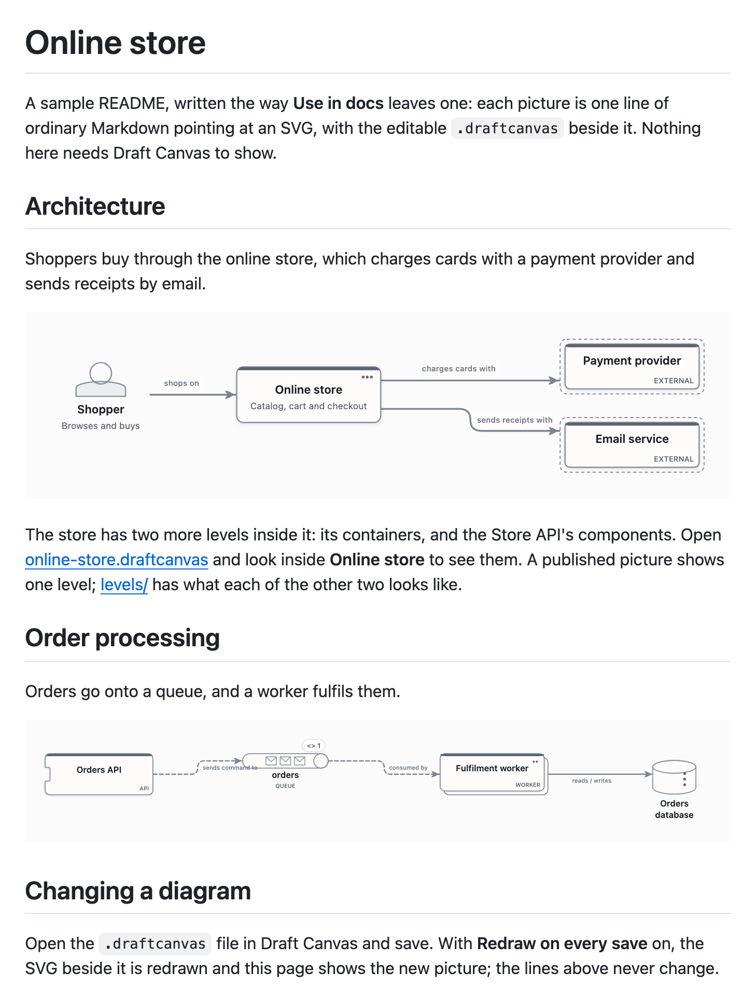

# Diagrams in your docs

Put a diagram in a README, an ADR or any Markdown page, and keep it connected to the diagram you
edit. The page shows an ordinary SVG image; the editable `.draftcanvas` file sits beside it.



The picture above is a real one: Draft Canvas drew it from
[order-processing.draftcanvas](../media/guides/docs-example/order-processing.draftcanvas), and this
page shows it with nothing more than:

```markdown

```

It works anywhere Markdown shows SVG images, including GitHub. Readers need no plugin, no account
and no Draft Canvas. Anyone who wants to change the diagram opens the `.draftcanvas` file.

## Use in docs

Open **Share → Export…** (`⌘⇧E`) and choose **Use in a README**, or run **Use in docs…** in `⌘K`.



The preview shows the picture on a page, as a reader will see it. Choose:

- **Level** — the whole diagram, or the inside of one shape. Each level is its own picture, so a
  page can show several. The tab opens on the level you're looking at; levels already published
  are marked **published**.
- **Look** — **Light** or **Dark**. The picture keeps its own background, so it reads on either kind
  of page. **Transparent** drops that background so the diagram sits on the page itself; choose the
  look that matches the page, because a light picture on a dark page is hard to read.

## On the desktop

Save the diagram to a file first. Then:

1. **Publish image** writes `payments.svg` beside `payments.draftcanvas`, in the same folder. Unsaved
   changes are saved first, so the picture always matches its file.
2. **Choose file…** under the Markdown line picks the page it goes on. The line then holds the
   path from that page: from a README two folders up, the image is `docs/diagrams/payments.svg`.
3. **Section** chooses where: the image goes under that heading's text, before the next heading. The
   preview shows the lines around it before anything is written.
4. **Add to README.md** adds that one line. Nothing else in the file changes, and a picture the file
   already shows is never added twice.



With **Redraw on every save** on, every save of the diagram redraws the picture: yours, and an
AI agent's change once it is saved. The Markdown line stays the same, so the page just shows the new
picture. Turn it off and the picture is a snapshot that changes only when you choose **Update
payments.svg**. The setting travels with the SVG, so a teammate who saves the diagram in Draft
Canvas redraws it too.

What Draft Canvas will and won't do:

- It only ever replaces an SVG it made. Another `payments.svg` already in that folder is left alone,
  and the dialog marks it **Name taken**.
- A save that changes nothing visible leaves the SVG untouched, so it never shows up as a change in
  Git.
- It never edits a Markdown file on its own. **Add to …** adds one line, only when you choose it, and
  only if the file hasn't changed since you picked it.
- Renaming or moving the diagram ends the link: the old SVG stays where the page points, Draft
  Canvas tells you so, and the dialog offers to publish beside the file's new name.
- If the level a picture shows is deleted, the next save tells you and leaves the picture as it was.

## On the web

The web app can't write beside your files, so **Download for docs** gives you a ZIP with
`diagrams/payments.svg` and `diagrams/payments.draftcanvas`. Put the `diagrams` folder next to your
Markdown file and paste the line from **Copy Markdown**:

```markdown

```

The path in that line is the path inside the ZIP. It's a snapshot; to update it, download again and
replace both files.

## Diagrams with levels

A diagram with levels inside it, such as a C4 context view with containers and components inside,
gets one picture per level, each in its own file beside the diagram:

| Level | Picture |
| --- | --- |
| Whole diagram | [online-store.svg](../media/guides/docs-example/online-store.svg) |
| Inside Online store | [online-store.online-store.svg](../media/guides/docs-example/online-store.online-store.svg) |
| Inside Online store / Store API | [online-store.store-api.svg](../media/guides/docs-example/online-store.store-api.svg) |

A level's picture is named after its shape (numbered when two shapes share a name) the first time
you publish it, and keeps that name: renaming the shape later doesn't move the file your Markdown
points at. Every save redraws all of a
diagram's pictures that follow saves.



When the Markdown file already shows another level of the same diagram, **Section** starts at
**After** that picture, so the context view and its containers read together. The
[sample README](../media/guides/docs-example/sample-readme.md) shows two levels of one diagram and
a second diagram. This is how GitHub shows it:



## What the picture contains

A docs picture is only a picture. Unlike an editable image export, it never carries the diagram
inside it, so levels you didn't publish, notes, code and other attachments stay out of a public page.
It shows what the chosen level shows, attachment markers included, but not their text. Open points
keep their markers, so nothing unsettled reads as decided.

A short note inside the SVG names its source file, the level, the look and whether it follows saves.
That note is how Draft Canvas knows the picture is its own. The SVG has no scripts, external links or
web fonts.

Flows don't play in a static image. Share a [read-only link](saving-and-sharing.md#share-a-diagram)
when readers should step through one.

Draft Canvas has no interactive Markdown preview (zoom, levels, Flow playback inside the page). Any
such preview would belong to one tool, such as a VS Code extension or a docs site, and never to
GitHub. So the portable SVG is what ships.

## Keeping it in Git

Commit both files. The `.draftcanvas` is the source; the SVG is what readers see. Drawing the same
diagram again gives the same SVG, so the history only changes when the picture does. Text is
measured with the fonts on the machine that draws it, so a teammate on another system may produce a
picture with slightly different spacing.

Draft Canvas doesn't redraw pictures in CI: drawing needs the app's text measurement, which a
headless build doesn't have. Pictures are updated where diagrams are edited and saved.
