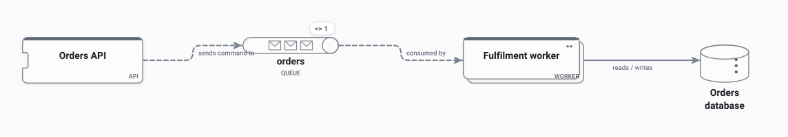
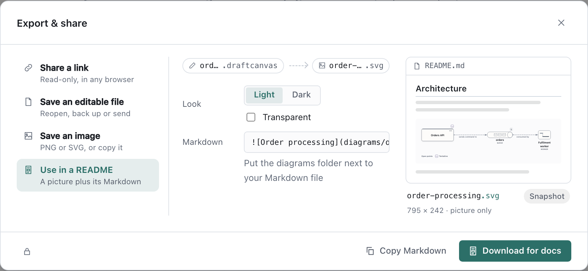
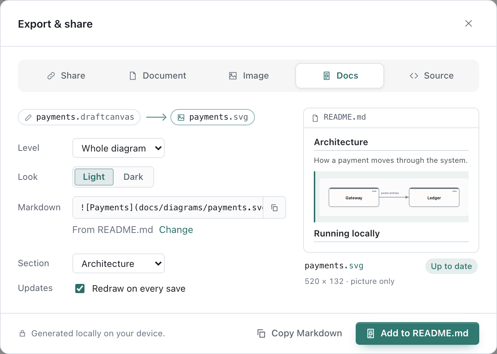
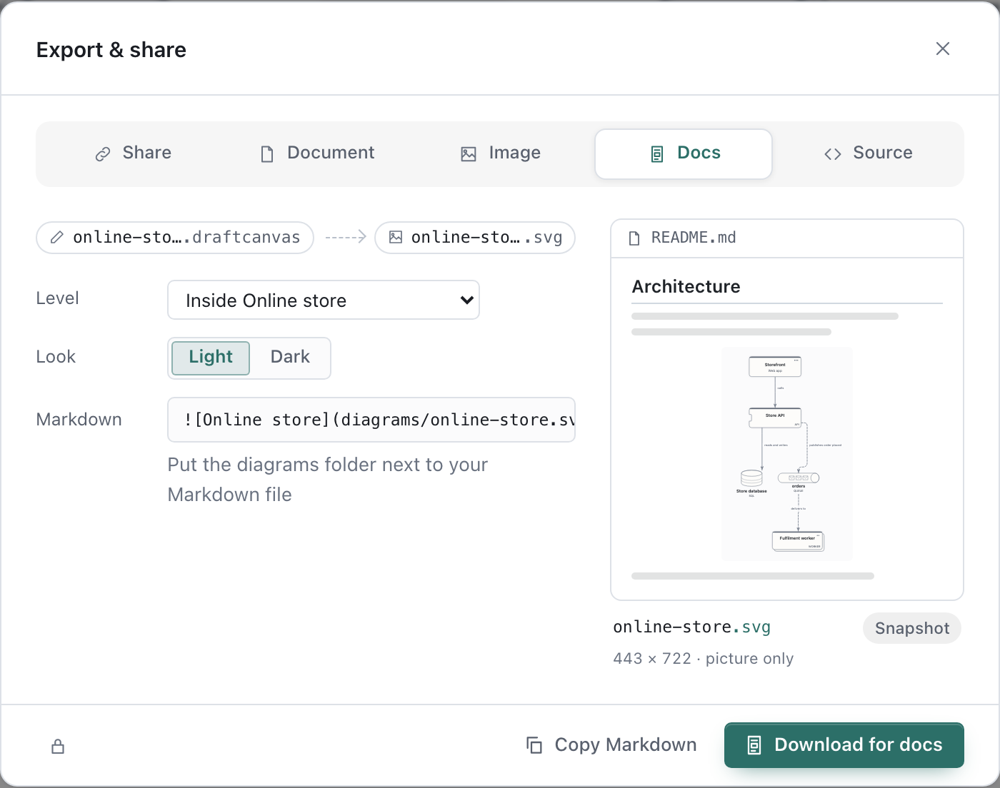

# Diagrams in your docs

Put a diagram in a README, an ADR or any Markdown page, and keep it connected to the diagram you
edit. The page shows an ordinary SVG image; the editable `.draftcanvas` file sits beside it.



Draft Canvas drew that picture from
[order-processing.draftcanvas](../media/guides/docs-example/order-processing.draftcanvas). This page
shows it with one line:

```markdown

```

It works anywhere Markdown shows SVG images, including GitHub. Readers need no plugin or account.
Anyone who wants to change the diagram opens the `.draftcanvas` file.

## Use in docs

Open **Share → Export…** (`⌘⇧E`) and choose **Use in a README**, or run **Use in docs…** in `⌘K`.



The preview shows the picture as a reader will see it. Choose:

- **Level:** the whole diagram, or the inside of one shape. Each level is its own picture, so a page
  can show several. Levels already published are marked **published**.
- **Look:** **Light** or **Dark**. The picture keeps its own background, so it reads on either kind
  of page. **Transparent** drops it so the diagram sits on the page itself; match the look to the
  page, because a light picture on a dark page is hard to read.

## On the desktop

Save the diagram to a file first. Then:

1. **Publish image** writes `payments.svg` beside `payments.draftcanvas`. Unsaved changes are saved
   first, so the picture always matches its file.
2. **Choose file…** under the Markdown line picks the page. The line then holds the path from that
   page: from a README two folders up, `docs/diagrams/payments.svg`.
3. **Section** chooses where: under that heading's text, before the next heading. The preview shows
   the surrounding lines before anything is written.
4. **Add to README.md** (named after your file) adds that one line. Nothing else in the file
   changes, and a picture it already shows is never added twice.



With **Redraw on every save** on, each save redraws the picture, including a save of an AI agent's
change. The Markdown line stays the same, so the page just shows the new picture. Turn it off and
the picture changes only when you choose **Update payments.svg**. The setting travels with the SVG,
so a teammate who saves the diagram redraws it too.

What Draft Canvas will and won't do:

- It replaces only an SVG it made. Another `payments.svg` in that folder is left alone, and the
  dialog marks it **Name taken**.
- A save that changes nothing visible leaves the SVG untouched, so Git sees no change.
- It edits a Markdown file only when you choose **Add to …**, and only if the file hasn't changed
  since you picked it.
- Renaming or moving the diagram ends the link. The old SVG stays where the page points, and the
  dialog offers to publish beside the new name.
- If the level a picture shows is deleted, the next save tells you and leaves the picture as it was.

## On the web

The web app can't write beside your files, so **Download for docs** gives you a ZIP with
`diagrams/payments.svg` and `diagrams/payments.draftcanvas`. Put the `diagrams` folder next to your
Markdown file and paste the line from **Copy Markdown**:

```markdown

```

The path in that line is the path inside the ZIP. It is a snapshot: to update it, download again and
replace both files.

## Diagrams with levels

A diagram with levels inside it, such as a C4 context view with containers inside, gets one picture
per level, each in its own file beside the diagram:

| Level | Picture |
| --- | --- |
| Whole diagram | [online-store.svg](../media/guides/docs-example/online-store.svg) |
| Inside Online store | [online-store.online-store.svg](../media/guides/docs-example/online-store.online-store.svg) |
| Inside Online store / Store API | [online-store.store-api.svg](../media/guides/docs-example/online-store.store-api.svg) |

A level's picture is named after its shape (numbered when two share a name) the first time you
publish it, and keeps that name, so renaming the shape later doesn't move the file your Markdown
points at. Every save redraws all of the diagram's pictures that follow saves.



When the Markdown file already shows another level of the same diagram, **Section** starts **After**
that picture, so the levels read together. The
[sample README](../media/guides/docs-example/sample-readme.md) shows two levels of one diagram and a
second diagram, as GitHub renders it:


## What the picture contains

A docs picture is only a picture. Unlike an editable image export, it never carries the diagram
inside it, so unpublished levels, notes, code and other attachments stay out of a public page. It
shows what the chosen level shows, attachment markers included but not their text. Open points keep
their markers, so nothing unsettled reads as decided.

A short note inside the SVG names its source file, the level, the look and whether it follows saves;
that is how Draft Canvas knows the picture is its own. The SVG has no scripts, external links or web
fonts.

Flows don't play in a static image. Share a [read-only link](saving-and-sharing.md#share-a-diagram)
when readers should step through one.

## Keeping it in Git

Commit both files. The `.draftcanvas` is the source; the SVG is what readers see. Drawing the same
diagram again gives the same SVG, so history changes only when the picture does. Text is measured
with the fonts on the machine that draws it, so a teammate on another system may get slightly
different spacing.

Pictures are not redrawn in CI, because drawing needs the app's text measurement. Update them where
you edit and save the diagram.
