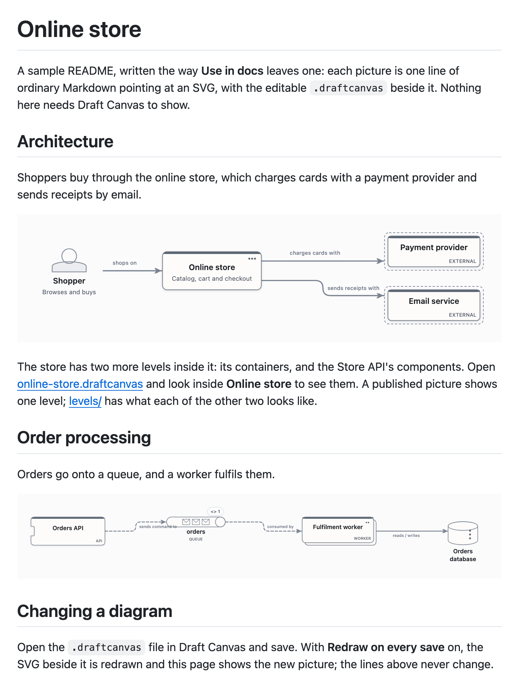

# Diagrams in your docs

Put a diagram in a README, an ADR or any Markdown page as an ordinary SVG image, with the editable
`.draftcanvas` file beside it.


Draft Canvas drew that picture from
[order-processing.draftcanvas](../media/guides/docs-example/order-processing.draftcanvas), and this
page shows it with one line of Markdown. It works anywhere Markdown shows SVG images, including
GitHub.

## Use in docs

Open **Share → Export…** (`⌘⇧E`) and choose **Use in a README**, or run **Use in docs…** in `⌘K`.


- **Level:** the whole diagram, or the inside of one shape. Each level is its own picture. Levels
  already published are marked **published**.
- **Look:** **Light** or **Dark**. The picture keeps its own background, so it reads on any page.
  **Transparent** drops the background; match the look to the page.

## On the desktop

Save the diagram to a file first. Then:

1. **Publish image** writes `payments.svg` beside `payments.draftcanvas`. Unsaved changes are saved
   first, so the picture always matches its file.
2. **Choose file…** under the Markdown line picks the page. The line then holds the path from that
   page.
3. **Section** chooses the heading to put the picture under. The preview shows the surrounding lines.
4. **Add to README.md** (named after your file) adds that one line and changes nothing else.


With **Redraw on every save** on, each save redraws the picture, including a save of an AI agent's
change. Turn it off and the picture changes only when you choose **Update payments.svg**. The setting
travels with the SVG, so a teammate who saves the diagram redraws it too.

- Draft Canvas replaces only an SVG it made. Another `payments.svg` in that folder is left alone and
  marked **Name taken**.
- A save that changes nothing visible leaves the SVG untouched, so Git sees no change.
- It edits a Markdown file only when you choose **Add to …**, and only if the file hasn't changed
  since you picked it.
- Renaming or moving the diagram ends the link. The old SVG stays, and the dialog offers to publish
  beside the new name.

## On the web

**Download for docs** gives you a ZIP with `diagrams/payments.svg` and
`diagrams/payments.draftcanvas`. Put the `diagrams` folder next to your Markdown file and paste the
line from **Copy Markdown**:

```markdown

```

It is a snapshot: to update it, download again and replace both files.

## Diagrams with levels

A diagram with levels gets one picture per level, each in its own file beside the diagram:

| Level | Picture |
| --- | --- |
| Whole diagram | [online-store.svg](../media/guides/docs-example/online-store.svg) |
| Inside Online store | [online-store.online-store.svg](../media/guides/docs-example/online-store.online-store.svg) |
| Inside Online store / Store API | [online-store.store-api.svg](../media/guides/docs-example/online-store.store-api.svg) |

A level's picture is named after its shape the first time you publish it, and keeps that name, so
renaming the shape doesn't break your Markdown. Each save redraws every picture of the diagram that
has **Redraw on every save** on.


When the page already shows another level of the same diagram, **Section** starts **After** that
picture. The [sample README](../media/guides/docs-example/sample-readme.md) shows two levels of one
diagram and a second diagram, as GitHub renders it:



## What the picture contains

A docs picture never carries the diagram inside it, so unpublished levels, notes, code and other
attachments stay out of a public page. It shows attachment markers but not their text, and open
points keep their markers. The SVG has no scripts, external links or web fonts.

Flows don't play in an image. Share a [read-only link](saving-and-sharing.md#share-a-diagram) when
readers should step through one.

## Keeping it in Git

Commit both files. Drawing the same diagram again gives the same SVG, so Git sees a change only when
the picture changes. Text is measured with the fonts on the machine that draws it, so a teammate on
another system may get slightly different spacing. Pictures can't be redrawn in CI: update them where
you edit and save the diagram.
