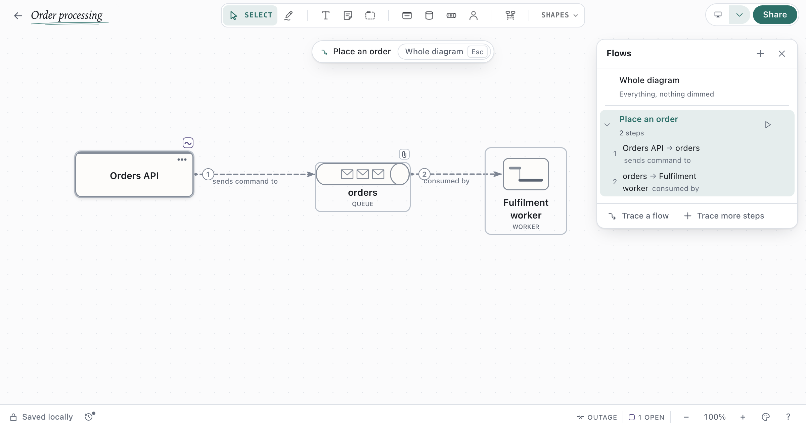
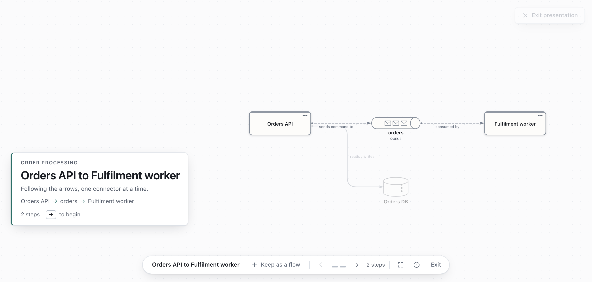

# Flows and presenting

A flow is an ordered list of connectors, presented one step at a time. You don't need one to
[present](#present): without a flow, **Present** follows the diagram's arrows.

Shortcuts use Mac keys. On Windows and Linux, use `Ctrl` for `⌘`.

## Trace a flow

1. Press `F` to open **Flows**, then choose **Trace a flow** at the bottom of the panel (also in
   `⌘K`).
2. Name it and click connectors in order.
3. Choose **Finish**.

While tracing, **Remove last** (`Backspace`) and **Cancel** (`Esc`) undo; **Outline** picks
connectors by keyboard. With a flow chosen, **Trace more steps** at the bottom of the panel extends
it.

## Add steps one at a time

Click a connector and choose **Add to flow**, then name the flow. On the next connector, choose
**Add to <flow name>**.

In **Flows**:

| Control | Does |
| --- | --- |
| Up / down arrows | Reorder a step |
| **⋯ → + Selection** | Also highlight the selected shapes in that step |
| **⋯ → Pin view** | Present the step from the current camera |
| **Remove step** | Remove a step |
| **New flow** (+) | Start another flow on the same diagram |
| **Rename** (`F2`) / **Delete** | Manage a flow |

A step shows its connector's label; rename the connector to change it.

## Choose a flow, and leave it

Click a flow in **Flows** to choose it: its connectors light up with step numbers and the rest dims.
To see everything again, choose **Whole diagram** (on the canvas or at the top of **Flows**), or
press `Esc` with nothing selected. Opening a diagram always shows the whole diagram.

## Present

Click **Present** (`⌘Enter`). What it walks through depends on what you have:

| You have | Present walks |
| --- | --- |
| One shape selected | From that shape onward, along its arrows |
| Two shapes selected | The way from one to the other |
| Several shapes, connectors or a boundary selected | That part, in arrow order |
| Nothing selected, and flows | The chosen flow, or the one you pick |
| Nothing selected, and no flows | The whole diagram, in arrow order |

The button reads **Present selection** when the selection will be walked. A selection that makes
fewer than two steps, or that takes in every connector, is ignored. To present a flow while something is selected, use its **Present**
button in **Flows**.

A walk in arrow order starts at the shapes nothing points into and follows one path to its end
before the next. Connectors that fan out to end points, or fan in from starting points, share a
step. Nothing is saved until you choose **Keep as a flow** (`K`), which adds the walk to **Flows**
in one undo step; rename or reorder it there.

The opening shows the whole path; advance to start. During a step, the boundaries around its highlighted shapes stay in focus, nested
ones included, and unrelated boundaries stay subdued.

| Key | Action |
| --- | --- |
| `→` / `Space`, `←` | Next, previous |
| `Home` / `End`, `1`–`9` | First, last, jump to step |
| `Shift+→` / `Shift+←`, `Shift+F` | Next, previous, choose flow |
| `O` | Whole-flow overview |
| `R` | Re-centre and resume guided camera |
| `P` | Pointer ring |
| `K` | Keep the walk as a flow |
| `⌘↓` / `⌘↑` | Look inside a shape / go back out |
| `Esc` | Close a reveal, then leave |

Pan and zoom freely; `R` hands the camera back. For a long step, choose **Read full step details**.

A [sequence](sequence-diagrams.md) presents the same way, one message at a time: select it and
choose **Present this sequence**.

## Draw a flow as a sequence

`⌘K` → **Draw the flow as a sequence** (**Draw a flow as a sequence…** when there are several) adds a
[sequence](sequence-diagrams.md) beside the diagram: the flow's steps as messages, in order, between
participants that stand for its shapes. Add replies, conditions and loops there; the flow itself is
unchanged.

## Export a flow

**Share → Export… → Other formats → Sequences** (`⌘⇧E`) turns each flow and each sequence into a
**Mermaid** or **PlantUML** sequence diagram, nested levels included. With a flow selected, an image
export numbers its connectors. See [Saving and sharing](saving-and-sharing.md#export-a-file).
