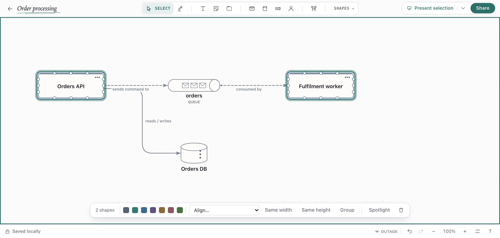
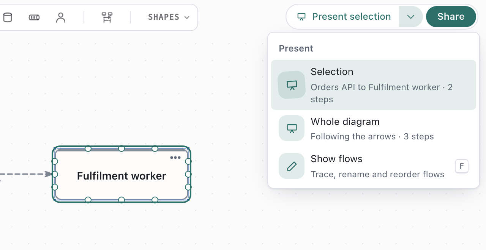
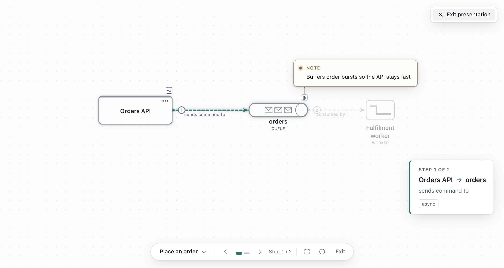

# Flows and presenting

A flow is an ordered list of connectors, presented one step at a time. You don't need one to
[present](#present): without a flow, **Present** follows the diagram's arrows.

Shortcuts use Mac keys. On Windows and Linux, use `Ctrl` for `⌘`.

## Trace a flow

1. Press `F`, or choose **Show flows** in the menu beside **Present**, to open **Flows**.
2. Choose **Trace a flow** at the bottom of the panel (also in `⌘K`).
3. Name it and click connectors in order.
4. Choose **Finish**.

While tracing, **Remove last** (`Backspace`) takes back the last step and **Cancel** (`Esc`)
discards the trace. **Outline** picks connectors by keyboard. With a flow chosen,
**Trace more steps** extends it.

To add steps one at a time instead, click a connector and choose **Add to flow**, then name the
flow. On the next connector, choose **Add to** *flow name*.

In **Flows**:

| Control | Does |
| --- | --- |
| Up / down arrows | Reorder a step |
| **⋯ → + Selection** | Also highlight the selected shapes in that step |
| **⋯ → Pin view** | Present the step from the current camera |
| **Remove step** | Remove a step |
| **New flow** (+) | Start another flow on the same diagram |
| **Rename** (`F2`) / **Delete** | Manage a flow |

A step shows its connector's label; rename the connector to change it.

Click a flow in **Flows** to choose it: its connectors light up with step numbers and the rest dims.
To see everything again, choose **Whole diagram** (on the canvas or at the top of **Flows**), or
press `Esc` with nothing selected.

## Present

Click **Present** (`⌘Enter`). What it walks through depends on what you have:

| You have | Present walks |
| --- | --- |
| One shape selected | From that shape onward, along its arrows |
| Two shapes selected | The way from one to the other |
| Several shapes, connectors or a boundary selected | That part, in arrow order |
| Nothing selected, and flows | The chosen flow, or the one you pick |
| Nothing selected, and no flows | The whole diagram, in arrow order |

The button reads **Present selection** when the selection will be walked. A selection that makes
fewer than two steps, or that takes in every connector, is ignored. To choose for yourself, open the
menu beside **Present**: it lists the selection, the whole diagram and up to ten flows, with **Show
flows** for the rest.

During a walk, click a connector to make it the next step; the walk carries on from there. Click one
already shown to go back to it. This changes the walk only, never a saved flow. To keep the walk,
choose **Keep as a flow** (`K`): it is added to **Flows** in the order you took, as one undo step.

| Key | Action |
| --- | --- |
| `→` / `Space`, `←` | Next, previous |
| `Home` / `End`, `1`–`9` | First, last, jump to step |
| `⇧→` / `⇧←`, `⇧F` | Next flow, previous flow, choose a flow |
| `O` | Whole-flow overview |
| `R` | Re-centre and resume guided camera |
| `P` | Pointer ring |
| `K` | Keep the walk as a flow |
| `⌘↓` / `⌘↑` | Look inside a shape / go back out |
| `Esc` | Close a reveal, then leave |

Pan and zoom freely; `R` hands the camera back. For a long step, choose **Read full step details**.

Click a [linked junction](shapes-and-connectors.md#linked-junctions) to travel to where the flow
continues. `⇧G` or the bar at the top left brings you back, and the presentation carries on from its
step.

A [sequence](sequence-diagrams.md) presents the same way, one message at a time: select it and
choose **Present this sequence**.

## Draw a flow as a sequence

Run **Draw the flow as a sequence** in `⌘K` (**Draw a flow as a sequence…** when there are several).
It adds a [sequence](sequence-diagrams.md) beside the diagram: the flow's steps as messages, in
order, between participants that stand for its shapes. The flow itself is unchanged.

## Export a flow

**Share → Export… → Other formats → Sequences** (`⌘⇧E`) turns each flow and each sequence into a
**Mermaid** or **PlantUML** sequence diagram, nested levels included. With a flow selected, an image
export numbers its connectors. See [Saving and sharing](saving-and-sharing.md#export-a-file).
