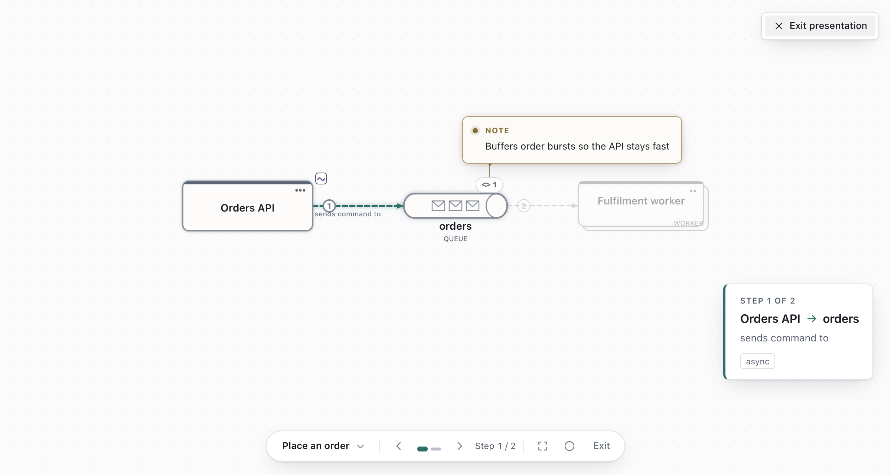

# Flows and presenting

A flow is an ordered list of connectors, presented one step at a time.

Shortcuts use Mac keys. On Windows and Linux, use `Ctrl` for `⌘`.

## Trace a flow

1. Press `F` to open **Flows**, then choose **Trace a flow** at the bottom of the panel (also in
   `⌘K`).
2. Name it and click connectors in order.
3. Choose **Finish**.

While tracing, **Remove last** (`Backspace`) and **Cancel** (`Esc`) undo; **Outline** picks
connectors by keyboard. With a flow chosen, **Trace more steps** at the bottom of the panel extends
it.

## Add steps one at a time

Click a connector and choose **Add to flow**, then name the flow. On the next connector, choose
**Add to <flow name>**.

In **Flows**:

| Control | Does |
| --- | --- |
| Up / down arrows | Reorder a step |
| **⋯ → + Selection** | Also highlight the selected shapes in that step |
| **⋯ → Pin view** | Present the step from the current camera |
| **Remove step** | Remove a step |
| **New flow** (+) | Start another flow on the same diagram |
| **Rename** (`F2`) / **Delete** | Manage a flow |

A step shows its connector's label; rename the connector to change it.

## Choose a flow, and leave it

Click a flow in **Flows** to choose it: its connectors light up with their step numbers and the rest
of the diagram dims. The canvas names the chosen flow at the top. To see everything again, choose
**Whole diagram** there or at the top of **Flows**, or press `Esc` on the canvas with nothing
selected. Opening a diagram always shows the whole diagram.

## Present

Click **Present** (`⌘Enter`) and pick a flow if there are several. The opening shows the whole
path; advance to start. During a step, the boundaries containing its highlighted shapes stay
in focus too, including nested boundaries. Unrelated boundaries remain subdued.

| Key | Action |
| --- | --- |
| `→` / `Space`, `←` | Next, previous |
| `Home` / `End`, `1`–`9` | First, last, jump to step |
| `Shift+→` / `Shift+←`, `Shift+F` | Next, previous, choose flow |
| `O` | Whole-flow overview |
| `R` | Re-centre and resume guided camera |
| `P` | Pointer ring |
| `⌘↓` / `⌘↑` | Look inside a shape / go back out |
| `Esc` | Close a reveal, then leave |

Pan and zoom freely; `R` hands the camera back. For a long step, choose **Read full step details**.

## Export a flow

**Share → Export → Source → Flows** (`⌘⇧E`) turns each flow into a **Mermaid** or **PlantUML**
sequence diagram, nested levels included. With a flow selected, an **Image** export numbers its
connectors. See [Saving and sharing](saving-and-sharing.md).
