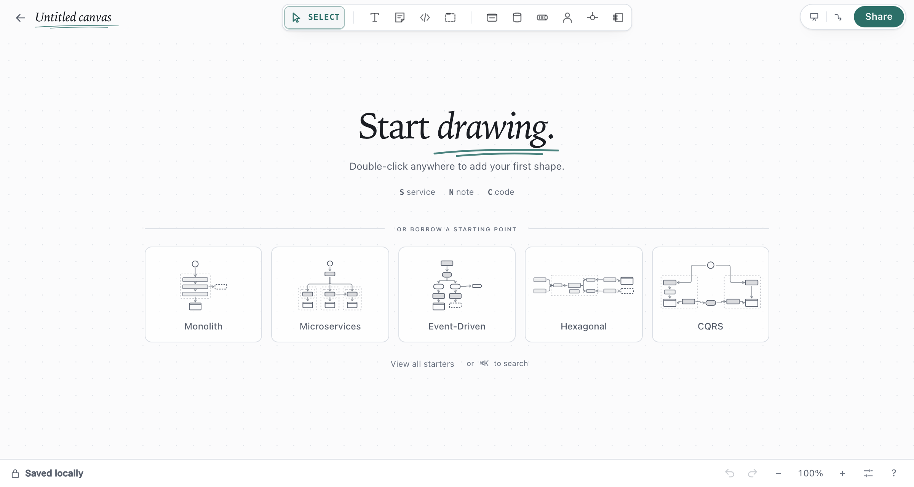
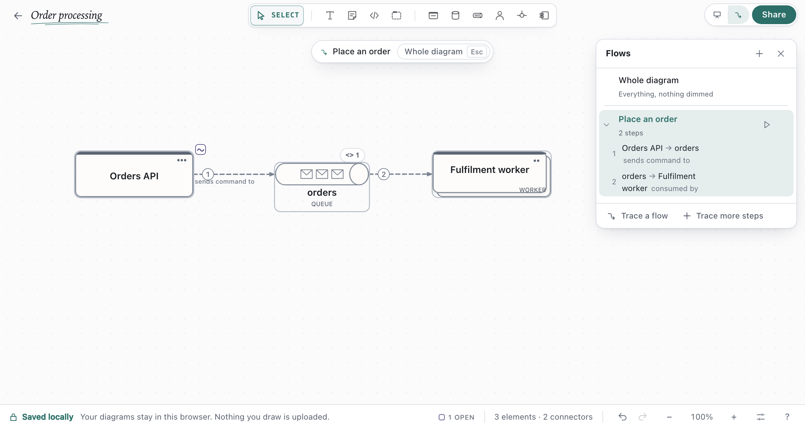

# Getting started

Open the [web editor](https://app.draftcanvas.dev/) or the [desktop app](desktop.md). No account
needed.

Shortcuts use Mac keys. On Windows and Linux, use `Ctrl` for `⌘`.

## Start a canvas

On Home, choose **Quick Draft**. To see a finished diagram first, choose **Try an example**, then
**Play explanation**.

The web app saves in your browser as you draw; on desktop, `⌘S` saves a file. Shape tools are at
the top; **Present**, **Flows** and **Share** at the top right. `⌘K` finds any command and `?` lists
shortcuts.
The back arrow beside the diagram title returns to your diagrams.

On a blank canvas, double-click anywhere to choose your first shape, or pick one of the five
architecture sketches for a starting point.
**View all starters** opens the full collection; `⌘K` searches for a starter or command by name.

## Draw Service → Queue → Worker

1. Point at the canvas and press `S`. Type `Orders API`, then `Enter`.
2. Drag from a dot on the service's edge into empty space and choose **Queue**. Name it `orders`.
3. A faint Worker suggestion appears beside the queue. Press `Tab` to accept it and name it
   `Fulfilment worker`. No suggestion? Press `]`.

[Preview the result.](../media/guides/service-queue-worker.png)

Connectors label themselves; click one to change it.

## Add a note

Right-click the queue and choose **Attach note**. Type, then press `Esc`. Click the chip to reopen it.

## Draw a boundary

Select all three shapes, press `⌘G`, then `Enter` to name the [boundary](shapes-and-connectors.md#boundaries).

## Present a flow

1. Click the API-to-queue connector and choose **Add to flow**. Name it `Place an order`.
2. Click the queue-to-worker connector and choose **Add to Place an order**.
3. Press `F` to open **Flows** and check the order.
4. Click **Present** (`⌘Enter`). `→` or `Space` advances, `←` goes back, `Esc` returns to editing.

More in [Flows and presenting](flows-and-presentation.md).

## Export

Open **Share → Export** (`⌘⇧E`):

| Choose | For |
| --- | --- |
| **Image** | PNG or SVG for a slide or chat |
| **Document → Editable** | A `.draftcanvas` file to reopen or send |
| **Source** | Mermaid or PlantUML from your flows, or architecture source |

Next: [saving and sharing](saving-and-sharing.md), [starters](examples.md),
[looking inside a service](depth.md) and [open points](open-points.md).
