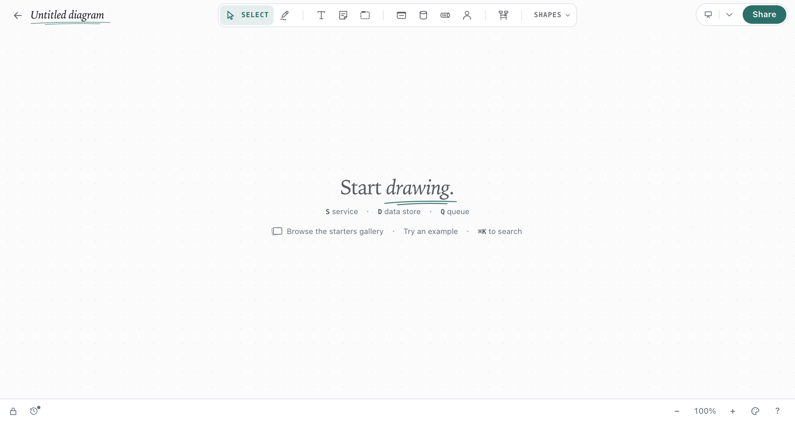

# Getting started

Draw, present and share your first diagram in a few minutes, in the
[web app](https://app.draftcanvas.dev/) or the [desktop app](desktop.md). No account needed.

Shortcuts use Mac keys. On Windows and Linux, use `Ctrl` for `⌘`.

## Start a diagram

On Home, choose **Quick Draft**. To see a finished diagram first, choose **Try an example**, then
**Play explanation**. Or begin from a [starter](#start-from-a-starter).

The web app saves in your browser as you draw; in the desktop app, `⌘S` saves a file. `⌘K` finds
any command and `?` lists shortcuts.

On a blank canvas, double-click (long-press on touch) to choose your first shape, or point at the
canvas and press `S`, `D` or `Q` for a Service, Data Store or Queue.

## Draw Service → Queue → Worker

1. Point at the canvas and press `S`. Type `Orders API`, then `Enter`.
2. Drag from a dot on the service's edge into empty space and choose **Queue**. Name it `orders`.
3. A faint Worker suggestion appears beside the queue a moment after you select it. Press `Tab` to
   accept it, then `Enter` to name it `Fulfilment worker`. No suggestion? Press `]`.

Connectors label themselves; click one to change it.
[Preview the result.](../media/guides/service-queue-worker.png)

## Add a note

Right-click the queue and choose **Attach note**. Type, then click the canvas to keep it (`Esc`
throws it away). Rest the pointer on the queue to read the note; click the paperclip tab, then the
chip, to edit it.

## Draw a boundary

Select all three shapes, press `⌘G`, then `Enter` to name the
[boundary](shapes-and-connectors.md#boundaries).

## Present a flow

**Present** (`⌘Enter`) walks the diagram in the order its arrows point. A flow is a walkthrough in
an order you choose:

1. Click the API-to-queue connector and choose **Add to flow**. Name it `Place an order`.
2. Click the queue-to-worker connector and choose **Add to Place an order**.
3. Press `F` to open **Flows** and check the order.
4. Click **Present**. `→` or `Space` advances, `←` goes back, `Esc` returns to editing.

More in [Flows and presenting](flows-and-presentation.md).

## Export

Open **Share → Export…** (`⌘⇧E`):

| Choose | For |
| --- | --- |
| **Share a link** | A read-only link anyone can open in a browser |
| **Save an editable file** | A `.draftcanvas` file to reopen or send |
| **Save an image** | PNG or SVG for a slide or chat |
| **Use in a README** | A picture for a Markdown page, with its editable file beside it |
| **Other formats** | Mermaid or PlantUML from your flows, or architecture source |

## Start from a starter

Starters are ready-made architectures with flows: Monolith, Microservices, Event-Driven, CQRS,
sagas, data pipelines and more. They come from a public repository,
[draft-canvas-starters](https://github.com/acltabontabon/draft-canvas-starters), where each one's
page says when to use it.

1. On a blank canvas, choose **Browse the starters gallery**, or run **Browse starters…** from `⌘K`.
2. Choose **Load starters**. This reads the gallery from GitHub and sends nothing about your
   diagrams. The gallery is then kept on this device and works offline.
3. Pick a starter to preview it, then choose **Add to canvas**, or **Open as new diagram** to keep
   it apart. One `⌘Z` removes a starter you added.

Once loaded, a blank canvas suggests five starters and `⌘K` finds any by name. The dialog checks
for changes when you open it (at most once a day) or press refresh, and marks starters **New** or
**Updated**. A diagram made from a starter never changes by itself: when the starter is updated, a
note on the diagram offers **Open the new version** as a separate diagram, or **Dismiss** until it
changes again.

**Stop loading starters**, at the bottom of the dialog, removes the downloaded gallery and makes no
more requests. Diagrams made from starters stay. **Try an example** needs no gallery: its example
ships with the app.

## Make it yours

The palette button at the bottom right opens [Appearance](shapes-and-connectors.md#appearance)
beside the canvas. Start from **Clean**, **Draft**, **Sketch** or a style pack, then change lines,
corners, colours, the canvas or how a kind of shape is drawn. The switch for next-shape suggestions
is on its **Canvas** tab.
