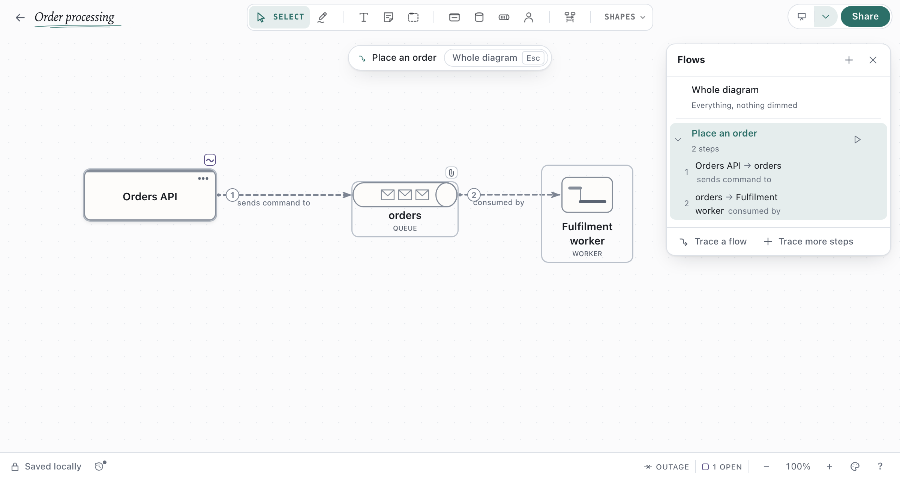

# Getting started

Open the [web editor](https://app.draftcanvas.dev/) or the [desktop app](desktop.md). No account
needed.

Shortcuts use Mac keys. On Windows and Linux, use `Ctrl` for `⌘`.

## Start a canvas

On Home, choose **Quick Draft**. To see a finished diagram first, choose **Try an example**, then
**Play explanation**.

The web app saves in your browser as you draw; on desktop, `⌘S` saves a file. Shape tools are at the
top, and **Present** and **Share** at the top right. `⌘K` finds any command and `?` lists
shortcuts. The back arrow beside the title returns to your diagrams.

On a blank canvas, double-click (long-press on touch) to choose your first shape, or point at the
canvas and press `S`, `D` or `Q` for a Service, Data Store or Queue. For a head start, **Browse the
starters gallery** offers ready-made architectures; see [architecture examples](examples.md).

## Draw Service → Queue → Worker

1. Point at the canvas and press `S`. Type `Orders API`, then `Enter`.
2. Drag from a dot on the service's edge into empty space and choose **Queue**. Name it `orders`.
3. A faint Worker suggestion appears beside the queue a moment after you select it. Press `Tab`
   to accept it, then `Enter` to name it `Fulfilment worker`. No suggestion? Press `]`.

[Preview the result.](../media/guides/service-queue-worker.png)

Connectors label themselves; click one to change it.

## Add a note

Right-click the queue and choose **Attach note**. Type, then click the canvas to keep it (`Esc`
throws it away). Rest the pointer on the queue to read the note beside it; click the paperclip tab,
then the chip, to edit it.

## Draw a boundary

Select all three shapes, press `⌘G`, then `Enter` to name the [boundary](shapes-and-connectors.md#boundaries).

## Present a flow

**Present** (`⌘Enter`) already walks the diagram in the order its arrows point. A flow is a
walkthrough in an order you choose:

1. Click the API-to-queue connector and choose **Add to flow**. Name it `Place an order`.
2. Click the queue-to-worker connector and choose **Add to Place an order**.
3. Press `F` to open **Flows** and check the order.
4. Click **Present** (`⌘Enter`). `→` or `Space` advances, `←` goes back, `Esc` returns to editing.

More in [Flows and presenting](flows-and-presentation.md).

## Export

Open **Share → Export…** (`⌘⇧E`):

| Choose | For |
| --- | --- |
| **Share a link** | A read-only link anyone can open in a browser |
| **Save an editable file** | A `.draftcanvas` file to reopen or send |
| **Save an image** | PNG or SVG for a slide or chat |
| **Use in a README** | A picture for a Markdown page, with its editable file beside it |
| **Other formats** | Mermaid or PlantUML from your flows, or architecture source |

## Make it yours

The sliders button at the bottom right opens **Settings**. **Canvas** has next-shape suggestions and
a background image for the open diagram. **Appearance** is your style: start from **Clean**, **Draft**
or **Sketch**, then change the line weight, corners, shadows, colours, arrowheads, or how one kind of
shape is drawn. The first change makes it a style of your own, kept on this device.

What you change shows on the open diagram as you change it. A new diagram starts with a copy of your
style and keeps it, so it looks the same for everyone you share it with. A diagram that arrives with
a different look of its own keeps that look: **Use my style in this diagram**, on the same page or
in `⌘K`, replaces it, and undo takes it back.

Next: [saving and sharing](saving-and-sharing.md), [starters](examples.md), [system
levels](depth.md) and [open points](open-points.md).
