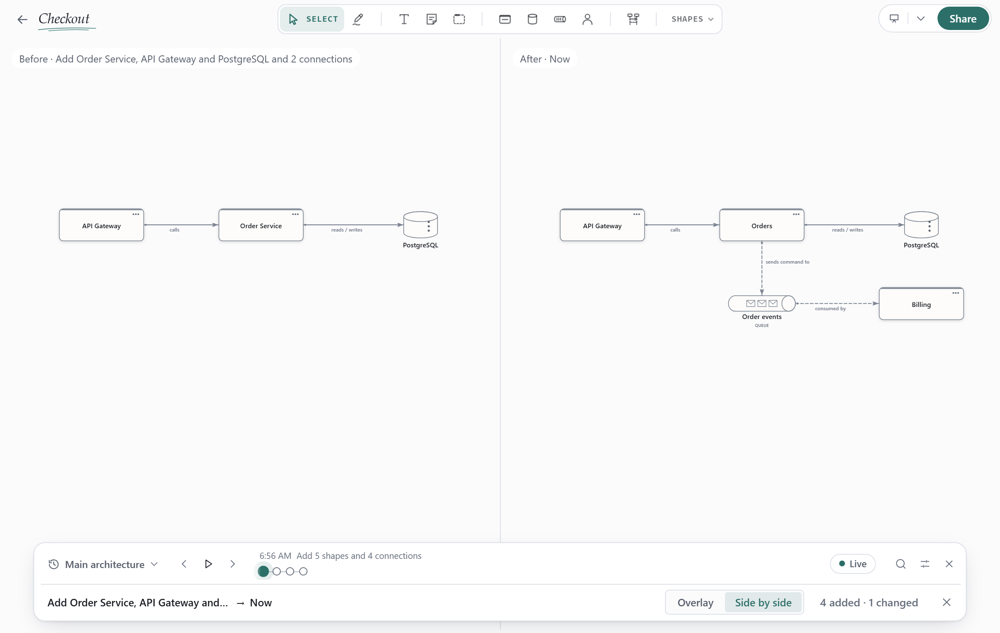

# Diagram history

Draft Canvas records each diagram's history as you work, with nothing to set up. Browse it, compare
versions, restore one, or explore an alternative design.

## Recording

A revision is added after 30 seconds without changes, and at least every 2 minutes while you keep
drawing; change either in [Settings](#settings). If a diagram is open in two browser tabs, only one
records its history.

The clock beside the save mark in the status bar shows when history last recorded a change. Click
it to **Open timeline**, **Add to history now** or open **History settings…**.

The clock shows words only when it needs you: **Continue history?**, **History paused**,
**History paused: storage full** or **History unavailable**. In each case your diagram is still
saved.

## The timeline

Open it from the clock, or with **Show the timeline** in `⌘K`. It docks at the foot of the editor;
close it with **×** or `Esc`.

Revisions run oldest to newest, grouped into editing sessions, with **Live** (the diagram now) at
the end. Choose a revision to see it on the canvas, or **Play the evolution** (`Space`) to step
through them. **Find a revision** searches summaries, shape names, people, milestone names and
dates, and filters by what changed.

With focus in the timeline:

| Key | Action |
| --- | --- |
| `←` / `→` | Older / newer revision; past the newest is Live |
| `Home` / `End` | Oldest revision / Live |
| `Space` | Play or pause |
| `Esc` | Stop comparing, then return to Live, then close the timeline |

To name a revision you will want to find again, such as "Reviewed with security", choose it, then
**More for this revision** (**⋯**) → **Name this revision…**. A named revision is a milestone; the
**Milestones** filter shows only those.

## Look at the past

A chosen revision is drawn in place of your diagram, exactly as it looked. It is read-only, and your
diagram is unchanged underneath. If the revision has levels inside shapes, pick one from **View in
this revision**. Choose **Live** to come back.

## Compare two versions

| To compare | Do this |
| --- | --- |
| A revision with now | Choose it, then **Compare with now** |
| Any two revisions | Choose one, then Shift-click another |
| A session's start and end | Click the session's label |

The older version is **Before** and the newer **After**. The bar above the timeline switches
between two views:

- **Overlay** draws one version with every difference marked: `+` added, `−` removed, `•` changed,
  and a dashed outline where a moved shape used to be. Switch **Before** and **After** to see each
  side.
- **Side by side** shows each version in half of the canvas.

The count, such as "3 added · 1 changed", opens the list of changes. **Structure only** hides
changes to text, layout, style or details alone.

When you compare a revision with now, **Bring back** in the list restores one removed or changed
element, with the connectors it needs, as one undo step.

## Restore a revision

Choose the revision, click **Restore…**, read the note, then click **Restore**. The diagram becomes
that version, as one undo step. Restoring adds a new revision, so nothing in history is lost.

## Alternatives

An alternative is another direction the architecture could take, such as "Event-driven payments".
The main architecture stays as it is while you work on one.

Click the timeline's title (**Main architecture** or the alternative's name) to:

- Start one with **Explore an alternative…**, from the diagram as it is now. To start from an earlier
  revision, use **More for this revision** → **Explore an alternative from here…**.
- Switch to another. What you had is recorded first, and undo starts afresh.
- Rename, compare with main or archive one, under **Manage alternatives…**. An archived alternative
  keeps every revision, and **Unarchive** brings it back.
- [Bring one in](#bring-one-alternative-into-another).

You can't switch, start or bring in alternatives during a [live session](#live-sessions), or while
recording is paused or off and there are changes not yet in history.

## Bring one alternative into another

Click the timeline's title and choose **Bring in “X”…**. If X is already included, nothing changes.
If X only adds to where you are, you move to its latest revision. Otherwise you review a merge.

A merge shows the combined result on the canvas and lists each difference that needs a decision,
such as a shape both sides moved differently. Click a difference to see it, then choose **Keep
this** or **Take “X”**. **Merge** is enabled once every difference is decided, and is one undo step.
**Cancel** leaves both architectures as they were.

## When a diagram looks like a copy

When you open a copy of a diagram whose history is on this device, the clock asks **Continue
history?**. This happens with a duplicated file, a file moved outside Draft Canvas, or one saved with
**Save As**. Nothing is recorded until you answer:

- **Continue its history** carries it on as an alternative named "Copy: …". From then on the
  original and the copy record separately.
- **Start new history** gives the copy a new history of its own.

**Duplicate** in the Library copies no history unless you choose **Copy its history too**. On the
desktop, renaming or moving a file inside the app keeps its history.

## Agents and history

On the desktop, a [connected agent](connect-an-ai-agent.md) can read the open diagram's history
with the `diagram_history` tool: summaries, comparisons, and previews of a restore or merge. It
cannot restore, merge, switch alternatives or change history. It can suggest naming a revision,
which you accept with **Name it** in the clock's details.

Reading a past revision in full is off unless you turn on **Let agents read past revisions in full**
in **Settings → History**, because history can hold content you later deleted.

## Live sessions

When you [share a diagram live](collaborating.md), only you, the owner, record its history.
Collaborators never receive it and cannot open the timeline. Revisions credit the people whose
changes they contain ("with Ada"), marked unverified because people name themselves. Ending the
session records its changes right away.

## Settings

Open **History settings…** from the clock or `⌘K`, or **Settings → History** on the desktop.

| Setting | What it does |
| --- | --- |
| **Keep a history of every diagram** | Turns recording on or off for this device. History already kept stays |
| **Add a revision after**, **While drawing steadily, at least every** | How often revisions are added |
| **Let agents read past revisions in full** (desktop) | See [Agents and history](#agents-and-history) |
| **Recorded as** | The name and email on revisions; "Draft Canvas" if empty. A label, not a sign-in |
| **Record this diagram's history** | Pauses or resumes this diagram only |
| **Export history…** | Saves the whole history as a Git `.bundle` file, which opens with `git clone history.bundle` |
| **Import history…** | Continues this diagram from a `.bundle`. Its earlier history stays on the device |
| **Remove this diagram's history…** | Deletes its revisions from this device; the diagram, exports and published copies are unchanged. Recording starts again with your next change unless you turn it off first |

## Privacy

History stays on your device: in the browser on the web, in the app's data folder on the desktop.
Nothing is uploaded unless you [publish it](#publish-history). On the web, clearing site data or the
browser freeing space can remove it, so export a history to keep a copy.

History keeps what a diagram used to contain, including deleted shapes and text. Think before you
export or share a history, or let an agent read it in full. Exporting the diagram itself (file,
image or link) never includes its history. See
[Privacy and security](../reference/privacy.md#what-is-stored-and-where).

## Publishing and project repositories (desktop)

With Git 2.38 or later installed, the desktop app can publish history and commit diagrams to your
projects. Both are in **Settings → History** and do nothing until you ask. Draft
Canvas uses your own Git sign-in (credential manager or SSH key) and never stores a password.

### Publish history

1. Enter the `https://` or SSH address of a Git repository of your own and choose **Connect**.
   Connecting sends nothing.
2. Choose **Publish…**. The first publish to an address shows where it goes and what it sends, and
   asks you to confirm; the app then asks again in its own window.
3. Choose when to publish from then on: **When I publish** (the default), **Shortly after each
   revision** or **Only milestones**.

The main architecture and the alternative you are on are always published; tick others to add them.
Archived alternatives are never published.

**Fetch** checks the remote without changing anything. If it has new revisions, **Bring in remote
revisions…** brings them in [like an alternative](#bring-one-alternative-into-another). Publishing
is never forced: if the remote has moved on, bring its revisions in first.

### Commit the diagram to its project

When a saved diagram is inside a Git repository, you can commit the file (not its history):

- **Commit to draft-canvas/…** commits to the diagram's own branch, leaving your current branch,
  staged changes and working files alone. Merge it or open a pull request yourself.
- **Commit to** *your branch*… adds one commit to your current branch; anything else you staged
  stays staged. Draft Canvas refuses, and says why, when that isn't safe, such as during a rebase.
- **Push draft-canvas/…** pushes the diagram's branch to `origin`, after showing every commit it
  would publish.

Draft Canvas won't run Git in a repository whose settings would run a program, such as hooks or
filters, and says which setting stopped it. See
[how Draft Canvas runs Git](../reference/evolution.md#running-git-for-remotes-and-project-repositories-desktop).
