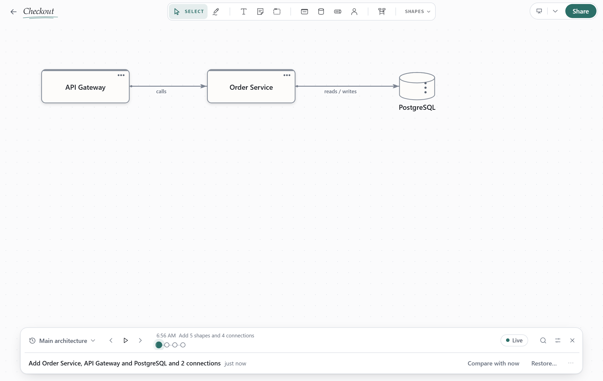
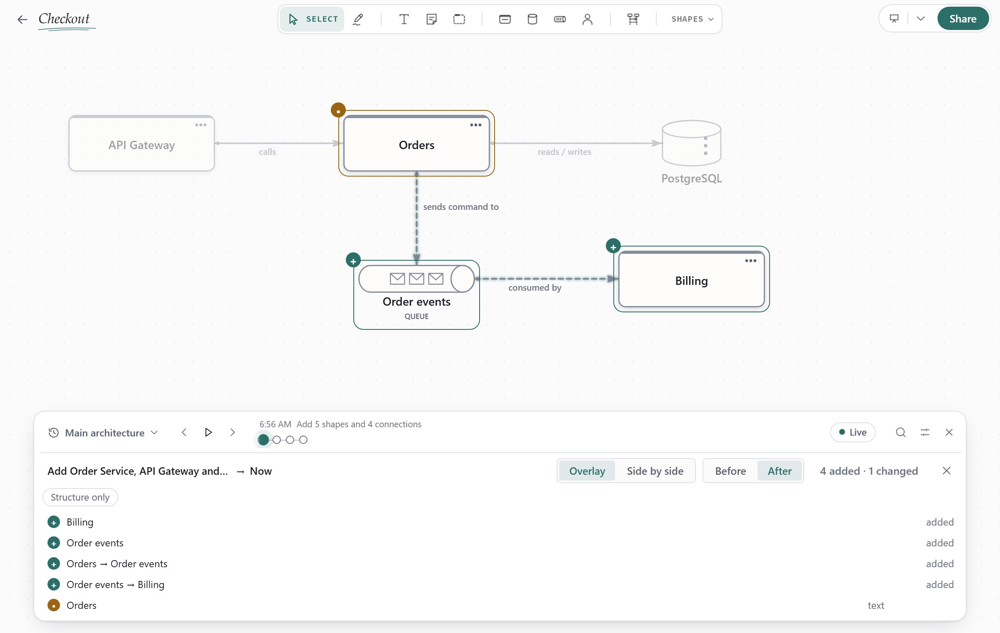
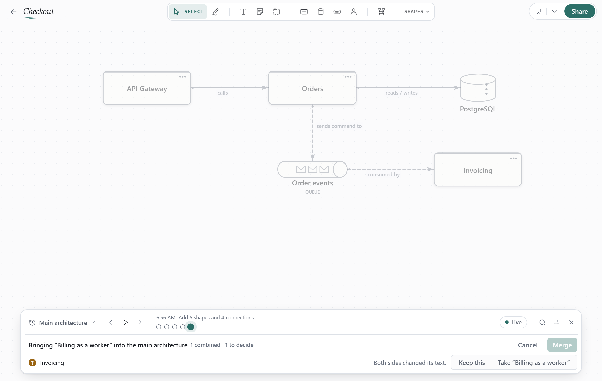

# Diagram history

Draft Canvas keeps a history of each diagram as you work, so you can see how your architecture
evolved, compare any two moments, and go back. There is nothing to set up and nothing to remember:
no saving versions, no commit messages, no Git steps. Underneath, each history is standard Git, so
you can take it elsewhere whenever you like.

## Saving, history and publishing

Three things are kept apart, and the status bar never mixes them up:

| | What it means | Where you see it |
| --- | --- | --- |
| **Saved** | What is on screen is safe on this device | The save mark at the start of the status bar |
| **In history** | A revision of the diagram is recorded | The clock beside the save mark |
| **Published** | Revisions are copied somewhere you chose (desktop) | See [Publishing and project repositories](#publishing-and-project-repositories-desktop) |

**Saved.** On the web, a small lock means your diagram is saved in this browser. **Saved locally**
shows for a moment after each save, then fades. Unsaved work shows as a soft dot until the save
lands, which takes about a second. Only a problem, such as **Storage full — not saved**, stays in
words. On the desktop the label says **Saved** or **Unsaved changes** for the file, and a Quick
Draft is kept on this computer until you save it.

**In history.** History records what is on screen, saved or not. A revision is added once you pause
for 30 seconds, or every 2 minutes while you keep drawing. While you are dragging or typing, history
waits for you to finish. Moving around the canvas never adds a revision, and neither does a change
you undo before it was recorded. A connected agent's reviewed changes become one revision once the
agent has been quiet for a few seconds.

Click the clock to see when history last recorded a change. From there you can **Open timeline**,
**Add to history now** when changes are waiting, or open **History settings…**. A small dot on the
clock means recent changes are about to be recorded, or that something there wants a look. The clock
shows words only when it needs you: **Continue history?**, **History paused**, **History paused:
storage full** or **History unavailable**. Your diagram is still saved in each case; only its
history is waiting.

## The timeline

Open it from the clock's details (**Open timeline**) or run **Show the timeline** from `⌘K`. It
docks at the foot of the editor, where the status bar was, and closes with its **×** or `Esc`.

- **Revisions** run oldest to newest, grouped into editing sessions. A session ends after 20 minutes
  without a revision. Each session is labelled with when it ended and its net change, start to end:
  a shape added and removed again within it is not mentioned. **Earlier** loads older revisions.
- **Live** always ends the row. It is the diagram as it is now; its dot moves while changes are
  waiting to be recorded.
- **Choose a revision** to see it on the canvas. Its summary, when it was recorded and who took part
  show below the row.
- **Play the evolution** (`Space`) steps through the revisions, from the oldest if you start at Live,
  and stops at Live.
- **Playback options** (the sliders button) sets the speed and **Follow changes with the camera**,
  which moves the view to each change as you step. It stays still when the change is already in view.
- **Find a revision** (the magnifier) searches summaries, shape names, people, milestone names and
  dates. Filter by what changed (**Shapes**, **Connections**, **Text**, **Layout**, **Style**,
  **Grouping**, **Links**, **Flows**, **Notes**) or show **Milestones** only.

With focus in the timeline:

| Key | Action |
| --- | --- |
| `←` / `→` | Older / newer revision; past the newest is Live |
| `Home` / `End` | Oldest revision / Live |
| `Space` | Play or pause |
| `Esc` | Stop comparing, then return to Live, then close the timeline |

### Name a revision

Name a moment you will want to find again, such as "Reviewed with security". Choose the revision,
open **More for this revision** (**⋯**), then **Name this revision…**. A named revision is a
milestone: its name shows on the timeline and in search, and **Milestones** filters to them. A
revision can carry more than one name (**Add another name…**). Naming never changes the revision.

**More for this revision** also has **Compare with the revision before**, **Copy revision id** and
**Show Git details** (the revision's id, what it follows, who recorded it and each change).

## Look at the past

A revision you choose is drawn where your diagram is, exactly as it looked, in its own style. It is
read-only: you cannot select or change it, and your live diagram stays as it is underneath. Moving
between revisions animates: shapes glide to where they were, new ones arrive and removed ones fade.

If the revision has shapes with views inside, pick one from the **View in this revision** list. If
the view you were in did not exist yet, the timeline says so and shows the nearest one that did.

Choose **Live**, press `End` or `Esc`, or close the timeline to come back.

## Compare two versions

- **Compare with now**: choose a revision, then **Compare with now**.
- **Any two revisions**: choose one, then Shift-click another on the timeline.
- **A whole session**: click its label to compare its start with its end.
- **Two alternatives**: see [Alternatives](#alternatives).

The older version is always **Before** and the newer **After**. A bar above the timeline shows what
is compared and how:

- **Overlay** draws one version with every difference marked: `+` added, `−` removed (drawn faintly
  where it was), `•` changed, and a dashed outline where a moved shape used to be. What did not
  change recedes. Switch between **Before** and **After** to see each side.
- **Side by side** shows both versions, each in half of the canvas. Panning or zooming either moves
  both.
- **The count** (for example "3 added · 1 changed") opens the list of changes. Click one to go to
  it, even in another view. **Structure only** keeps what was added, removed, connected, grouped or
  linked, and hides changes that only touch text, layout, style or details.

When you compare a revision with now, **Bring back** beside a removed or changed element restores
just that element from the revision, with any connectors it needs. The rest of the diagram stays as
it is, and it is one undo step.

## Restore a revision

1. Choose the revision and click **Restore…**.
2. Read the note, then click **Restore**.

The diagram becomes that version. Restoring adds a new revision; nothing in history is lost or
rewritten, and the version you had stays in history. It is one undo step.

If the diagram changes while the restore runs, for example because a collaborator edited it,
nothing on the canvas is replaced. The restored version is already in history, and the clock's
details ask whether to finish restoring or **Keep the diagram as it is**. The same question appears
if Draft Canvas closed in the middle of a restore.

## Alternatives

An alternative is another direction the architecture could take, such as "Event-driven payments".
You can work on it while the main architecture stays exactly as it is, and come back any time.

The timeline's title is the name of the architecture you are on, **Main architecture** or an
alternative's name. Click it to switch, start one, or bring one in.

- **Start one**: choose **Explore an alternative…** and name it. It starts from the diagram as it is
  now. To start from an earlier moment, choose that revision and use **More for this revision** →
  **Explore an alternative from here…**.
- **Switch**: choose another name. What you had is recorded first. Switching changes which diagram
  you are working on, so undo starts afresh, as when you open a diagram.
- **Manage alternatives…**: **Rename**, **Compare with main**, or **Archive**. Archiving keeps every
  revision and only takes the alternative out of the list; **Unarchive** brings it back. Archiving
  the one you are on moves you back to the main architecture first.

Alternatives cannot be switched, started or merged during a live session, because everyone in it
would change diagram. End the session first.

While recording is paused for the diagram, or history is off on this device, changes made since the
last revision are not in history, and switching would replace them. So switching, starting an
alternative and bringing one in wait until you turn recording back on. When the diagram has nothing
unrecorded, they work as usual.

## Bring one alternative into another

Click the timeline's title and choose **Bring in “X”…** to combine X's changes with the architecture
you are on.

- **Already included**: if everything in X is already here, Draft Canvas says so and changes nothing.
- **Simply ahead**: if X only adds to where you are, you move to X's latest revision. No merge is
  needed.
- **Otherwise** the combined result shows on the canvas, marked against what you have, with how many
  changes combined on their own. Each difference that needs a decision is listed, in plain words:
  both sides moved the same shape differently, one removed what the other changed, or the combination
  would leave something broken, such as a connector to a removed shape. Click a difference to see it,
  then choose **Keep this** or **Take “X”**.

**Merge** is enabled once every difference is decided. It records a merge revision that keeps both
histories, and it is one undo step. **Cancel** leaves both architectures as they were. If either
architecture, or the diagram on screen, changed while you were deciding, Draft Canvas asks you to
start the merge again so it includes the latest of both.

If Draft Canvas closes during a merge, the merge is offered back with your choices the next time you
open the diagram, unless the architecture you were on has changed since.

Two alternatives that share no history cannot be merged. If two have been merged into each other
in a criss-cross, Draft Canvas may ask you to merge step by step instead.

## When a diagram looks like a copy

If you open a copy of a diagram whose history is on this device (a duplicated file, one moved
outside Draft Canvas, or a file saved with **Save As**), the clock asks **Continue history?**:

- **Continue its history** carries the existing history on, as an alternative of its own named
  "Copy: …", so the original and the copy each keep recording without mixing.
- **Start new history** keeps this copy's history separate.

Draft Canvas never decides this for you, and records nothing until you answer.

**Duplicate** in the library makes a copy with no history. When the original has some, a note
offers **Copy its history too**: the copy then gets its own history, holding every revision,
alternative and milestone of the original, and the two record separately from then on.

## Agents and history

On the desktop, a [connected agent](connect-an-ai-agent.md) can ask about the open diagram's history
with the `diagram_history` tool. It can read summaries, list and search revisions, compare two
revisions or a revision with now, and preview what a restore or a merge would change. It cannot
restore, merge, switch alternatives or change history.

An agent can suggest naming a revision. The suggestion appears in the clock's details, and nothing
is named until you choose **Name it**.

Reading a past revision in full is off unless you turn on **Let agents read past revisions in full**
in **Settings → History**, because history can hold content you later removed from the diagram.

## Live sessions

When you [share a diagram live](collaborating.md), only you, the owner, record its history, from
your own copy. History is never sent to collaborators.

- A revision credits the people whose changes it contains, shown as "with Ada" on the timeline.
  People whose changes were all undone are not credited, and being connected is not enough. Names
  are as people gave them in the session, so history marks them as unverified.
- Ending the session records what it changed right away.
- Collaborators see that the owner's copy is the one saved with its history. They cannot open the
  timeline or browse the owner's history.
- Switching and merging alternatives wait until the session ends.

## Settings

Open **History settings…** from the clock's details or `⌘K`, or **Settings → History** on the desktop.

- **Keep a history of every diagram**: turn recording off or on for this device. History already
  kept stays.
- **Add a revision after**, and **While drawing steadily, at least every**: how often history
  records.
- **Let agents read past revisions in full** (desktop): see [Agents and history](#agents-and-history).
- **Recorded as**: the name and email revisions carry. Left empty, they say "Draft Canvas". It is a
  label, not a sign-in.
- **Record this diagram's history**: pause or resume one diagram. A copy that continues another
  diagram's history pauses on its own.
- **Export history…**: saves the whole history, archived alternatives included, as a `.bundle` file.
  Anyone with Git can open it: `git clone history.bundle`.
- **Import history…**: brings a `.bundle` in. This diagram then continues that history; its earlier
  history stays on the device. Branches that are not diagram history are left out.
- **Remove this diagram's history…**: deletes its revisions from this device, after asking. The
  diagram itself is unchanged, and exported or published copies are not affected. Recording starts
  again with your next change unless you turn it off first. When another diagram on this device
  continues the same history, it is kept for that diagram and this one only stops using it;
  **Delete the shared history…** deletes it for both.
- **History on this device**: how much space histories use.

## Privacy

History stays on your device: in this browser on the web, in the app's data folder on the desktop.
Nothing is uploaded.

History keeps what a diagram used to contain, including shapes and text you later deleted. Keep
that in mind before you export or share a history, or let an agent read it in full. Exporting a
diagram (a `.draftcanvas` file, an image, a link) never includes its history.

See [Privacy and security](../reference/privacy.md#what-is-stored-and-where) for where each history
is kept.

## Web and desktop

| | Web | Desktop |
| --- | --- | --- |
| Where history is kept | IndexedDB in this browser | The app's data folder |
| Take it elsewhere | **Export history…** / **Import history…** | The same, plus [publishing](#publishing-and-project-repositories-desktop) |
| Renames and moves | Not applicable | History follows a file you rename or move inside the app, and a Quick Draft you save. **Save As** asks whether the new file continues it |

On the web, clearing site data, or the browser freeing up space, can remove history along with
diagrams. Export a diagram's history to keep a copy. If the same diagram is open in two tabs, one
records its history and the other shows it read-only. A browser that cannot coordinate tabs (no Web
Locks) cannot keep history safe, so history is off there and the clock says so.

## Publishing and project repositories (desktop)

The desktop app can use Git installed on your computer (2.38 or later) for two optional things.
Both are in **Settings → History**, and neither runs until you press its button. Draft Canvas uses
your own Git sign-in (your credential manager or SSH key) and never stores a password.

### Publish history

Publishing copies a diagram's history to a Git repository of your own, on GitHub, GitLab or any Git
server, as a backup or to share it.

1. Enter the repository's `https://` or SSH address and choose **Connect**. Connecting sends
   nothing.
2. Choose **Publish…**. The first publish to an address shows where it goes, which branches and how
   many revisions, and asks you to confirm. The desktop app asks again in its own window.
3. Choose when to publish from then on:
   - **When I publish** (the default)
   - **Shortly after each revision**
   - **Only milestones**, which publishes your named milestones and every revision they need

The main architecture is always published, along with the alternative you are on. Tick any other
alternatives you want published too. Archived alternatives are never published.

**Fetch** checks what the remote has without changing your diagram. If it has revisions this device
doesn't, **Bring in remote revisions…** brings them in the same way as
[bringing in an alternative](#bring-one-alternative-into-another). When this device has nothing
new, it simply moves forward. Otherwise you review a merge.

Publishing is never forced. If the remote has moved on, fetch and bring its revisions in first.
**Disconnect** forgets the address and leaves whatever was published where it is.

### Commit the diagram to its project

When a saved diagram lives inside a Git repository, next to your code, you can commit it there.
This commits the file as saved, not its history. Unsaved changes are not included.

- **Commit to draft-canvas/…** commits to a branch of the diagram's own. Your current branch, your
  staged changes and your working files are left exactly as they are. Merge that branch yourself, or
  open a pull request.
- **Commit to** your current branch commits the file there as one new commit. Anything else you
  staged stays staged. Draft Canvas refuses, and says why, when any of these is true:
  - HEAD is detached.
  - A merge, rebase or similar is in progress.
  - The diagram has staged changes of its own.
  - The repository requires signed commits.
  - Git would convert the file on commit.
  - The branch moved since you looked.
- **Push…** pushes the diagram's own branch to `origin`. It first shows every commit that would be
  published, your own included.

Draft Canvas will not run Git in a repository whose settings would run a program, such as hooks,
filters, credential helpers or included config files. The page says which setting stopped it.
[Canvas Evolution security](../reference/evolution-security.md#running-git-for-remotes-and-project-repositories-desktop)
explains how Git is run.
