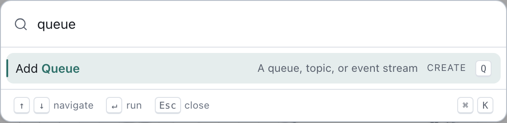

# Keyboard shortcuts and the command palette

Press `?` for the full shortcut list, or `⌘K` to find a command.
On Windows and Linux, use `Ctrl` for `⌘` and `Alt` for `⌥`.
Single-letter shortcuts work while the canvas has focus, outside text fields and dialogs.

## Draw without the mouse

Shapes appear under your pointer, or near the selection if the pointer has not entered the canvas.

| Key | Adds | Key | Adds |
| --- | --- | --- | --- |
| `S` | Service | `N` | Note |
| `D` | Data Store | `C` | Code |
| `Q` | Queue | `T` | Text |
| `A` | Actor | `B` | Boundary |
| `M` | Component | `J` | Junction |

Select a shape and run **Connect to…** from `⌘K` to connect it to an existing or new shape.

### Take the suggestion

| Key | Action |
| --- | --- |
| `Tab` | Accept the faint next-shape suggestion |
| `]` / `[` | Next / previous suggestion |
| `Esc` | Dismiss |

Suggestions depend on the diagram and [view level](depth.md).
If no useful guess is available, `]` can open the add-element menu instead.
Use **Turn off Intent Continuation** in `⌘K` to disable suggestions; the command then offers to turn them on.

## Move around

| Key | Action |
| --- | --- |
| `⌥` + arrow | Select the nearest shape in that direction |
| `⌥⇧→` / `⌥⇧←` | Follow an outgoing / incoming connector |
| Arrow; `Shift` + arrow | Nudge 1 unit; 10 units |
| `Shift+1` | Fit the diagram in view |
| `⌘+` / `⌘−` / `⌘0` | Zoom in / out / to 100% |
| `Space` + drag | Pan; wheel and trackpad scrolling also pan |
| `⌘↓` / `⌘↑` | Look inside / go back out |
| `⌥O` | Open the Outline |

## Edit

| Key | Action |
| --- | --- |
| `Enter` | Edit the selected element's text |
| `Esc` | Close editing, a popover or the selection, one at a time |
| `⌘Z` / `⌘⇧Z` | Undo / redo |
| `⌘C` / `⌘X` / `⌘V` | Copy / cut / paste, including between diagrams |
| `⌘D` | Duplicate |
| `Delete` / `Backspace` | Delete |
| `⌘A` | Select all shapes |
| `⌘G` / `⌘⇧G` | Group in a boundary / ungroup |
| `⌘B` / `⌘I` | Bold / italic on selected Text, or selected words while editing |
| `⌘⌥F` (`Ctrl+H` on Windows/Linux) | Find and replace across all rooms |
| `Shift+F10` / Menu key | Open the selection's context menu |
| `F` | Open Flows |
| `I` | Add an open point |
| `⌘⇧E` | Export |

For shape labels, `Enter` commits and `Shift+Enter` adds a line; `Esc` cancels.
For Notes, `Enter` adds a line, `⌘Enter` commits, and `Esc` keeps the text.
Code always uses `Enter` for a new line.
Text shapes have a [Markdown editor and formatting shortcuts](shapes-and-connectors.md#write-rich-text);
while editing Text, `⌘K` inserts a link.

## The Outline, and what a screen reader hears

Open **Outline** (`⌥O`) for a tree of shapes, boundary members and connectors in the current view.
Use arrows to navigate or expand rows, `Enter` to edit, and `Esc` to close.
Outline and canvas selection stay in sync; off-screen selections pan into view.

Screen readers announce shape names and kinds, connector relationships, and selection changes.
See [accessibility](accessibility.md) for touch, pen and contrast support.

## What the command palette does

Open `⌘K`, type part of an action or name, and press `Enter`.

- Find drawing, connector, flow, export and view commands.
- Insert [architecture starters](examples.md).
- Jump to named shapes, labelled connectors and flows, including in other rooms.
- Run **Arrange selection**, **Arrange diagram**, **Tidy connectors** or **Fit shapes to text** to clean up.

Some commands open a second picker. `Esc` goes back.

## While presenting

| Key | Action |
| --- | --- |
| `⌘Enter` | Start / leave presentation |
| `→` / `Space`; `←` | Advance; go back |
| `Home` / `End`; `1`–`9` | First / last step; jump to a step |
| `Shift+→` / `Shift+←`; `Shift+F` | Next / previous flow; choose a flow |
| `O` / `R` / `P` | Overview / re-centre / pointer |
| `Esc` | Close a reveal, then leave |

See [flows and presenting](flows-and-presentation.md) for the walkthrough.
Desktop file shortcuts are in the [desktop guide](desktop.md#keyboard).

## Browser files and flow tracing

The web app saves locally. **Import** opens a file; **Export** downloads a copy.
While **Trace a flow** is active, `Backspace` removes the last provisional step and `Esc` cancels.
In its Outline, `Enter` appends a connector. **Finish** commits the trace once.
