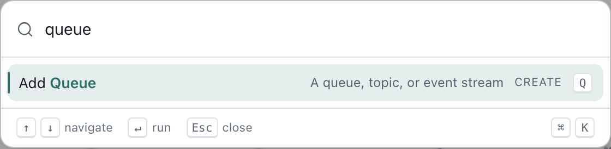

# Keyboard shortcuts and the command palette

Draw, move around and edit from the keyboard, and find any command in the command palette.

Shortcuts use Mac keys. On Windows and Linux, use `Ctrl` for `⌘` and `Alt` for `⌥`.

In the app, `?` lists every shortcut and `⌘K` opens the command palette; both are also in the **?**
help menu. Single keys work when the canvas has focus (`Tab` from the toolbar), not in text fields
or dialogs.

## Add shapes

| Key | Adds | Key | Adds |
| --- | --- | --- | --- |
| `S` | Service | `N` | Note |
| `D` | Data Store | `C` | Code |
| `Q` | Queue | `T` | Text |
| `A` | Actor | `B` | Boundary |
| `M` | Component | `J` | Junction |
| `L` | [Sequence](sequence-diagrams.md) | | |

The shape appears under the pointer, ready to name; **Connect to…** in `⌘K` connects it. Over a
sequence, `S` `D` `Q` `A` `M` add a participant of that kind instead. For any other shape or a
technology, press `Enter` on **Shapes** at the end of the toolbar, type its name (`kafka`), and
press `Enter` to put it down.

`Tab` accepts the faint next-shape suggestion and `Esc` waves it away. `]` / `[` cycle through
others, or pick the next shape when none shows. To stop suggestions, run **Turn off next-shape
suggestions** from `⌘K`, or use the switch on the **Canvas** tab of
[Appearance](shapes-and-connectors.md#appearance).

## Move around

| Key | Action |
| --- | --- |
| `⌥` + arrow | Select the nearest shape in that direction |
| `⌥⇧→` / `⌥⇧←` | Follow an outgoing / incoming connector |
| `G` | Go where the selected [linked junction](shapes-and-connectors.md#linked-junctions) continues; with several places, list them |
| `⇧G` / `⌥G` | Back to where you followed a junction from / forward again |
| Arrow / `Shift` + arrow | Nudge the selection 1 / 10 units |
| Hold `⌥` while dragging or resizing | Turn off [snapping](shapes-and-connectors.md#line-things-up) |
| Hold `Shift` and rest on a shape | Light up everything its data comes from and feeds |
| `⇧1` | Fit the diagram in view |
| `⌘+` / `⌘−` / `⌘0` | Zoom in / out / to 100% |
| `Space` + drag | Pan (scrolling also pans) |
| `⌘↓` / `⌘↑` | [Look inside](depth.md) the selected shape / back out; `⌘↓` also steps into a selected sequence |
| `⌥O` | Outline: arrows move and expand, `Enter` edits, `Esc` closes |

## Edit

| Key | Action |
| --- | --- |
| `Enter` or `F2` | Edit the selected shape's or connector's text; `F2` with nothing selected renames the diagram |
| `Esc` | Step back: editing, a popover, a next-shape suggestion, the selection, then out of a shape |
| `⌘Z` / `⌘⇧Z` or `⌘Y` | Undo / redo |
| `⌘C` / `⌘X` / `⌘V` | Copy / cut / paste, also between diagrams |
| `⌘D` | Duplicate |
| `Delete` / `Backspace` | Delete |
| `⌥⌫` | Delete and join the connectors through it (`Client → Gateway → API` leaves `Client → API`) |
| `⇧S` `⇧D` `⇧Q` `⇧A` `⇧M` | Turn the selection into a Service, Data Store, Queue, Actor or Component |
| `⌘A` | Select all shapes |
| `⌘G` / `⌘⇧G` | Group into a boundary / ungroup |
| `⌘B` / `⌘I` | Bold / italic on the selected Text |
| `⌘⌥F` (`Ctrl+H`) | Find and replace across every room |
| `Shift+F10` or Menu key | Context menu for the selection; with nothing selected, the canvas menu |
| `F` | Flows panel |
| `I` | Add an open point to the selection |
| `⌘⇧E` or `⌘E` | Export |
| `⌘J` | Desktop: show or hide [Nodi](connect-an-ai-agent.md#ask-nodi-on-the-canvas) |

| While editing | New line | Finish | `Esc` |
| --- | --- | --- | --- |
| A shape's name | `Shift+Enter` | `Enter` | Restores the old name |
| Note, Text or Code | `Enter` | `⌘Enter` | Keeps your text |

Text also has [Markdown and format shortcuts](shapes-and-connectors.md#write-rich-text); `⌘K` there
inserts a link.

## Command palette

Press `⌘K`, type part of a command or name, then press `Enter`. It runs editor actions, jumps to
named shapes, connectors and flows in any room, and inserts
[starters](getting-started.md#start-from-a-starter) once the gallery is loaded. With shapes selected,
it also aligns, distributes and matches sizes.

## Keys in other guides

| Keys for | Guide |
| --- | --- |
| The Pencil (`P`) and its tools | [Sketch and Smart Ink](sketching.md) |
| Presenting (`⌘Enter`) | [Flows and presenting](flows-and-presentation.md#present) |
| Sequences | [Sequence diagrams](sequence-diagrams.md#keyboard) |
| The timeline | [Diagram history](history.md#the-timeline) |
| Files and windows in the desktop app | [Desktop app](desktop.md#keyboard) |
