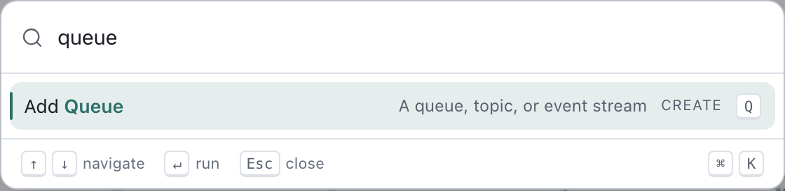

# Keyboard shortcuts and the command palette

`?` lists every shortcut and `⌘K` finds any command; both are also in the **?** help menu.
On Windows and Linux, use `Ctrl` for `⌘` and `Alt` for `⌥`.
Single keys work when the canvas has focus (`Tab` from the toolbar), not in text fields or dialogs.

## Add shapes

| Key | Adds | Key | Adds |
| --- | --- | --- | --- |
| `S` | Service | `N` | Note |
| `D` | Data Store | `C` | Code |
| `Q` | Queue | `T` | Text |
| `A` | Actor | `B` | Boundary |
| `M` | Component | `J` | Junction |
| `L` | [Sequence](sequence-diagrams.md) | | |

The shape appears under the pointer, ready to name. **Connect to…** in `⌘K` connects it.
Over a sequence, `S` `D` `Q` `A` `M` add a participant of that kind instead.

`Tab` accepts the faint next-shape suggestion; `]` / `[` cycle through others, or pick the next
shape when none shows. **Turn off Intent Continuation** in `⌘K`, or the switch in
[Settings → Canvas](getting-started.md#make-it-yours), hides them.

## Draw

| Key | Action |
| --- | --- |
| `P` | Pick up the [Pencil](sketching.md); again to switch Sketch and Smart Ink |
| `H` / `E` | Highlighter / eraser |
| `Esc` | Put the Pencil down; mid-stroke, take back that stroke |
| `←` `→` / `Enter` / `Esc` | Smart Ink: change what a drawing became / keep and name it / keep the sketch |

## Move around

| Key | Action |
| --- | --- |
| `⌥` + arrow | Select the nearest shape in that direction |
| `⌥⇧→` / `⌥⇧←` | Follow an outgoing / incoming connector |
| Arrow / `Shift` + arrow | Nudge the selection 1 / 10 units |
| `Shift+1` | Fit the diagram in view |
| `⌘+` / `⌘−` / `⌘0` | Zoom in / out / to 100% |
| `Space` + drag | Pan (scrolling also pans) |
| `⌘↓` / `⌘↑` | [Look inside](depth.md) the selected shape / back out; `⌘↓` also steps into a selected sequence |
| `⌥O` | Outline: arrows move and expand, `Enter` edits, `Esc` closes |

## Edit

| Key | Action |
| --- | --- |
| `Enter` or `F2` | Edit the selected shape's or connector's text; `F2` with nothing selected renames the diagram |
| `Esc` | Step back: editing, a popover, the selection, then out of a shape |
| `⌘Z` / `⌘⇧Z` or `⌘Y` | Undo / redo |
| `⌘C` / `⌘X` / `⌘V` | Copy / cut / paste, also between diagrams |
| `⌘D` | Duplicate |
| `Delete` / `Backspace` | Delete |
| `⌥⌫` | Delete and join the connectors through it (`Client → Gateway → API` leaves `Client → API`) |
| `⇧S` `⇧D` `⇧Q` `⇧A` `⇧M` | Turn the selection into a Service, Data Store, Queue, Actor or Component |
| `⌘A` | Select all shapes |
| `⌘G` / `⌘⇧G` | Group into a boundary / ungroup |
| `⌘B` / `⌘I` | Bold / italic on the selected Text |
| `⌘⌥F` (`Ctrl+H`) | Find and replace across every room |
| `Shift+F10` or Menu key | Context menu |
| `F` | Flows panel |
| `I` | Add an open point to the selection |
| `⌘⇧E` or `⌘E` | Export |

| While editing | New line | Finish | `Esc` |
| --- | --- | --- | --- |
| A shape's name | `Shift+Enter` | `Enter` | Restores the old name |
| Note, Text or Code | `Enter` | `⌘Enter` | Keeps your text |

Text also has [Markdown and format shortcuts](shapes-and-connectors.md#write-rich-text);
`⌘K` there inserts a link.

## Inside a sequence

With a participant, message or frame of a [sequence](sequence-diagrams.md) selected:

| Key | Action |
| --- | --- |
| `⌥` + arrow / `⌥⇧` + arrow | Move the selection / extend it |
| Arrow | Move the message up or down, or the participant left or right |
| `Enter` or `F2` | Edit |
| `Tab`, `]` / `[` | Add the offered next message; offer another |
| `P` | Add a participant after the selected one |
| `⌘D` | Duplicate |
| `⌘G` / `⌘⇧G` | Wrap messages or group participants / unwrap or ungroup |
| `Delete` | Delete; on a frame, remove the frame and keep its messages |
| `Esc` | Back out to the sequence |

## Command palette

Press `⌘K`, type part of a command or name, then `Enter`.

It runs editor actions, inserts [starters](examples.md) once the starters gallery is loaded (**Browse starters…** opens it), jumps to named shapes, connectors and flows
in any room, and tidies up. **Tidy up** previews a gentle cleanup before applying it; **Straighten
connectors**, **Arrange diagram**, **Check layout**, **Tidy connectors**, **Auto attach all connectors** and **Fit
shapes to text** each do one thing. With shapes selected it also aligns,
distributes and matches sizes (**Same width**, **Same height**).

## Presenting

| Key | Action |
| --- | --- |
| `⌘Enter` | Start / stop presenting |
| `→` or `Space` / `←` | Next / previous step |
| `Home` / `End` / `1`–`9` | First / last / that step |
| `Shift+→` / `Shift+←` / `Shift+F` | Next / previous / any flow |
| `O` / `R` / `P` | Overview / re-centre / pointer |
| `Esc` | Close a reveal, then stop presenting |

Tracing keys are in [flows and presenting](flows-and-presentation.md); desktop file keys in the
[desktop guide](desktop.md#keyboard).
