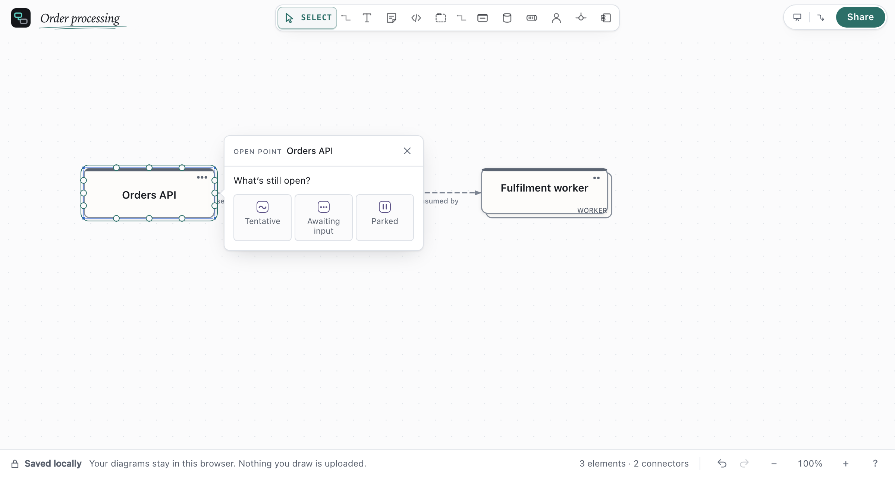
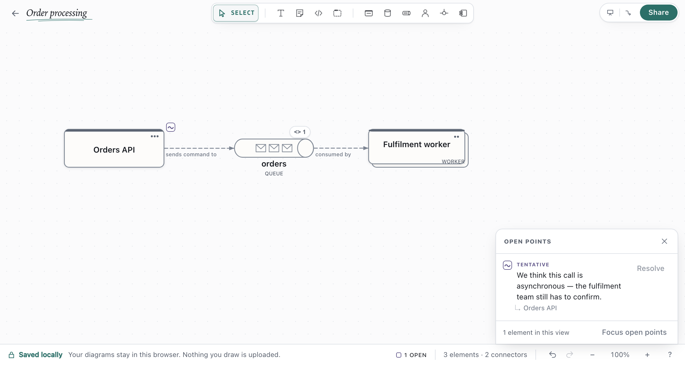

# Mark what is still open

An **open point** is a marker for an unresolved question on a shape, connector or boundary.

| Kind | For |
| --- | --- |
| **Tentative** | A working assumption |
| **Awaiting input** | An answer or review you need |
| **Parked** | A topic put off on purpose |

## Add one

1. Select one or more elements (several share one point).
2. Press `I`, or right-click → **Add open point…**.
3. Choose a kind and optionally add context. `Enter` closes; `Shift+Enter` adds a line.

Click a marker to change its kind, edit context, **Resolve** or delete it. On a shared point,
**Not this one** detaches just that element.

## Review them

Click the open-point count in the status bar to list points from every room. Choose a row to go to
its element. **Focus open points** dims everything else; **Exit focus** or `Esc` undoes it.

**Resolve** hides the marker and moves the point to the resolved list, where you can add a note,
reopen or delete it.

## Good to know

- While presenting, click a marker to read it.
- PNG and SVG exports show markers and a key; untick **Open point markers** to hide them.
  Sequence exports leave points out.
- Deleting an element detaches it from a shared point; the others keep it.
- A copied element gets its own point.
- An [AI agent](connect-an-ai-agent.md) can manage points when asked.
