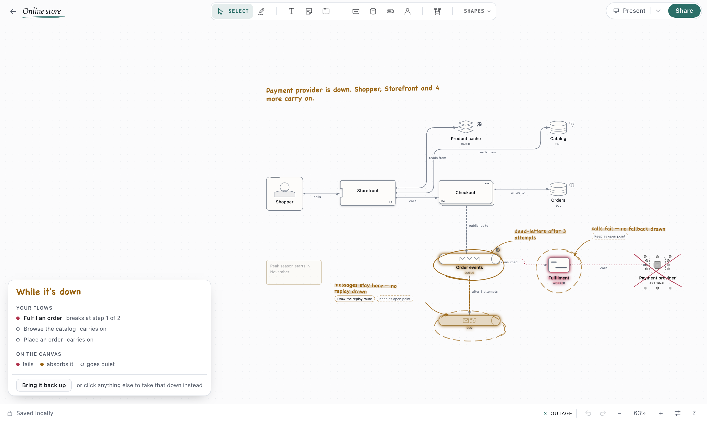
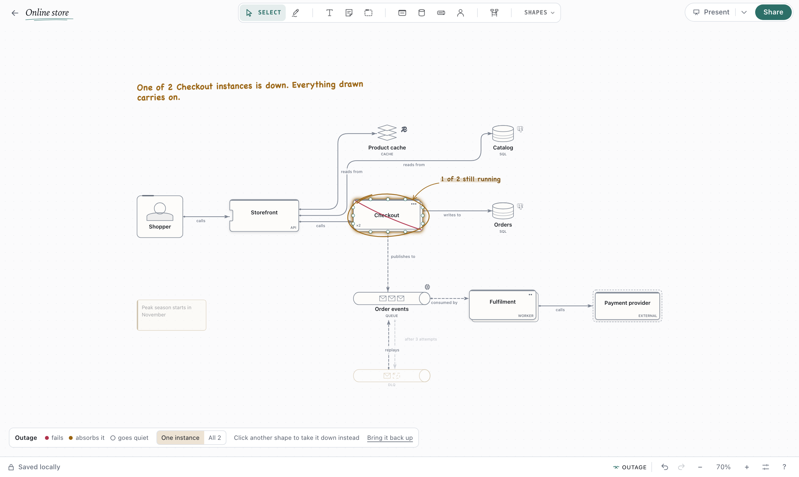

# Outage

Take a shape, Boundary or connector down and see what the drawing says happens next: what fails,
what absorbs the failure, and what the diagram leaves open.

An outage is read from the drawing alone: shapes, kinds, technology, instance counts, what each
connector means and the order of your flows. It assumes no load, timing or likelihood, so it can't
tell you capacity, latency or how long an outage lasts. Where the drawing is silent, it asks rather
than guesses.

## Take something down

Outage needs a runtime connector on the canvas: a service calling a service, reading or writing a
data store, or publishing to or consuming from a queue. Then:

- Right-click a Service, Queue or Data Store → **Take down**, a Boundary → **Take everything inside
  down**, or a connector → **Take this connection down**.
- Or select one and click **Outage** in the status bar, or run **Take down** from `⌘K`.
- Click **Outage** with nothing selected to [see every outage at once](#see-every-outage-at-once).

While it is open, click another shape or connector to take that down instead. The card at the
bottom left says what the outage does to your flows and what the colours mean.

To end it, press `Esc`, click **Outage** again or choose **Bring it back up**. Presenting, opening
another diagram or turning on a spotlight also ends it.

## Read the canvas

| On the canvas | Means |
| --- | --- |
| Struck out in red | Down |
| Red outline, dashed red connectors | Fails, because it waits on something down or failing. A failure travels back along calls that wait for an answer, up to whoever started them |
| Amber outline | Absorbs the failure or is partly hit: a queue holds or redelivers, a drawn fallback or dead-letter route comes into use, a store goes stale |
| Faded | Goes quiet, because everything that reached it came through the outage, or takes no part |
| Everything else | Carries on; the handwritten headline names it |

A note beside each affected shape says what happens to it. Click a note, or `Tab` to it and press
`Enter`, to unfold the full sentence; `Esc` folds it.

## See every outage at once

With nothing selected, **Outage** lists everything whose loss would change something drawn, under
**If it goes down**:

- **A person sees it**: the failure travels back to someone drawn at the start of a chain. Listed
  first, in red.
- **No one drawn waits on it**: the rest.
- **Connections**: the same reading for each connector, folded at the end.

Point at a row, or `Tab` to it, to circle what it names on the canvas; click it to take that down.
The order follows the drawing: it is not a ranking of likelihood or severity.

## Answer the questions

A dashed loop marks something the drawing leaves open. It may only be something not drawn yet, not
a gap in the system. Each question offers its answers:

- Draw the answer, where one edit settles it: **Add a dead-letter queue**, **Draw the replay route**
  or **Run two instances**. It is an ordinary edit that `⌘Z` undoes, and the outage is read again at
  once.
- **Keep as open point** leaves the question on that shape as an
  [open point](shapes-and-connectors.md#open-points) for the review.

Neither is offered where the diagram can't be edited: a read-only copy, a past revision in
[History](history.md#look-at-the-past), or a flow you are tracing.

## What the shapes say

| Drawn | Read as |
| --- | --- |
| A call or read/write that waits for its answer | The caller fails too, unless a **Fallback** connector is drawn from it |
| A call nobody waits on | The caller carries on, and it asks what becomes of the calls that don't arrive |
| A Queue in front of something down | Holds messages, then delivers the backlog at once. With no product named, it says the drawing doesn't show how long or how much it keeps |
| A Queue in front of something failing | Redelivers, then dead-letters after the attempts drawn. With no dead-letter queue, it asks |
| A dead-letter queue | Asks how messages are replayed, unless a route is drawn out of it |
| A Topic delivering straight to a service | Asks whether events are kept for a subscriber that is down |
| A Stream | Keeps the log; the consumer resumes where it left off |
| A Cache | Its readers are degraded, not failed, and it asks whether they fall through to the store |
| A Data Store nothing writes to any more | Goes stale for whoever still reads it |
| An External system | Its callers fail, and recovery isn't yours to speed up |

### A connection down

Take a connector down and both shapes stay up but can't reach each other. The same rules apply to
that one route, and the notes say "can't be reached", never "is down".

### Instances

A Service drawn with several instances (`Fulfilment ×3`) loses one first: the rest keep running and
nothing else changes, though the drawing can't say whether they can take all the work. To lose them
all, switch to **All 3** in the card at the bottom left, or choose **Take all 3 instances down** from
the shape's menu. A Service drawn as a single instance that something depends on asks whether it
should run more than one; **Run two instances** answers it.

### Technology

When a shape names a known product, such as Kafka, Amazon SQS, RabbitMQ, Google Pub/Sub, Redis or
Memcached, its notes add that product's documented default. Unfold the note and **Source** links to
the vendor's page. A default is not your setting, so the question stays.

## What it does to your flows

The card lists each [flow](flows-and-presentation.md) under **Your flows**:

- **breaks at step 3 of 5**: the first step, in the flow's order, that can no longer happen as
  drawn. Hover it for the reason.
- **comes into use**: no step breaks, and the flow runs over a fallback or dead-letter route the
  outage brings into use, usually the failure path you drew.
- **carries on**: none of its own steps is hit.

A flow can carry on through a shape the canvas shows failing, when its own steps from that shape
still work. A later step counts as hit only when its own connector fails or goes quiet.

## Work caught half-done

A shape that fails on one step may already have finished another. The outage checks every connector
the drawing says changes something: one labelled as a write, a publish or a command, or a call with
a [recovery action](shapes-and-connectors.md#recovery-compensation). A plain call or an unlabelled
data connector doesn't count, since it may only read.

- **half-done — what undoes it?**: a service wrote to its store, then a step it waits on failed. A
  recovery action drawn for the write answers it and lights up.
- **runs again on each redelivery**: behind a queue that redelivers, the work before the failing
  step repeats, so it asks whether the consumer is safe to run twice on the same message.
- A write and a message come apart: a service writes to a store but can't publish to its queue, and
  nothing drawn keeps the two in step.

Only a flow says which step comes first. With one, the note says the write "has already happened";
without one, it says "if that comes before". A write that every flow puts after the failing step
never happens, so the note says nothing about it.

## With your agent

A connected agent can ask the same questions through `read_diagram`:

- `outage: { element: "<id>" }` takes a shape or Boundary down and returns what the canvas shows,
  including the open questions, where each flow breaks and the vendor sources behind any note.
- `outage: { connector: "<id>" }` does the same for a connection.
- `outage: {}` returns the list of everything whose loss changes something drawn.

You still review every change it proposes. See [Connect an AI agent](connect-an-ai-agent.md).
