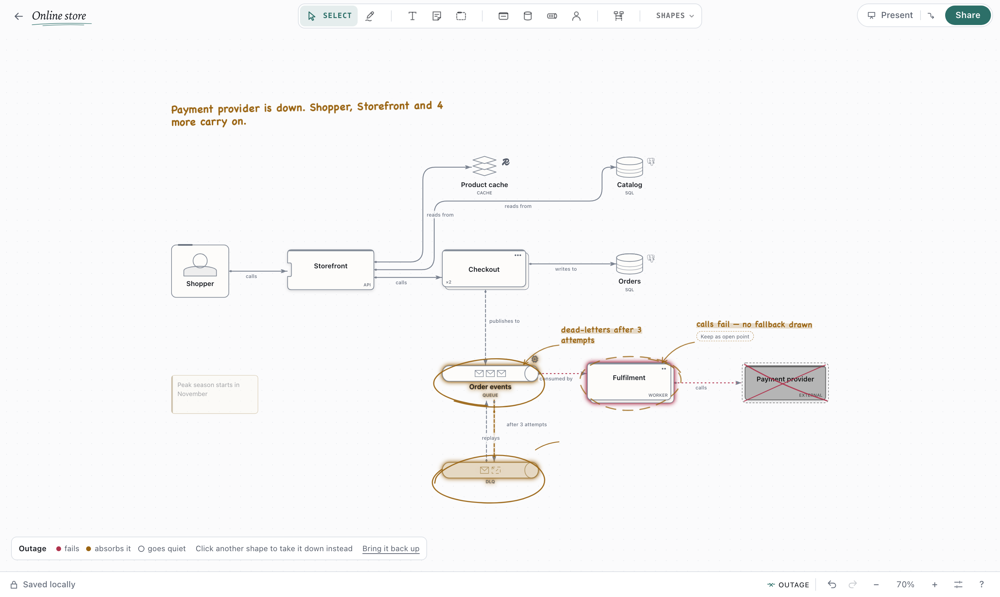
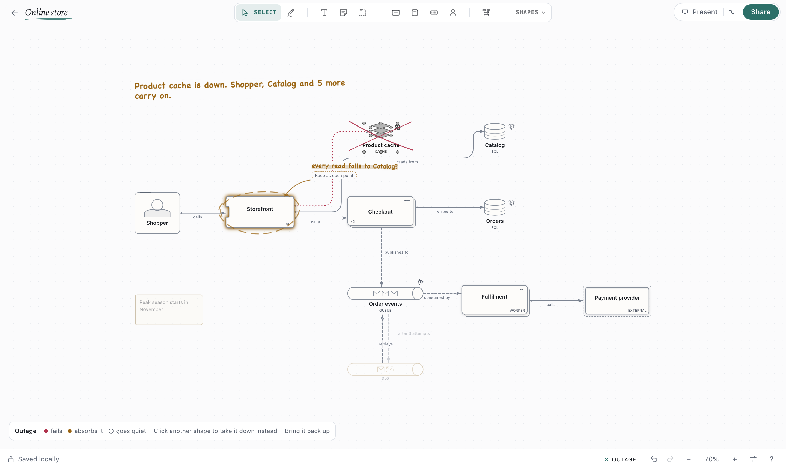

# Outage

Take one shape down and see what the drawing says happens next: what fails with it, what absorbs
the failure, and what the diagram leaves open. It is the question a design review asks about every
box, answered on the canvas.

An outage is read **from the drawing alone**. It uses the shapes, their kinds, technology and
instance counts, and what each connector means. It assumes no load, timing or likelihood, and it
shows no numbers you didn't draw. Where the drawing doesn't say what happens, it asks you instead
of guessing.

## Take something down

Once the canvas has a runtime connector (a service calling a service, reading or writing a data
store, publishing to or consuming from a queue), any of these starts it:

- Right-click a Service, Queue, Data Store or Boundary and choose **Take down**.
- Select one and click **Outage** in the status bar, or run **Take down** from `⌘K`.
- Click **Outage** with nothing selected, then click the shape to take down.

While it is open, click any other shape to take that one down instead. Press `Esc`, click **Outage**
again or choose **Bring it back up** to end it. Presenting, opening another diagram or turning on a
spotlight also ends it.

## Read the canvas

- **Struck out in red**: what is down.
- **Red outline and dashed red connectors**: what now fails, because it waits on something that is
  down or failing. A failure travels back along calls that wait for an answer, up to the person or
  system that started them.
- **Amber outline**: what absorbs the failure or is only partly hit. A queue holds or redelivers, a
  drawn fallback or dead-letter route comes into use (its connector lights up), a store goes stale.
- **Faded**: what goes quiet because everything that reached it came through the outage, and
  anything that takes no part.
- **Everything else** carries on, and the handwritten headline names it.

Each consequence is written beside the shape it is about, in the order it travels. Click a note, or
`Tab` to it and press `Enter`, to unfold the full sentence; `Esc` folds it.

## Questions are yours to answer

A dashed loop marks something the drawing leaves open. Each question has its answers under it:

- **Draw the answer**, where one edit would settle it: **Add a dead-letter queue**, **Draw the
  replay route** or **Run two instances**. It is an ordinary edit, undone with `⌘Z`, and the outage
  is read again at once, so you see what your answer changes.
- **Keep as open point** leaves the question on that shape as an [open point](open-points.md), in
  the file, for the review.

Nothing is changed for you, and a gap in the diagram is not proof of a gap in the system: it may
simply not be drawn yet.

## What the shapes say

| Drawn | Read as |
| --- | --- |
| A call or a read/write that waits for its answer | The caller fails with what it waits on, unless a **Fallback** connector is drawn from it |
| An asynchronous hand-off | The failure does not travel back across it |
| A Queue in front of something down | Holds messages until it is back, then the backlog arrives at once |
| A Queue in front of something failing | Redelivers, then dead-letters after the attempts drawn; with no dead-letter queue, it asks |
| A Queue with another consumer | The other consumer keeps draining it |
| A Dead-letter queue | Asks how messages are replayed, unless a route is drawn out of it |
| A Topic delivering straight to a service | Asks whether events are kept for a subscriber that is down |
| A Stream | Keeps the log; the consumer resumes where it left off |
| A Cache | Its readers are degraded, not failed, and it asks whether they fall through to the store |
| A Data Store nothing writes to any more | Goes stale for whoever still reads it |
| An External system | Its callers fail, and it says recovery isn't yours to speed up |
| A Scheduler | What it starts never starts |
| A Boundary | Everything that runs inside it goes down together |

### Instances

A Service drawn with several instances (`Fulfilment ×3`) loses **one** first: the rest keep
running and nothing else changes. Switch to **All 3** in the strip at the bottom left, or choose
**Take all 3 instances down** from the shape's menu, to lose them all. A Service drawn as a single
instance that something depends on raises the question itself.

### Technology

When a shape names one product, its notes add that product's documented default: Kafka keeps the
log for its retention period, Amazon SQS keeps a message for its retention period and shows it
again after each visibility timeout, RabbitMQ keeps a message until it is acknowledged, Amazon SNS
retries and then drops, and Redis or Memcached come back empty. These are product behaviour, not
your settings. A setting that changes one is yours to know, so the question stays.

## With your agent

An agent you have connected can ask the same question. `read_diagram` with
`outage: { element: "<id>" }` returns the same reading the canvas shows: what is affected and how,
what carries on, and the open questions. The agent can reason about them, check them against your
code if you have let it read it, and propose a change; you still review every proposal before it
lands. See [Connect an AI agent](connect-an-ai-agent.md).

## What it cannot tell you

Topology can't establish capacity, latency, how long an outage lasts, whether a timeout fires, or
what matters most to protect. An outage shows what the drawing implies and where it is silent. The
decisions are yours.
