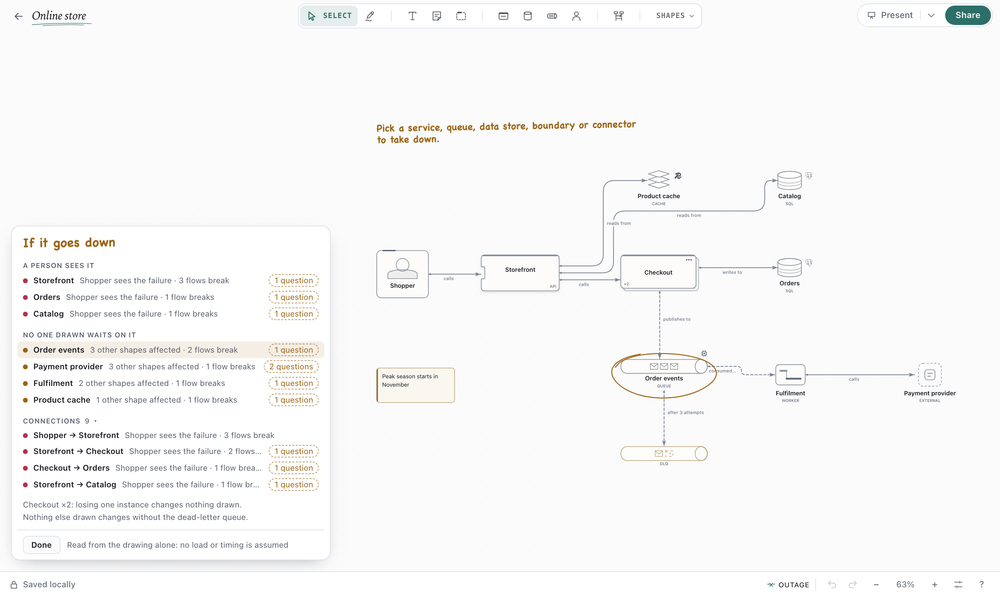
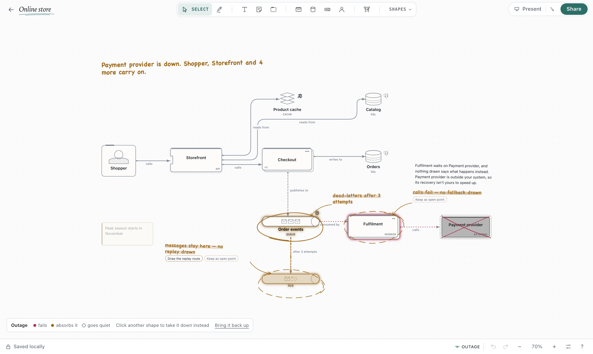
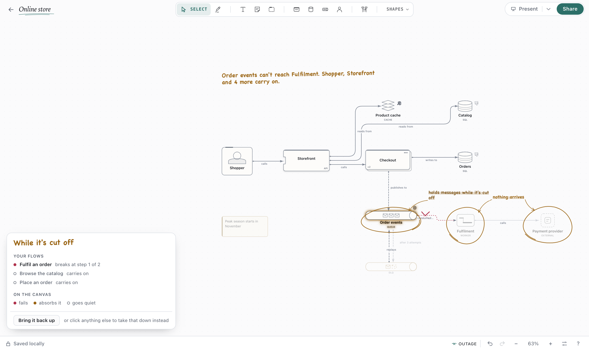
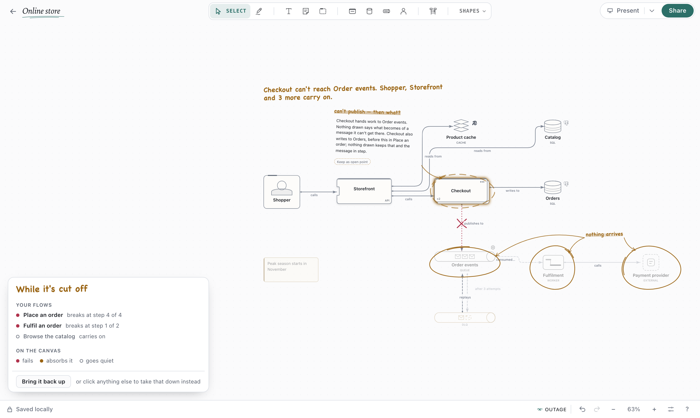

# Outage

Take one thing down and see what the drawing says happens next: what fails with it, what absorbs
the failure, and what the diagram leaves open. It is the question a design review asks about every
box and every line, answered on the canvas.

An outage is read **from the drawing alone**. It uses the shapes, their kinds, technology and
instance counts, what each connector means, and the order your flows give. It assumes no load,
timing or likelihood, and it shows no numbers you didn't draw. Where the drawing doesn't say what
happens, it asks you instead of guessing.

## Take something down

Once the canvas has a runtime connector (a service calling a service, reading or writing a data
store, publishing to or consuming from a queue), any of these starts it:

- Right-click a Service, Queue or Data Store and choose **Take down**, or a Boundary and choose
  **Take everything inside down**.
- Right-click a connector and choose **Take this connection down**.
- Select one of them and click **Outage** in the status bar, or run **Take down** from `⌘K`.
- Click **Outage** with nothing selected, then pick from the list or click what to take down.

While it is open, a card at the bottom left says what the outage does to your flows and what the
colours mean. Click any other shape or connector to take that one down instead. Press `Esc`, click
**Outage** again or choose **Bring it back up** to end it. Presenting, opening another
diagram or turning on a spotlight also ends it.

## See every outage at once

Opened with nothing selected, the walk first lists everything whose loss would change something
drawn, under **If it goes down**:

- **A person sees it**: the failure travels back to someone drawn at the start of a chain. These
  come first, marked in red.
- **No one drawn waits on it**: the rest, by the flows they break and how much else they touch.
- **Connections**: folded at the foot of the list, the same reading for each connector.

Each row says whom the failure reaches, how many flows break and how many questions the drawing
leaves open. A Boundary is listed as everything in it lost together. Point at a row, or `Tab` to
it, and what it names is circled on the canvas; hovering gives the full sentence. Click a row to
take it down.

Below the rows, a Service drawn with several instances is named as one that can lose an instance,
and so is anything whose loss changes nothing else drawn.

The order is what the drawing says, not a score: the list says nothing about which outage is
likelier or worse. On a window wide enough, the drawing is framed beside the list.

## Read the canvas

- **Struck out in red**: what is down.
- **Red outline and dashed red connectors**: what now fails, because it waits on something that is
  down or failing. A failure travels back along calls that wait for an answer, up to the person or
  system that started them.
- **Amber outline**: what absorbs the failure or is only partly hit. A queue holds or redelivers, a
  drawn fallback or dead-letter route comes into use (its connector lights up), a store goes stale.
- **Faded**: what goes quiet because everything that reached it came through the outage, and
  anything that takes no part.
- **Everything else** carries on, and the handwritten headline names it.

Each consequence is written beside the shape it is about, in the order it travels. Click a note, or
`Tab` to it and press `Enter`, to unfold the full sentence; `Esc` folds it. An unfolded note moves
if it has to, so its sentence never covers a shape.

## Questions are yours to answer

A dashed loop marks something the drawing leaves open. Each question has its answers under it:

- **Draw the answer**, where one edit would settle it: **Add a dead-letter queue**, **Draw the
  replay route** or **Run two instances**. It is an ordinary edit, undone with `⌘Z`, and the outage
  is read again at once, so you see what your answer changes.
- **Keep as open point** leaves the question on that shape as an [open point](open-points.md), in
  the file, for the review.

Nothing is changed for you, and a gap in the diagram is not proof of a gap in the system: it may
simply not be drawn yet.

## What the shapes say

| Drawn | Read as |
| --- | --- |
| A call or a read/write that waits for its answer | The caller fails with what it waits on, unless a **Fallback** connector is drawn from it |
| A call nobody waits on | The failure does not travel back. The caller carries on, and it asks what becomes of the calls that don't arrive |
| A Queue in front of something down | Holds messages while it is down, then the backlog arrives at once. With no product named, it says the drawing doesn't show how long or how much it keeps |
| A Queue in front of something failing | Redelivers, then dead-letters after the attempts drawn; with no dead-letter queue, it asks |
| A Queue with another consumer | The other consumer keeps draining it |
| A Dead-letter queue | Asks how messages are replayed, unless a route is drawn out of it |
| A Topic delivering straight to a service | Asks whether events are kept for a subscriber that is down |
| A Stream | Keeps the log; the consumer resumes where it left off |
| A Cache | Its readers are degraded, not failed, and it asks whether they fall through to the store |
| A Data Store nothing writes to any more | Goes stale for whoever still reads it |
| A Data Store nothing reaches any more | Stops being updated, or is no longer read if nothing wrote to it |
| An External system | Its callers fail, and it says recovery isn't yours to speed up |
| A Scheduler | What it starts never starts |
| A Boundary | Everything that runs inside it goes down together |

### A connection down

Take a connector down and the two shapes stay up but can no longer reach each other. The connector
is struck through, and the same rules apply to that one route: a caller that waits across it fails,
a queue that can't hand over holds, a publisher that can't publish raises the question, and
whatever was only reached across it goes quiet. The notes say "can't be reached", never "is down",
because nothing is.

A trunk several routes share on the way to a junction is named by everything it led to: "Gateway
can't reach Orders and Billing".

### Instances

A Service drawn with several instances (`Fulfilment ×3`) loses **one** first: the rest keep
running and nothing else changes. Switch to **All 3** in the card at the bottom left, or choose
**Take all 3 instances down** from the shape's menu, to lose them all. A Service drawn as a single
instance that something depends on raises the question itself.

### Technology

When a shape names one product, its notes add that product's documented default: Kafka keeps
events for the topic's retention period, Amazon SQS keeps a message for its retention period and
shows it again after each visibility timeout, RabbitMQ keeps a message until it is acknowledged,
Google Pub/Sub keeps an unacknowledged one for seven days, Amazon Kinesis keeps a record for 24
hours, Amazon SNS, EventBridge and Event Grid retry and then drop, core NATS and MQTT drop what an
offline subscriber missed, Redis and Valkey reload their last snapshot, and Memcached comes back
empty. The same holds for managed and compatible Kafka (Amazon MSK, Confluent, Redpanda).

Each of these sentences was read from the vendor's own documentation. Unfold the note and
**Source** under it links to that page, so you can check it against the version you run. These are
product behaviour, not your settings. A setting that changes one is yours to know, so the question
stays.

## What it does to your flows

A [flow](flows-and-presentation.md) is your own account of one journey through the diagram, so the
outage is read against each one. The card at the bottom left lists them under **Your flows**:

- **breaks at step 3 of 5**: the first step, in the flow's own order, that can no longer happen as
  drawn. Hover it for the sentence: which connector, and whether the call fails or nothing travels
  it at all.
- **comes into use**: no step breaks, and the flow runs over a fallback or dead-letter route the
  outage brings into use. This is usually the flow you drew for the failure path.
- **carries on**: none of its own steps is hit.

A flow can carry on through a shape the canvas shows failing. A shape fails because something it
waits on fails; the flow says what it does on this journey. If the flow goes on from that shape by
steps that still work, the outage says so: "Storefront fails only where it waits on something this
flow doesn't use." If the flow says nothing further about that shape, the step breaks.

The step number is the flow's, not a claim about what depends on what: a later step is only counted
as hit when its own connector fails or goes quiet.

## Work caught half-done

A shape that fails on one step may already have finished another. The outage reads that for
anything the drawing says changes something: a connector labelled as a write, a publish, a
command, or a call you drew a [recovery action](shapes-and-connectors.md#recovery-compensation) for.
A plain call or an unlabelled data connector is not counted, because it may only be a read.

- **half-done — what undoes it?** A service wrote to its store and then the step it waits on
  failed. A recovery action drawn for the write is the answer, and it lights up; without one, the
  question stays.
- **runs again on each redelivery.** The same service behind a queue that redelivers: whatever it
  does before the failing step is repeated every time, so it asks whether the consumer is safe to
  run twice on the same message.
- **A write and a message come apart.** A service that writes to a store and publishes to a queue
  that can't take the message: "nothing drawn keeps that and the message in step".

Which step comes first is drawn only where a flow puts both connectors in order. With one, the
note says the write "has already happened". Without one it says "if that comes before", and where
every flow puts the write after the step that fails, it says nothing: that write never happens.

## With your agent

An agent you have connected can ask the same questions through `read_diagram`:

- `outage: { element: "<id>" }` takes a shape or Boundary down and returns what the canvas shows:
  what is affected and how, what carries on, the open questions, which step of each flow
  breaks, and the vendor page behind any product behaviour a note quotes.
- `outage: { connector: "<id>" }` does the same for a connection.
- `outage: {}` returns the list of everything whose loss changes something drawn.

The agent can reason about them, check them against your code if you have let it read it, and
propose a change; you still review every proposal before it lands. See
[Connect an AI agent](connect-an-ai-agent.md).

## What it cannot tell you

Topology can't establish capacity, latency, how long an outage lasts, whether a timeout fires, or
what matters most to protect. An outage shows what the drawing implies and where it is silent. The
decisions are yours.
