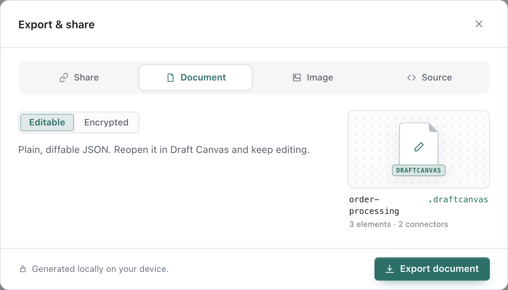
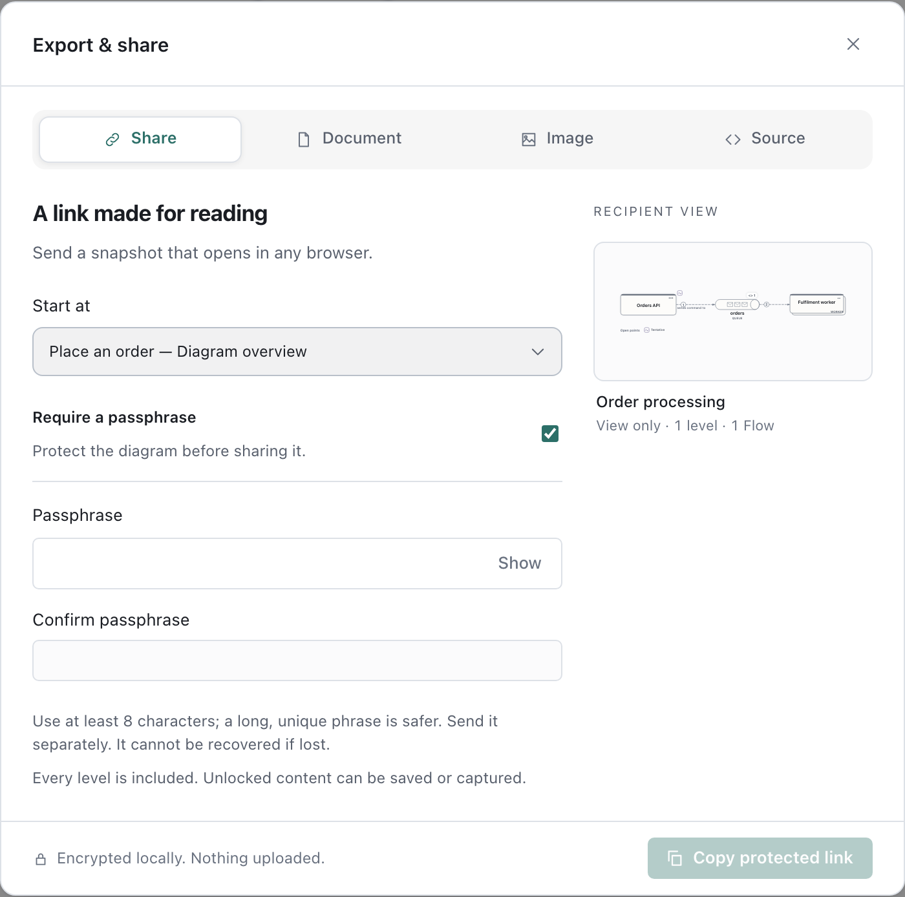
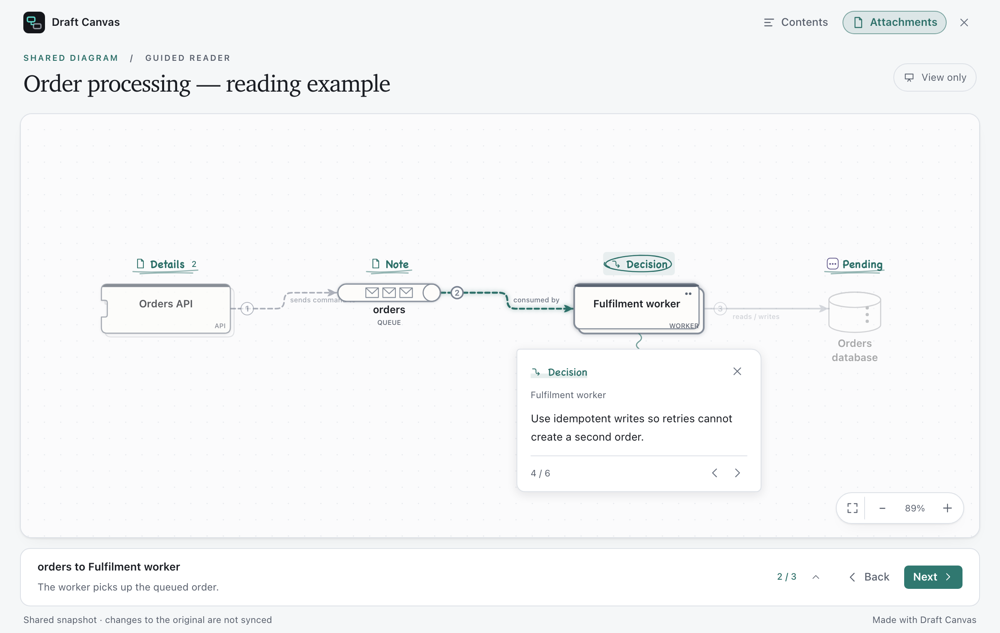
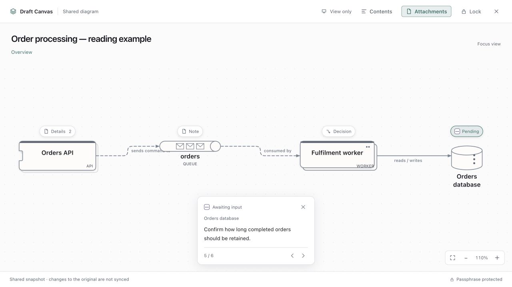

# Saving, backing up and sharing

## Save your work

- **Web:** saves automatically in this browser profile. Wait for **Saved locally** before closing.
- **Desktop:** `⌘S` saves to a file; see [desktop files](desktop.md#files).

Browser diagrams do not sync between devices, browsers or sites, and clearing site data deletes them.
The footer keeps the save status and canvas controls together, without diagram counts or a repeating
privacy message.

If the status bar says **In memory only**, nothing is stored: export before closing.
If another tab changed the same diagram, choose **Keep mine** or **Load the other tab's**.

## Back up the browser library

1. On Home, choose **View all** to open the Library.
2. Choose **Back up** to download a ZIP of every diagram and project.
3. To bring it back, choose **Restore…**. Existing diagrams are never overwritten; matches come back
   as copies.

The Library reminds you when the last backup is missing or over a week old. Press `/` there to
search; deleting a project moves its diagrams to **Unorganized**.

## Export a file

Open **Share → Export** (`⌘⇧E`).

| Choose | You get |
| --- | --- |
| **Document → Editable** | A `.draftcanvas` file to reopen, share or keep in version control |
| **Document → Encrypted** | A passphrase-protected `.dcenc` file |
| **Image** | PNG or SVG |
| **Source → Flows** | Mermaid or PlantUML sequence diagrams of your flows |
| **Source → Architecture** | Mermaid flowchart, C4-PlantUML, Structurizr DSL or draw.io |

- Exports are snapshots, made on your device. Documents include every room, and a background
  image up to 2 MB.
- An encrypted file needs a passphrase of 8 or more characters. It cannot be recovered, so send it
  separately. Open `.dcenc` files in the web app.
- **Copy** puts an image or source on the clipboard; `⌘K` has **Copy as image**, **Copy as SVG**
  and **Copy source as…**. If the clipboard refuses, the file downloads instead.

Image options:

- **Light** or **Dark**, **Transparent**, **Selection only**; PNG at 1×, 2× or 3×.
- Inside a room: that room or **The whole canvas**. **Every level** zips one image per room.
- Open-point markers are included unless you untick them.
- **Editable — carries the diagram inside** embeds the whole diagram, every room, so the image can
  be imported and edited. On by default for SVG, off for PNG.

## Import a file

Choose **Import** on Home or in the Library, or drop the file onto the Library or canvas.

- `.draftcanvas` or `.json`: opens as a diagram.
- `.dcenc`: asks for the passphrase (web only).
- Editable PNG or SVG: opens the diagram inside.
- Mermaid `.mmd`, `.mermaid` or Markdown: see below.

An import never replaces an existing diagram. Older files upgrade; files from a newer version are
refused until you update. Damaged files are repaired where possible, with a report of what was
dropped. Files over 24 MB are refused; other limits are in the [schema reference](../reference/schema.md).

### Importing a Mermaid flowchart

Import a `flowchart` or `graph` file for a new diagram, or paste Mermaid text onto a canvas (one
undo removes it). Draft Canvas lays it out. Styling is skipped; other diagram types are refused.
See the [Mermaid import reference](../reference/mermaid-import.md).

## Share a diagram

| Send | How | Recipient gets |
| --- | --- | --- |
| Link | **Share → Share read-only link**, or **Copy share link** in `⌘K` | A protected, view-only snapshot in Guided reader or Focus view |
| File | **Document → Editable** or **Encrypted** | A diagram they can reopen |
| Picture | **Image**, or **Copy as image** | A PNG or SVG; editing requires an embedded diagram |
| Live session | **Share → Draw together, live** | A shared canvas; see [Collaborating live](collaborating.md) |

### Create a protected link

1. Choose **Share → Share read-only link**. **Require a passphrase** is on by default.
2. Choose **Start at**: the diagram overview, current level or a playable Flow.
3. Enter and confirm a passphrase of at least eight characters. A long, unique phrase is safer.
4. Choose **Copy protected link**, then send the passphrase separately.

Desktop links open in the browser at `app.draftcanvas.dev`. The completed link stays visible if
copying is unavailable; **Copy link** retries, and **Open Guided reader** opens the recipient view.
Turn protection off to create a link anyone can open.

Preparation compresses the snapshot locally, using a background worker for larger diagrams.
A progress bar names the current stage; **Cancel** stops preparation. Protected links are encrypted
on your device and unlocked on the recipient's device. Draft Canvas never stores or recovers the
passphrase. **Lock** discards an unlocked diagram from memory and asks for its passphrase again.

Links contain every room after the `#`; nothing is uploaded. Later edits do not update them.
They have no expiry or revocation, and someone who unlocks a diagram can save or capture its content.
Browsers and messages may keep the link. The compressed limit is 32 KB; export a file if the diagram
is too large. Background images are omitted.

### Read a shared diagram

The reader uses the actual shapes and connectors. Shapes stay fixed; recipients can pan, zoom,
fit the diagram and inspect details. **Contents** holds the existing levels and shapes. The reader
frames the diagram beneath its title,
with zoom controls in the lower-right corner and walkthrough controls below the canvas. Handwritten,
underlined attachment labels sit beside their shapes; the selected label is circled and linked to its
open note. The note’s body stays in regular type.
There are no editing, download or editable-copy controls.

**Guided reader** has a compact manual walkthrough. Choose **Start walkthrough**, then **Back** or
**Next**; open the step count to choose a step or switch Flows. Nothing advances automatically.
A level without a playable Flow opens in **Focus view**, with no walkthrough controls.

[Guided reader in dark mode](../media/guides/share-guided-reader-dark.png).

**Attachments** opens one card beside its shape or connector. Diagram markers show notes,
decisions, code and pending items. The card's previous and next arrows browse details across
levels; related-element links show the other shapes a shared point concerns. A Flow step reveals
its relevant detail. Close a card at any time. On smaller or shorter screens, cards sit below the
diagram, clear of the shapes and walkthrough controls.

Pending items keep their Tentative, Awaiting input or Parked status. Resolved points retain their
resolution notes. Browsing never changes the snapshot.

[Focus view in dark mode](../media/guides/share-focus-view-dark.png).

Run **Share from here…** or **Copy share link** in `⌘K`, or use **Start at** in **Share → Export → Share**.
It defaults to the selected playable Flow, then the current level, then the overview.
A Flow link starts at its introduction; the reader chooses when to advance.

The starting point changes where reading begins. **Every room is still shared.**
An unavailable level or Flow falls back to the overview with a notice. Older unprotected links
also open in the reader. Starting metadata counts toward the link-size limit.

## If something looks wrong

| Problem | Try |
| --- | --- |
| Empty Library | Use the same browser profile and site, outside a private window. |
| Storage full or unavailable | Export now, then free space or use another browser. |
| Saving stopped after an update | Export recent changes, then reload. |
| A diagram cannot be read | Restore from a backup. |

For a bug report, choose **Diagnostic report…** in the **?** help menu (desktop: **Settings →
Support**), then **Download report**. It has no diagram content or file paths and is never sent
automatically. See [privacy](../reference/privacy.md) and [recovery limits](../reference/reliability.md).
