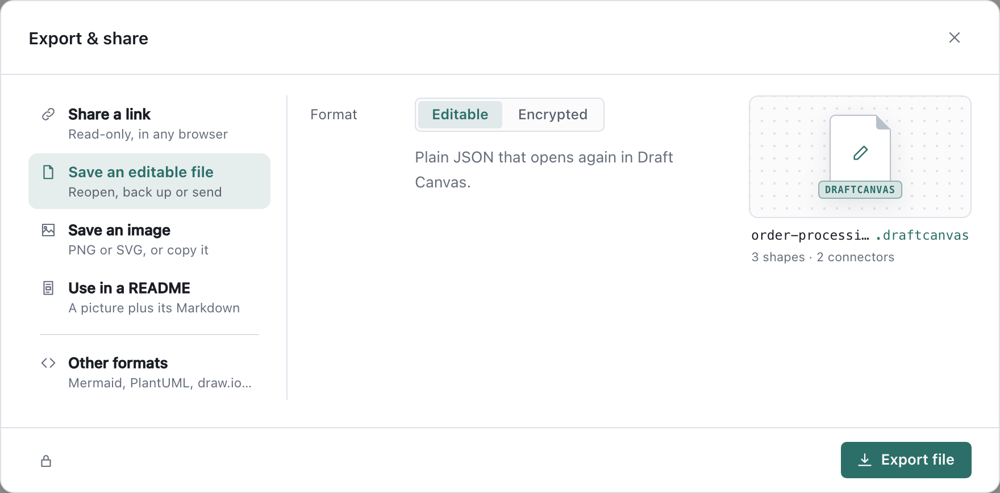

# Saving, backing up and sharing

Where your diagrams are kept, and how to back them up, export, import and share them.

## Save your work

- **Web:** diagrams save automatically in this browser profile. Wait for **Saved locally** before
  closing.
- **Desktop:** `⌘S` saves to a file; see [desktop files](desktop.md#files).

Browser diagrams don't sync between devices, browsers or sites, and clearing site data deletes them.
If the status bar says **In memory only**, nothing is stored: export before closing. If another tab
changed the same diagram, choose **Keep mine** or **Load the other tab's**.

If a save fails, the status bar says why and offers **Retry**, **Export** and **Leave without
saving**. **Export** downloads the diagram as it is on screen. To free space, export first, then
delete diagrams you no longer need from the Library.

## Back up the browser library

1. On Home, choose **View all** to open the Library.
2. Choose **Back up** to download a ZIP of every diagram and project.
3. To bring it back, choose **Restore…**. In a browser with no diagrams yet, choose **Import a file**
   on Home instead, or drop the ZIP onto Home.

Restoring never overwrites a diagram: matches come back as copies. The Library reminds you when the
last backup is missing or over a week old.

## Export a file

Open **Share → Export…** (`⌘⇧E`).

| Choose | You get |
| --- | --- |
| **Share a link** | A read-only link; see [Share a diagram](#share-a-diagram) |
| **Save an editable file → Editable** | A `.draftcanvas` file to reopen, share or keep in version control |
| **Save an editable file → Encrypted** | A passphrase-protected `.dcenc` file |
| **Save an image** | PNG or SVG |
| **Use in a README** | An SVG for a Markdown page, linked to its `.draftcanvas`; see [Diagrams in your docs](diagrams-in-docs.md) |

- Files include every level.
- An encrypted file needs a passphrase of at least 8 characters. Send it separately; it can't be
  recovered. `.dcenc` files open in the web app only.
- **Copy** puts an image on the clipboard; `⌘K` has **Copy as image** and **Copy as SVG**. If the
  clipboard refuses, the file downloads instead.
- Draft Canvas does not write other tools' formats (Mermaid, PlantUML, C4-PlantUML, Structurizr DSL
  or draw.io). Send the `.draftcanvas` file when someone needs the architecture, and a PNG or SVG
  when they need a picture.

Image options:

- **Light** or **Dark**, **Transparent**, **Selection only**; PNG at 1×, 2× or 3×.
- Inside a level: that level or **The whole canvas**. **Every level** zips one image per level.
- Open-point markers are included unless you untick them. [Sketches](sketching.md) are drawn too,
  except in a **Selection only** image.
- **Editable** embeds the whole diagram so the image can be imported and edited again. It is on by
  default for SVG, off for PNG.

## Import a file

In the web app, choose **Import a file** on Home or **Import** in the Library, or drop the file onto
Home, the Library or the canvas. In the desktop app, use **Open file…** on Home.

- `.draftcanvas` or `.json` opens as a diagram.
- `.dcenc` asks for the passphrase (web only).
- An editable PNG or SVG opens the diagram inside.
- Mermaid `.mmd`, `.mermaid` or Markdown: see below.

An import never replaces a diagram: one already stored comes in as a copy. A file saved by a newer
version opens once you update Draft Canvas.

Damaged files are repaired where possible, with a report of what was dropped. Files over 24 MB are
refused.

### Importing a Mermaid flowchart

Import a `flowchart` or `graph` file for a new diagram, or paste Mermaid text onto a canvas. Draft
Canvas lays it out itself and skips styling. A `sequenceDiagram` becomes an editable
[sequence](sequence-diagrams.md); other diagram types are refused. The
[Mermaid import reference](../reference/mermaid-import.md) lists what is supported.

## Share a diagram

Send a read-only link, an [exported file or image](#export-a-file), or invite people to
[edit live](collaborating.md). A link opens as a view-only snapshot.

### Create a protected link

1. Choose **Share → Share read-only link…**. **Require a passphrase** is on by default.
2. Choose **Start at**: the diagram overview, the current level or a playable flow.
3. Enter and confirm a passphrase of at least 8 characters.
4. Choose **Copy protected link**, then send the passphrase separately.

**Open Guided reader** previews what the recipient sees. Turn protection off for a link anyone can
open. Links made in the desktop app open in the browser at `app.draftcanvas.dev`.

Before you send a link:

- It carries the whole diagram, every level, whatever **Start at** says. Nothing is uploaded, and
  later edits don't update it.
- A protected link is encrypted on your device and unlocked on the recipient's. Draft Canvas never
  stores or recovers the passphrase.
- Links have no expiry and can't be revoked. Someone who unlocks a diagram can save or capture it,
  and browsers and messages may keep the link.
- A link holds up to 32 KB, compressed. Export a file if the diagram is too large.

### Read a shared diagram

Recipients see the real shapes and connectors. They can pan, zoom and inspect details, and
**Contents** lists the levels and shapes. There are no editing, download or copy controls. **Lock**
discards an unlocked diagram from memory and asks for the passphrase again.

**Guided reader** walks through a flow by hand: **Start walkthrough**, then **Back** or **Next**. A
level without a playable flow opens in **Focus view**. Markers on the diagram show notes, decisions,
code and pending items; click one to open its card.

[Guided reader in dark mode](../media/guides/share-guided-reader-dark.png).

[Focus view in dark mode](../media/guides/share-focus-view-dark.png).

## If something looks wrong

| Problem | Try |
| --- | --- |
| Empty Library | Use the same browser profile and site, outside a private window. |
| Storage full or unavailable | Export now, then free space or use another browser. |
| Saving stopped after an update | Export recent changes, then reload. |
| A diagram cannot be read | Restore from a backup. |

For a bug report, choose **Diagnostic report…** in the **?** help menu (desktop: **Settings →
Support**), then **Download report**. It has no diagram content or file paths and is never sent
automatically. See [Privacy and security](../reference/privacy.md#optional-local-diagnostic-report)
and [storage limits](../reference/privacy.md#storage-limits-and-backups).
