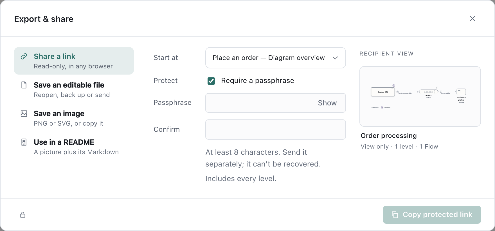
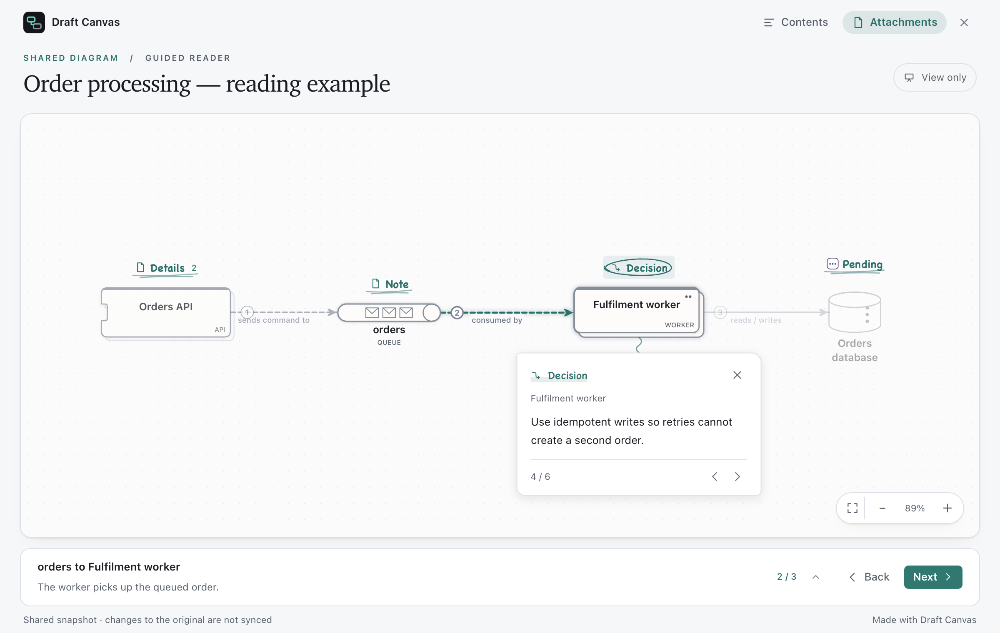
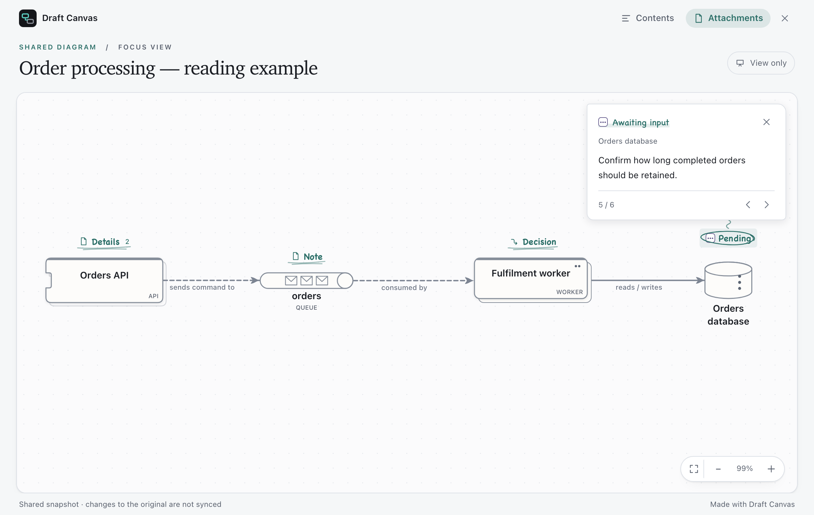

# Saving, backing up and sharing

## Save your work

- **Web:** saves automatically in this browser profile. Wait for **Saved locally** before closing.
- **Desktop:** `⌘S` saves to a file; see [desktop files](desktop.md#files).

Browser diagrams do not sync between devices, browsers or sites, and clearing site data deletes them.

If the status bar says **In memory only**, nothing is stored: export before closing. If another tab
changed the same diagram, choose **Keep mine** or **Load the other tab's**.

If a save fails, the status bar says why (the browser is out of space, or storage became
unavailable) and offers **Retry**, **Export** and **Leave without saving**. **Export** downloads the
diagram as it is on screen. To free space, export first, then delete diagrams you no longer need from
the Library. **Leave without saving** asks before it gives up the unsaved changes.

## Back up the browser library

1. On Home, choose **View all** to open the Library.
2. Choose **Back up** to download a ZIP of every diagram and project.
3. To bring it back, choose **Restore…**. Existing diagrams are never overwritten; matches come back
   as copies.

In a browser with no diagrams yet, Home has no **View all**. Choose **Import a file** and pick the
backup ZIP, or drop it onto Home, to restore it.

Once you have a few diagrams, the Library reminds you when the last backup is missing or over a week
old. Press `/` in the Library to search. Deleting a project moves its diagrams to **Unorganized**.

## Export a file

Open **Share → Export…** (`⌘⇧E`).

| Choose | You get |
| --- | --- |
| **Share a link** | A read-only link; see [Share a diagram](#share-a-diagram) |
| **Save an editable file → Editable** | A `.draftcanvas` file to reopen, share or keep in version control |
| **Save an editable file → Encrypted** | A passphrase-protected `.dcenc` file |
| **Save an image** | PNG or SVG |
| **Use in a README** | An SVG for a README or other Markdown page, linked to its `.draftcanvas`; see [Diagrams in your docs](diagrams-in-docs.md) |
| **Other formats → Sequences** | Mermaid or PlantUML sequence diagrams of your flows and [sequences](sequence-diagrams.md) |
| **Other formats → Architecture** | Mermaid flowchart, C4-PlantUML, Structurizr DSL or draw.io |

- Exports are snapshots made on your device. Files include every level and a background image up to
  2 MB.
- An encrypted file needs a passphrase of 8 or more characters. It cannot be recovered, so send it
  separately. `.dcenc` files open in the web app only.
- **Copy** puts an image or source on the clipboard; `⌘K` has **Copy as image**, **Copy as SVG** and
  **Copy source as…**. If the clipboard refuses, the file downloads instead.

Click the preview to inspect it. **100%** shows actual size, so you can read the smallest text as a
reader will; **200%** doubles it.

Image options:

- **Light** or **Dark**, **Transparent**, **Selection only**; PNG at 1×, 2× or 3×.
- Inside a level: that level or **The whole canvas**. **Every level** zips one image per level.
- Open-point markers are included unless you untick them.
- [Sketches](sketching.md) are drawn over the diagram, except in a **Selection only** image and in
  text exports.
- **Editable** embeds the whole diagram so the image can be imported and edited again. On by default
  for SVG, off for PNG.

## Import a file

Choose **Import** on Home or in the Library, or drop the file onto the Library or canvas.

- `.draftcanvas` or `.json`: opens as a diagram.
- `.dcenc`: asks for the passphrase (web only).
- Editable PNG or SVG: opens the diagram inside.
- Mermaid `.mmd`, `.mermaid` or Markdown: see below.

An import never replaces an existing diagram: one whose id is already stored comes in as a copy
titled "… copy". Older files upgrade; a file saved by a newer version is not opened until you update
Draft Canvas. Damaged files are repaired where possible, with a report of what was dropped. Files
over 24 MB are refused.

### Importing a Mermaid flowchart

Import a `flowchart` or `graph` file for a new diagram, or paste Mermaid text onto a canvas (one undo
removes it). Draft Canvas lays it out itself and skips styling. A `sequenceDiagram` becomes an
editable [sequence](sequence-diagrams.md). Other diagram types are refused. What is supported,
skipped and limited is in the [Mermaid import reference](../reference/mermaid-import.md).

## Share a diagram

| Send | How | Recipient gets |
| --- | --- | --- |
| Link | **Share → Share read-only link…**, or the same in `⌘K` | A protected, view-only snapshot in Guided reader or Focus view |
| File | **Save an editable file → Editable** or **Encrypted** | A diagram they can reopen |
| Picture | **Save an image**, or **Copy as image** | A PNG or SVG; it can be edited only if the diagram is embedded |
| Live session | **Share → Collaborate…** | A shared canvas; see [Collaborating live](collaborating.md) |

### Create a protected link

1. Choose **Share → Share read-only link…**. **Require a passphrase** is on by default.
2. Choose **Start at**: the diagram overview, current level or a playable Flow.
3. Enter and confirm a passphrase of at least eight characters. A long, unique phrase is safer.
4. Choose **Copy protected link**, then send the passphrase separately.

Desktop links open in the browser at `app.draftcanvas.dev`. **Open Guided reader** previews what the
recipient sees. Turn protection off to create a link anyone can open.

The link is built on your device, with a progress bar and **Cancel** for larger diagrams. A protected
link is encrypted there and unlocked on the recipient's device; Draft Canvas never stores or recovers
the passphrase. **Lock** discards an unlocked diagram from memory and asks for the passphrase again.

The link carries the whole diagram, every level, after the `#`; nothing is uploaded, and later edits
do not update it. Links have no expiry and cannot be revoked, and someone who unlocks a diagram can
save or capture it. Browsers and messages may keep the link. The compressed limit is 32 KB; export a
file if the diagram is too large. Background images are left out.

### Read a shared diagram

Recipients see the real shapes and connectors. They can pan, zoom, fit the diagram and inspect
details; **Contents** lists the levels and shapes. There are no editing, download or copy controls.

**Guided reader** has a manual walkthrough: **Start walkthrough**, then **Back** or **Next**. Open
the step count to choose a step or switch flows. Nothing advances on its own. A level without a
playable flow opens in **Focus view**, with no walkthrough controls.

[Guided reader in dark mode](../media/guides/share-guided-reader-dark.png).

Markers on the diagram show notes, decisions, code and pending items. Click one to open its card
beside the shape or connector; the arrows on the card browse details across levels. A flow step
reveals its relevant detail. On small screens cards sit below the diagram. Pending items keep their
Tentative, Awaiting input or Parked status, and resolved points keep their notes. Browsing never
changes the snapshot.

[Focus view in dark mode](../media/guides/share-focus-view-dark.png).

**Start at** defaults to the selected playable flow, then the current level, then the overview. It
changes only where reading begins: **every level is still shared.** If the level or flow is
unavailable, the reader opens the overview with a notice.

## If something looks wrong

| Problem | Try |
| --- | --- |
| Empty Library | Use the same browser profile and site, outside a private window. |
| Storage full or unavailable | Export now, then free space or use another browser. |
| Saving stopped after an update | Export recent changes, then reload. |
| A diagram cannot be read | Restore from a backup. |

For a bug report, choose **Diagnostic report…** in the **?** help menu (desktop: **Settings →
Support**), then **Download report**. It has no diagram content or file paths and is never sent
automatically. See [Privacy and security](../reference/privacy.md#optional-local-diagnostic-report)
and [recovery limits](../reference/reliability.md).
