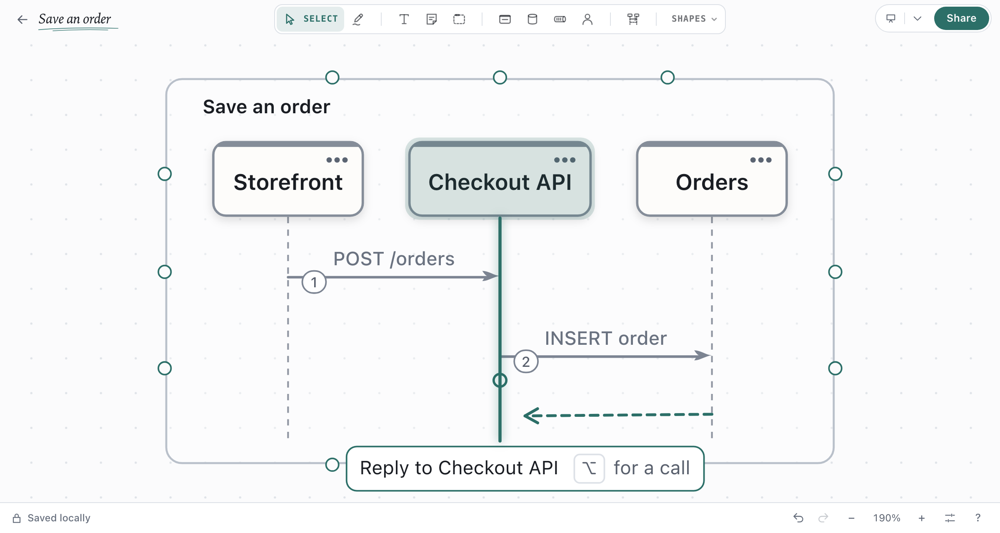
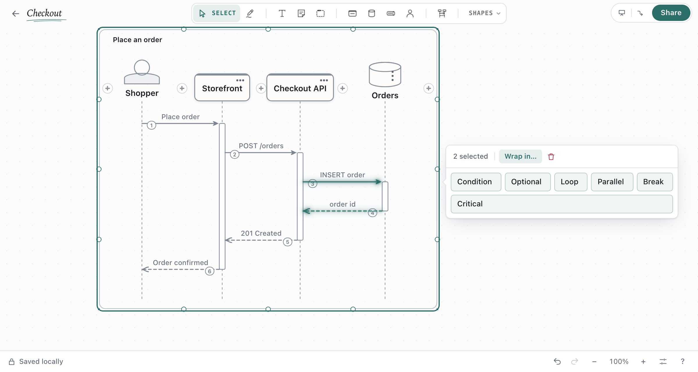

# Sequence diagrams

A **sequence** shows behaviour over time: who says what to whom, in what order, and under which
condition. It is one element on the canvas, beside your architecture, and it lays itself out. You
say who takes part and what happens; you never place a lifeline or size an arrow.

## Start one

Press `L`, or click **Sequence** in the toolbar and then the canvas. It starts with **Participant 1**;
click **+** to add more anywhere along the row.

Double-click a participant to rename it, then press `Enter` or click away. While typing, the arrow
keys browse suggestions: a participant type, a matching technology, or
[a shape already on the canvas](#use-shapes-from-your-architecture).

## Add messages

Drag from one lifeline to another, then type what the message says. The arrow follows the pointer,
the destination lifeline lights up, and a dot marks where the message will land.

A new message starts with the label a canvas connector between those shapes would get: a service
calling a data store starts with **reads / writes**, a cache with **reads from**. Type to replace
it or press `Enter` to keep it.

Arrows are numbered in reading order, and the numbers follow inserts, moves and deletes. To turn
them off, select the sequence and toggle **Message numbers** in the inspector; each sequence keeps
its own setting.

- Drag past the last participant until **Add participant** appears, then release to add a participant
  with a default name and write the message.
- Drag away and back onto the same lifeline for a message to itself.
- Hover between two participants and click **+** to add one there. The others make room.

Click the suggested message below the selection or press `Tab` to add it. Use `]` and `[` to
browse other suggestions, such as a reply, a call onward, or a call to itself.

A call starts work on its receiver, drawn as a bar on the lifeline. A reply ends it.

### Replies

Drag back. From the lifeline of whoever was called, drag to whoever called it: the line is drawn
dashed and says **Reply to** the caller before you let go, and it lands as that call's reply. It is
a reply only when the participant you drag from still owes one to the participant you drag to;
otherwise the same drag is a call, as always. Hold `⌥` to draw a call anyway.

With a call selected, press `R` or choose **Reply**: the reply goes below whatever that call set
going. A reply is never added on its own.

To connect two sequences, drag from a lifeline in one to a participant's head or lifeline in the
other. The connector stays attached as you move either sequence, and its label edits like any
connector.

## Select and change

Click a participant, message, note or frame to select it; `Shift`-click extends the selection. What
you can do appears beside it.

| Selected | You can |
| --- | --- |
| Participant | Rename, change its colour, shape, kind or technology, link or unlink a shape, group, delete |
| Message | Edit, make it a **Call**, **Asynchronous**, **Reply**, **Create** or **Destroy**, reverse it, turn its work bar on or off, add a reply, add a timeline note, attach a note or code, duplicate, delete |
| Several messages | **Wrap in…** a condition, optional part, loop, parallel branches, break or critical section |
| Frame or branch | Change its kind, edit the condition, add, move or remove a branch, unwrap, delete |
| The sequence | Rename it, add a participant or a reference, present it |

The right-click menu and `⌘K` also offer message commands.

- **Reorder** by dragging a message or frame up or down, or a participant sideways. A move that
  cannot be right (a reply above its call, a message to something not yet created) is refused, and
  says why.
- **Change the sender or receiver** by selecting a message and dragging either end of its arrow
  to another participant's head or lifeline. The destination lifeline lights up, and the arrow
  snaps into place on release.
- **Asynchronous** is suggested where the receiver is usually not waited on (a queue or topic),
  never assumed. One click applies it.
- **Create** starts the receiver's lifeline at that message; **Destroy** ends it.
- A problem in the order (a reply with no call, a message after its participant ended) is marked
  with a small warning on its row. Select it to read what is wrong.

### Conditions, loops and parallel branches

Select the messages that belong together and choose **Wrap in…**.

| Frame | Means |
| --- | --- |
| **Condition** (`alt`) | One of several branches happens, each under its own condition |
| **Optional** (`opt`) | Happens only when the condition holds |
| **Loop** | Repeats while the condition holds |
| **Parallel** (`par`) | Branches that run at the same time, in no order |
| **Break** | If this happens, the rest is skipped |
| **Critical** | Must not be interleaved with anything else |
| **Reference** | Stands for another interaction, named but not drawn here |

Type the condition and press `Enter`. **Add branch** adds an *else* (or another parallel branch).
`Delete` on a frame removes the frame and keeps its messages; **Delete with its messages** removes
both.

Each kind of frame has its own colour and mark, so a loop is told from a condition at a glance, and
every branch after the first is labelled `else` (or `and`, in a parallel frame). None of it is
yours to style.

### Notes and groups

**Timeline note** draws a note over one or two participants on its own row.

To keep supporting detail on an arrow, right-click a message and choose **Attach note** or **Attach
code** (also **Attach note to message** and **Attach code to message** in `⌘K`). To reuse a canvas
note or code card, drag it onto the arrow and release when **Attach to message** appears. Click a
chip below the arrow to reopen its card. Cards stay with the message as you move it, and can be
reordered, deleted or detached onto the canvas. While presenting, the current message's chips open
its cards. **Find and replace** includes notes attached to messages anywhere in the sequence.

`Shift`-click several neighbouring participants and choose **Group** to draw them under one name
(a subsystem, a team). A group says only that they belong together.

## Use shapes from your architecture

Drag a shape from the canvas over a sequence and rest it between two participants.

- A shape **that is part of a diagram** (connected, in a boundary, annotated or in a flow) stays
  where it is. The participant *stands for* it: rename either one, or change its kind, technology
  or colour, and the other follows. A small link mark shows on the participant.
- A shape **on its own** moves into the sequence. Nothing is left behind on the canvas.

A shape tool or key used over a sequence (`S`, `D`, `Q`, `A`, `M`, or a toolbar button) adds a
participant of that kind there.

With architecture shapes selected, `⌘K` → **Sequence from these** starts a sequence beside them with
one linked participant each, left to right. It adds no messages, because order is never guessed from
connectors. **Unlink** on a participant lets the two go their own way; deleting the shape keeps the
participant.

A [flow](flows-and-presentation.md#draw-a-flow-as-a-sequence) already has an order, so `⌘K` → **Draw
the flow as a sequence** can draw it for you.

## Keyboard

`⌘↓` steps into the selected sequence; `Esc` steps back out.

| Key | Action |
| --- | --- |
| `⌥` + arrow | Move the selection to the next participant or message |
| `⌥⇧` + arrow | Extend the selection |
| Arrow | Move the selected message up or down, or the participant left or right |
| `Enter` or `F2` | Edit |
| `Tab`, `]` / `[` | Add the offered message; offer another |
| `P` | Add a participant after the selected one |
| `R` | Add the reply to the selected call |
| `⌘D` | Duplicate |
| `⌘G` / `⌘⇧G` | Wrap messages or group participants / unwrap or ungroup |
| `Delete` | Delete; on a frame, unwrap |

## Present

Select the sequence and choose **Present this sequence** (also in `⌘K` and the right-click menu). It
plays one message at a time with the [same keys as a flow](flows-and-presentation.md#present). What
has been said stays, the current message is lit and crosses from its sender to its receiver, the
frame it is in lights with it, and the caption names its condition or branch.

## Export and import

- **Images** (PNG, SVG) show sequences as drawn, with message numbers and connectors between
  sequences.
- **Share → Export… → Other formats → Sequences** writes each sequence and each flow as **Mermaid**
  or **PlantUML**, with conditions, loops, work bars and groups. Attached cards stay in the
  `.draftcanvas` file; image exports show their chips.
- Paste or import a Mermaid `sequenceDiagram` to get an editable sequence; anything not drawn is
  listed. See the [Mermaid import reference](../reference/mermaid-import.md#sequence-diagrams).
- An [AI agent](connect-an-ai-agent.md) can add, read and change sequences.

## Good to know

- A sequence is one shape on the canvas: move it, put it in a boundary, connect to it, copy it, attach
  notes and [open points](open-points.md). It never resizes smaller than what it holds.
- Nothing you write is cut short. A long message, condition, note or title wraps onto more lines
  and the sequence makes room; the field you type it in wraps the same way.
- Mermaid has no reference frame, so one is exported as a note. draw.io shows a sequence as a
  labelled box.
- While [collaborating live](collaborating.md), if two people change the same sequence at once the
  later change wins.
- A single message can be duplicated but not copied to the clipboard.
- A flow step can light a whole sequence, not one of its messages.
