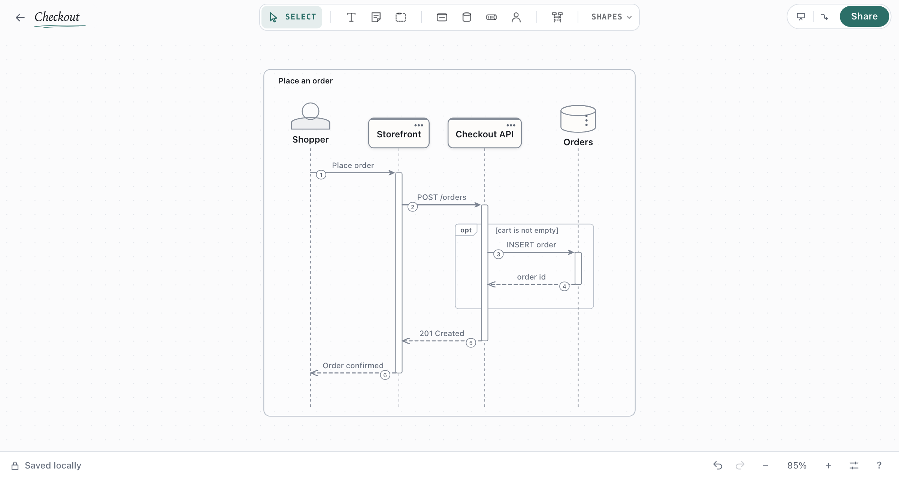
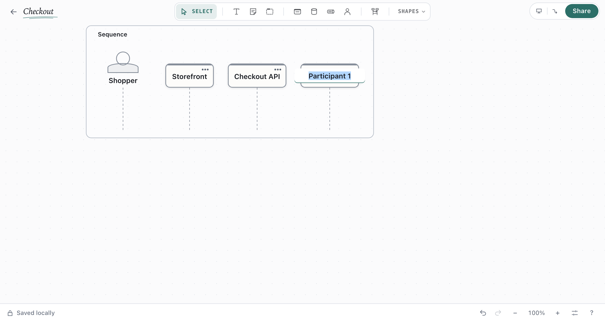
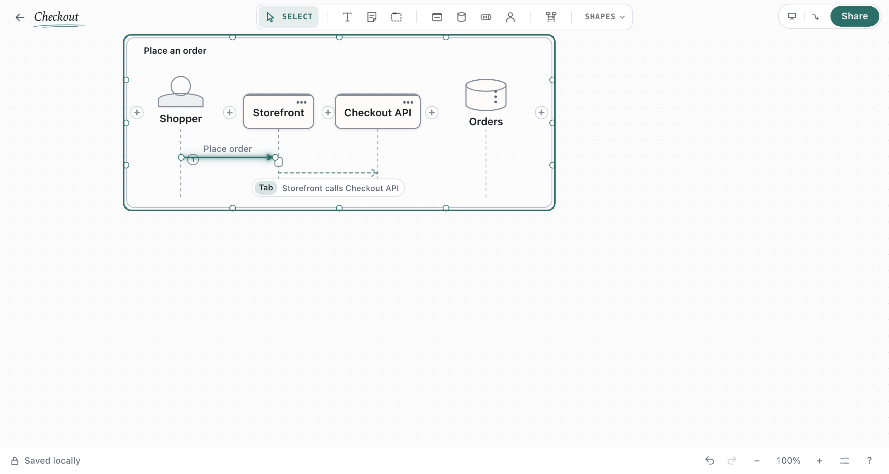
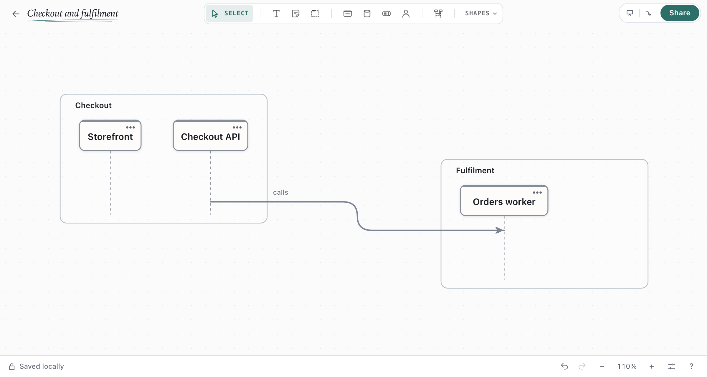
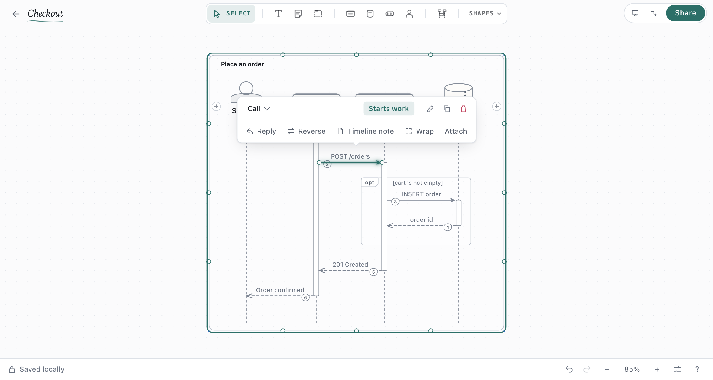
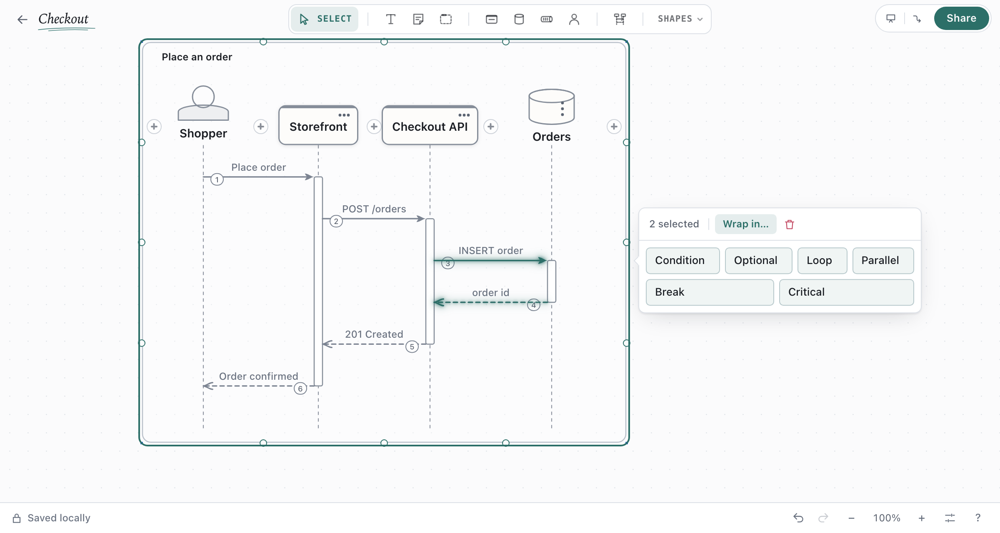
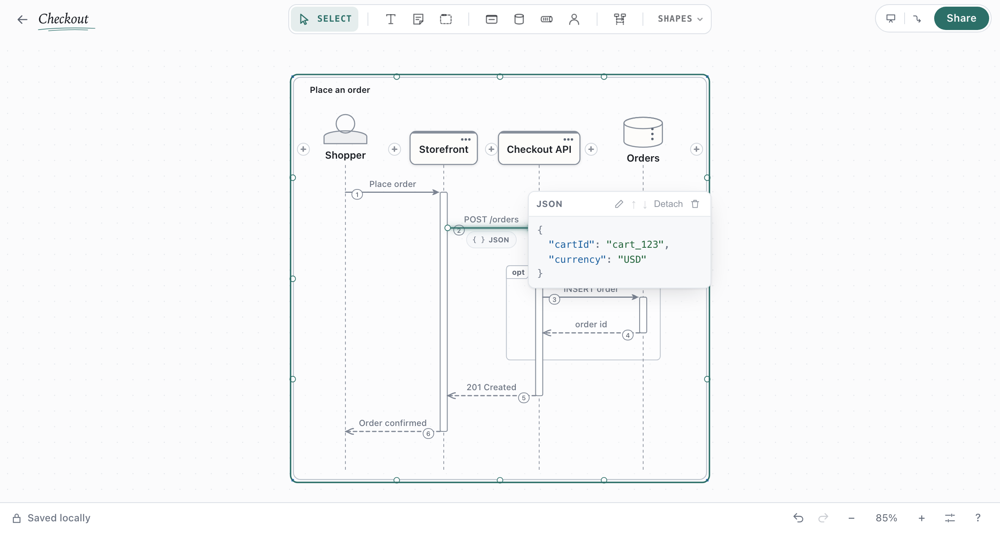
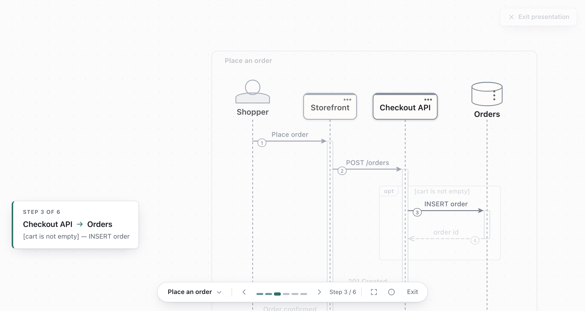

# Sequence diagrams

A **sequence** shows behaviour over time: who says what to whom, in what order, and under which
condition. It is one element on the canvas, beside your architecture, and it lays itself out. You
say who takes part and what happens; you never place a lifeline, size an arrow or draw a frame.

## Start one

Press `L`, or click **Sequence** in the toolbar and then click the canvas. The sequence starts
with **Participant 1**. Click **+** to add another participant anywhere along the row, with a
default name assigned immediately.

Double-click a participant to rename it. Press `Enter` or click away to save the name. While
editing, use the arrow keys to browse suggestions. Click an option to choose a participant
type, a matching technology, or [a shape already on the canvas](#use-shapes-from-your-architecture).

## Add messages

Drag from one lifeline to another, then type what the message says. The arrow follows the pointer,
the destination lifeline lights up, and a dot marks where the message will land.

New messages start with the same editable label as a canvas connection between those shapes.
For example, a service calling a data store starts with **reads / writes**. A cache starts with
**reads from**. Type to replace the label or press `Enter` to keep it.

By default, arrows are numbered in reading order. The numbers update when messages are inserted,
moved, or deleted. Click the sequence title or frame, then toggle **Message numbers** in the
inspector. Each sequence saves its own setting.

- Drag past the last participant until **Add participant** appears, then release to add a participant
  with a default name and write the message.
- Drag away and back onto the same lifeline for a message to itself.
- Hover between two participants and click **+** to add one there. The others make room.

Click the suggested message below the selection or press `Tab` to add it. Use `]` and `[` to
browse other suggestions, such as a reply, a call onward, or a call to itself.

A call starts work on its receiver, drawn as a bar on the lifeline. **Reply** puts the reply
below whatever that call set going, and ends the bar. Nothing is added that you did not ask for:
a reply is never inserted on its own.

To connect two sequences, drag from a lifeline in one frame to a participant's head or lifeline
in the other. The connector stays attached as you move either frame or reorder its participants.
Select it to edit its label as you would any canvas connector.

## Select and change

Click a participant, message, note or frame to select it; `Shift`-click extends the selection.
What you can do appears beside it and nowhere else.

| Selected | You can |
| --- | --- |
| Participant | Rename, change its colour, shape, kind or technology, link or unlink a shape, group, delete |
| Message | Edit, make it a **Call**, **Asynchronous**, **Reply**, **Create** or **Destroy**, reverse it, turn its work bar on or off, add a reply, add a timeline note, attach a note or code, duplicate, delete |
| Several messages | **Wrap in…** a condition, optional part, loop, parallel branches, break or critical section |
| Frame or branch | Change its kind, edit the condition, add, move or remove a branch, unwrap, delete |
| The sequence | Rename it, add a participant or a reference, present it |

The right-click menu and `⌘K` also offer message commands.

- **Reorder** by dragging a message or frame up or down, or a participant sideways. A move that
  cannot be right (a reply above its call, a message to something not yet created) is refused, and
  says why.
- **Change the sender or receiver** by selecting a message and dragging either end of its arrow
  to another participant's head or lifeline. The destination lifeline lights up, and the arrow
  snaps into place on release.
- **Asynchronous** is suggested, never assumed, where the receiver is usually sent to without
  waiting (a queue or topic). One click applies it.
- **Create** starts the receiver's lifeline at that message; **Destroy** ends it.
- A problem in the order (a reply with no call, a message after its participant ended) is marked
  with a small warning on its row. Select it to read what is wrong.

### Conditions, loops and parallel branches

Select the messages that belong together and choose **Wrap in…**.

| Frame | Means |
| --- | --- |
| **Condition** (`alt`) | One of several branches happens, each under its own condition |
| **Optional** (`opt`) | Happens only when the condition holds |
| **Loop** | Repeats while the condition holds |
| **Parallel** (`par`) | Branches that run at the same time, in no order |
| **Break** | If this happens, the rest is skipped |
| **Critical** | Must not be interleaved with anything else |
| **Reference** | Stands for another interaction, named but not drawn here |

Type the condition and press `Enter`. **Add branch** adds an *else* (or another parallel branch).
`Delete` on a frame removes the frame and keeps its messages; **Delete with its messages** removes
both.

### Notes and groups

**Timeline note** draws a note over one or two participants on its own row.

To keep supporting details on the arrow, select a message and choose **Attach** → **Attach note**
or **Attach code** to start typing. You can also drag an existing canvas note or code card onto
the arrow and release when **Attach to message** appears. Click a note or code chip below the arrow
to reopen its card. Cards stay with the message as you move it, and can be reordered, deleted or
detached onto the canvas. During a presentation, the current message’s chips open its cards for
reading.

`Shift`-click several neighbouring participants and choose **Group** to draw them under one name
(a subsystem, a team). A group says only that they belong together.

## Use shapes from your architecture

Drag a shape from the canvas over a sequence and rest it between two participants.

- A shape **that is part of a diagram** (connected, in a boundary, annotated or in a flow) stays
  where it is. The participant *stands for* it: rename either one, or change its kind, technology
  or colour, and the other follows. A small link mark shows on the participant.
- A shape **on its own** moves into the sequence. Nothing is left behind on the canvas.

A shape tool or key used over a sequence (`S`, `D`, `Q`, `A`, `M`, or a toolbar button) adds a
participant of that kind there.

With architecture shapes selected, `⌘K` → **Sequence from these** starts a sequence beside them
with one linked participant each, left to right. It adds no messages: order is never guessed from
connectors. **Unlink** on a participant lets the two go their own way. Deleting the shape keeps
the participant.

A [flow](flows-and-presentation.md) has an order you already gave it. `⌘K` → **Draw the flow as a
sequence** draws it beside the diagram, with participants that stand for the flow's shapes.

## Keyboard

`⌘↓` steps into the selected sequence; `Esc` steps back out.

| Key | Action |
| --- | --- |
| `⌥` + arrow | Move the selection to the next participant or message |
| `⌥⇧` + arrow | Extend the selection |
| Arrow | Move the selected message up or down, or the participant left or right |
| `Enter` or `F2` | Edit |
| `Tab`, `]` / `[` | Add the offered message; offer another |
| `P` | Add a participant after the selected one |
| `⌘D` | Duplicate |
| `⌘G` / `⌘⇧G` | Wrap messages or group participants / unwrap or ungroup |
| `Delete` | Delete; on a frame, unwrap |

## Present

Select the sequence and choose **Present this sequence** (also in `⌘K` and the right-click menu). It plays one
message at a time with the same keys as a [flow](flows-and-presentation.md#present): what has been
said stays, what is being said is lit, and the caption names the condition or branch it is in.
The lifelines stay visible throughout.

## Export and import

- **Images** (PNG, SVG) show sequences as drawn, including message numbers and connectors between
  frames.
- **Share → Export → Other formats → Sequences** writes each sequence, and each flow, as
  standalone **Mermaid** or **PlantUML**, with its conditions, loops, work bars and groups.
  Attached cards stay in the editable Draft Canvas file. The image exports show their chips.
- Paste or import a Mermaid `sequenceDiagram` to get an editable sequence. Anything it uses that
  is not drawn is listed. See the [Mermaid import reference](../reference/mermaid-import.md#sequence-diagrams).
- An [AI agent](connect-an-ai-agent.md) can add, read and change sequences when asked.

## Good to know

- A sequence is one shape on the canvas: move it, put it in a boundary, connect to it, copy and
  paste it, attach notes and [open points](open-points.md) to it. Resize it for more room; it
  never gets smaller than what it holds.
- Undo and redo work inside it. Naming a new participant or message is one step.
- Mermaid has no reference frame; one is exported as a note.
- draw.io export shows a sequence as a labelled box.
- While [collaborating live](collaborating.md), two people changing the same sequence at the same
  moment keep the later change; changes to different shapes never conflict.
- Copying a single message to the clipboard is not available; **Duplicate** is.
- A flow step can light a whole sequence, not one of its messages.
