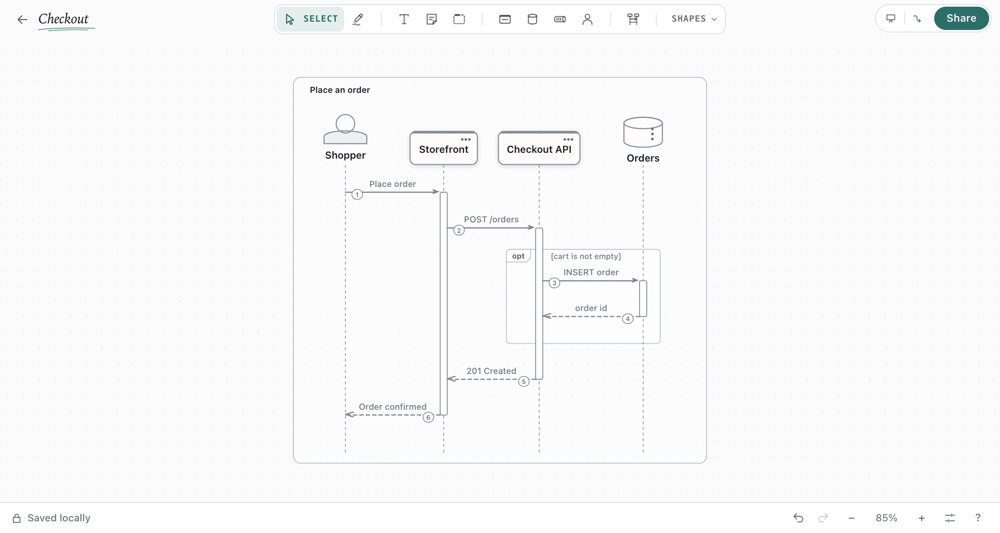
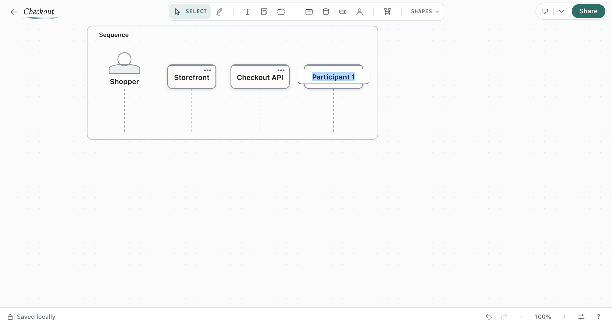
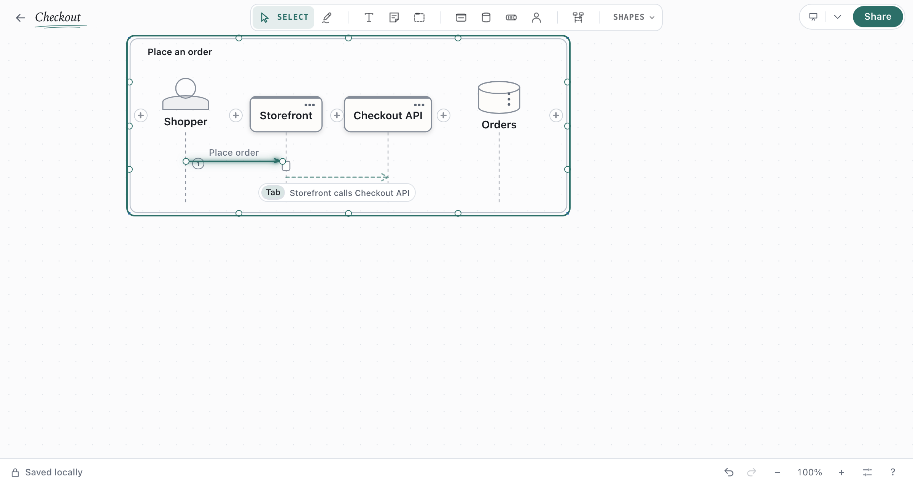
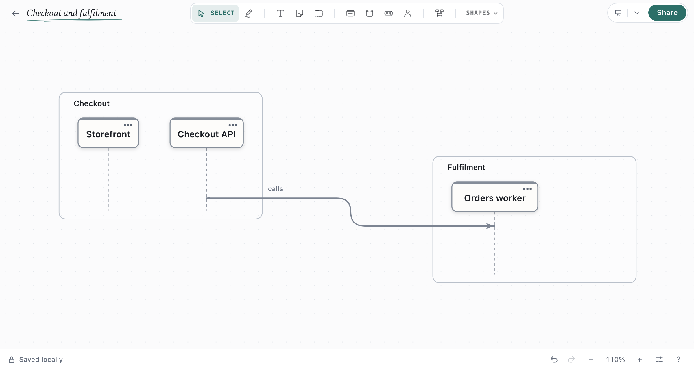
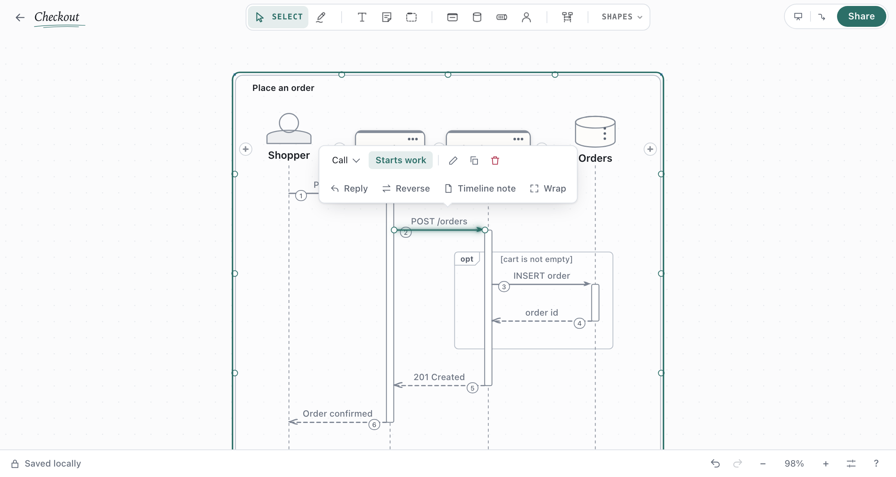
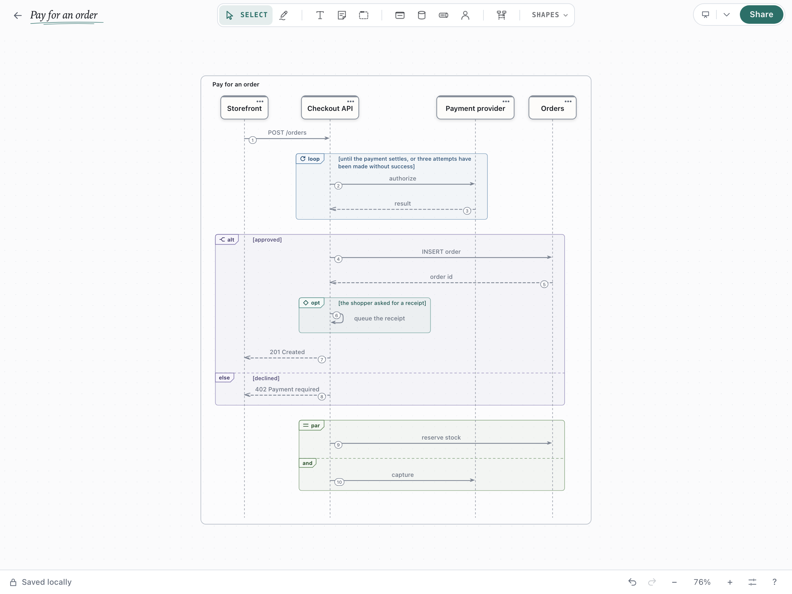
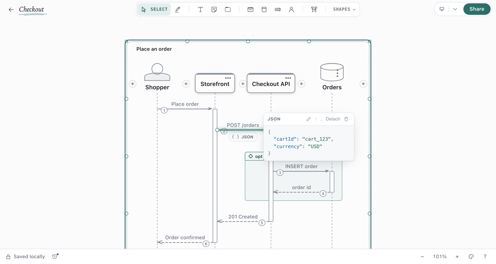
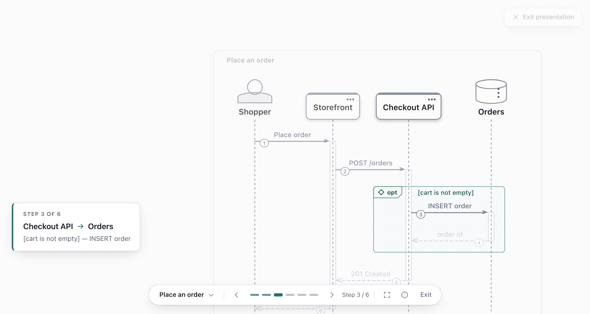

# Sequence diagrams

A sequence shows who says what to whom, in what order and under which condition. It sits on the
canvas beside your architecture and lays itself out.

Shortcuts use Mac keys. On Windows and Linux, use `Ctrl` for `⌘` and `Alt` for `⌥`.

## Start one

Press `L`, or click **Sequence** in the toolbar and then the canvas. To add a participant, click
**+** anywhere along the row of participants.

Double-click a participant to rename it. While you type, the arrow keys browse suggestions: a
participant type, a matching technology, or
[a shape already on the canvas](#use-shapes-from-your-architecture).

## Add messages

Drag from one lifeline to another, then type what the message says, or press `Enter` to keep the
suggested label.

- To add a participant with the message, drag past the last participant until **Add participant**
  appears.
- For a message to itself, drag away and back onto the same lifeline.
- To add the message offered below the selection, click it or press `Tab`. `]` and `[` browse other
  suggestions.

A call starts work on its receiver, drawn as a bar on its lifeline, and a reply ends it. Messages are
numbered in reading order; to hide the numbers, select the sequence and turn off **Message numbers**.

To connect two sequences, drag from a lifeline in one to a participant in the other. The connector
stays attached when either sequence moves.

### Replies

Drag back from whoever was called to whoever called it. While a reply is owed, the line turns dashed
and says **Reply to** the caller before you let go; otherwise the drag draws a call. Hold `⌥` to draw
a call anyway. With a call selected, `R` or **Reply** adds its reply.

## Select and change

Click a participant, message, note or frame to select it; `Shift`-click extends the selection. What
you can do appears beside it, and the right-click menu and `⌘K` offer message commands too.

| Selected | You can |
| --- | --- |
| Participant | Rename, change its colour, shape, kind or technology, link or unlink a shape, group, delete |
| Message | Edit, make it a **Call**, **Asynchronous**, **Reply**, **Create** or **Destroy**, reverse it, turn its work bar on or off, add a reply, add a timeline note, attach a note or code, duplicate, delete |
| Several messages | **Wrap in…** a condition, optional part, loop, parallel branches, break or critical section |
| Frame or branch | Change its kind, edit the condition, add, move or remove a branch, unwrap, delete |
| The sequence | Rename it, add a participant or a reference, present it |

- To reorder, drag a message or frame up or down, or a participant sideways. A move that can't be
  right, such as a reply above its call, is refused with the reason.
- To change a message's sender or receiver, select it and drag either end of its arrow to another
  participant.
- **Create** starts the receiver's lifeline at that message; **Destroy** ends it.
- A problem in the order, such as a reply with no call, shows a warning on its row. Select it to read
  what is wrong.

### Conditions, loops and parallel branches

Select the messages that belong together, choose **Wrap in…**, then type the condition and press
`Enter`.

| Frame | Means |
| --- | --- |
| **Condition** (`alt`) | One of several branches happens, each under its own condition |
| **Optional** (`opt`) | Happens only when the condition holds |
| **Loop** | Repeats while the condition holds |
| **Parallel** (`par`) | Branches that run at the same time, in no order |
| **Break** | If this happens, the rest is skipped |
| **Critical** | Must not be interleaved with anything else; each *option* branch says what happens instead |
| **Reference** | Stands for another interaction, named but not drawn here |

**Add branch** adds an *else* (another parallel branch, or an *option* in a critical section).
`Delete` on a frame removes the frame and keeps its messages; **Delete with its messages** removes
both.

### Notes and groups

**Timeline note** draws a note over one or two participants, on its own row.

To attach detail to a message, right-click it and choose **Attach note** or **Attach code**, or drag
a canvas note or code card onto the arrow until **Attach to message** appears. Click a chip below the
arrow to reopen its card. Cards move with the message, and the current message's cards open while
presenting.

To group neighbouring participants under one name, such as a team, `Shift`-click them and choose
**Group**.

## Use shapes from your architecture

Drag a shape from the canvas over a sequence and rest it between two participants:

- A shape that is part of a diagram (connected, in a boundary, annotated or in a flow) stays where it
  is. The participant stands for it: rename either one, or change its kind, technology or colour, and
  the other follows.
- A shape on its own moves into the sequence.

A shape key (`S`, `D`, `Q`, `A`, `M`) or toolbar button used over a sequence adds a participant of
that kind.

With shapes selected, **Sequence from these** in `⌘K` starts a sequence beside them with one linked
participant each. It adds no messages, because order is never guessed from connectors. **Unlink** on
a participant separates the two; deleting the shape keeps the participant.

A [flow](flows-and-presentation.md#draw-a-flow-as-a-sequence) already has an order, so
**Draw the flow as a sequence** in `⌘K` can draw it for you.

## Keyboard

`⌘↓` steps into the selected sequence; `Esc` steps back out.

| Key | Action |
| --- | --- |
| `⌥` + arrow | Move the selection to the next participant or message |
| `⌥⇧` + arrow | Extend the selection |
| Arrow | Move the selected message up or down, or the participant left or right |
| `Enter` or `F2` | Edit |
| `Tab`, `]` / `[` | Add the offered message; offer another |
| `P` | Add a participant after the selected one |
| `R` | Add the reply to the selected call |
| `⌘D` | Duplicate |
| `⌘G` / `⌘⇧G` | Wrap messages or group participants / unwrap or ungroup |
| `Delete` | Delete; on a frame, unwrap |

## Present

Select the sequence and choose **Present this sequence** (also in `⌘K` and the right-click menu). It
plays one message at a time, with the [same keys as a flow](flows-and-presentation.md#present). The
caption names the condition or branch of the current message.

## Export and import

- PNG and SVG images show sequences as drawn, with message numbers and connectors between sequences.
- A sequence is saved in the `.draftcanvas` file, which is how to hand one on for editing. Draft
  Canvas does not export Mermaid or PlantUML text.
- Paste or import a Mermaid `sequenceDiagram` to get an editable sequence; anything not drawn is
  listed. See the [Mermaid import reference](../reference/mermaid-import.md#sequence-diagrams).
- [Your coding agent](connect-an-ai-agent.md) can add, read and change sequences.

## Good to know

- A sequence is one shape on the canvas: move it, put it in a boundary, connect to it, copy it, or
  attach notes and [open points](shapes-and-connectors.md#open-points).
- Long text wraps and the sequence makes room. The canvas and images cut a message at 8 lines, a
  condition at 6, a note at 16 and the title at 3, ending with "…". The diagram keeps the whole text.
- When [collaborating live](collaborating.md), if two people change the same sequence at once, the
  later change wins.
- A single message can be duplicated but not copied to the clipboard.
- A flow step can light a whole sequence, not one of its messages.
