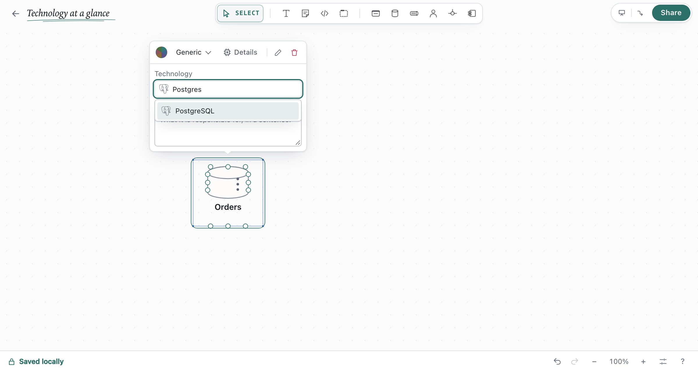
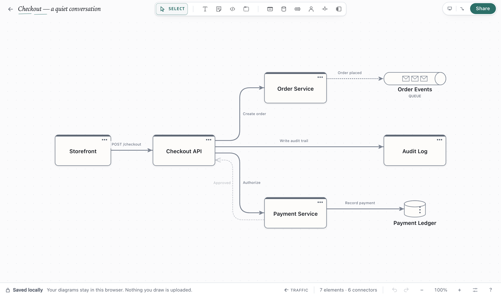
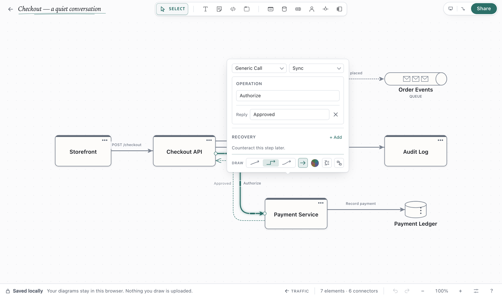
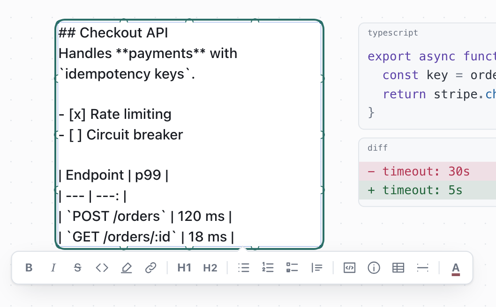

# Shapes, connectors and boundaries

Shortcuts use Mac keys. On Windows and Linux, use `Ctrl` for `⌘` and `Alt` for `⌥`.

## Shapes and kinds

Press a key to add a shape. Select it to choose a kind in its toolbar.

| Shape | Key | Kinds |
| --- | --- | --- |
| Service | `S` | Generic, API, Worker, External, Scheduler, Gateway |
| Data Store | `D` | Generic, SQL, NoSQL, Cache, File System, Object Storage, Search Index, Table |
| Queue | `Q` | Queue, Topic, Stream |
| Actor | `A` | Human, System, Device, Group, Third Party, AI Agent |
| Component | `M` | Generic, Module, Adapter, Port |
| Junction | `J` | |
| Boundary | `B` | See [Boundaries](#boundaries) |
| Text / Note / Code | `T` / `N` / `C` | |

Use **External** for a service you do not own. **Actor frame → Framed** outlines an actor. Drag an
actor's corner resize handle to grow its glyph and box together.
Queue and Data Store artwork also grows when you drag a corner resize handle.

## Names and technology

- Rename: double-click, or select and press `Enter`.
- A label cut short? Run **Fit shapes to text** from `⌘K`.
- Technology: click **Tech** on the selected shape, then enter a name. `Postgres` or `Rust 1.90`
  work; the shape shows a matching icon. Edit and delete are directly beside the shape's kind.
  Small marks and simple notes get a content-sized card. Drag the card's top edge to move it
  out of the way; click empty canvas to dismiss it. Resize the description box from its lower-right
  corner. Right-click for attachment, copy and other actions.

## Connect shapes

- Drag from a shape's edge dot onto another shape, or onto empty space to create one.
- Keyboard: select a shape and run **Connect to…** from `⌘K`.
- Click a connector to change its relationship
  ([rules](../reference/semantics.md#the-capability-matrix)). Drag its end to reconnect it.

Hovering a connector briefly traces the request and then its reply, once. The canvas stays still
otherwise, and reduced-motion preferences turn the trace off.

The default, **Sculpted Ink**, uses sweeping corners and a carved arrowhead. Replies use a lighter dashed return
rail, with each caption outside its own line. Two differently named operations keep separate exits;
a repeated relationship can share a trunk. These details also appear in SVG and PNG exports.

## Pinned and automatic ends

An automatic end faces the shape it joins and turns to follow it as shapes move. A pinned end keeps its
side and point. When facing sides overlap enough, automatic ends line up across their shared band
for a short, straight connection. If another shape blocks the approach, an automatic end can slide
to a nearby clear point on the same side. Pins, hand-placed bends and shared attachment slots stay fixed.

| Draw it | The end is |
| --- | --- |
| Drawn from any dot | Automatic |
| Dropped on a shape or a dot | Automatic |
| Reconnected to a shape or a dot | Automatic at the reconnected end |
| Set with **Pin ends here** | Pinned at its drawn position |

A selected connector shows a pinned end filled and an automatic end as a ring. Its inspector also
shows **Fixed start**, **Fixed end** or **Fixed ends**, with **Auto attach** to let them follow
the shapes again. Right-click a connector
→ **Auto attach start**, **Auto attach end**, **Auto attach both ends** or **Pin ends here**.
**Auto attach all connectors** (`⌘K`) frees every end in the view, including the pins of diagrams
drawn before automatic ends existed.

Connectors route around shapes. When no clear line exists, such as from pins facing away from each other, the line is
drawn anyway and its toolbar says so, with **Auto attach** to fix it.

## Bend a connector by hand

Select a connector, then:

| Style | Edit the route |
| --- | --- |
| **Stepped** | Drag a bar on a straight run sideways. |
| **Straight / Curved** | Drag a faint dot to add a bend, drag a square to move it, double-click a square to remove it. |

Right-click → **Reset route** restores automatic routing. **Tidy connectors** (`⌘K`) resets all.

## Sync, async and the reply

Between two services, choose **HTTP** or **Generic Call**, then describe the request. For HTTP,
pick a method and enter the path. **Sync** and **Async** sit beside Protocol. Choose **Add reply**
for an editable return path with a suggested response. Async shows a break mark and has no reply.
The drawing rail shows straight, stepped and curved routes as small
previews you can choose with one click, beside arrowhead, colour, condition and flow controls. The
colour wheel means automatic colour, as it does for shapes; click it to choose a fixed colour. Click
the condition icon to edit a condition without making the inspector taller. Hover an icon to see
what it does.

**Settings → Canvas → Drawing style** controls shapes and connectors together. **Clean** uses the
Sculpted Ink default; **Draft** adds a restrained hand-drawn quality, and **Sketch** adds visible
graphite drift and retraced strokes. This device preference applies to every diagram and its exports,
without changing the diagram or its undo history. Connector colours follow the theme and their
semantic accents.

To show how a successful step could be counteracted later in a workflow, select its connector and
choose **+ Add** in Recovery, then click the shape that should receive the recovery action. A
temporary arrow follows your pointer; press `Esc` to cancel. The new dashed arrow stays on the
canvas. Hover either arrow to see the linked pair glow; hovering the recovery arrow also shows the
original call in a small canvas tooltip. Click the recovery arrow to name the business action and
edit its protocol and operation in the compact companion card. The arrow shows the action name and
operation together when both are set. Its editor clears the canvas while you drag a recovery arrow's
bend or endpoint, then returns when you release it.
Drag the top edge of the main popup; the counteraction card and linking thread move with it.
Click empty canvas to dismiss both.
The route is chosen from the canvas and can still be changed there.
You can add several actions to one step. A compensation is a business operation, not an automatic
HTTP retry or a claim that the earlier state is restored exactly.

An AI agent using Draft Canvas MCP, including Nodi, can make the same association. Add a
`compensates` relationship with `compensationFor` set to the original connector id; use
`compensationName` for the business action, `label` for its operation, and
`compensationProtocol` for `http`, `calls` or `grpc`. `read_diagram` returns the association, and
`update_diagram` can edit or fold the recovery arrow with `compensationVisible: false`.

## More connector tools

- **Attach note** / **Attach code** (right-click), or drag a note onto the line and hold.
- **Add DLQ** on a Queue adds a dead-letter queue; click its connector to set delivery attempts.
- A Junction (`J`) shares a route. Right-click a bundle → **Convert to junction**.

## Boundaries

Select shapes and press `⌘G`, or press `B` and drag shapes in. Contents move, copy and delete
with the boundary. Pick a kind and colour in its toolbar:

| Kind | For |
| --- | --- |
| Boundary | A general frame |
| Group | Shapes that belong together for this explanation |
| System | One software system |
| Domain | A shared domain responsibility |
| Network | A network scope |
| Deployment | A runtime or hosting scope |

Kinds change the look only.

## Write rich text

Press `T`, then `Enter` to edit Markdown. **Aa** sets font, alignment and background
(**Card**, **Marker**, **Banner**).

| Write | Get |
| --- | --- |
| `#`, `##`, `###` | Headings |
| `**bold**`, `_italic_`, `~~struck~~`, `==highlight==` | Emphasis |
| `` `code` ``, fenced block with a language | Code |
| `- item`, `1. step`, `- [ ] todo` | Lists |
| `> quote`, `> [!WARNING]` | Quote, callout (NOTE, TIP, IMPORTANT, WARNING, CAUTION) |
| `\| A \| B \|` + `\| --- \| --- \|` | Table |
| `---` | Divider |
| `[words](https://…)`, `[words]{.rose}` | Link, coloured words |

| Keys while editing | Does |
| --- | --- |
| `⌘B` `⌘I` `⌘E` `⌘⇧X` `⌘⇧H` `⌘K` | Bold, italic, code, strikethrough, highlight, link |
| `⌘⇧8` `⌘⇧7` `⌘⇧9` | Bulleted, numbered, checklist |
| `⌘⌥1`–`⌘⌥3` | Heading 1–3 |

[Preview formatting examples.](../media/guides/rich-text.png)
