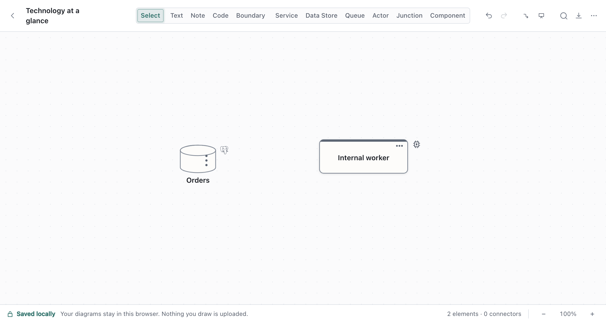

# Shapes, connectors and boundaries

Draft Canvas knows what its shapes are. A Queue is not a rectangle with a caption: it is something a
Service hands work to and a Worker consumes from, and the connectors between them say so without you
typing it. This guide is about using that: picking the right kind of shape, saying what an arrow
means, showing the reply, and marking the failure path.

Shortcuts are written for a Mac. On Windows and Linux, read `⌘` as `Ctrl`.

## Technology and description

Select an architecture shape and open **Details** to set **Technology** and **Description**.
As you type, matching names appear with their Simple Icons. Choose a suggestion with the pointer,
or use the arrow keys and Enter. Escape closes suggestions; Enter without a matching suggestion
or leaving the field keeps your custom value. A version you have already typed is preserved when
you choose a matching name: **Postgres 16** becomes **PostgreSQL 16**.

Every nonempty technology appears as a small, unframed icon beside the shape's upper-right corner;
for a Data Store, it sits beside the symbol. Recognized names use their brand logo; custom names
and mixed stacks such as **Node.js / React** use a neutral chip. Click the icon, or focus it and
press Enter, to read the complete technology and version. The name, kind and description stay
visible. Clear the Technology field to remove the icon.

The bundled catalog includes PostgreSQL (also **Postgres**), MySQL, MariaDB, MongoDB, Redis, SQLite,
Node.js, Python, Spring Boot, .NET, RabbitMQ, Apache Kafka, React, NGINX, Docker, Kubernetes, Go and
TypeScript. Names are case-insensitive, and a trailing version such as **PostgreSQL 16** is recognized.
Suggestions advertise only this bundled catalog; free text is always allowed.

Brand logos come from [Simple Icons](https://github.com/simple-icons/simple-icons). All icons are
bundled with the app and work offline on the canvas and in image exports. The full technology
remains in saved files and architecture source exports. Technology never changes a shape's kind
or its relationships.

## Pick the right kind

Every architecture shape has a **kind**, one step sharper than the shape. Select a shape and choose it
from the bar that appears; the silhouette changes so the kind can be read from across the room.

| Shape (key) | Kinds |
| --- | --- |
| Service (`S`) | Service, API, Worker, External System, Scheduler, Gateway |
| Data Store (`D`) | Database, SQL, NoSQL, Cache, File system, Object storage, Search index, Table |
| Queue (`Q`) | Queue, Topic, Stream |
| Actor (`A`) | Human, System, Device, Group, Third Party |
| Component (`M`) | Component, Module, Adapter, Port |

The kind decides which relationships the shape can have. A Service *reads / writes* its Database and
*invalidates* a Cache; a Topic *fans out* to queues and a Queue is *consumed by* a worker. The full
table is in [Architecture semantics](../reference/semantics.md#the-capability-matrix).

An **External System** is a Service you don't own: a payment provider, an email service. It carries an
EXTERNAL caption and takes the same connectors a Service does.

## Keep names readable

Double-click a shape or select it and press `Enter` to edit its name where the label is drawn.
Press `Enter` to keep the name, or `Escape` to cancel the rename.

Long architecture names grow their shapes as you edit them; boundary headings gain width. Names in
the toolbar, panels and menus wrap so you can read the full name.

For an existing small shape whose label is shortened, select it and choose **Fit shapes to text**
from the command palette (`⌘K`). You can fit several selected shapes at once. The change keeps their
positions and membership and can be undone in one step.

## Say what the arrow means

Drag from a shape's handle onto another shape to connect them. The connector labels itself with the
most likely relationship for that pair, reading in the direction of the arrow: `Orders API`
*sends command to* `orders`, and `orders` is *consumed by* `Fulfilment worker`.

Hold `Shift` while clicking shapes or connectors to add them to or remove them from the selection.
A connector can be selected alongside shapes without selecting both of its endpoints.

To change it, click the connector. Its popover lists only the relationships that make sense for those
two shapes, with the current one marked. Nothing stops you drawing something unusual on purpose: a
pairing the matrix has an opinion about shows a small ▲ and still offers *depends on*.

## Bend a connector by hand

Connectors route themselves, and re-route as you move shapes. When a line doesn't go where you want
— it crowds a label, takes the long way round, or an agent drew it somewhere awkward — select it and
drag it into place:

- A **Stepped** connector shows a small bar on each straight run. Drag one sideways to move that run;
  the runs either side stretch to follow, so the line stays square. A run snaps level with the ends
  and with the line's other runs, which is how a jog comes back out.
- A **Straight** or **Curved** connector shows a square on each bend and a faint dot between any two
  points. Drag a dot to add a bend, drag a square to move it, and double-click a square to remove it.

The ends still follow their shapes. Move both shapes together and the bends come along; move one and
the line re-squares itself to meet it. Each drag is one undo step.

To hand a connector back to automatic routing, right-click it and choose **Reset route**. **Tidy
connectors** in the command palette (`⌘K`) does the same for every connector at once.

## Sync, async and the reply

Between two Services, the popover's **Interaction** section chooses the protocol (**HTTP** or a
**Generic Call**) and the mode:

- **Sync** draws a solid line: the caller waits.
- **Async** draws a dashed line with a break mark: the caller carries on. Right-click a connector and
  choose **Make asynchronous** to toggle the same thing without opening the popover.

Turn **Response** on to draw the reply coming back along the same connector, with its own text
(`200 OK`, `order accepted`). **Guess** fills in a sensible status for the protocol. An asynchronous
call has no response line; switching a connector to Async removes it.

## Put a note or payload on a connector

Notes and Code shapes dock onto connectors the same way they dock onto shapes: drag one over the
line and hold until it snaps into a chip. Use a Code chip for the payload or the message schema, and
a Note for why the call is there. Click the chip to read or edit it; drag it off to make it a
free-standing shape again.

Right-click a connector for the same two, created already docked.

## Mark the failure path

A queue whose messages can fail needs somewhere for them to land. Select a Queue and choose **Add
DLQ** (in the popover, the right-click menu or the palette). Draft Canvas adds a dead-letter queue
beside it, connected with a dashed *dead-letters to* connector. Click that connector to set how many
deliveries are attempted before a message is parked; the default is three.

A Topic never dead-letters: retries and a DLQ belong to each subscriber's own queue, which is what
the suggestion after a Topic offers.

## Branch through a junction

When one source reaches several targets along the same route, press `J` to drop a **Junction**, a
small point you connect through. Connectors into and out of a junction keep the relationship of the
shapes on either side; the junction itself adds no meaning. A bundle of connectors that already
share a route can become one: right-click it and choose **Convert to junction**.

## Boundaries

A boundary is a frame around shapes that share a scope. Select shapes and press `⌘G`, or press `B`
for an empty one and drag shapes in. Pick the boundary's kind (Boundary, Group, System, Domain,
Network, Deployment) in its bar; each has its own outline so it reads without the label. The
[getting started guide](getting-started.md#draw-a-boundary) walks through them.

## Where next

- [Explain a system at different levels](depth.md): keep the overview small and draw the detail
  inside a shape, C4-style.
- [Flows and presenting](flows-and-presentation.md): tell the story one step at a time.
- [Architecture semantics](../reference/semantics.md): every relationship the matrix offers, and why.
