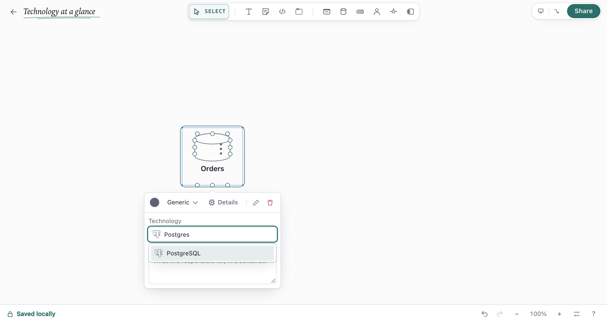
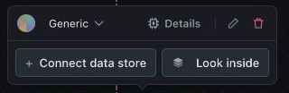
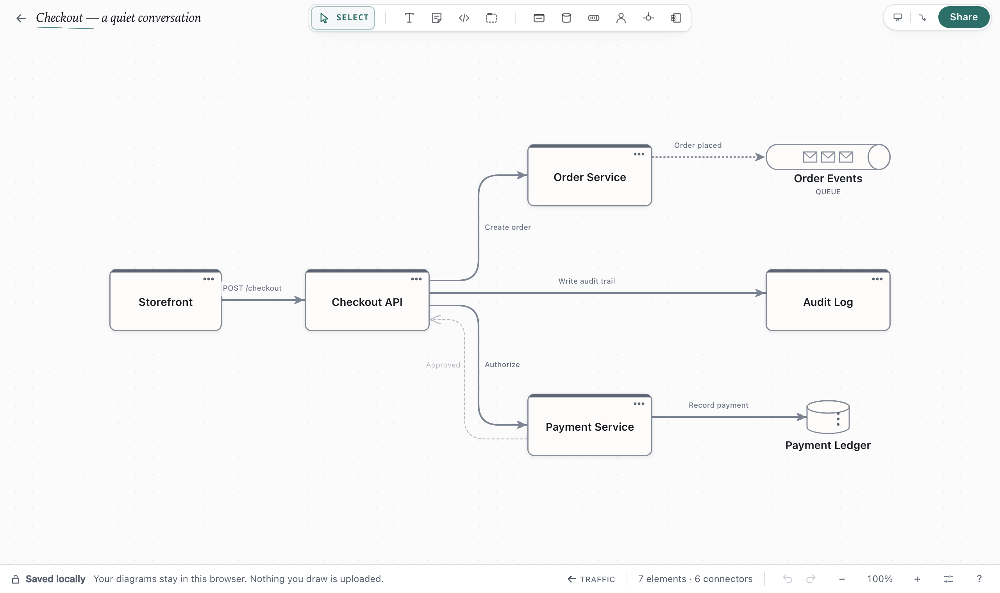
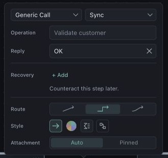
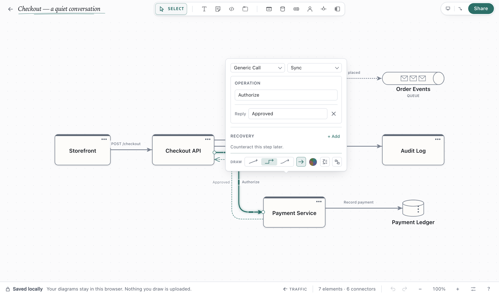
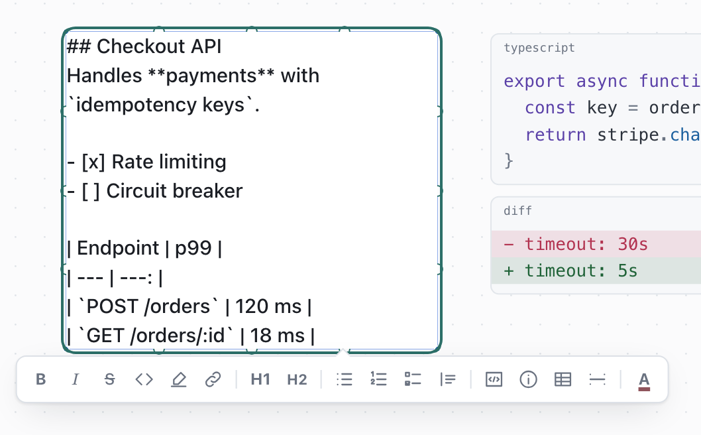

# Shapes, connectors and boundaries

Shortcuts use Mac keys. On Windows and Linux, use `Ctrl` for `⌘` and `Alt` for `⌥`.

## Shapes and kinds

Press a key to add a shape, or pick one from the toolbar. The toolbar keeps the shapes most diagrams
use; **Shapes** at its end lists every one by name, with what it is for and its key, and finds a
shape by any name you'd use for it (`cache`, `user`, `topic`). Type a technology and it offers the
shape that technology is: `kafka` gives a Queue that arrives as an Apache Kafka topic, `redis` a
Data Store that is a cache, `s3` object storage, each with its logo where there is one. A language
or framework (`spring`, `rust`, `node`) gives a Service built with it. Select a shape to choose a
kind in its toolbar.

| Shape | Key | Kinds |
| --- | --- | --- |
| Service | `S` | Generic, API, Worker, External, Scheduler, Gateway |
| Data Store | `D` | Generic, SQL, NoSQL, Cache, File System, Object Storage, Search Index, Table |
| Queue | `Q` | Queue, Topic, Stream |
| Actor | `A` | Human, System, Device, Group, Third Party, AI Agent |
| Component | `M` | Generic, Module, Adapter, Port |
| Junction | `J` | |
| Boundary | `B` | See [Boundaries](#boundaries) |
| Text / Note / Code | `T` / `N` / `C` | |

To turn a shape into another, select it and press `Shift` with the new shape's key: `⇧Q` makes it a
Queue, `⇧D` a Data Store, and so on for Service, Actor and Component. Its name, connectors, flows
and notes stay; connectors whose meaning was inferred are inferred again. **Turn into…** in `⌘K`
does the same.

Use **External** for a service you do not own. **Actor frame → Framed** outlines an actor. Drag an
actor's corner resize handle to grow its glyph and box together.
Queue and Data Store artwork also grows when you drag a corner resize handle.

## Names and technology

- Rename: double-click, or select and press `Enter`.
- A label cut short? Run **Fit shapes to text** from `⌘K`.
- Technology: click **Details** on the selected shape, then enter a name. `Postgres` or `Rust 1.90`
  work; the shape shows a matching icon. Once assigned, its technology name replaces Details.
  The same panel edits the description. Edit and delete are directly beside the shape's kind.
  Small marks and simple notes get a content-sized card. Drag the card's top edge to move it
  out of the way; click empty canvas to dismiss it. Resize the description box from its lower-right
  corner. Right-click for attachment, copy and other actions.
- A known product also sets the kind, as long as you haven't picked one: Redis or Memcached makes a
  Data Store a Cache, PostgreSQL makes it SQL, Kafka or SNS makes a Queue a Topic, Kinesis a Stream,
  and Stripe or Twilio makes a Service External. A kind you choose yourself always stays.
- Instances: type `×3` (or `x3`) after a Service's name, or use **− ×1 +** in its toolbar. It draws
  as a stack with a small ×3, and [Traffic](traffic.md) reads it.

## Line things up

Dragging does most of the lining up for you:

- A shape joined to another snaps to where their connector runs perfectly straight. The line goes
  through each shape's own middle: a queue's tube or a Data Store's cylinder, not the box around it.
  This catches from a little further away than the other snaps and wins over them.
- It also snaps to its neighbours' edges and centres, and to an equal gap: when the space to a
  neighbour matches a gap already in the row or column, both gaps are marked with their size.

For more, select shapes and use the bar at the bottom: **Align**, **Distribute** (three or more),
and **Same width** / **Same height**, which give every selected shape the largest size among them.
A boundary selected with shapes keeps its size; select only boundaries to match them.

**Tidy up** is the one to reach for first. Run it from `⌘K` or by right-clicking the canvas. It
keeps every shape where you put it and fixes only what looks untidy: a connector that just misses
running level is straightened by nudging a shape a few pixels, and a connector drawn through a
shape is re-attached so it goes round. Before anything changes you see the result laid over the
diagram, with a faint outline where each nudged shape stands now. **Apply** (`Enter`) makes it one
undo step; **Cancel** (`Esc`) leaves the diagram as it was.

With shapes selected, **Tidy up selection** touches only those shapes and their connectors. After
adding a service or two, select them and tidy that corner; the rest of the diagram stays exactly
as it is.

The tools it draws on are still in `⌘K` for when you want one of them alone. **Straighten
connectors** does only the nudging. **Arrange diagram** (**Rearrange layout** on right-click) is the
bigger tool: it lays the whole view out again from scratch, so expect shapes to move.

Arrange shows its result first too, with the reading direction to choose: **Across →** or
**Down ↓**. It starts on the suggested one, the way the diagram reads now unless the other way reads
clearly better or, for a big diagram, fits a wide screen clearly better. Boundaries keep what they
hold and notes stay beside their shapes. A long name gets a wider box so it reads in two lines, and
the gap between two rows is only as long as its captions need. **Apply** makes it one undo step;
**Cancel** keeps your own layout. With shapes selected, **Rearrange selection** lays out only those,
in the direction the rest of the diagram reads.

## Connect shapes

- Drag from a shape's edge dot onto another shape, or onto empty space to create one.
- Several shapes selected? Drag from any one of their dots onto a shape to connect all of them to
  it at once — a faint line from each shows what the drop will do.
- Keyboard: select a shape and run **Connect to…** from `⌘K`.
- Click a connector to change its relationship
  ([rules](../reference/semantics.md#the-capability-matrix)). Drag its end to reconnect it.

Hovering a connector briefly traces the request and then its reply, once. The canvas stays still
otherwise, and reduced-motion preferences turn the trace off.

The default, **Sculpted Ink**, uses sweeping corners and a carved arrowhead. Replies use a lighter dashed return
rail, with each caption outside its own line. Two differently named operations keep separate exits;
a repeated relationship can share a trunk. These details also appear in SVG and PNG exports.

A caption sits on its connector's longest straight stretch, never on a short jog or over the
arrowhead. One too long for its line is cut short; hover it to read the whole caption.

## Pinned and automatic ends

An automatic end faces the shape it joins and turns to follow it as shapes move. A pinned end keeps its
side and point. When facing sides overlap enough, automatic ends line up across their shared band
for a short, straight connection. If another shape blocks the approach, an automatic end can slide
to a nearby clear point on the same side. Pins, hand-placed bends and shared attachment slots stay fixed.

An automatic end also picks a better side when the facing one makes a mess. A connector that would
cross another connector, cut through a shape or take a long way round one tries the other sides of
its two shapes and takes the cleanest line: an elbow out of the bottom instead of a step across
three arrows, or a loop round the outside instead of a path through the middle. It happens as you
draw and each time you drop a shape; while you drag, the lines of the shape in your hand follow it
the plain way and settle when you let go. A connector with nothing wrong is never moved. To keep an
end where it is whatever happens around it, pin it.

| Draw it | The end is |
| --- | --- |
| Drawn from any dot | Automatic |
| Dropped on a shape or a dot | Automatic |
| Endpoint dragged to a side or attachment dot | Pinned at that side and nearest attachment point |
| Endpoint dragged to the center of a shape | Automatic at the reconnected end |
| Set with **Pin ends here** | Pinned at its drawn position |

While dragging an endpoint over a valid target, its attachment dots stay visible and the targeted dot fills in so you can choose a pin.
Moving to the center clears the dot highlight to indicate automatic attachment.

A selected connector shows a pinned end filled and an automatic end as a ring. Its inspector also
shows **Attachment · Auto / Pinned**. **Pinned** means at least one end is fixed; choosing it from
Auto fixes both ends where they are. Choose **Auto** to let both ends follow the shapes again.
Right-click a connector
→ **Auto attach start**, **Auto attach end**, **Auto attach both ends** or **Pin ends here**.
**Auto attach all connectors** (`⌘K`) frees every end in the view, including the pins of diagrams
drawn before automatic ends existed.

Connectors route around shapes. When no clear line exists, such as from pins facing away from each other, the line is
drawn anyway and its toolbar says so, with **Auto attach** to fix it.

## Bend a connector by hand

Select a connector, then:

| Style | Edit the route |
| --- | --- |
| **Stepped** | Drag a bar on a straight run sideways. |
| **Straight / Curved** | Drag a faint dot to add a bend, drag a square to move it, double-click a square to remove it. |

**Reset route**, beside the route styles or on right-click, restores automatic routing. Switching a
bent connector between Stepped and Straight or Curved starts its route afresh. **Tidy connectors**
(`⌘K`) resets all.

## Sync, async and the reply

Between two services, choose **HTTP** or **Generic Call**, then describe the request. For HTTP,
pick a method and enter the path. **Sync** and **Async** sit beside Protocol. Choose **Add reply**
for an editable return path with a suggested response. Async shows a break mark and has no reply.
Operation and Reply share an aligned field column. Recovery keeps its add action and explanation
compact. The Route row shows straight, stepped and curved previews; Style groups arrowhead, colour,
condition and flow controls. Attachment switches between Auto and Pinned. The
colour wheel means automatic colour; click it to choose a fixed colour. A shape has no automatic
colour: unset, it shows the default colour. Click
the condition icon to edit a condition without making the inspector taller. Hover an icon to see
what it does.

**Settings → Canvas → Drawing style** controls shapes and connectors together. **Clean** uses the
Sculpted Ink default; **Draft** adds a restrained hand-drawn quality, and **Sketch** adds visible
graphite drift and retraced strokes. This device preference applies to every diagram and its exports,
without changing the diagram or its undo history. Connector colours follow the theme and their
semantic accents.

To show how a successful step could be counteracted later in a workflow, select its connector and
choose **+ Add** in Recovery, then click the shape that should receive the recovery action. A
temporary arrow follows your pointer; press `Esc` to cancel. The new dashed arrow stays on the
canvas. Hover either arrow to see the linked pair glow; hovering the recovery arrow also shows the
original call in a small canvas tooltip. Click the recovery arrow to name the business action and
edit its protocol and operation in the compact companion card. The arrow shows the action name and
operation together when both are set. Its editor clears the canvas while you drag a recovery arrow's
bend or endpoint, then returns when you release it.
Drag the top edge of the main popup; the counteraction card and linking thread move with it.
Click empty canvas to dismiss both.
The route is chosen from the canvas and can still be changed there.
You can add several actions to one step. A compensation is a business operation, not an automatic
HTTP retry or a claim that the earlier state is restored exactly.

An AI agent using Draft Canvas MCP, including Nodi, can make the same association. Add a
`compensates` relationship with `compensationFor` set to the original connector id; use
`compensationName` for the business action, `label` for its operation, and
`compensationProtocol` for `http`, `calls` or `grpc`. `read_diagram` returns the association, and
`update_diagram` can edit or fold the recovery arrow with `compensationVisible: false`.

## More connector tools

- **Attach note** / **Attach code** (right-click), or drag a note onto the line and hold.
- **Add DLQ** on a Queue adds a dead-letter queue; click its connector to set delivery attempts.
  DLQs use a muted amber outline and message icon by default, with a neutral fill. This identifies
  the recovery role, not a live error. Any explicit colour choice overrides the default.
- A Junction (`J`) shares a route. Right-click a bundle → **Convert to junction**.
- **Put a shape in between**: drag a shape with no connectors of its own onto a connector, or place
  one there with a shape tool. `Orders API → Billing` with a Queue dropped on it becomes
  `Orders API → orders → Billing`, both lines dashed and captioned for what they now join. Works for
  Queues, Data Stores, Services, Components and Junctions; the label, notes and flow steps stay.
- **Data pipelines**: draw arrows the way the data moves. A Data Store drawn into what reads it
  reads "read by", and a Table drawn into the next Table is `transforms`. A data connector's panel
  has **Cadence** (Streaming, Hourly, Daily, Weekly, On demand), shown as a small chip under its
  caption.
- **Show lineage** (right-click a shape, or `⌘K`): everything its data comes from and everything it
  feeds stays lit, whichever way each arrow is drawn. `Esc` ends it.
- **Take one out**: select it and press `⌥⌫` (**Delete and join connectors**). `Client → Gateway → API`
  becomes `Client → API`, keeping its flows. A shape with several ways in *and* out has no single way
  to join, so `⌥⌫` leaves it; plain `⌫` deletes it.

## Boundaries

Select shapes and press `⌘G`, or press `B` and drag shapes in. Contents move, copy and delete
with the boundary. Pick a kind and colour in its toolbar:

| Kind | For |
| --- | --- |
| Boundary | A general frame |
| Group | Shapes that belong together for this explanation |
| System | One software system |
| Domain | A shared domain responsibility |
| Network | A network scope |
| Deployment | A runtime or hosting scope |

Kinds change the look only.

## Write rich text

Press `T`, then `Enter` to edit Markdown. **Aa** sets font, alignment and background
(**Card**, **Marker**, **Banner**).

| Write | Get |
| --- | --- |
| `#`, `##`, `###` | Headings |
| `**bold**`, `_italic_`, `~~struck~~`, `==highlight==` | Emphasis |
| `` `code` ``, fenced block with a language | Code |
| `- item`, `1. step`, `- [ ] todo` | Lists |
| `> quote`, `> [!WARNING]` | Quote, callout (NOTE, TIP, IMPORTANT, WARNING, CAUTION) |
| `\| A \| B \|` + `\| --- \| --- \|` | Table |
| `---` | Divider |
| `[words](https://…)`, `[words]{.rose}` | Link, coloured words |

| Keys while editing | Does |
| --- | --- |
| `⌘B` `⌘I` `⌘E` `⌘⇧X` `⌘⇧H` `⌘K` | Bold, italic, code, strikethrough, highlight, link |
| `⌘⇧8` `⌘⇧7` `⌘⇧9` | Bulleted, numbered, checklist |
| `⌘⌥1`–`⌘⌥3` | Heading 1–3 |

[Preview formatting examples.](../media/guides/rich-text.png)
