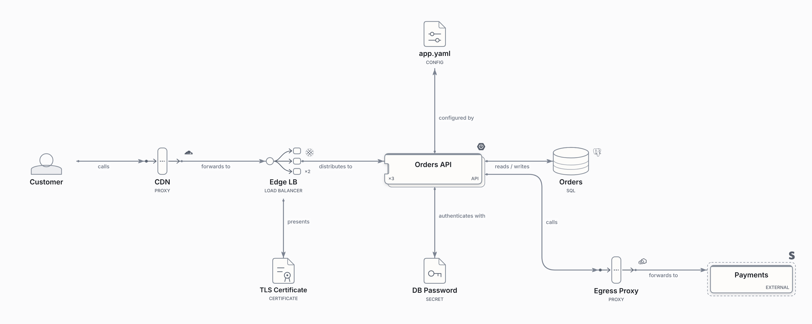
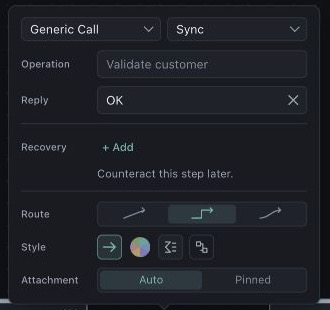
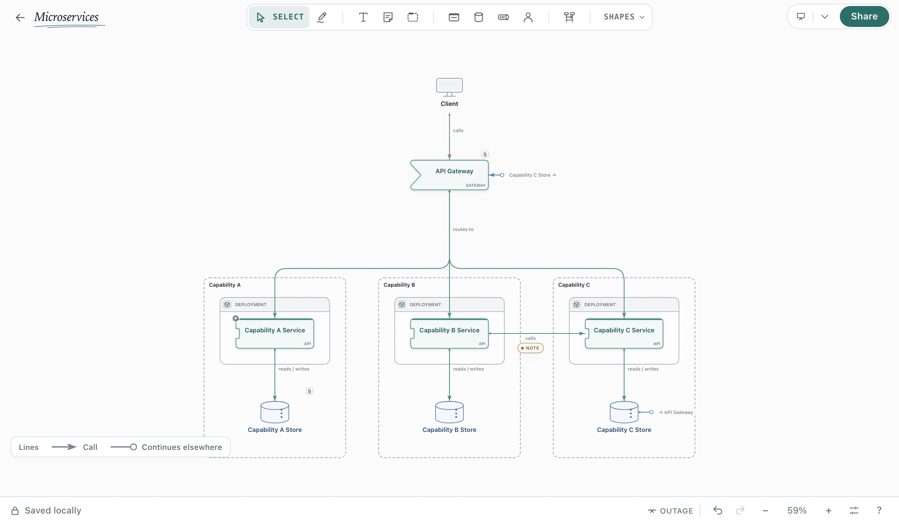
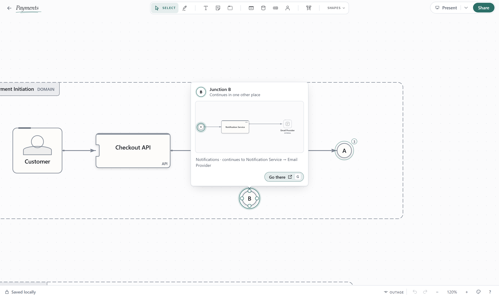
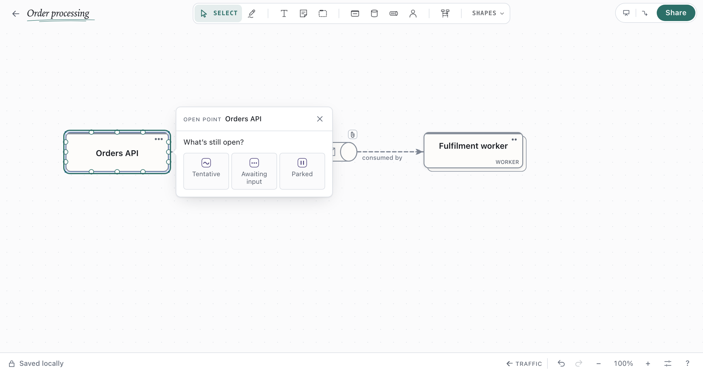
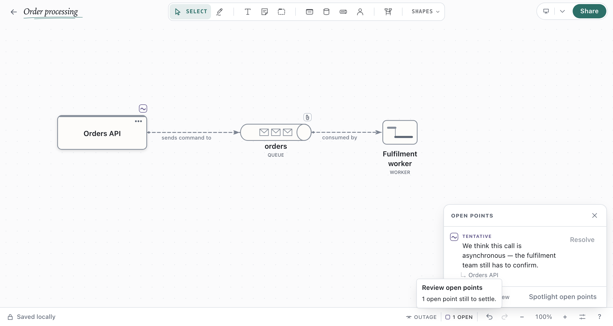
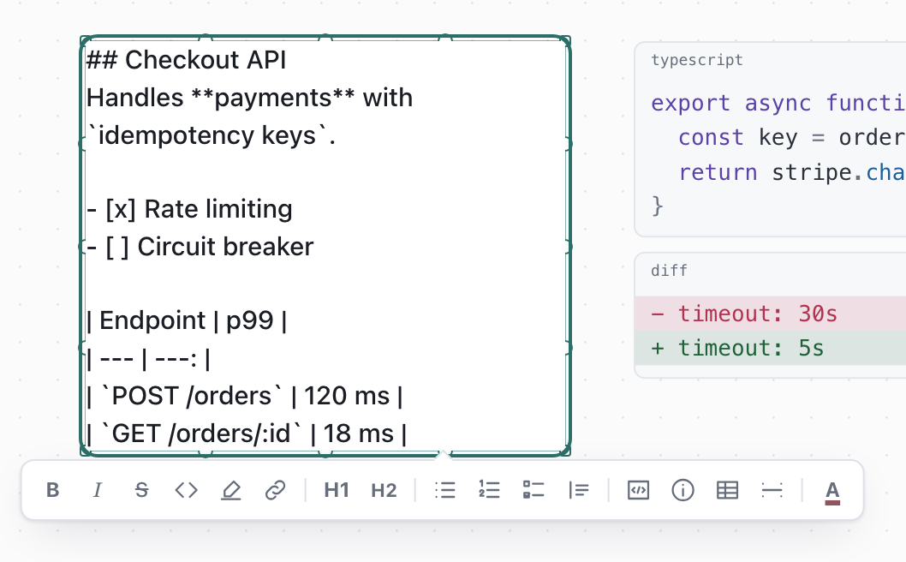
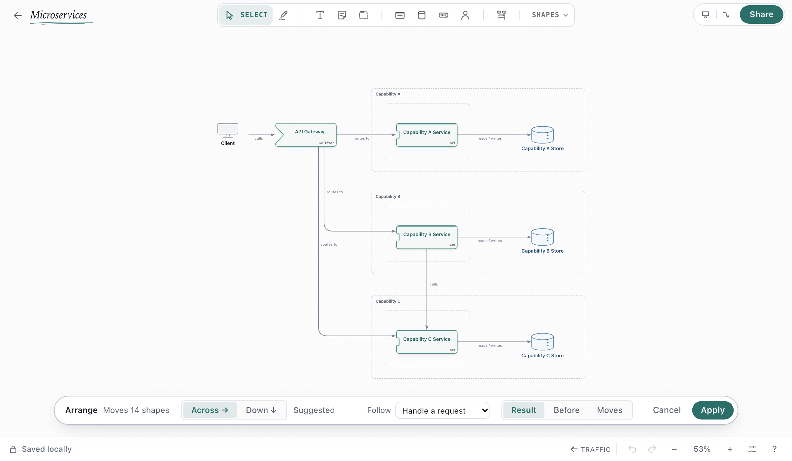
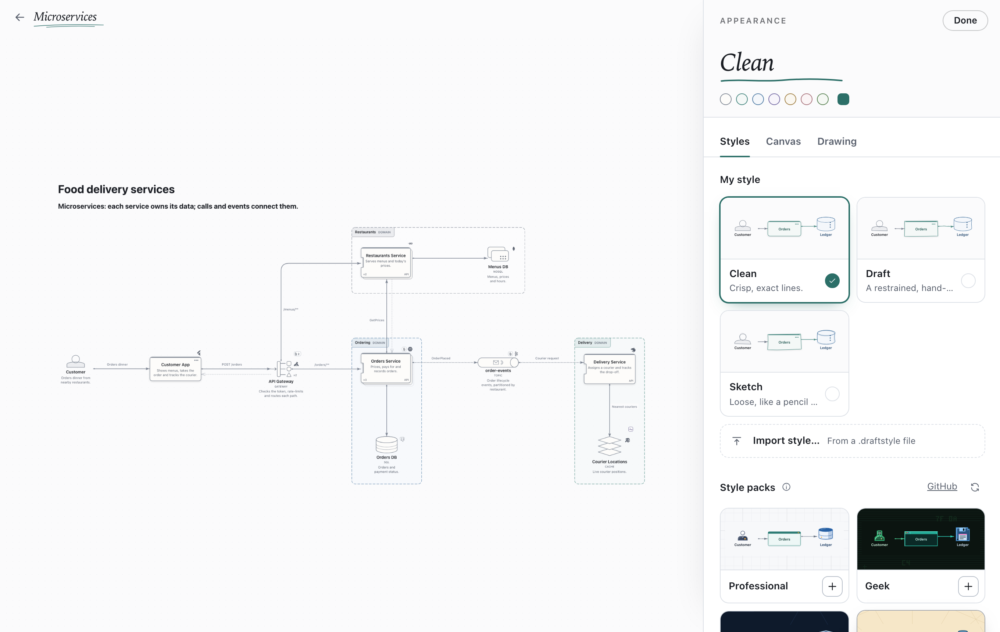
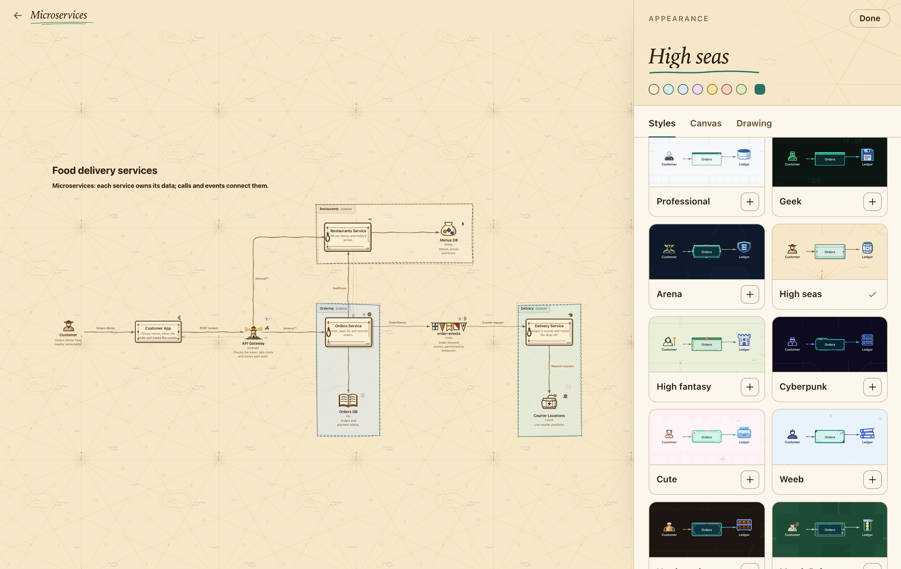

# Shapes, connectors and boundaries

Add shapes and connect them, group them in boundaries, mark open questions, write rich text, lay a
diagram out, and choose how it is drawn.

Shortcuts use Mac keys. On Windows and Linux, use `Ctrl` for `⌘` and `Alt` for `⌥`.

## Shapes and kinds

Press a shape's key over the canvas, or pick it from the toolbar. Select a shape to change its kind
in its toolbar.

| Shape | Key | Kinds |
| --- | --- | --- |
| Service | `S` | Generic, API, Worker, External, Scheduler, Gateway, Load Balancer, Proxy |
| Data Store | `D` | Generic, SQL, NoSQL, Cache, File System, Object Storage, Search Index, Table |
| Queue | `Q` | Queue, Topic, Stream |
| Actor | `A` | Human, System, Device, Group, Third Party, AI Agent |
| Component | `M` | Generic, Module, Adapter, Port |
| Artifact | | File, Config, Secret, Certificate |
| Junction | `J` | |
| Boundary | `B` | See [Boundaries](#boundaries) |
| Text / Note / Code | `T` / `N` / `C` | |

- **Shapes**, at the end of the toolbar, finds a shape by what you would call it: `cache`, `user`,
  `load balancer`, `cdn`, `tls`, `pod`. A technology gives its shape, with its logo where there is
  one: `kafka` gives a Queue that is a Kafka stream, `redis` a cache, `spring` a Service built with
  Spring. The same names work in `⌘K` (**Add Load Balancer**, **Add TLS Certificate**).
- To turn a shape into another, select it and press `⇧` with the new shape's key (`⇧Q` for a
  Queue). Its name, connectors, flows and notes stay. **Turn into…** in `⌘K` does the same.
- Use **External** for a service you don't own. For a sidecar, put the service and a Proxy in a
  Boundary (`pod` gives you one). Draw an **Artifact** when a config, secret or certificate is part
  of what you are explaining.

## Names, technology and instances

- Rename: double-click, or select and press `Enter`. If a name is cut short, select the shape and
  run **Fit shapes to text** from `⌘K`.
- Technology: click **Details** on the selected shape and enter a product or language, such as
  `Postgres` or `Rust 1.90`, and the shape shows its icon. A known product also sets the kind unless
  you chose one (Redis makes a Data Store a Cache). **Details** also holds the description.
- Instances: type `×3` (or `x3`) after a Service's name, or use **− ×1 +** in its toolbar. It draws
  as a stack, and an [outage](outage.md#instances) loses one instance before all of them.

## Connect shapes

- Drag from a dot on a shape's edge onto another shape, or onto empty canvas to create one there.
- With several shapes selected, drag from any of their dots to connect them all to one shape.
- Keyboard: select a shape and run **Connect to…** from `⌘K`.
- Click a connector to change its relationship. Drag an end to reconnect it.
- A caption too long for its line is cut short: hover it to read all of it.

## Pinned and automatic ends

An automatic end follows its shape and moves to whichever side gives the cleanest line. A pinned end
keeps its side and point. A selected connector shows a pinned end filled and an automatic end as a
ring.

| Action | The end is |
| --- | --- |
| Drawn from any dot onto a shape or dot | Automatic |
| Dropped on empty canvas, to a shape chosen from **Add to canvas** | Automatic |
| An end dragged to a side or attachment dot | Pinned at that side and attachment point |
| An end dragged to the centre of a shape | Automatic |
| **Pin ends here** (right-click) | Pinned where it is drawn |

**Attachment** in the connector's panel switches both ends between **Auto** and **Pinned**.
Right-click offers **Auto attach start**, **Auto attach end** and **Auto attach both ends**, and
**Auto attach all connectors** in `⌘K` frees every end in the view. When pinned ends leave no clear
route, the line is drawn anyway and its toolbar offers **Auto attach**.

## Bend a connector by hand

Select a connector, then:

| Route | Edit it |
| --- | --- |
| **Stepped** | Drag a bar on a straight run sideways. |
| **Straight** / **Curved** | Drag a faint dot to add a bend, drag a square to move it, double-click a square to remove it. |

**Reset route** (beside the route styles, or on right-click) restores automatic routing, and **Tidy
connectors** in `⌘K` resets every route. Switching a bent connector between Stepped and Straight or
Curved starts its route afresh.

## Sync, async and the reply

Between two services, choose **HTTP** or **Generic Call** and **Sync** or **Async** in the
connector's panel, then describe the request (for HTTP, a method and path). **Add reply** draws an
editable return path with a suggested response; an async call has no reply. The colour wheel means
automatic colour; click it to choose one.

### Recovery (compensation)

To show how a successful step is counteracted later in a workflow, select its connector, choose
**+ Add** in **Recovery**, then click the shape that receives the recovery action (`Esc` cancels).
Click the new dashed arrow to name the business action.

A step can have several recoveries. Each is a business operation, not an automatic HTTP retry or a
promise that the earlier state is restored exactly.

## More connector tools

- **Attach note** / **Attach code** (right-click), or drag a note onto the line and hold. Rest the
  pointer on the connector to read them; click a chip to edit one.
- **Add DLQ** on a Queue adds a dead-letter queue. Click its connector to set delivery attempts.
- A Junction (`J`) shares a route: right-click a bundle → **Convert to junction**.
- Drop a shape with no connectors onto a connector to put it in between: a Queue dropped on
  `Orders API → Billing` makes `Orders API → orders → Billing`. This works for Queues, Data Stores,
  Services, Components and Junctions.
- `⌥⌫` (**Delete and join connectors**) takes a shape out: `Client → Gateway → API` becomes
  `Client → API`, keeping flows, notes and code. It skips a shape with several ways in and out, or
  one whose joined connector would hold more than four notes and code cards; `⌫` deletes those.
- Draw data connectors the way the data moves. A data connector's panel sets its **Cadence**
  (Streaming, Hourly, Daily, Weekly, On demand).

### Portals

Select a connector that crosses the whole diagram and run **Draw as portal** from `⌘K`. Its line
becomes a short stub at each end naming the shape at the other end ("→ Billing"); click the words to
go there.

Flows, outages and agents still read it as a connector. **Draw as line** restores it. A connector
with a reply line can't be a portal.

### Legend

**Show legend** in `⌘K` adds a key naming the kinds of line the diagram uses. While it is on, image
exports include it. The setting is kept on this device, not in the file.

### Large diagrams

Hold `Shift` and rest the pointer on a shape to light up everything its data comes from and feeds.
**Show lineage** (right-click a shape, or `⌘K`) keeps it lit until you press `Esc`. Zoomed out below
about 55%, connector captions hide; below about 28%, labels do too.

## Linked junctions

To continue a flow elsewhere without a connector across the diagram, end it at a Junction and link
that Junction to another. Linked Junctions are one point drawn in several places ("continues at
A"). A link is not a connector: nothing is routed along it, and flows, outages and exports ignore
it.

- **Add link** (a Junction's toolbar or right-click; **Add linked junction** in `⌘K`): pan, zoom or
  look inside a shape, then click where the flow continues. The new Junction gets the same label,
  colour and size.
- **Link junctions** links the selected Junctions. **Link to junction group…** in `⌘K` joins an
  existing group. **Unlink** takes one Junction out and leaves its connectors.
- Renaming a linked Junction renames all of them, in one undo step. Junctions are linked only by
  choice, never by matching labels.

Rest the pointer on a linked Junction to see where it continues. Press `G` or click **Go there** to
go; with several places, pick one with `↑` `↓` and `Enter`.

`⇧G` returns to the view you left and `⌥G` goes forward again. Following a Junction is not an edit,
so undo doesn't take you back.

## Boundaries

Select shapes and press `⌘G`, or press `B` and drag shapes in. Contents move, copy and delete with
the boundary. Its toolbar sets a colour and a kind: Boundary, Group, System, Domain, Network or
Deployment. Boundaries nest up to 32 levels deep.

## Open points

An open point marks an unresolved question on a shape, connector or boundary. Its kind is
**Tentative** (a working assumption), **Awaiting input** (an answer or review you need) or
**Parked** (put off on purpose).

1. Select one or more shapes or connectors. Several can share one point.
2. Press `I`, or right-click → **Add open point…**.
3. Choose a kind and add context if you like. `Enter` closes; `Shift+Enter` adds a line.

Click a marker to change its kind, edit the context, delete it or **Resolve** it. **Resolve** hides
the marker and moves the point to the resolved list, where you can add a note, reopen or delete it.
On a shared point, **Not this one** takes it off this shape or connector only.

Click the open-point count in the status bar to list the points in every room, and choose a row to
go to what it marks. **Spotlight open points** dims everything else; `Esc` or **Exit spotlight**
ends it.

- While presenting, click a marker to read it.
- PNG and SVG exports show markers and a key; untick **Open point markers** to leave them out.
  Sequence exports leave points out.
- Deleting a shape or connector detaches it from a shared point. A copy gets its own point.

## Write rich text

Press `T`, then `Enter` to edit Markdown. **Aa** sets font, alignment and background (**Card**,
**Marker**, **Banner**).

| Write | Get |
| --- | --- |
| `#`, `##`, `###` | Headings |
| `**bold**`, `_italic_`, `~~struck~~`, `==highlight==` | Emphasis |
| `` `code` ``, fenced block with a language | Code |
| `- item`, `1. step`, `- [ ] todo` | Lists |
| `> quote`, `> [!WARNING]` | Quote, callout (NOTE, TIP, IMPORTANT, WARNING, CAUTION) |
| `\| A \| B \|` + `\| --- \| --- \|` | Table |
| `---` | Divider |
| `[words](https://…)`, `[words]{.rose}` | Link, coloured words |

| Keys while editing | Does |
| --- | --- |
| `⌘B` `⌘I` `⌘E` `⌘⇧X` `⌘⇧H` `⌘K` | Bold, italic, code, strikethrough, highlight, link |
| `⌘⇧8` `⌘⇧7` `⌘⇧9` | Bulleted, numbered, checklist |
| `⌘⌥1`–`⌘⌥3` | Heading 1–3 |

## Line things up

Shapes snap as you drag or resize: to where a connector runs straight, to their neighbours' edges
and centres, and to equal gaps. Hold `⌥` to turn snapping off. With shapes selected, the bar at the
bottom offers **Align**, **Distribute** (three or more), **Same width** and **Same height**.

### Make room

Run **Make room** from `⌘K`, then drag across or down: everything past where you pressed moves away,
or back. A boundary the line crosses stretches with what it holds. The drag is one undo step, and
`Esc` cancels it.

### Tidy up

**Tidy up** (`⌘K`, or right-click the canvas) keeps your layout and fixes only what looks untidy. It
nudges a shape up to 32 pixels to straighten a small step in a connector, and re-attaches a
connector drawn through a shape so it goes round.

It previews first: **Apply** (`Enter`) is one undo step, **Cancel** (`Esc`) changes nothing.
**Tidy up selection** touches only the selected shapes and their connectors.

### Arrange

**Arrange diagram** in `⌘K` lays the whole view out again, so expect shapes to move. It is
**Rearrange layout** on right-click and **Arrange Diagram** in the desktop menu bar. In its preview:

- Choose **Across →** or **Down ↓**. The bar counts the shapes that move and the connector
  crossings before and after.
- **Spacing** is **Snug**, **Standard** or **Roomy**: closer together for a small screen, or more
  room between everything.
- **Result**, **Before** and **Moves** compare the layouts; **Moves** draws a trail from each
  shape's old place to its new one.
- With flows, **Follow** (or **Arrange around a flow…** in `⌘K`) lays one flow out in a straight
  line and the rest around it.

`⌘K` also opens the preview already set one way: **Arrange left to right**, **Arrange top down**,
**Arrange with more room** and **Arrange snug**.

**Apply** is one undo step; **Cancel** returns the view to where it was. **Rearrange selection**
lays out only the selected shapes.

**Hold in place** in `⌘K` pins the selected shapes so Arrange and Tidy up leave them where they are.
Holding a boundary holds what is inside it, and holding a shape in a boundary holds the boundary.
You can still drag held shapes; **Let go** frees them.

**Check layout** in `⌘K` finds names, captions, boundaries and spacing that read badly, and opens
Arrange's preview with the fixes marked.

On a large diagram, Tidy up and Arrange run in the background with a **Cancel**. If the bar says
"Stopped early on a large diagram", apply what it found and run it again.

## Appearance

**Appearance** sets how diagrams are drawn. Open it with the palette button at the bottom right,
**Appearance…** on the canvas's right-click menu, or `⌘K`. In the desktop app it is also in
**Settings → Appearance**, for when no diagram is open.

It opens beside the canvas, and the tools, **Present**, **Share** and the status bar step back until
you press **Done**. It has three tabs:

- **Styles**: pick **Clean**, **Draft**, **Sketch** or one of your own. Your first change on the
  other tabs saves a copy as a style of your own, kept on this device. **Export…** saves it as a
  `.draftstyle` file, which holds no diagram, and **Import style…** brings one in.
- **Canvas**: a colour set, a canvas colour (any colour; words and shapes stay readable on it), a
  brand colour for what is selected and what to press, and a backdrop pattern or **Your SVG…**.
  Image exports draw the backdrop, except transparent ones. The next-shape suggestions switch is
  here too.
- **Drawing**: drawing hand, line weight, corners and shadows, for everything or for one shape or
  kind, and the arrowhead, weight and colour rule for connectors. What a line means is never part
  of a style: an asynchronous call is dashed in every style.

**Style packs**, on **Styles**, are ready-made styles from the
[starters gallery](https://github.com/acltabontabon/draft-canvas-starters#style-packs), each with its
own drawing for every shape, its own colours and backdrop. **Load style packs** downloads them from
GitHub and sends nothing about your diagrams; **Add** makes one a style of your own. A pack changes
how shapes look, never what they are or where they sit. Some packs use a dark canvas or a light one
whatever your device is set to, in exports too.

To draw a shape with your own picture, pick it under **Shapes** on **Drawing**, then **Choose SVG…**
or **Paste SVG**. The shape keeps its size, its name's place and its connection points. Text,
images, effects and outside references in the SVG are left out. Boundaries, sequences, and Text,
Note and Code shapes take no picture.

A diagram keeps a copy of the style it was made with, so its exports and everyone you share it with
see the same picture.

- A diagram drawn in your style follows your changes.
- One with a different look keeps it until you choose **Use my style in this diagram**; undo takes
  that back.
- One with no style of its own is drawn in the style of whoever opens it.

To make new shapes start your way, right-click one you have set up and choose **Save as my default
Service** (or whichever shape it is): new shapes of that type start with its kind and colour.
**Reset my default Service** goes back.
