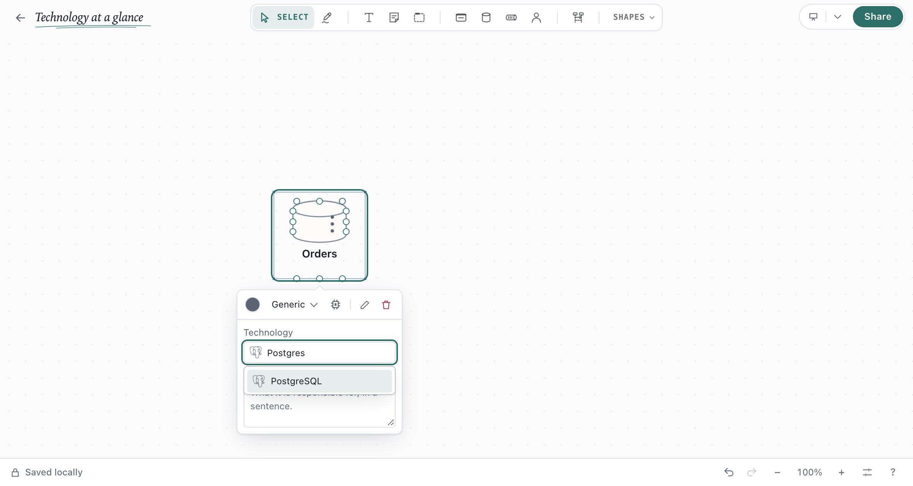
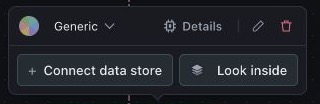
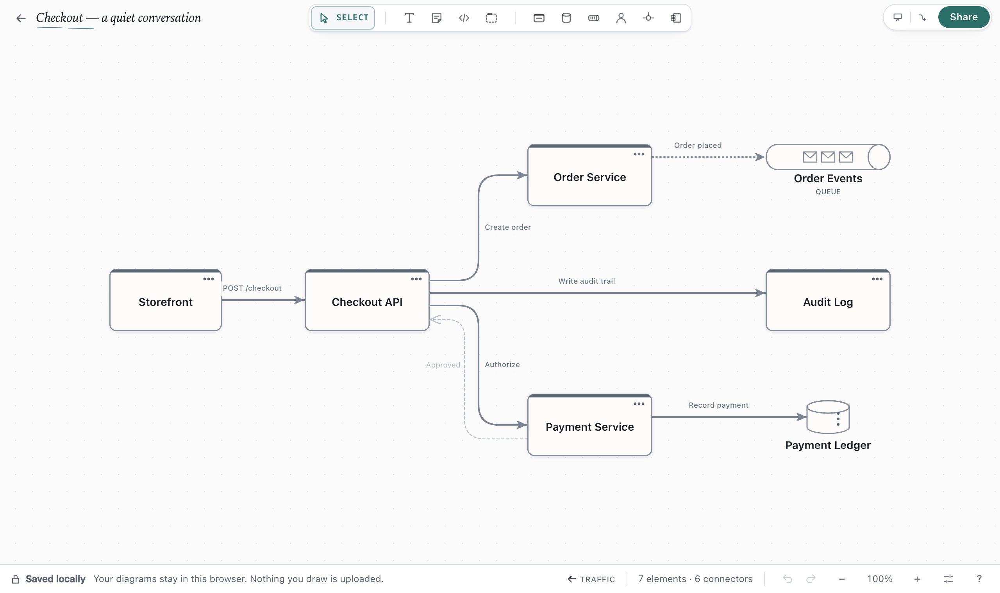
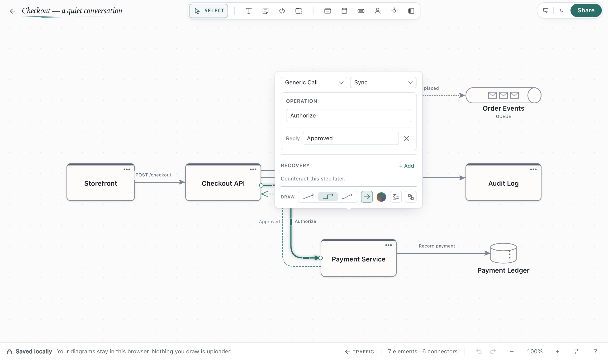

# Shapes, connectors and boundaries

Shortcuts use Mac keys. On Windows and Linux, use `Ctrl` for `⌘` and `Alt` for `⌥`.

## Shapes and kinds

Press a key to add a shape, or pick one from the toolbar. **Shapes** at the end of the toolbar lists
every shape with its key and finds one by any name you'd use (`cache`, `user`, `topic`). Type a
technology and it offers the shape that technology is: `kafka` gives a Queue that arrives as a Kafka
topic, `redis` a Data Store that is a cache, `s3` object storage, each with its logo where there is
one. A language or framework (`spring`, `rust`) gives a Service built with it.

Select a shape to choose its kind in the toolbar.

| Shape | Key | Kinds |
| --- | --- | --- |
| Service | `S` | Generic, API, Worker, External, Scheduler, Gateway |
| Data Store | `D` | Generic, SQL, NoSQL, Cache, File System, Object Storage, Search Index, Table |
| Queue | `Q` | Queue, Topic, Stream |
| Actor | `A` | Human, System, Device, Group, Third Party, AI Agent |
| Component | `M` | Generic, Module, Adapter, Port |
| Junction | `J` | |
| Boundary | `B` | See [Boundaries](#boundaries) |
| Text / Note / Code | `T` / `N` / `C` | |

To turn a shape into another, select it and press `⇧` with the new shape's key: `⇧Q` makes it a
Queue, `⇧D` a Data Store. Its name, connectors, flows and notes stay. **Turn into…** in `⌘K` does the
same.

Use **External** for a service you don't own. **Actor frame → Framed** outlines an actor. Drag a
corner handle to resize; Actor, Queue and Data Store artwork grows with the box.

## Names, technology and instances

- Rename: double-click, or select and press `Enter`. A label cut short? Run **Fit shapes to text**
  from `⌘K`.
- Technology: click **Details** on the selected shape and enter a name such as `Postgres` or
  `Rust 1.90`. The shape shows a matching icon. The same panel edits the description; drag the
  card's top edge to move it, and click empty canvas to dismiss it.
- A known product also sets the kind, unless you've picked one: Redis makes a Data Store a Cache,
  PostgreSQL makes it SQL, Kafka makes a Queue a Topic, Kinesis a Stream, Stripe a Service External.
  A kind you choose yourself always stays.
- Instances: type `×3` (or `x3`) after a Service's name, or use **− ×1 +** in its toolbar. It draws
  as a stack, and [Traffic](traffic.md) reads it.

## Line things up

Dragging does most of the lining up:

- A shape joined to another snaps to where their connector runs straight, through each shape's own
  middle (a queue's tube, a Data Store's cylinder), not the box around it.
- It also snaps to its neighbours' edges and centres, and to an equal gap: when the space to a
  neighbour matches a gap already in the row or column, both gaps show their size.
- Snapping pulls 6 pixels on screen at any zoom (12 for a connector's straight line). Resizing snaps
  the same way.
- Hold `⌥` while you drag or resize to turn snapping off.

With shapes selected, the bar at the bottom offers **Align**, **Distribute** (three or more) and
**Same width** / **Same height**, which use the largest size among them. A boundary selected with
shapes keeps its size.

### Tidy up

**Tidy up** is the one to reach for first. Run it from `⌘K` or the canvas's right-click menu. It
keeps every shape where you put it and fixes only what looks untidy: a connector with a small step in
it is straightened by nudging a shape a few pixels (up to 32), and a connector drawn through a shape
is re-attached so it goes round. A connector that already runs straight is left alone.

You see the result before anything changes, with a faint outline where each nudged shape stands now
and a line saying what it did ("2 shapes nudged to straighten connectors, 1 connector re-attached to
clear shapes"). **Apply** (`Enter`) is one undo step; **Cancel** (`Esc`) leaves the diagram as it was.
**Tidy up selection** touches only the selected shapes and their connectors. Sketches never move.

On a large diagram, Tidy up and Arrange run in the background with a **Cancel**, and the canvas stays
usable. They stop at a fixed amount of work, not a timer, so the same diagram gives the same result
on any computer. If the bar says "Stopped early on a large diagram", apply what it found and run it
again.

### Arrange

**Arrange diagram** (**Rearrange layout** on right-click, **Arrange Diagram** in the desktop Canvas
menu) lays the whole view out again from scratch, so expect shapes to move. It previews first, however
you start it, and you choose the reading direction: **Across →** or **Down ↓**. It starts on the
suggested one and counts the shapes it moves. On a very large diagram only one direction is worked
out, and the bar says so.

Boundaries keep what they hold and notes stay beside their shapes. A long name gets a wider box, and
gaps are only as long as their captions need. **Apply** is one undo step and frames the result;
**Cancel** returns the view to where it was. **Rearrange selection** lays out only the selected
shapes.

The preview shows the **Result** on its own. **Before** shows the diagram as it is, and **Moves**
shows both with a trail from each shape's old place to its new one. In **Result**, point at a shape
to see its move, or click it to keep the trail up.

**Check layout** in `⌘K` looks for what makes a diagram hard to read: a name stacked into a tall
column, a caption with no room, a boundary that is mostly header, spacing that leaves everything too
small for a screen. It reports only what Arrange fixes, by opening that preview with the fixes
marked in teal. **Straighten connectors** does only the nudging.

## Connect shapes

- Drag from a shape's edge dot onto another shape, or onto empty space to create one.
- With several shapes selected, drag from any of their dots onto a shape to connect all of them to it;
  a faint line from each shows what the drop will do.
- Keyboard: select a shape and run **Connect to…** from `⌘K`.
- Click a connector to change its relationship. Drag its end to reconnect it.

Hovering a connector briefly traces the request and then its reply, once. Reduced-motion settings
turn the trace off.

The default style, **Sculpted Ink**, uses sweeping corners and a carved arrowhead. Replies run on a
lighter dashed return rail, with each caption outside its own line. Two differently named operations
keep separate exits; a repeated relationship can share a trunk. SVG and PNG exports match.

A caption sits on its connector's longest straight stretch, clear of corners, arrowheads and the reply
line, and a line passing under it is masked. One too long for its line is cut short; hover it to read
all of it. Notes, code and open points attached to a connector sit in one row just past its words.

## Pinned and automatic ends

An automatic end faces the shape it joins and follows it as shapes move. A pinned end keeps its side
and point.

Automatic ends also avoid mess. A connector that would cross others, cut through a shape or take a
long way round tries the other sides of its two shapes and takes the cleanest line: an elbow out of
the bottom instead of a step across three arrows. This happens as you draw and when you drop a shape;
while you drag, lines settle only when you let go. A connector with nothing wrong is never moved.

| Action | The end is |
| --- | --- |
| Drawn from any dot, or dropped on a shape or dot | Automatic |
| Dragged to a side or attachment dot | Pinned at that side and attachment point |
| Dragged to the centre of a shape | Automatic |
| **Pin ends here** | Pinned where it is drawn |

While you drag an end over a target, its attachment dots show and the one you'd pin to fills in.
Moving to the centre clears the highlight, meaning automatic.

A selected connector shows a pinned end filled and an automatic end as a ring. In its inspector,
**Attachment · Auto / Pinned** switches both ends at once. Right-click offers **Auto attach start**,
**Auto attach end**, **Auto attach both ends** and **Pin ends here**. **Auto attach all connectors**
(`⌘K`) frees every end in the view, including pins from diagrams drawn before automatic ends existed.

Connectors route around shapes. When no clear line exists, such as from pins facing away from each
other, the line is drawn anyway and its toolbar says so, with **Auto attach** to fix it.

## Bend a connector by hand

Select a connector, then:

| Style | Edit the route |
| --- | --- |
| **Stepped** | Drag a bar on a straight run sideways. |
| **Straight / Curved** | Drag a faint dot to add a bend, drag a square to move it, double-click a square to remove it. |

**Reset route**, beside the route styles or on right-click, restores automatic routing. Switching a
bent connector between Stepped and Straight or Curved starts its route afresh. **Tidy connectors**
(`⌘K`) resets all.

## Sync, async and the reply

Between two services, choose **HTTP** or **Generic Call**, then describe the request. For HTTP, pick
a method and enter the path. **Sync** and **Async** sit beside Protocol. **Add reply** draws an
editable return path with a suggested response. Async shows a break mark and has no reply.

The colour wheel means automatic colour; click it to fix a colour. A shape has no automatic colour.
Hover any icon to see what it does.

**Settings → Canvas → Drawing style** controls shapes and connectors together: **Clean** is the
Sculpted Ink default, **Draft** adds a restrained hand-drawn quality, **Sketch** adds visible
graphite drift and retraced strokes. It is a device preference that applies to every diagram and
export, and never changes the diagram or its undo history.

### Recovery (compensation)

To show how a successful step is counteracted later in a workflow, select its connector, choose
**+ Add** in Recovery, then click the shape that receives the recovery action. Press `Esc` to cancel.
The new dashed arrow stays on the canvas, and you can add several to one step.

Click the recovery arrow to name the business action and edit its protocol and operation. Hovering
either arrow makes the linked pair glow. A compensation is a business operation, not an automatic
HTTP retry or a promise that the earlier state is restored exactly.

An agent using the Draft Canvas MCP tools, including Nodi, can add the same association: a
`compensates` relationship with `compensationFor` set to the original connector's id. See
[schema reference](../reference/schema.md) for the fields.

## More connector tools

- **Attach note** / **Attach code** (right-click), or drag a note onto the line and hold.
- **Add DLQ** on a Queue adds a dead-letter queue; click its connector to set delivery attempts. A
  muted amber outline and message icon mark its role, not a live error. An explicit colour overrides
  it.
- A Junction (`J`) shares a route. Right-click a bundle → **Convert to junction**.
- **Put a shape in between**: drag a shape with no connectors onto a connector, or place one there
  with a shape tool. `Orders API → Billing` with a Queue dropped on it becomes
  `Orders API → orders → Billing`. Works for Queues, Data Stores, Services, Components and Junctions;
  the label, notes and flow steps stay.
- **Take one out**: select a shape and press `⌥⌫` (**Delete and join connectors**).
  `Client → Gateway → API` becomes `Client → API`, keeping its flows. A shape with several ways in
  and out has no single way to join, so `⌥⌫` leaves it; plain `⌫` deletes it.
- **Data pipelines**: draw arrows the way the data moves. A Data Store drawn into what reads it
  reads "read by", and a Table drawn into the next Table is `transforms`. A data connector's panel
  has a **Cadence** (Streaming, Hourly, Daily, Weekly, On demand), shown as a chip under its caption.
- **Show lineage** (right-click a shape, or `⌘K`): everything its data comes from and everything it
  feeds stays lit, whichever way each arrow points. `Esc` ends it.

## Boundaries

Select shapes and press `⌘G`, or press `B` and drag shapes in. Contents move, copy and delete with
the boundary. Pick a kind and colour in its toolbar:

| Kind | For |
| --- | --- |
| Boundary | A general frame |
| Group | Shapes that belong together for this explanation |
| System | One software system |
| Domain | A shared domain responsibility |
| Network | A network scope |
| Deployment | A runtime or hosting scope |

Kinds change the look, and [Traffic](traffic.md#boundary-crossings) reads the Network, Deployment,
Domain and System ones. Boundaries nest up to 32 levels deep; grouping past that is refused.

## Write rich text

Press `T`, then `Enter` to edit Markdown. **Aa** sets font, alignment and background (**Card**,
**Marker**, **Banner**).

| Write | Get |
| --- | --- |
| `#`, `##`, `###` | Headings |
| `**bold**`, `_italic_`, `~~struck~~`, `==highlight==` | Emphasis |
| `` `code` ``, fenced block with a language | Code |
| `- item`, `1. step`, `- [ ] todo` | Lists |
| `> quote`, `> [!WARNING]` | Quote, callout (NOTE, TIP, IMPORTANT, WARNING, CAUTION) |
| `\| A \| B \|` + `\| --- \| --- \|` | Table |
| `---` | Divider |
| `[words](https://…)`, `[words]{.rose}` | Link, coloured words |

| Keys while editing | Does |
| --- | --- |
| `⌘B` `⌘I` `⌘E` `⌘⇧X` `⌘⇧H` `⌘K` | Bold, italic, code, strikethrough, highlight, link |
| `⌘⇧8` `⌘⇧7` `⌘⇧9` | Bulleted, numbered, checklist |
| `⌘⌥1`–`⌘⌥3` | Heading 1–3 |

[Preview formatting examples.](../media/guides/rich-text.png)
