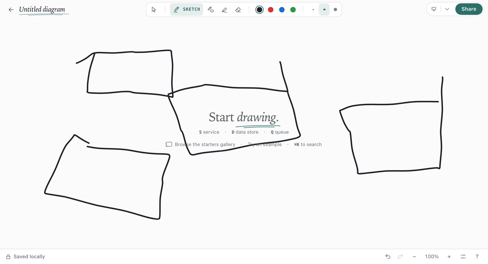
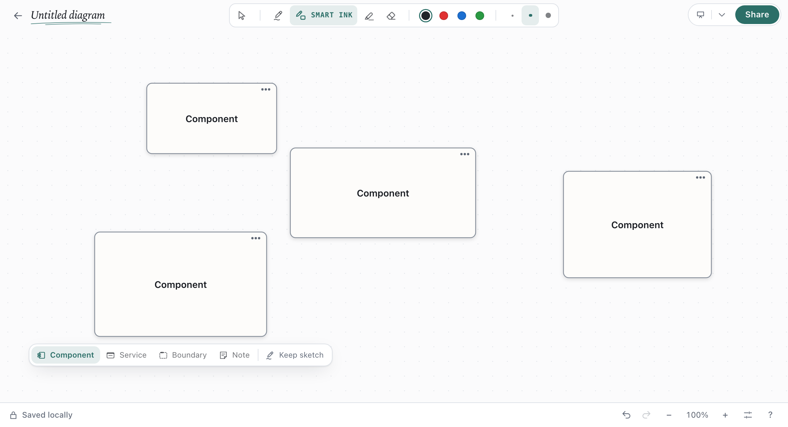

# Sketch and Smart Ink

Draw over a diagram with the Pencil, and let Smart Ink turn rough boxes, cylinders and arrows into
real shapes and connectors.

Pick up the Pencil beside **Select** in the toolbar, or press `P`. Its tools replace the shapes in
the toolbar until you put it down with **Select** or `Esc`.

| Tool | For | Key |
| --- | --- | --- |
| **Sketch** | Freehand ink that stays exactly as drawn | `P` |
| **Smart ink** | Rough shapes and arrows that become real ones | `P` again |
| **Highlight** | A broad, see-through marker | `H` |
| **Erase** | Drag across a stroke to take it away | `E` |

Choose an ink and a width beside them. `Esc` mid-stroke takes back that stroke.

Draw with a mouse, a pen or a finger; the wheel, a pinch or the middle mouse button still pan and
zoom. A stylus draws with pressure and its eraser end erases. Once a stylus has touched the canvas,
a finger pans instead, so a resting hand leaves no marks.

## Sketches

A sketch is annotation. It never moves, connects or changes the shapes under it, and routing,
Arrange, Tidy up and agents ignore it.

With **Select**, click a stroke to choose it (`Shift`-click for more), drag to move it, and press
`Backspace` to erase it. A marquee picks up the strokes inside it. Right-click a stroke for
**Convert to shape** or **Erase stroke**.

Sketches belong to the view they were drawn in. Inside a [room](depth.md), add a shape before
drawing or pasting a sketch. Deleting a room's last shape takes its sketches with it; undo brings
them back.

## Smart Ink

Choose **Smart ink** and draw roughly. The Pencil waits a moment after you lift it, so you can
finish a box in several strokes or add an arrowhead.

| You draw | It becomes |
| --- | --- |
| A box | A **Component**, also offered as a Service, Boundary or Note |
| A large box in empty space | A **Boundary** |
| A box around shapes | A **Boundary** that holds them |
| A cylinder (an oval on top, then the sides and bottom) | A **Data Store** |
| A tube on its side | A **Queue** |
| A circle | A **Component**, or a **Junction** when small |
| A stick figure | An **Actor** |
| An arrow from one shape to another | A connector, pointing where you drew it |
| A line from one shape to another | A plain connector, without an arrowhead |
| One stroke from one shape round to another, with up to six turns | A plain connector that keeps your path as its bends |

A box can lean, sit off level or overshoot its corners: it becomes an upright shape the size of the
box you drew. A diamond is not a box and stays ink.

| Drawn | Becomes |
| --- | --- |
|  |  |

A strip beside the new shape shows what it became and what else it could be:

- `←` / `→` or a number changes it in place.
- `Enter` keeps it and starts its name.
- `Esc` or **Keep sketch** puts your drawing back.
- Drawing on keeps it as it is.

Anything else stays ink: a circle around shapes, a mark across a shape, a curved arrow, a line
ending in empty space, handwriting. A drawing that is close but unclear is only offered with
**Make it**, and nothing changes until you choose.

To convert strokes later, select them and choose **Convert to shape** (right-click or `⌘K`), which
also reads weaker drawings. Highlighter strokes in the selection stay as they are.

Undo takes a converted shape or connector back to your strokes; undo again removes the strokes.
Smart Ink reads geometry only and never guesses a technology, protocol or responsibility.
Recognition runs on your device, with no AI model or network.

## Saving, exporting and sharing

- Sketches are saved with the diagram.
- PNG and SVG exports draw them, except a selection-only export.
- In a live session, collaborators see each stroke once it is finished.
- Older versions of Draft Canvas refuse to open a file with sketches rather than open it without
  them.
- A file holds up to 4,000 strokes, and very long strokes are simplified to 2,000 points.
