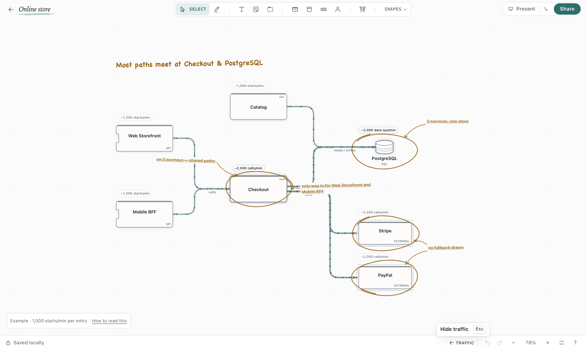
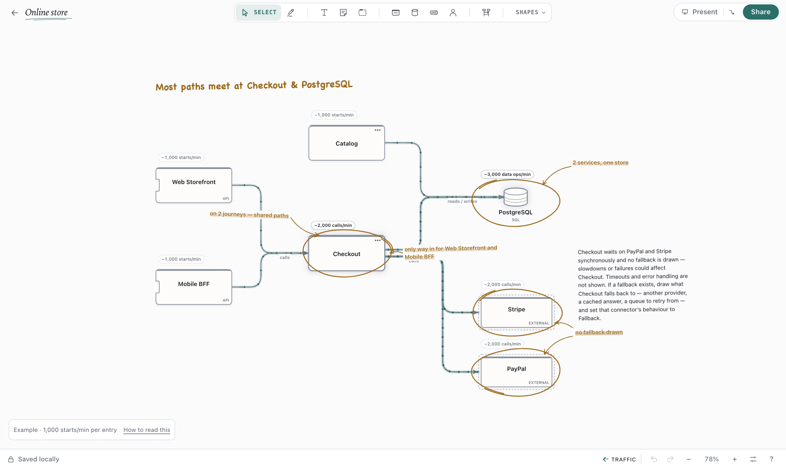
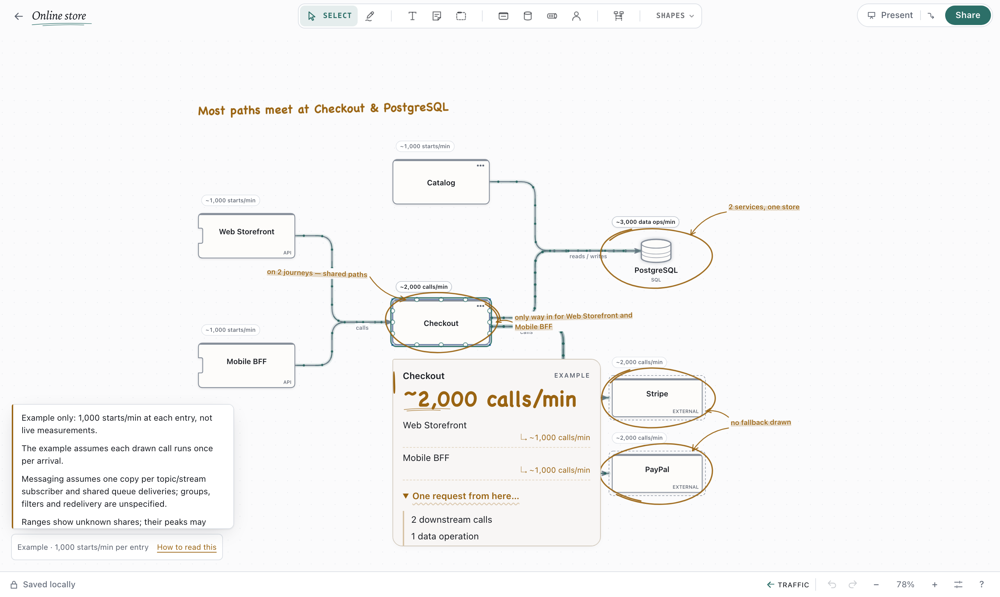
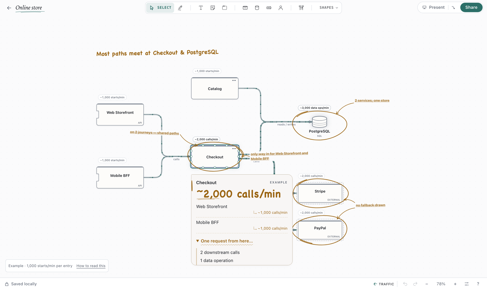
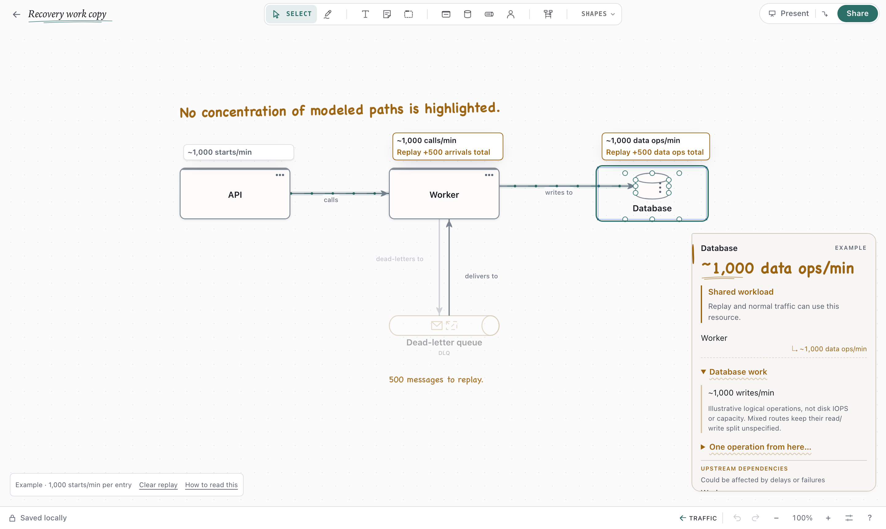
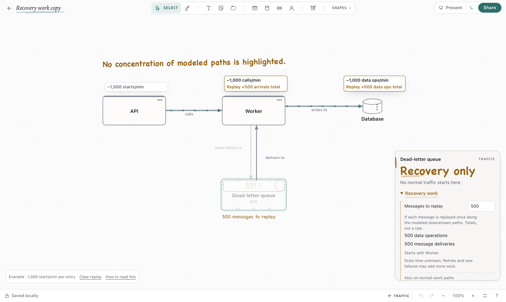
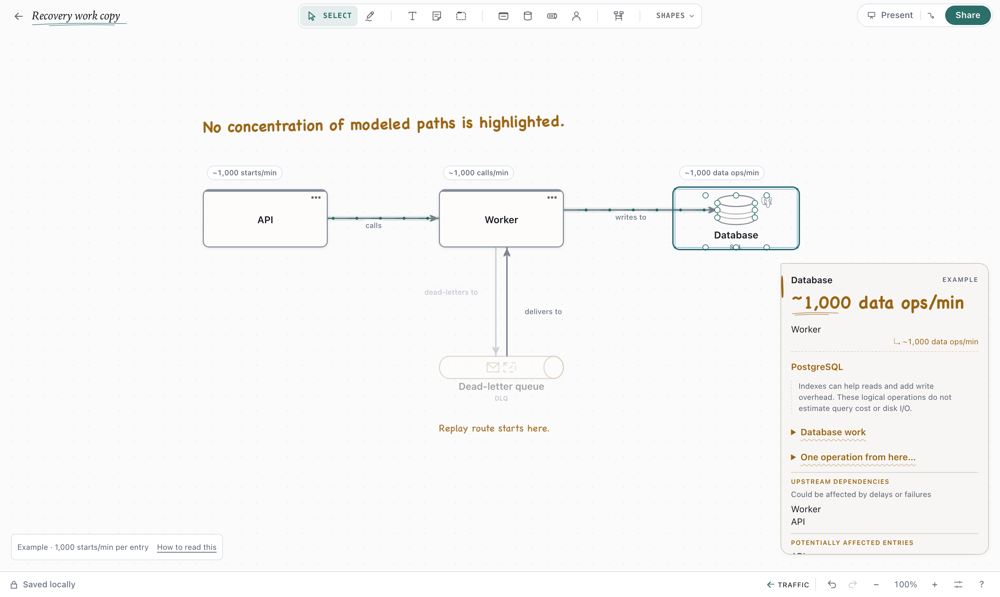
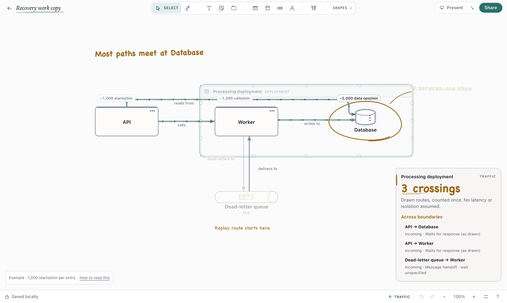

# Traffic

Traffic reads the runtime connectors in your diagram and shows where modeled paths meet. It uses an
illustrative rate, so there is nothing to fill in. It is a reading aid for review, not a load model:
it predicts no latency, utilisation or capacity.

## Show traffic

Click **Traffic** in the status bar once the canvas has a runtime connector: a service calling a
service, reading or writing a data store, publishing to or consuming from a queue. You can also run
**Show traffic** from the canvas's right-click menu or `⌘K`.

Press `Esc` or click **Traffic** again to put it away. Opening another diagram, stepping into or out
of a shape, presenting or turning on a spotlight also ends it. If a flow is in view when you turn it
on, only that flow's connectors are analysed.

If nothing can be read, because there are no runtime connectors or every service is reached from
another so no path has a start, Traffic says so.

## Read the canvas

- **Flowing light** runs along every connector in the direction the work travels. A backwards
  **read by** arrow still flows from the reader to the store. Busier lines are denser. A branch that
  only some traffic may take (after a Junction split, through one of a gateway's routes, toward
  competing consumers, or behind a condition) is sparse and faint.
- **Outlines and rates**: where paths meet, the shape is lit along its outline with a rate such as
  **~3,000 calls/min**. A range means a branch share isn't drawn.
- **Notes**: up to seven findings appear beside the shapes they describe, as a marker loop and a
  short note. Up to three are handwritten; with more, they are set in plain type. Click a note, or
  `Tab` to it and press `Enter`, to unfold the explanation; `Esc` folds it.

  

- **Headline**: a handwritten line above the diagram says where most paths meet. **+N open questions**
  under it unfolds what the diagram doesn't say: unknown split shares, conditions, loops, retries,
  schedules, connectors through components, and gateways that are also called directly.

Select a shape to open its field note: an illustrative rate, a contribution from each incoming
source, then potential impact and synchronous dependencies as drawn. These show reachability, not
guaranteed outages; timeouts, optional calls and fallbacks decide what happens. The note keeps a
readable size as you zoom and scrolls when long.

## What it finds

- resources on several modeled journeys
- stores used by several services, without assuming shared tables, locks or ownership
- synchronous external dependencies with no fallback drawn (a gap in the diagram is not proof of a
  gap in the system)
- a single drawn way in, or several routes to one resource
- synchronous chains worth reviewing for failure handling
- message handoffs, with buffering and delivery left as stated assumptions
- queues with no consumer or replay route drawn, and paths around a gateway

Topology can't establish availability, failure isolation, real backlog or what matters most to
protect.

## How the numbers work

Traffic starts at **1,000 starts/min per entry**. That is a round example, not a measurement or a
recommended rate, and it can't be changed. **How to read this** in the lower-left reference bar opens
a short explanation.

Each entry point (an Actor, a Scheduler, or a service or queue that nothing drawn leads into) starts
one path. Every runtime connector carries the paths reaching its source on to its target. Each drawn
call is assumed to run once per arrival; how often it is really taken isn't drawn.

Rates use **calls/min**, **messages/min** or **data ops/min**, and **arrivals/min** for mixed work.
Entries use **starts/min**, so a scheduler isn't shown as HTTP traffic. Two independent entries into
one service each contribute their rate. Competing consumers and conditional routes show ranges, not
invented shares.

Topic and stream subscribers are modeled as independent recipients; queue consumers share deliveries.
Give a Service an instance count (`Fulfilment ×3`) and Traffic treats the instances as competing
consumers of the queue they read, each with about a third of its messages. Consumer groups, filters,
acknowledgements and redelivery change real counts.

### One request from here

Unfold **One request from here…** in a selected shape's note to see what one arrival at that shape
causes downstream: calls, data operations, messages published and deliveries. Queues say **One
message**; schedulers say **One start**. It follows all drawn downstream work in the current view (or
flow), not just immediate neighbours, and doesn't depend on the example rate. A topic with two
subscribers reads as one publication and two deliveries.

Loops, capped counts and incomplete analysis show **Rate unknown**. Retries, failure paths and
background work are outside this baseline.

## What counts

| Counted | Not counted |
| --- | --- |
| Calls, HTTP, gRPC, commands, queries, routes, triggers | Depends on, uses, implements |
| Reads, writes, queries, searches, indexing, cache invalidation | Replication, change capture, syncing |
| Publishing to and consuming from queues, topics and streams | Dead-lettering, compensation, failure and fallback paths |
| Routes through Junctions | Retries and callbacks (noted, not added) |

Components, ports, adapters, tables, boundaries, notes and plain shapes aren't runtime resources; a
path that runs through one stops there.

Junctions route traffic but never receive it, and a route through several counts once. When a
Junction sends traffic to more than one place, each branch is only a possible path. A Topic or Stream
behind a Junction delivers to each drawn subscriber, so its branches stay certain. Loops count once.

Traffic reads the view you are in, and shapes inside another shape aren't counted again at this
level. To see traffic between services, step out of a room.

## Database work

Select a data store and unfold **Database work** for illustrative logical reads and writes per
minute, derived from its incoming connectors. Mixed or unspecified routes stay combined; Traffic
doesn't invent a read/write ratio. These are not disk IOPS or latency: caches, indexes and batching
change physical work.

## Recovery work

Select a dead-letter queue, or a shape with an outgoing compensation connector, and unfold
**Recovery work**. One replay or compensation attempt is the default. For a drawn replay route you
can enter a batch size such as **500 messages** to see the total downstream calls, data operations
and deliveries. These are totals, not rates, because a backlog alone doesn't say how fast it drains.

An idle DLQ starts no normal traffic. Recovery follows the routes you drew and highlights
dependencies that normal work also uses, with a short **Shared workload** takeaway while a replay is
active. Without an outgoing replay route, it asks you to draw one. Compensation stays a range
because the diagram can't say which earlier steps completed.

The count is local, never edits the diagram, and clears when you close Traffic or the analysed graph
changes. **Clear replay** beside the traffic example returns to normal traffic. Affected shapes show
**Replay +… total** in their top chip. Enter zero to show "Nothing to replay in this example"; that
doesn't claim the real queue is empty.

## Technology notes

A data store or messaging shape with a supported **Technology** gets one short note in its
explanation. It uses the assigned technology, never the shape name, and doesn't change the counts or
infer deployment settings. Aliases and versions such as "Postgres 16" are recognised. Supported:
PostgreSQL, MySQL, MongoDB, Redis, DynamoDB, Kafka, RabbitMQ, SQS and SNS. Notes apply to the store or
broker shape, not to a service using a client library.

The notes draw on these product docs:
[PostgreSQL indexes](https://www.postgresql.org/docs/current/indexes.html),
[MySQL indexes](https://dev.mysql.com/doc/refman/8.0/en/optimization-indexes.html),
[MongoDB write performance](https://www.mongodb.com/docs/manual/core/write-performance/),
[Redis eviction](https://redis.io/docs/latest/develop/reference/eviction/),
[DynamoDB capacity consumption](https://docs.aws.amazon.com/amazondynamodb/latest/developerguide/read-write-operations.html),
[Kafka consumer groups](https://kafka.apache.org/22/javadoc/org/apache/kafka/clients/consumer/KafkaConsumer.html),
RabbitMQ [acknowledgements](https://www.rabbitmq.com/docs/confirms) and [flow control](https://www.rabbitmq.com/docs/flow-control),
[SQS delivery](https://docs.aws.amazon.com/AWSSimpleQueueService/latest/SQSDeveloperGuide/standard-queues.html),
[SNS filtering](https://docs.aws.amazon.com/sns/latest/dg/sns-message-filtering.html).

## Boundary crossings

Select a network, deployment, domain or system boundary to see its incoming and outgoing modeled
routes. Resource notes and selected connectors show their crossings too. **Waits for response (as
drawn)** comes from synchronous calls and data operations, including the connector default. Message
handoffs say **Message handoff · wait unspecified**, and conditional routes say **If taken**.

Membership decides a crossing, not where a line bends. Each logical route counts once, even across
nested boundaries or duplicate connectors. Plain groups add no meaning. A logical crossing is not a
physical network hop, and no latency, security or isolation is inferred. Failure, compensation and
background connectors are left out.

## Accessibility and privacy

Notes are keyboard-focusable buttons, and findings are announced to screen readers. With reduced
motion on, every stream, count and note still appears; only the movement goes.

Traffic is worked out on your device from the diagram on screen. It isn't saved, doesn't touch the
diagram or its undo history, and isn't sent to collaborators; each person in a live session sees
their own.
