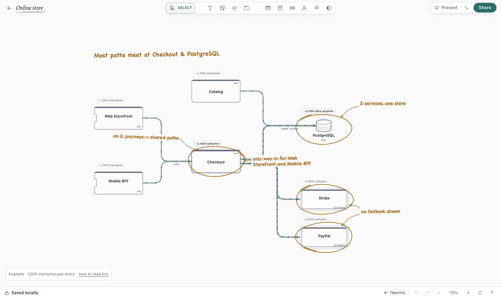
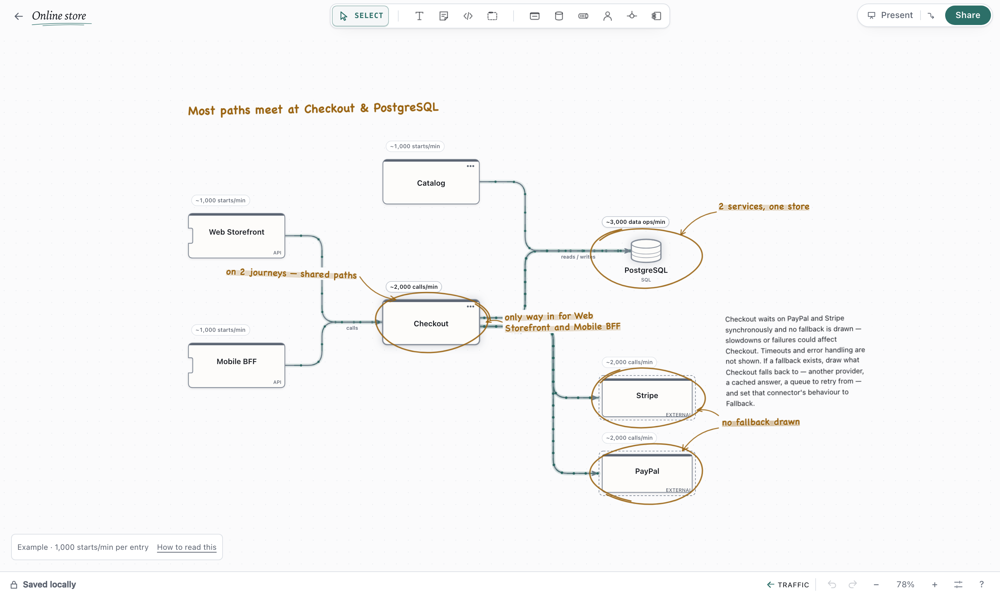
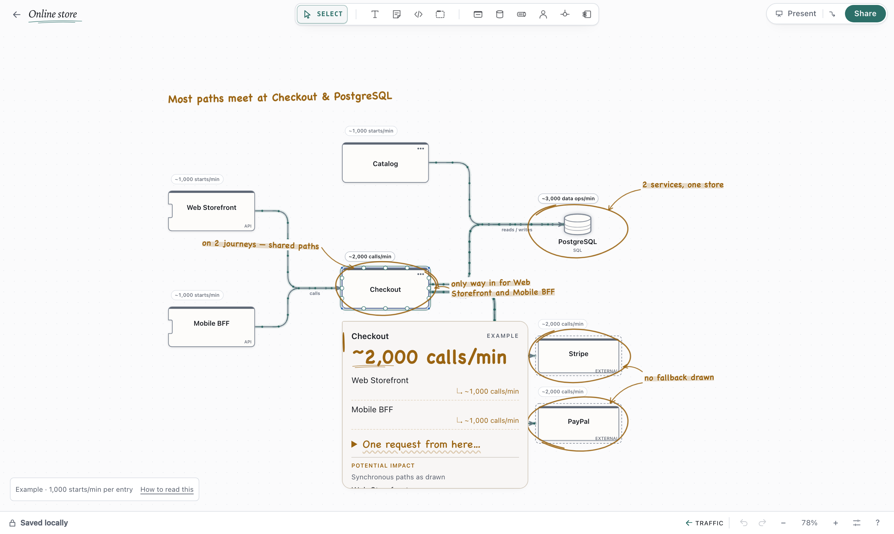
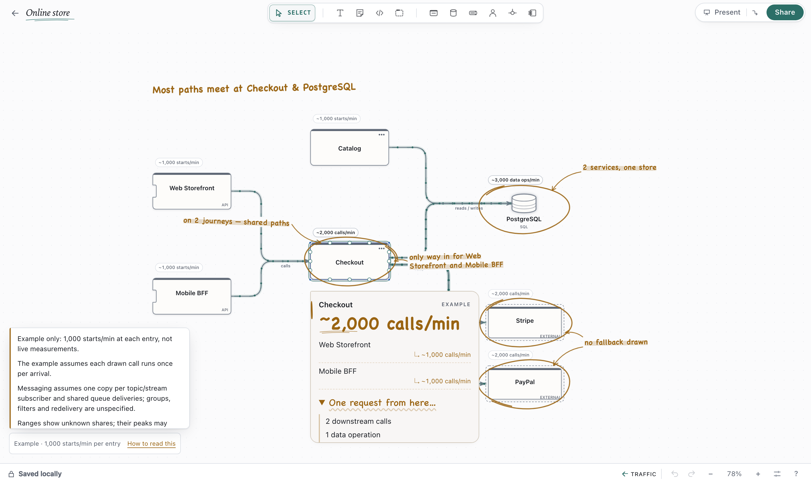
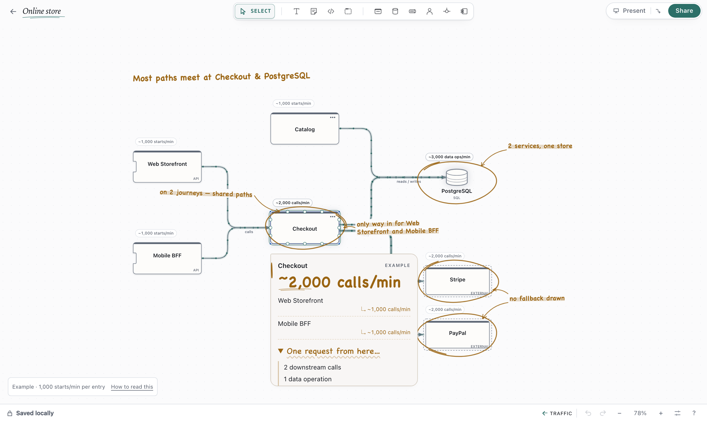
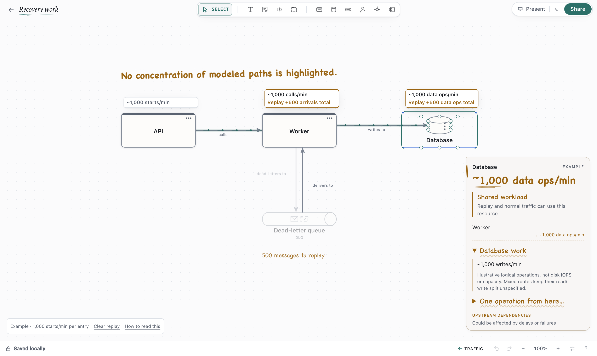
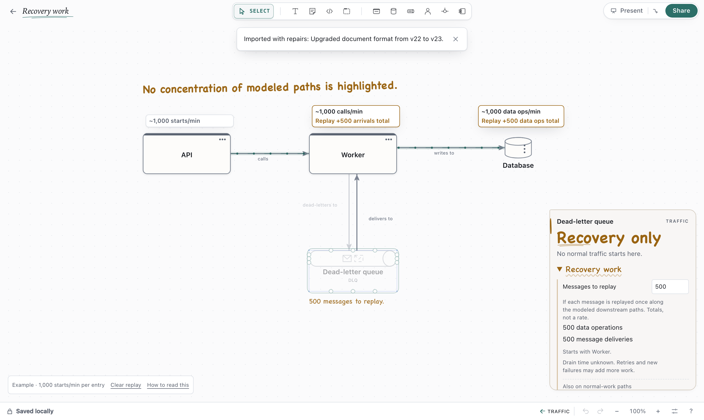
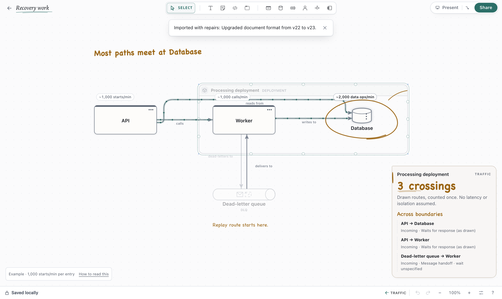

# Traffic

Traffic reads the runtime connectors in your diagram and marks modeled paths and dependencies on the canvas.
It starts with an illustrative traffic rate; there is nothing to fill in.

## Show traffic

Click **Traffic** in the status bar once the canvas has a runtime connector: a service calling a
service, reading or writing a data store, publishing to or consuming from a queue. You can also
choose **Show traffic** from the canvas's right-click menu or the command palette (⌘K / Ctrl+K).

Press `Esc`, or click **Traffic** again, to put it away. Opening another diagram, stepping into or
out of a shape, presenting or turning on a spotlight also ends it.

## Read the canvas

- Flowing light runs along every connector that carries traffic, in the direction the work travels.
  A backwards **read by** arrow still flows from the reader to the store. Busier lines carry denser
  streams. A branch that only some traffic may take — after a Junction split, through one of a
  gateway's routes, toward competing consumers, or behind a condition — is sparse and faint. When
  traffic starts, the streams begin at entry points and spread hop by hop.
- Where paths meet, the shape is lit along its outline with illustrative rates beside runtime shapes, such as **~3,000 calls/min**. A range
  keeps unknown branch shares explicit; its upper bounds need not occur together.
- Up to seven findings appear as handwritten notes beside the shapes they describe: a marker loop,
  a short note and sometimes an arrow between shapes. Tap or click a note, or Tab to it and press
  `Enter`, to unfold the explanation in place. Activate it again or press `Esc` to fold it.
  Notes sit above connector labels and arrows, with the canvas colour behind their text so dense
  drawings stay readable. A selected shape's explanation also avoids nearby findings.

  

- A handwritten headline above the diagram says where most paths meet. **+N open questions** below
  it unfolds what the diagram does not say: unknown split shares, conditions, loops, retries,
  schedules, connectors through components, and gateways that are also called directly.

Select a shape while traffic shows to open a field note: a large illustrative rate, a rate contribution for each incoming
source, then separate sections for potential impact and synchronous dependencies as drawn. These
show reachability, not guaranteed outages: timeouts, optional calls and fallback behavior affect
what actually happens. Resources after message handoffs are identified without promising isolation
from backpressure or acknowledgement waits.

The field note keeps a readable text size as you zoom and stays inside the canvas. Longer notes
scroll within the available space; focus the note to scroll it with the keyboard.

If nothing can be read — there are no runtime connectors, or every service is reached from another
so no path has a start — Traffic says so instead.

## What it finds

Traffic points out observations such as:

- resources on several modeled journeys;
- stores used by several services, without assuming shared tables, locks or ownership;
- synchronous external dependencies with no fallback drawn (absence from a diagram is not proof
  of absence in the implementation);
- a single drawn way in, or several routes to one resource;
- synchronous dependencies and chains worth reviewing for failure handling;
- message handoffs, with buffering and delivery semantics left explicit as assumptions;
- queues with no consumer or replay route drawn, and paths around a gateway.

Topology alone cannot establish availability, failure isolation, real backlog, or which component
is most important to protect. A single shape can represent multiple replicas.

## Follow the work

Traffic starts at **1,000 starts/min per entry**, a round example rather than measured usage or a
recommended operating rate. It is a fixed reference to make the drawing easier to read, with no
rate controls or required input. **How to read this** in the small lower-left reference bar opens a compact explanation; select a
shape to see where its traffic comes from and unfold the work caused by one arrival. The floating
edit toolbar stays out of the way while Traffic is open.

Each drawn baseline call is assumed to run once per incoming arrival. Rates use **calls/min**,
**messages/min**, or **data ops/min**; mixed work uses **arrivals/min**. Entry points use
**starts/min**, so a scheduler or source queue is not presented as HTTP traffic. Two independent
entries feeding the same service each contribute their example rate. The example models topic/stream subscribers as independent recipients and queue consumers as
sharing deliveries. Consumer groups, filters, acknowledgements and redelivery can change real
counts. Competing consumers and conditional routes keep ranges instead of invented shares.

Select a shape to see its illustrative rate alongside a tally of the incoming sources and potential dependency impact. The tally uses the current example
rate. Different types of work from one source stay separate.

Unfold **One request from here…** in the selected shape’s note to see the downstream calls, data
operations, messages published and message deliveries caused by one arrival at that shape. Queues
say **One message**; schedulers say **One start**. No additional input is needed. This follows all
drawn downstream work in the current view (or selected flow), rather than only immediate neighbours,
and is independent of the example rate. A published message and its deliveries are counted
separately, so a topic with two subscribers reads as one publication and two deliveries. Unknown
branches stay ranges; reachable loops or analysis limits withhold the total. Retries and failure
paths remain outside the baseline.

Loops and their downstream work show **Rate unknown**, as do capped counts or incomplete analysis.
Retries, failure paths and background work remain outside this baseline. The example does not predict
latency, utilisation, capacity or overload.

## Paths and assumptions

Each entry point — an Actor, a Scheduler, or a service or queue that nothing drawn leads into —
starts one path. Every runtime connector carries the paths that reach its source on to its target.
A count is the number of drawn routes that meet at a shape.

Counts assume every drawn call happens; how often each is taken is not drawn. The illustrative scenario scales these paths by the example input; it does not establish an actual
rate, latency number, utilisation or capacity. Requests, messages and data operations are ranked
separately because they are different kinds of work.

## What counts

| Counted | Not counted |
| --- | --- |
| Calls, HTTP, gRPC, commands, queries, routes, triggers | Depends on, uses, implements |
| Reads, writes, queries, searches, indexing, cache invalidation | Replication, change capture, syncing |
| Publishing to and consuming from queues, topics and streams | Dead-lettering, compensation, failure and fallback paths |
| Routes through Junctions | Retries and callbacks (noted, not added) |

Components, ports, adapters, tables, boundaries, notes and plain shapes aren't runtime resources. A
path that runs through one stops there.

When a flow is in view when traffic is shown, that flow's connectors are analyzed.

## Database work

Select a data store and unfold **Database work** for illustrative logical reads and writes per
minute, derived from its incoming connectors. No input is needed. Mixed or unspecified routes stay
combined, including parallel connectors merged into one modeled route; Traffic does not invent a
read/write ratio. Unknown branch shares remain ranges. These operations are not disk IOPS,
throughput capacity or latency: caches, query complexity, batching and indexes affect physical work.

## Recovery work

Select a dead-letter queue or a shape with an outgoing compensation connector, then unfold
**Recovery work** in its traffic note. One replay or compensation attempt is the default.
For a drawn replay route, optionally enter a batch size such as **500 messages** to see the total
downstream calls, data operations and message deliveries. These are totals, not requests per minute:
a backlog alone cannot tell us how quickly it drains.

An idle DLQ does not start normal traffic. Recovery follows the routes you drew and highlights
dependencies also used by normal work. Without an outgoing replay route, it asks you to draw one.
While a positive replay example is active, selecting a resource used by both replay and normal
traffic shows a short **Shared workload** takeaway. It points out shared use, without predicting
overload or latency.

Compensation remains a range because the diagram cannot tell which earlier steps completed.
Retries and new failures can add more work; loops have no finite total. The optional count is local,
stays while you inspect other shapes, and never edits the diagram. Returning to the DLQ keeps
the chosen count. Use **Clear replay** beside the traffic example to return to normal traffic without closing the
reading. Closing Traffic or changing the analyzed graph also clears the example. While exploring a replay,
affected shapes include **Replay +… total** in their top traffic chip, alongside the normal rate.
The replay total updates with the count. Collapsing **Recovery work** hides its controls while
keeping the chosen example visible on the diagram. A small note beside the DLQ describes the example.
Enter zero to show “Nothing to replay in this example” and hide extra replay numbers; this does
not claim the live queue is empty. Normal RPM
stays unchanged; a batch size does not establish a replay rate.

## Boundary crossings

Select a network, deployment, domain or system boundary to see its incoming and outgoing modeled
routes. Resource notes and selected connectors also show their boundary crossings. **Waits for
response (as drawn)** comes from calls and data operations modeled as synchronous, including the
connector default. Message handoffs say **Message handoff · wait unspecified**: the diagram does
not establish acknowledgement behavior or whether an application waits for a reply. Conditional
routes say **If taken**.

Membership determines a crossing, not where a bent line runs. Each logical route counts once,
even across nested boundaries or duplicate connectors. Plain visual groups add no architectural
meaning. A logical crossing is not a physical network hop. These notes do not infer latency,
security, isolation or capacity. Failure, compensation
and background connectors remain outside these normal-route readings.

## Junctions

Junctions route traffic but never receive it. A route through several Junctions counts once. When a
Junction sends traffic to more than one place, each branch is only a possible path — the split isn't
drawn, so none is assumed. A Topic or Stream behind a Junction is modeled as delivering to each drawn subscriber, so its
branches stay certain within that assumption.

## Loops

Loops are counted once. How often they repeat isn't drawn.

## Levels

Traffic reads the view you are in. Shapes inside another shape aren't counted again at this level.
In a view of the parts inside one service, step out to see traffic between services.

## Accessibility

Notes are keyboard-focusable buttons. Findings are also announced to screen readers. With reduced
motion enabled, all streams, counts and notes still appear; only the movement is reduced.

## Privacy

Traffic is worked out on your device from the diagram on screen. It isn't saved, doesn't change the
diagram or its undo history, and isn't sent to collaborators — each person in a live session sees
their own.
