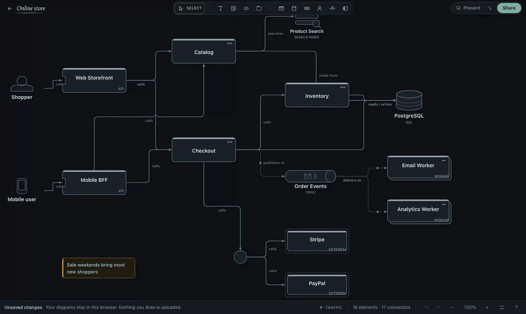

# Traffic

Traffic reads the runtime connectors in your diagram and marks the consequences on the canvas.
There is no panel to fill in or open.

## Show traffic

Click **Traffic** in the status bar once the canvas has a runtime connector: a service calling a
service, reading or writing a data store, publishing to or consuming from a queue. You can also
choose **Show traffic** from the canvas's right-click menu or the command palette (⌘K / Ctrl+K).

Press `Esc`, or click **Traffic** again, to put it away. Opening another diagram, stepping into or
out of a shape, presenting or turning on a spotlight also ends it.

## Read the canvas

- Flowing light runs along every connector that carries traffic, in the direction the work travels.
  A backwards **read by** arrow still flows from the reader to the store. Busier lines carry denser
  streams. A branch that only some traffic may take — after a Junction split, through one of a
  gateway's routes, toward competing consumers, or behind a condition — is sparse and faint. When
  traffic starts, the streams begin at entry points and spread hop by hop.
- Where paths meet, the shape is lit along its outline with a count such as **3 paths**. **2–4
  paths** means two are certain and up to two more may arrive across a split whose share is not
  drawn.
- Up to seven findings appear as handwritten notes beside the shapes they describe: a marker loop,
  a short note and sometimes an arrow between shapes. Tap or click a note, or Tab to it and press
  `Enter`, to unfold the explanation in place. Activate it again or press `Esc` to fold it.
  Notes sit above connector labels and arrows, with the canvas colour behind their text so dense
  drawings stay readable. A selected shape's explanation also avoids nearby findings.

  

- A handwritten headline above the diagram says where most paths meet. **+N open questions** below
  it unfolds what the diagram does not say: unknown split shares, conditions, loops, retries,
  schedules, connectors through components, and gateways that are also called directly.

Select a shape while traffic shows to open a field note: a large path count, a row for each incoming
source, then separate sections for outage impact and dependencies. When the waiting services are
also the stalled journeys, their names appear once. The note also shows what is safely behind a
queue or topic.

The field note keeps a readable text size as you zoom and stays inside the canvas. Longer notes
scroll within the available space; focus the note to scroll it with the keyboard.

If nothing can be read — there are no runtime connectors, or every service is reached from another
so no path has a start — Traffic says so instead.

## What it finds

Traffic points out consequences such as:

- elements on several journeys: protect these first;
- a store that several services write: coupled schema, locks and outage risk, with no clear owner;
- an external service on a synchronous path with no fallback. To draw one, connect the caller to
  what it falls back to and set that connector's behaviour to **Fallback**. The note then becomes
  a question about coverage;
- a single way in for a journey;
- a store hit twice by one request, directly and through a callee;
- a request that needs many things up at once;
- the longest synchronous wait chain, including which call to put behind a queue;
- what a queue or topic decouples or copies;
- queues or topics nobody consumes, a dead-letter queue nobody drains, and a gateway that is also
  called directly.

## Paths, not load

Each entry point — an Actor, a Scheduler, or a service or queue that nothing drawn leads into —
starts one path. Every runtime connector carries the paths that reach its source on to its target.
A count is the number of drawn routes that meet at a shape.

Counts assume every drawn call happens; how often each is taken is not drawn. Traffic never shows a
rate, latency number, utilisation or capacity. Requests, messages and data operations are ranked
separately because they are different kinds of work.

## What counts

| Counted | Not counted |
| --- | --- |
| Calls, HTTP, gRPC, commands, queries, routes, triggers | Depends on, uses, implements |
| Reads, writes, queries, searches, indexing, cache invalidation | Replication, change capture, syncing |
| Publishing to and consuming from queues, topics and streams | Dead-lettering, compensation, failure and fallback paths |
| Routes through Junctions | Retries and callbacks (noted, not added) |

Components, ports, adapters, tables, boundaries, notes and plain shapes aren't runtime resources. A
path that runs through one stops there.

When a flow is in view when traffic is shown, that flow's connectors are analyzed.

## Junctions

Junctions route traffic but never receive it. A route through several Junctions counts once. When a
Junction sends traffic to more than one place, each branch is only a possible path — the split isn't
drawn, so none is assumed. A Topic or Stream behind a Junction delivers to every subscriber, so its
branches stay certain.

## Loops

Loops are counted once. How often they repeat isn't drawn.

## Levels

Traffic reads the view you are in. Shapes inside another shape aren't counted again at this level.
In a view of the parts inside one service, step out to see traffic between services.

## Accessibility

Notes are keyboard-focusable buttons. Findings are also announced to screen readers. With reduced
motion enabled, all streams, counts and notes still appear; only the movement is reduced.

## Privacy

Traffic is worked out on your device from the diagram on screen. It isn't saved, doesn't change the
diagram or its undo history, and isn't sent to collaborators — each person in a live session sees
their own.
