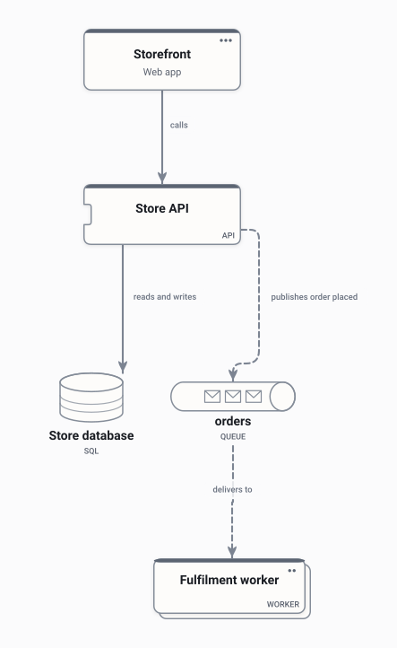
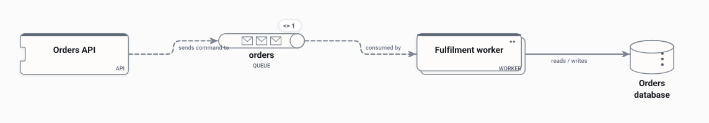

# Online store

A sample README, written the way **Use in docs** leaves one: each picture is one line of ordinary
Markdown pointing at an SVG, with the editable `.draftcanvas` beside it. Nothing here needs Draft
Canvas to show.

## Architecture

Shoppers buy through the online store, which charges cards with a payment provider and sends
receipts by email.

Inside the store, the storefront calls the Store API, and a worker fulfils orders from a queue.

The Store API's own components are one level further in:
[online-store.store-api.svg](online-store.store-api.svg). All three pictures come from
[online-store.draftcanvas](online-store.draftcanvas).

## Order processing

Orders go onto a queue, and a worker fulfils them.

## Changing a diagram

Open the `.draftcanvas` file in Draft Canvas and save. With **Redraw on every save** on, the SVG
beside it is redrawn and this page shows the new picture; the lines above never change.
