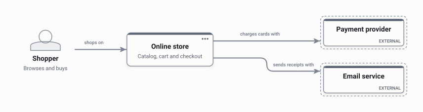

# Online store

A sample README, written the way **Use in docs** leaves one: each picture is one line of ordinary
Markdown pointing at an SVG, with the editable `.draftcanvas` beside it. Nothing here needs Draft
Canvas to show.

## Architecture

Shoppers buy through the online store, which charges cards with a payment provider and sends
receipts by email.

The store has two more levels inside it: its containers, and the Store API's components. Open
[online-store.draftcanvas](online-store.draftcanvas) and look inside **Online store** to see them.
A published picture shows one level; [levels/](levels/) has what each of the other two looks like.

## Order processing

Orders go onto a queue, and a worker fulfils them.

## Changing a diagram

Open the `.draftcanvas` file in Draft Canvas and save. With **Redraw on every save** on, the SVG
beside it is redrawn and this page shows the new picture; the lines above never change.
