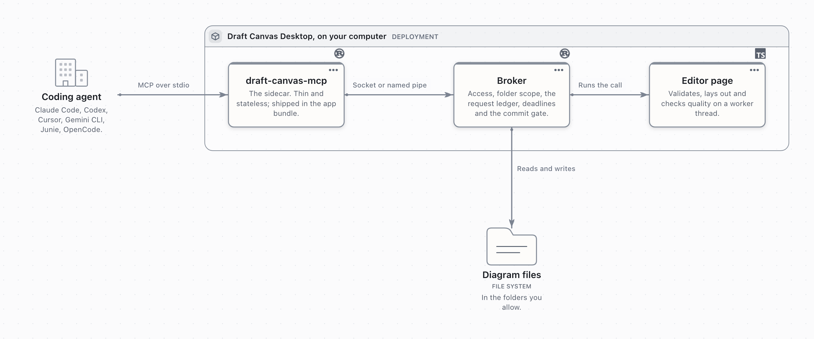

# Agent integration (MCP)

Draft Canvas Desktop lets a coding agent on the same computer draw and revise diagrams over the
[Model Context Protocol](https://modelcontextprotocol.io). This page is the contract: tools,
receipts, limits, errors and security.

The agent sends a semantic graph: elements, relationships, groups, flows and notes. Draft Canvas
validates it, lays it out and writes ordinary, editable content that is saved and undoable; files
carry no agent data. Setup and everyday use:
[Connect an AI agent](../guides/connect-an-ai-agent.md).

## Architecture

<!-- Drawn in Draft Canvas: docs/media/reference/agent-architecture.json, rendered by
     `npx tsx e2e/og-diagram.ts --request <that> --out <the png>` against a dev server. -->


| Part | Code | Role |
| --- | --- | --- |
| Sidecar | `draft-canvas-mcp` in `src-tauri/mcp/` (`rmcp` 3.4), bundled with the app | MCP JSON-RPC over stdio, logs on stderr. Stateless: forwards each call, reconnecting on the next |
| Broker | `src-tauri/src/agent/` | Newline-delimited JSON over a user-only Unix socket (macOS) or named pipe (Windows). Access, folder scope, the request ledger, file reads, deadlines and the commit gate |
| Page | `src/desktop/agent.ts` → `src/agent/` (worker) → editor store | Runs each call; validation, layout and quality checks use the canvas's own shape, text and routing code |

- **One writer.** Edits to the open document go through the editor store and undo history. The shell
  writes a new diagram with a create-only write, which never overwrites.
- **Versions.** The MCP version is what `rmcp` negotiates. A sidecar and app on different bridge
  versions answer `VERSION_MISMATCH`.

## Tools

Discovery advertises one dispatcher, `diagram_tool({tool, args})`: send an operation from the tool
table as `tool`, with its arguments in `args`.

| Dispatcher call | Returns |
| --- | --- |
| `{tool: "help", args: {}}` | This session's operations |
| `{tool: "help", args: {tool: "update_diagram"}}` | The operation's common arguments; for `update_diagram`, every op and the fields `set` takes for each kind of target |
| `{tool: "get_capabilities", args: {tool: "update_diagram"}}` | The operation's complete schema |

- Every request is validated against the full contract (`contract: 4`).
- The sidecar refuses a malformed dispatcher call, naming the argument at fault: arguments beside
  `tool` instead of inside `args`, `args` as a string, or an unknown operation (listing the known
  ones).
- The dispatcher is annotated as mutating; the broker checks permissions, review-only restrictions
  and idempotency against the resolved operation.
- `--full-tools` advertises each operation as its own tool with read/write annotations, for clients
  that need them or tool allowlists. Operation names work directly without it too.
- Schemas live in `src/agent/schema.ts`; `npm run agent:schemas` regenerates `tools.json` and
  `entry-tools.json` in `src-tauri/mcp/`.

| Tool | Kind | Purpose |
| --- | --- | --- |
| `get_capabilities({tool?, topics?, starter?})` | read | With `tool`, that tool's complete input schema; with `starter`, one starter's element keys and flows. Otherwise an index of topics and common word lists, plus each of `topics` in full (`types`, `relationships`, `c4`, `flows`, `notes`, `sequences`, `starters`, `limits`, `layout`, `readability`). Starters are only those the person downloaded from the [starters gallery](../guides/getting-started.md#start-from-a-starter). |
| `list_diagrams({query?, project?, cursor?, limit?})` | read | Diagrams in allowed folders, plus `active` (the open one) and `thisSession` (ones this session changed). |
| `read_diagram({diagramId, query?, view?, focus?, include?, outage?, impact?, cursor?, format?})` | read | One view, semantically ([Reading](#reading)). |
| `read_attachment({diagramId, expectedRevision, attachmentId, offset?, view?})` | read | Full note or code text in 8,192-character chunks: repeat with `offset: nextOffset` until `nextOffset` is `null`. A changed revision is refused. |
| `read_selection({diagramId})` | read | The current selection ([Selection-aware editing](#selection-aware-editing)). |
| `diagram_history({diagramId, action, revision?, against?, alternative?, name?, query?, limit?})` | read | The open diagram's history. `action`: `summary`, `list`, `compare`, `read` (only when the person allows it), `preview_restore`, `preview_merge` or `suggest_milestone` ([ADR-13](evolution.md#adr-13-diagram_history-a-reviewed-view-for-agents)). |
| `get_implementation_context({diagramId, view?, focus?})` | read | What to implement, in order ([Reading](#reading)). |
| `render_diagram({diagramId, view?, format?, scale?, theme?, previewId?, focus?})` | read | PNG (`scale` 1–3, `light`/`dark`) or SVG from the export renderer, at most 8 MB. `focus`: `{nodes}`, `{group}`, `{flow}` or `{selection: true}`, with optional `neighbors`. |
| `create_diagram({requestId, title, nodes?, relationships?, groups?, flows?, notes?, sequences?, level?, starter?, layout?, project?, open?, allowDuplicateTitle?, fallbackType?})` | write | A new file ([Creating a diagram](#creating-a-diagram)). |
| `update_diagram({requestId, diagramId, expectedRevision?, ops?, previewId?, rename?, intent?, view?, scope?, layout?, activate?, onConflict?})` | write | Every follow-up ([Changing a diagram](#changing-a-diagram)). |
| `preview_diagram({diagramId, expectedRevision, ops, view?, layout?, scope?})` | read | An unsaved candidate: `previewId`, diff and quality ([Changing a diagram](#changing-a-diagram)). |
| `submit_proposal({requestId, diagramId, expectedRevision?, summary, ops?, rename?, intent?, rationale?, assumptions?, openQuestions?, view?, layout?, scope?, sourceRef?, revises?})` | write | Changes for a person to review ([Proposals](#proposals-review-before-applying)). |
| `get_proposal({proposalId})` | read | Status, counts and `stale`. |
| `list_proposals({diagramId?, cursor?, limit?})` | read | Proposals, newest first. |

- Write tools are idempotent by `requestId`, 1–128 characters: a fresh UUID per change
  ([Retries](#retries-and-the-request-ledger)).
- New ids match `^[A-Za-z][A-Za-z0-9_.-]{0,63}$` and become native ids. Existing ids, such as `n_…`,
  are used as they are.

## Limits

Per request (`AGENT_LIMITS` in `src/agent/input.ts`). A breach is `LIMIT_EXCEEDED` with a JSON
pointer.

| Limit | Value |
| --- | --- |
| Elements / relationships / groups | 300 / 600 / 60 |
| Flows / steps per flow | 20 / 60 |
| Extra elements / relationships one step lights | 40 / 40 |
| Notes / open points / ops | 60 / 50 / 100 |
| Sequences / sequence text | 8 / 20,000 characters |
| Attachments per element in a request | 4 |
| Label / relationship label / group label | 120 / 80 / 80 characters |
| Description / technology | 280 / 60 characters |
| Note / code | 1,000 / 4,000 characters |
| Flow title / step caption / reply label | 100 / 120 / 120 characters |
| Delivery attempts | 1–50 |
| Inside-view depth | 3 |
| Boundaries nested in one view | 32 |
| Bridge frame | 4 MiB, at most 4 calls in flight per connection (the sidecar holds a fifth until one ends) |

Text is never truncated: a shape grows to 280 × 320 px, and a name that still does not fit is
`LIMIT_EXCEEDED`. Other bounds are in each tool's schema (`get_capabilities({tool})`), read page
sizes under [Reading](#reading) and deadlines under [Retries](#retries-and-the-request-ledger).

## Errors

A tool failure is a result with `isError: true`; a JSON-RPC error means a malformed request. A
failure has a stable `code` and a `message`, and where useful a `hint`, `retryable: true` (a
transient failure the same request may clear) and `details` with a JSON pointer `path` and up to 20
problems. Messages can name diagram items but never carry stack traces.

- A missing update target is `INVALID_REFERENCE` at its id, such as `/ops/0/id` or `/ops/1/ids/2`.
  If the exact id is in another view, the message names that view; if the input matches one label
  in the addressed view, it can suggest the id.
- An unsupported field on an existing target names its kind and accepted fields. A value error names
  the field and what it accepts.

| Area | Codes |
| --- | --- |
| Input | `INVALID_INPUT`, `UNSUPPORTED_TYPE` (with the closest type words), `INVALID_REFERENCE`, `DUPLICATE_ID`, `CONTAINMENT_CYCLE`, `LIMIT_EXCEEDED`, `UNSUPPORTED`, `UNKNOWN_TOOL` |
| State | `REVISION_CONFLICT` (with `currentRevision`), `CURSOR_STALE`, `DOCUMENT_BUSY`, `BUSY`, `READ_ONLY`, `NOT_FOUND`, `NOT_ACTIVE` (the diagram is not open: `read_selection`, a `{selection: true}` render, `diagram_history`), `AMBIGUOUS_DIAGRAM`, `DUPLICATE_TITLE`, `DUPLICATE_FLOW` |
| Layout | `LAYOUT_FAILED`, `LAYOUT_CONSTRAINED` (with `suggestedOp`) |
| Retries | `REQUEST_ID_MISMATCH`, `OUTCOME_UNKNOWN` (the change might have landed: check the diagram before another edit) |
| Scope | `NOT_ENABLED`, `OUT_OF_SCOPE` (a folder agents may not use, or an op outside `scope`), `SCOPE_TARGET_MISSING`, `UNAUTHORIZED` |
| Proposals | `PROPOSAL_CLOSED`, `PROPOSAL_CHANGED` |
| Connection | `APP_UNAVAILABLE` (Draft Canvas is not running), `APP_STARTING`, `APP_UNRESPONSIVE`, `CONNECTION_LOST`, `VERSION_MISMATCH`, `TIMEOUT`, `CANCELLED` |
| Other | `INTERNAL` |

## One diagram across a conversation

An agent creates a diagram once; every follow-up is `update_diagram` on the same `diagramId`. Which
diagram, in order:

1. An id the person named, or one from earlier in the conversation.
2. The diagram this conversation created or last changed (`list_diagrams.thisSession`, per sidecar
   process).
3. "The current diagram": `list_diagrams.active`.
4. A title: `list_diagrams({query})`. If several match, the agent asks.

A deleted or moved diagram is `NOT_FOUND`. A failed update never becomes a create.

## Reading

`read_diagram` returns elements with their C4 `role` and `scope` ([C4 support](#c4-support)),
relationships by endpoint, and notes, attachments and flows with their ids. Elements, boundaries,
notes, relationships and flows carry their `color` in the form `add` and `set` take. Empty values
are left out (no `insideViews` when none has one, no geometry `pins` when both ends are automatic),
and display geometry is rounded to hundredths.

Pages hold at most 200 elements, 400 relationships, 20 flows, 50 open points and 96 KB. A `cursor`
is bound to the revision and read options; a change answers `CURSOR_STALE`.

| Option | Effect |
| --- | --- |
| `view.inside: [ids…]` | A nested view. A service or component with none reads as empty. |
| `focus` | Elements, a group or a flow. Adds `partial: true` and the relationships crossing the edge. |
| `include: ["geometry"]` | Boxes, and relationship `geometry: {from, to, path, pins?, via?}`: the numbers `place` and `route` take. |
| `include: ["attachments"]` / `["fullText"]` | Attachment previews, or complete text. |
| `include: ["suggestions"]` | Up to 5 next-step suggestions per element. Never applied. |
| `include: ["views"]` | An outline of every inside view. |
| `outage: {element, allInstances?}` / `{connector}` | What the drawing says follows if that element or group goes down, or that relationship while both its ends stay up: `headline`, `affected` (id and state), `unaffected`, `notes` (an open question carrying `open`, a quoted product behaviour its `sources`) and `flows` (each flow's `state`, and the `step` it breaks at). First page only. |
| `outage: {}` | Every element, group and relationship whose loss changes something drawn: `review` and `connectors` (each with `reaches`, `flows`, `affected`, `open` and a sentence), `oneInstanceOfSeveral` and `nothingElseChanges`. An order, not a severity. |
| `impact: {element}` | What a change to that element or group touches, anywhere in the file: `reaches` and `reachedBy` (ids nearest first, with a `total`), `contains`, `crossings` (the boundaries its relationships cross), `shares`, `flows` and `openPoints`. Follows the relationships as drawn, through junctions and linked junctions into other views. Read from the drawing, never measured. |
| `include: ["checks"]` | What the drawing itself says is unfinished or tangled, across every view: `counts` by severity and `findings` (each with a stable `id`, `rule`, `class`, `severity`, `ids`, `view` and a sentence). The same findings `draftcanvas check` reports without a repository; evidence is not held against files here. |

| `format` | Returns |
| --- | --- |
| `"draft"` (default) | The semantic view, with the options above. |
| `"edit"` | An editing index: ids, types, labels and `view.inside` paths, relationships with both ends, 20 a page, plus patch syntax. Takes `query` (one name or up to 8) across every room, or `view`, and `cursor`; not `focus` or `include`. No review. |
| `"outline"` | File title and revision, plus paths, owners, levels and counts for up to 100 inside views (`viewsTruncated` marks a longer outline). |

`outline` covers the file and ignores `view`, `focus`, `include` and `cursor`.

Contract 4 removed the `"mermaid"`, `"plantuml"` and `"c4"` formats, which wrote the diagram as
another tool's text. Asking for one is refused as `INVALID_INPUT`, with a hint naming the formats
above. A native sequence still reads as Mermaid text inside a `draft` read, and `render_diagram`
gives a picture.

**Search.** `read_diagram({diagramId, query})` matches ids, labels and Junctions' `link`
(case-insensitive substring) in every room: shapes, free notes, groups, relationships and flows, not
attachment bodies or ink. It returns at most 20 matches with ids, types, labels and `view.inside`
paths, plus the file revision; `total` counts all matches, and `truncated` means refine the query.
A label over 200 characters has `labelTruncated: true`. Without `format: "edit"`, `query` takes no
other read option. Edit a match by its id, view and revision; the receipt verifies the change
without another read.

**Implementation context.** `get_implementation_context` returns flow steps as stored, sequences (at
most 8), notes, decisions, code and boundaries. It is held to 96 KB: notes are cut at 400
characters, a list that still doesn't fit is halved and named in `truncated`, and `more` says how to
read the rest.

### Semantic review

The first page of a read also carries `review`: up to 8 findings, most important first, about what
a pattern in the view is missing (`src/agent/review.ts`). Each is `{code, ids, message}`, a fact to
raise with the person, not a change to make. A focused read keeps the findings about its focus.

| `code` | When |
| --- | --- |
| `call-cycle` | Two services (or components) call each other with plain calls. A callback, event or async reply is not a call. |
| `shared-database` | Two or more services, workers or schedulers write (`writes`, `readsWrites`) the same database. |
| `no-consumer` | A queue, topic or stream receives messages and nothing consumes them. |
| `no-dead-letter` | A queue with consumers has no dead-letter path, its own or a consumer's; or a stream consumer has nowhere to park a record. Topics never get this. |
| `dead-letter-source` | A dead-letter queue is fed by something other than the queue whose messages it parks: a topic, a stream, or a consumer that writes to it itself. Names the queue to dead-letter from, or the consumer queue to add between a topic and its subscriber. A stream consumer parking a record is not flagged. |
| `no-producer` | A queue, topic or stream is consumed and nothing in the view sends to it. Not in inside views. |
| `cache-not-written` | A cache is read and nothing writes, refreshes or invalidates it. |
| `unconnected` | Shapes with no connections, in a view that has connections. Not in inside views. |

- A finding needs the model to say it: a connector's semantic counts when it was chosen, or inferred
  on a connector with no label (the canvas then shows that word).
- A connector that can't be read this way, or a junction or boundary at a part, silences findings
  about something absent there. A context-level view gets no messaging or cache findings.
- `create_diagram`'s receipt carries `review` for every view (an inside view's findings name it in
  `view`). An update or preview adds the findings it brought in to its advisories, as
  `Review (<code>): <message>`.

## Creating a diagram

`create_diagram` writes a new file.

- A title in use is `DUPLICATE_TITLE` unless `allowDuplicateTitle` is set.
- `fallbackType` draws unknown types as that type instead of refusing them.
- `starter` begins from a gallery starter the person downloaded. Its elements keep the file's ids
  under `starter.prefix`, in every view; an id in the request that one of them has is
  `DUPLICATE_ID`.
- The diagram opens when `open: true` and nothing would be lost, or when nothing else is open.
  Otherwise the receipt says `opened: false` and the person gets **Open**.
- The receipt counts free notes in `created.notes` and attached notes and code in
  `created.attachments`, across every inside view.

## Changing a diagram

`update_diagram` applies one change, as one undo step, whether or not the diagram is open. It takes
exactly one of these, plus `requestId` and `diagramId`:

| Change | Revision | Also takes |
| --- | --- | --- |
| `ops` | `expectedRevision` | `view`, `scope`, `layout`, `onConflict`, `activate` |
| `previewId` | `expectedRevision` | `view`, `activate` |
| `rename: {from, to}` ([Exact-label rename](#exact-label-rename)) | None: resolved to the current one | `view`, `scope`, `activate` |
| `intent` ([Edit intents](#edit-intents)) | `expectedRevision`, which must be current | `view`, `scope`, `activate` |

Ops run in order:

| Op | Does |
| --- | --- |
| `{op:"add", nodes?, relationships?, groups?, flows?, notes?, sequences?, openPoints?, level?}` | Adds content beside what it connects to. |
| `{op:"update", id, set:{…}}` | Edits anything by id. Omitted fields stay; `null` clears an optional field. |
| `{op:"remove", ids, cascade?}` | Removes. A non-empty group needs `cascade`. |
| `{op:"setLevel", level}` | Sets the view's C4 level. `null` makes it a non-C4 view, also an inside view that would otherwise inherit one. |
| `{op:"arrange", …}` | Re-lays out in place ([Arrange](#arrange)). |
| `{op:"moveInside", owner, ids}` / `{op:"moveOutside", ids}` | One C4 level down or up ([C4 support](#c4-support)). |

- `view.inside` names the view to change.
- Existing elements never move except by `arrange` or `set.place`. Boundaries grow to hold new
  members.
- As in the editor, one ordinary relationship runs each way between two elements. A second, added
  or re-pointed, is `UNSUPPORTED` (a `compensates` action may sit beside its step).
- A `set.kind` the pairing doesn't offer is `UNSUPPORTED`; on a new relationship it is left out with
  an advisory.
- If new content cannot fit, `LAYOUT_CONSTRAINED` carries `suggestedOp`, an `arrange` to add to the
  request. A problem in another view (a linked junction renamed there) names that view and carries
  none: arrange that view in a request of its own first.

**Previews.** `preview_diagram` makes a candidate with no file, history, recovery copy or proposal.
Render it with `render_diagram`, then apply it with `update_diagram`, both by `previewId`.
Candidates last 10 minutes, and at most 4 (64 MB) are kept per page. A changed diagram or another
agent session refuses the candidate; panning and zooming are not changes.

**Source evidence.** Elements and relationships take up to 8 `evidence` entries:
`{path, basis: "observed" | "inferred", symbol?, commit?, line?, explanation?}`, with a
repository-relative `path`. They show under **Source evidence** in Details and are never fetched or
checked.

### Exact-label rename

`rename_element({diagramId, requestId, from, to, view?, scope?})` renames in one call, with no read
or schema lookup. The sidecar sends it as `update_diagram` with `rename: {from, to}`.

- Labels match exactly, including case, across architecture shapes and boundaries in every room, or
  in one with `view: {inside: [ids]}`. `scope` keeps selection limits.
- When no architecture shape carries the label, a [linked junction group](#linked-junctions) with
  that label is renamed.
- No match is `NOT_FOUND`; several are `INVALID_INPUT`, with up to 20 `matches` and their `total` in
  `details`. Nothing changes.
- An identical retry replays its receipt even after the old label is gone: the request is journaled
  before the label is resolved.
- The compact receipt keeps durability, revision, undo, warnings and recovery instructions.
- If the person asked to review changes first, send the rename as a proposal.

### Edit intents

`intent` on `update_diagram` or `submit_proposal` is one edit addressed by exact labels instead of
ids, looked up in every room or only in `view`. No match is `NOT_FOUND`; several are
`INVALID_INPUT`. New ids are `intent_<n>`.

| `kind` | Fields | Becomes |
| --- | --- | --- |
| `shape` | `target`, `set: {label?, description?, technology?}` | An `update` of the shape or boundary labelled `target` |
| `add` | `type`, `label`, `description?`, `technology?` | A new shape in `view` (default: the top view) |
| `connect` | `from`, `to`, `label?`, `semantic?`, `kindOfConnection?` | A new relationship between the shapes labelled `from` and `to`, in `from`'s view |
| `connection` | `from`, `to`, `label?`, `set: {label?, from?, to?, semantic?, kind?}` | An `update` of the relationship from `from` to `to` (with that `label`, if given) |

### Linked junctions

A `junction` takes `link`, a name of up to 64 characters that the agent chooses. Junctions with the
same `link` are one continuation point drawn in several places, in one view or across inside views,
and people travel between them.

| To | Send |
| --- | --- |
| Create or add | `{id: "out", type: "junction", label: "A", link: "payment-handoff"}` |
| Link, or move to another group | `{op: "update", id, set: {link: "payment-handoff"}}` |
| Unlink | `{op: "update", id, set: {link: null}}` |

- `read_diagram` returns each junction's `link`, and `linkedJunctions: [{link, label, places:
  [{id, view}]}]` for every group with a member on the page.
- A group has one label. Junctions sharing a `link` in one create, or in the `add` ops of one
  update, need the same label (`INVALID_INPUT` otherwise).
- `set.label` on any member renames every member, in every view. The receipt says how many others
  changed, and a review or proposal lists each with its view.
- A junction joining a group (`add` with `link`, or `set.link` alone) takes the group's label, with
  an advisory when that replaced its own.
- A link adds no relationship for flows, semantics and outage reads, which follow drawn relationships only. An `impact` read and the `checks` do follow it: two halves that meet at linked junctions are one relationship there.
- `link` on any other element type is `UNSUPPORTED`.

## Selection-aware editing

An agent captures the selection once, then edits only those ids, even if the person selects
something else:

1. `read_selection({diagramId})` returns the ids as `selection: {path, nodes, edges}`.
2. The agent passes them as `scope: {nodes, edges}` to `update_diagram`, `preview_diagram` or
   `submit_proposal`.

`read_selection` answers `NOT_ACTIVE` if the diagram is not open, and a `null` selection if nothing
is selected. It marks items `role: "selected"` or `"context"` (up to 50 neighbours) and reports a
selected sequence in full under `sequences`. It is held to 96 KB, except `selection`, which always
keeps every selected id, so a select-all of a large diagram can exceed it. `message` says when the
selection is larger than a scope takes: 300 shapes and 300 relationships.

With `scope`:

- `add` is always allowed.
- An `update` or `remove` outside the scope is `OUT_OF_SCOPE`, naming the ids. So is a change inside
  it that would carry anything outside it, in any view: a connector's meaning re-inferred for a
  retyped shape, a linked junction renamed with its group, a sequence participant renamed with its
  shape, a connector or flow step removed with a shape.
- Only drawing may change past the scope: a boundary grows to hold a shape moved into it, and
  connectors are re-anchored to a shape that moved.
- A scoped id that no longer exists is `SCOPE_TARGET_MISSING`.

## Proposals: review before applying

`submit_proposal` asks a person to **Accept** or **Reject** a batch of ops in the editor. It never
applies anything, and no MCP tool can resolve a proposal.

| Field | Rule |
| --- | --- |
| `ops` | Validated as `update_diagram` would. A non-empty `ops` that changes nothing is `INVALID_INPUT`; `ops: []` with a `summary` records "no architectural impact" (`informational`). |
| `rename` | Instead of `ops`, with `summary` and optional `view`, `scope` and `revises`; never with `layout` or `expectedRevision`. |
| `intent` | Instead of `ops`, with `expectedRevision` ([Edit intents](#edit-intents)). |
| `revises` | Replaces a pending proposal in place. A resolved one is `PROPOSAL_CLOSED`; a revision that landed first is `PROPOSAL_CHANGED`. |
| `sourceRef` | `{url?, title?, baseCommit?, headCommit?}` of a PR, shown to the person. Never fetched. |

Submission resolves a `rename` or `intent` once, into concrete ids and ops, and stores them with the
base revision and preconditions: the before-state of everything the ops change, in every view.
Accept never resolves a label again.

| State | Cause | Effect |
| --- | --- | --- |
| Stale (`stale: true`) | The revision moved | Informational; a non-blocking banner |
| Conflict | Something the proposal is about changed (preconditions against the live document), or new work that a re-run would change or delete | **Accept** stays disabled until the agent revises, even after a successful dry run |

- **Accept** re-checks the proposal version and diagram revision inside the commit and applies the
  whole batch as one undo step. If the diagram is unchanged since the dry run, it commits that
  run's result; otherwise it works the proposal out again.
- **Reject** and **Dismiss** never touch the document.
- A revised proposal lists its earlier versions (`history`, up to ten).
- Proposals are stored in `agent/proposals.jsonl`; resolved ones are kept 30 days.

### Crash recovery

A proposal is recorded as `accepting` before its commit. After a crash, the review panel's dry run
decides:

| Case | Dry run shows | Panel offers |
| --- | --- | --- |
| A | Never applied | **Accept** (retries) or **Dismiss** |
| B | Fails only because this proposal's own new ids exist with matching content | **Mark as applied** (no document write) or **Dismiss** |
| C | Anything else | **Dismiss**; never resolved automatically |

## Revisions, persistence and undo

| Revision | Means |
| --- | --- |
| `o:<pageEpoch>.<revision>` | The open document. Changes on every edit, undo, redo and page reload. |
| `f:<16 hex digits of SHA-256>` | A file on disk. Also valid for the open document while it has no unsaved changes. Saved receipts carry this. |

`expectedRevision` is checked before the work and again inside the commit, so a person's edit in the
meantime is `REVISION_CONFLICT {currentRevision}`. With `onConflict: "rebase"` (open diagrams), the
change applies to the current revision when the person changed none of the same content; otherwise
`REVISION_CONFLICT` lists the overlap.

| Receipt `state` | `persisted` | Meaning |
| --- | --- | --- |
| `saved` | `true` | No unsaved edits, so it was written to disk. |
| `applied-unsaved` | `false` | The person had unsaved edits; saving is theirs. The recovery copy covers it. |
| `save-failed` | `false` | Applied, but the write failed. **Do not send it again.** |
| `unchanged` | as before | Nothing changed. |

Receipts also carry the `revision`, counts, `where` (`editor` or `file`), `undo`, `quality`,
`legibility` and up to 5 advisories (10 on create).

- **Closed diagrams** are changed in their file only if it is unchanged since read
  (`REVISION_CONFLICT` otherwise); a pending recovery copy is `DOCUMENT_BUSY`. The person gets a
  notice with **Show**.
- **`activate: true`** opens the diagram once the change is written, unless the person is typing or
  has edited what is open by then; the notice offers it instead. It is refused (`DOCUMENT_BUSY`,
  nothing changed) when what is open has unsaved changes or is in a live session. A rejected or
  cancelled request never switches what is on screen.
- **Undo.** For a closed file, the previous content is kept in memory (8 changes, 16 M characters)
  and becomes undoable if the file is opened unchanged this session. `create_diagram` has no undo
  step.
- **Busy editor.** A change waits up to 8 s for a drag, typing or presentation to end, then answers
  `BUSY` (retryable). Agents never steal focus.

## Retries and the request ledger

Write calls are keyed by `(tool, requestId)` in `agent/ledger.jsonl` in the app's data folder (mode
0600). At most one application per `requestId` happens while its entry is kept: resolved entries 7
days (at most 2,000), unresolved ones 30 days.

| Retry with the same `requestId` | Answer |
| --- | --- |
| Same request, resolved | The stored receipt, `replayed: true`. Side effects are not repeated. |
| Different payload while the first request is running, unresolved or committed | `REQUEST_ID_MISMATCH`. |
| Same payload while the first request is running | Waits for its outcome. |
| First refused before any change, as every input error is | A retry or correction can use the same id. |
| Create interrupted before its receipt | If the file has the minted id, returns `recovered: true`. If the target is absent, the same request can run again. |
| Update interrupted before the commit gate | Runs again; nothing was applied. |
| Update interrupted after the gate or a file write could not be confirmed | `OUTCOME_UNKNOWN`. Read the diagram to check what landed. |
| Stored receipt said `persisted: false` | The receipt, with `durability: "unverified"`. |

| Deadline | Limit | Past it |
| --- | --- | --- |
| Local bridge write | 5 s | Connection closes and waiters are released |
| Sidecar call, including connection and queue waits | 120 s | `CONNECTION_LOST`; retry a write with the same `requestId` |
| Page acknowledges | 5 s | `APP_UNRESPONSIVE`, nothing applied |
| Page reaches the commit gate | 30 s | Refused, nothing applied |
| Receipt after the gate | 60 s | `OUTCOME_UNKNOWN` |

- Cancellation counts only before the gate: during connection setup, folder lookup, between page
  requests, and before a prepared proposal is saved. Work past its gate finishes and keeps its
  receipt.
- A client disconnect is not a cancel. Turning access off cancels work that has not passed the gate.

## Layout and the quality gate

Layout is deterministic and uses the editor's own routing: main paths run straight, and failure,
retry and dead-letter paths step off them.

| `layout` field | Effect |
| --- | --- |
| `direction` | `right` or `down` |
| `spacing` | `compact`, `comfortable` or `spacious` |
| `primaryFlow` | Lay out one flow as the main path |
| `allowDegraded` | Keep a layout that fails the gate, with `degraded: true` |
| `normalizePeerSizes` | One size for peer shapes; on for new content, off for `arrange` |
| `viewport: [width, height]` | Prefer layouts readable at that size; refuse if none is |

`update_diagram`, `preview_diagram` and `submit_proposal` take only `direction`, `spacing`,
`normalizePeerSizes` and `viewport`; their `arrange` op takes `primaryFlow`.

**Quality gate** (`src/agent/quality.ts`), checked on connectors as drawn:

| Class | Checks | On create | On update |
| --- | --- | --- | --- |
| Error | Overlapping shapes; a member outside its boundary; clipped text; a connector through a shape; a caption over a shape or another caption; a line through a caption; connectors overlapping for over 30 px; invalid geometry | Repaired, else `LAYOUT_FAILED` (or kept under `allowDegraded`) | Only touched content is judged. An error is `LAYOUT_CONSTRAINED`. |
| Warning | A lone connector between facing sides that still steps sideways | Reported | Reported |

- Repair tries re-anchoring, roomier spacing, then the other direction. It stops at a 6 s soft
  budget; a worker still busy at 20 s is ended. Either way nothing changes.
- An add into an empty view (a new inside view) is laid out like a new diagram's room, around its
  first flow.
- Large one-shot requests (about 50+ elements) are often degraded or refused: build in steps or use
  inside views.

**Legibility** (`src/agent/legibility.ts`) ranks equal candidates and is reported per view:

| Measure | Counts |
| --- | --- |
| `crossings` | Connector crossings; `crossed` names the pairs (up to 8) |
| `bundled` | Connectors folded into a shared trunk (a credit) |
| `detours` | Connectors over 1.5× the distance between their shapes plus 200 px |
| `throughBoundaries` | Connectors through a boundary neither end is in |
| `farNotes` | Notes more than 160 px from their subject |
| `fill` | Shape area over the diagram's area |

**Proportion** (`src/agent/proportion.ts`) reports what reads badly although the lines are clean,
and never refuses or repairs a layout. Its fields appear beside the legibility measures only when
found; an update's advisories name those the edit touched, each with the op that fixes it.

| Field | Reports |
| --- | --- |
| `stackedNames` | Shapes whose name wraps into more than two lines where a wider box takes fewer |
| `hiddenCaptions` | Connectors whose label or caption is cut short or left out for lack of room |
| `heavyHeaders` | Boundaries whose header band is 45% or more of their height |
| `smallOverview` | The view fitted to a 1440×900 screen draws its smallest text under 8 px; `scale` says how small |

**Advisories** (`src/agent/advice.ts`) name what to change, with ops where possible:

- Ungroup unrelated external systems.
- Move detail inside past 8 elements per boundary or 15 per view.
- Give a note an `about`.
- Set a `primaryFlow` when there are many crossings or detours.
- Name a technology as its product ("Spring Boot 3", not "Spring Boot modular monolith") so its logo
  shows.
- An `arrange` that names a direction keeps it, and says so when the other direction reads clearly
  better.

### Arrange

`{op:"arrange", scope?, direction?, spacing?, connectors?, move?, primaryFlow?}`
(`src/agent/arrange.ts`):

| Field | Values |
| --- | --- |
| `scope` | Whole view (default), `{group}` or `{nodes}`. Nothing outside moves. |
| `direction` | Overrides the request's `layout.direction`; defaults to the view's current direction when neither is given. |
| `connectors` | `tidy` (default) re-anchors and drops hand routes; `keep` keeps them; `orthogonal` also makes them right-angled. |
| `move` | `false` only re-anchors connectors. |

- Ids, labels, attachments, note text and flows never change. To keep a shape fixed, leave it out of
  `scope`.
- A shape the person holds in place (`held: true` in reads) stays where it is, with the boundary it
  is in or what it holds. An advisory says so, also when that leaves nothing to arrange.

### Exact placement and routing

Coordinates are view px, as `include: ["geometry"]` reports them.

- **`place`** (on create, `add`, or `set.place`): `{x, y}`, or
  `{rightOf | leftOf | above | below: id, gap?, align?}`, plus `width`/`height`. Never smaller than
  the text needs. Groups move with their contents. An omitted `gap` uses an explicitly supplied
  `layout.spacing`, with room for captions between the shapes; without one it is 48 px. A numeric
  `gap` always wins.
- **`route`** (on a relationship, or `set.route`): `{from?, to?, via?}`. Each end is a side (`top`,
  `right`, `bottom`, `left`), `{side, offset}` with `offset` 0–1, or `"auto"`; `via` is up to 32
  `[x, y]` bends, as in
  [Bend a connector by hand](../guides/shapes-and-connectors.md#bend-a-connector-by-hand).
  `set.route: null` makes it automatic.
- For a single row or column, chain `set.place` updates (`rightOf` with `align: "center"` for a row,
  `below` for a column). `arrange.direction` only sets the graph's reading direction and can stack
  several nodes in a layer.
- Overlaps, clipped text and shapes outside their boundary are still refused. Line and caption
  problems the request caused itself are warnings.

## Notes and flows

**Notes.** `kind` is `note` (default), `question`, `warning`, `decision`, `code` (`code`,
`language`; never run) or `label` (Markdown `text`, optional `style`: role, font, background, align,
bold, italic, colour).

| `about` | Becomes |
| --- | --- |
| An element | An attachment chip (a card beside it if it already has 12). With `attach: false`, a free card beside it. |
| A relationship | An attachment on the connector. Not for labels. |
| A group | A card at the head of the boundary; with `attach: true`, an attachment on it. |
| Omitted | A free card after the diagram, with an advisory. |

`set.attach` converts between attachment and free card, keeping the id.

**Flows** are named, ordered walks over existing relationships (the Flows panel and presentation
use them). There is no stored "main" flow: agents build flows only from an order
the person or code gives.

- A step is a relationship id, `{relationship, caption?, highlight?}`, or
  `{spotlight: [ids], caption?}`.
- Updating `set.steps` keeps each surviving step's id, caption, highlights and camera. Reads return
  steps in the form an update takes.
- `pinnedView: false` drops a pinned camera; agents cannot pin one.
- Duplicate titles are `DUPLICATE_FLOW`. A relationship appears once per flow.
- `variantOf` links a variant to a base flow; a variant of a variant is `INVALID_REFERENCE`.

## Sequences

A native [sequence](../guides/sequence-diagrams.md) is sent and read as a Mermaid `sequenceDiagram`,
parsed as [Mermaid import](mermaid-import.md#sequence-diagrams) reads it; the app lays it out and
sizes it. As with flows, build one only from an order the person or the code gives.

- `sequences: [{id, title?, mermaid, links?}]` goes on `create_diagram` (placed below the
  architecture) or the `add` op (placed where there is room). Nothing else moves.
- `links: {participantId: elementId}` makes a participant stand for an element of the same view: it
  takes that element's name, kind and technology and follows it, in the same change when an agent
  renames or retypes the element. A participant written under an element's own id is linked without
  being listed. One participant per element; only a service, data store, queue, actor or component
  can be stood for.
- `read_diagram` returns `sequences: [{id, title, participants, messages, mermaid, links?}]`, apart
  from `elements`. Text over 6,000 characters is left out (`truncated: true`) unless `fullText` is
  included or the read is focused.
- `update` takes `set.title`, `set.mermaid` (replaces what it holds; participants still written
  under the ids a read gave keep their links), `set.links` (re-links; `null` unlinks all) and
  `set.place`. `remove` takes its id.
- What Mermaid can't say (a participant's kind, technology and colour, a box's colour, a reference
  read as a `ref:` note, a blank participant or box name read as "Participant" or "Group",
  attachments, which call a reply answers) is kept wherever the text sent back still says what the
  read said; only what it changed is taken from it. The same text sent back changes nothing.
- What the text asks for that is not drawn (`autonumber`, `rect`, lost messages) comes back as a
  receipt advisory. Text that is not a sequence diagram is `INVALID_INPUT`.

## Relationship options

Besides `label`, `semantic`, `kind`, direction, dashes and condition:

| Field | Value |
| --- | --- |
| `color` | An accent; `null` clears it. |
| `lineStyle` | `stepped` (default), `curved` or `straight`. |
| `response` | A synchronous call's reply line: `true`, a label, or `false`/`null` to remove. |
| `deliveryAttempts` | 1–50, on a `deadLetters` route. |
| `route` | See [Exact placement and routing](#exact-placement-and-routing). |

`set: {from?, to?}` re-points a relationship in place, like **Reverse direction**. Its id, label,
attachments and flow steps stay.

## C4 support

- **Levels** are the levels of Draft Canvas's views (`level`: `context`, `container` or
  `component`).
- **Inside views** exist only on services and non-port components (**Look inside**). Create one
  with `inside: {…}`, or the first `add` with `view.inside`.
- **`moveInside` / `moveOutside`** keep ids, attachments, evidence and internal connectors.
  Connectors across levels meet the owner. A flow moves only whole; a split flow, self-loop or
  merging connectors is refused.
- **Text.** Services, data stores, queues, actors and components take `description` and
  `technology`.
- **Boundaries** are groups of kind `system`, `domain`, `network`, `deployment`, `group` or
  `boundary`, nested by `parent`.
- **Relationship technology** goes in the label, as in "Makes API calls [JSON/HTTPS]"; there is no
  relationship `technology` field.

**Role and scope** are derived from type, level and boundary, never stored (`src/depth/c4.ts`).
Reads return `{role, scope}`, with `basis` saying why when the role is `unspecified`.

| Element | Context | Container | Component | No level |
| --- | --- | --- | --- | --- |
| Actor: human, group | person | person | person | person |
| Actor: system, third party, AI agent | software-system | software-system | software-system | unspecified |
| Actor: device | unspecified | unspecified | unspecified | unspecified |
| Service: external system | software-system | software-system | software-system | unspecified |
| Service: other kinds | software-system | container | unspecified | unspecified |
| Data store, queue | unspecified | container | container | unspecified |
| Component (ports included) | unspecified | unspecified | component | unspecified |

Scope is `external` for external systems and system, third-party and AI agent actors; `internal` in
a `system` boundary or an inside view; otherwise `unspecified`. Mixed levels give advisories, not
errors.

## Live progress and preview

While a request runs, the person sees its stage and a preview: **Agent’s proposed change** on the
open diagram, or a **Not saved yet** sheet for a new or closed one. Previews are never saved, undone
or exported.

- The person can keep editing; that turns the commit into `REVISION_CONFLICT`.
- **Cancel** before the commit answers `CANCELLED`. After it, the line says *Applying…*; use Undo.
- With a `progressToken`, each stage goes to the agent as an MCP progress notification.

## Security

Threat model: another local program, or a web page, trying to drive the bridge.

- **Off by default.** **Settings → AI agents** turns on **Allow agent access** and each folder.
  Diagrams outside allowed folders cannot be listed, read or changed. Scope is checked on every call
  and replay.
- **Local only.** A Unix socket (mode 0600, in a 0700 folder) or a named pipe that rejects remote
  clients; no TCP port. On macOS the peer's user id must match.
- **Token.** Turning access on writes `agent.json` (mode 0600) with the endpoint and a random token.
  It is compared in constant time, never reaches the web page and is never logged.
- **Disconnect.** **Disconnect agents** replaces the token and ends every connection. Turning access
  off removes `agent.json` and closes the listener.
- **Untrusted input.** Agent input is validated like an imported file. A new file must reopen with
  zero repairs before it is written; a change, to an open diagram or a closed one, must add none.
  Text read from a diagram is data, never instructions.
- **Collaborators.** While hosting live collaboration, `read_diagram`, `read_selection` and
  `get_implementation_context` include `fromCollaborators` for returned content with remembered
  collaborator touches (including attached notes and code). Treat it as untrusted even after the
  owner builds on it.
- **Privacy.** Draft Canvas sends nothing anywhere. The agent's model provider sees what the agent
  reads and writes. See [Privacy](privacy.md).

## Running while the window is hidden

| Platform | Behaviour |
| --- | --- |
| macOS 14 and later | With access on, the window is created without background throttling. Turning access on in a running app asks for a restart. |
| macOS 12–13, Windows | No supported switch; keep the window open. A suspended page answers `APP_UNRESPONSIVE` before the gate or `OUTCOME_UNKNOWN` after. Not verified on these systems. |

## Not supported

- Accepting part of a proposal.
- Pinning shapes: updates never move one, and `arrange` moves only its scope.
- Some graph shapes: one hub shared by four or more boundaries, or six or more labelled routes from
  one gateway, is refused or tangled. Split it into views.
- Starting a presentation.
- Reordering attachments.
- Writing export files: agents can render a view; the person exports.
- Linux (not a desktop target) and launching the app (a stopped app answers `APP_UNAVAILABLE`).
- Fetching a PR or repository, or editing code. Draft Canvas only changes diagrams.

## Native skill verification

`e2e/native-skill.ts` drives the real MCP sidecar and running desktop app, covering folder scope,
the request ledger and disk persistence. It installs no mock shell and rewrites no app settings, so
use a separate test build or profile.

1. Build and start the desktop app, add an empty folder as a project, enable agent access for only
   that folder in **Settings → AI agents**, and keep the window visible.
2. From the repository root, run the create phase:

   ```bash
   npx tsx e2e/native-skill.ts --phase create \
     --sidecar <path-to-draft-canvas-mcp> --agent-dir <app-data-folder>/agent \
     --project-dir <enabled-empty-folder> --out <report-folder>
   ```

3. Quit and relaunch the app, open the saved diagram from Recent, and run the same command with
   `--phase verify` and the same folders.

Keep the report folder outside the project and delete neither between phases. Both phases render
every view and save PNGs and JSON reports:

| Phase | Checks |
| --- | --- |
| `create` | Previews leave the real file untouched, exact retries do not write again or duplicate, and stale revisions cannot change the disk |
| `verify` | The saved bytes and all four views (flows, evidence, annotations, geometry) match the pre-restart snapshot |
