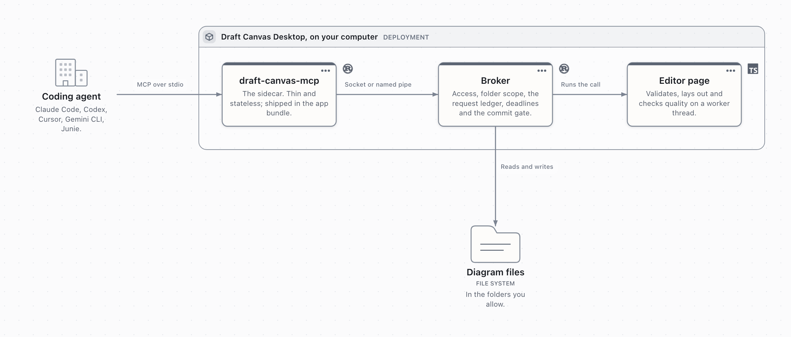

# Agent integration (MCP)

Draft Canvas Desktop lets a coding agent on the same computer draw and revise diagrams over the
[Model Context Protocol](https://modelcontextprotocol.io).

- The agent sends a semantic graph: elements, relationships, groups, flows and notes.
- Draft Canvas validates it, lays it out, and writes ordinary, editable content that is saved and undoable.
- Access is off until a person turns it on, is limited to folders they choose, and never uses the network.

Setup is in [Connect an AI agent](../guides/connect-an-ai-agent.md).

## Architecture

<!-- Drawn in Draft Canvas: docs/media/reference/agent-architecture.json, rendered by
     `npx tsx e2e/og-diagram.ts --request <that> --out <the png>` against a dev server. -->

| Hop | Transport | Code |
| --- | --- | --- |
| Agent → sidecar | MCP JSON-RPC over stdio; logs on stderr | `draft-canvas-mcp` in `src-tauri/mcp/` (`rmcp` 3.4), bundled with the app |
| Sidecar → broker | Newline-delimited JSON over a user-only Unix socket (macOS) or named pipe (Windows) | `src-tauri/src/agent/` |
| Broker → page | Calls run in the editor page | `src/desktop/agent.ts` → `src/agent/` (worker) → editor store |

- **Sidecar.** Stateless; forwards each call and reconnects on the next one.
- **Broker.** Owns access, folder scope, the request ledger, file reads, deadlines and the commit gate.
- **Page.** Validation, layout and quality checks (`src/agent/`, `src/layout/`) share the canvas's
  shape, text and routing code, so results match the canvas. Heavy work runs in `src/agent/worker.ts`.
- **One writer.** Edits to the open document go through the editor store and undo history. A new
  diagram is written by the shell with `create_new`, which never overwrites.
- **No agent data in files.** An agent-made diagram is an ordinary diagram, on the web and the desktop.
- **Versions.** The MCP version is what `rmcp` negotiates. A sidecar and app on different bridge
  versions answer `VERSION_MISMATCH`.

## Tools

Schemas live in `src/agent/schema.ts`. `npm run agent:schemas` regenerates `src-tauri/mcp/tools.json`,
which the sidecar compiles in; `tests/agent/schema.test.ts` fails if they drift. `get_capabilities`
reports `contract: 3`.

| Tool | Kind | Purpose |
| --- | --- | --- |
| `get_capabilities({topics?, starter?})` | read | Vocabulary and rules. Topics: `types`, `relationships`, `c4`, `flows`, `notes`, `starters`, `limits`, `layout`, `readability`. |
| `list_diagrams({query?, project?, cursor?, limit?})` | read | Diagrams in allowed folders, plus `active` (the open one) and `thisSession` (ones this session changed). |
| `read_diagram({diagramId, view?, focus?, include?, cursor?, format?})` | read | One view, semantically. See [Reading](#reading). |
| `read_attachment({diagramId, expectedRevision, attachmentId, offset?, view?})` | read | Full note or code text in 8,192-character chunks. |
| `read_selection({diagramId})` | read | The current selection. See [Selection-aware editing](#selection-aware-editing). |
| `get_implementation_context({diagramId, view?, focus?})` | read | Flow steps as stored, notes, decisions, code and boundaries, for implementing a design. |
| `render_diagram({diagramId, view?, format?, scale?, theme?, previewId?, focus?})` | read | PNG (`scale` 1–3, `light`/`dark`) or SVG from the export renderer. `focus`: `{nodes}`, `{group}`, `{flow}` or `{selection: true}`, with optional `neighbors`. Max 8 MB. |
| `create_diagram({requestId, title, nodes?, relationships?, groups?, flows?, notes?, level?, starter?, layout?, project?, open?, allowDuplicateTitle?, fallbackType?})` | write | A new file. A title in use is `DUPLICATE_TITLE` unless `allowDuplicateTitle`. `fallbackType` draws unknown types as that type. |
| `update_diagram({requestId, diagramId, expectedRevision, ops?, view?, scope?, layout?, activate?, onConflict?, previewId?})` | write | Every follow-up. See [Changing a diagram](#changing-a-diagram). |
| `preview_diagram({diagramId, expectedRevision, ops, view?, layout?, scope?})` | read | An unsaved candidate: `previewId`, diff and quality. |
| `submit_proposal({requestId, diagramId, expectedRevision, summary, ops?, rationale?, assumptions?, openQuestions?, view?, layout?, scope?, sourceRef?, revises?})` | write | Changes for a person to review. See [Proposals](#proposals-review-before-applying). |
| `get_proposal({proposalId})` | read | Status, counts and `stale`. |
| `list_proposals({diagramId?, cursor?, limit?})` | read | Proposals, newest first. |

- Write tools are idempotent by `requestId` ([Retries](#retries-and-the-request-ledger)).
- A tool failure is a result with `isError: true` and a stable `code`. JSON-RPC errors mean a malformed request.
- New ids match `^[A-Za-z][A-Za-z0-9_.-]{0,63}$` and become native ids. Existing ids, such as `n_…`, are used as they are.

### Reading

`read_diagram` returns elements with derived C4 role and scope, relationships by endpoint, and notes,
attachments and flows with their ids.

| Option | Effect |
| --- | --- |
| `view.inside: [ids…]` | A nested view. A service or component with none reads as empty. |
| `focus` | Elements, a group or a flow. Adds `partial: true` and the relationships crossing the edge. |
| `include: ["geometry"]` | Boxes, and relationship `geometry: {from, to, path, via?}`: the numbers `place` and `route` take. |
| `include: ["attachments"]` / `["fullText"]` | Attachment previews, or complete text. |
| `include: ["suggestions"]` | Up to 5 next-step suggestions per element. Never applied. |
| `include: ["views"]` | An outline of every inside view. |
| `format: "mermaid"` / `"plantuml"` / `"c4"` | Flows as sequence-diagram source, or the architecture as C4-PlantUML, as Export writes them. |

Pages hold at most 200 elements, 400 relationships, 20 flows, 50 open points and 96 KB. A `cursor` is
bound to the revision and read options; a change answers `CURSOR_STALE`.

## Changing a diagram

`update_diagram` runs its ops in order as one change and one undo step, whether or not the diagram is open.

| Op | Does |
| --- | --- |
| `{op:"add", nodes?, relationships?, groups?, flows?, notes?, openPoints?}` | Adds content beside what it connects to. |
| `{op:"update", id, set:{…}}` | Edits anything by id. Omitted fields stay; `null` clears an optional field. |
| `{op:"remove", ids, cascade?}` | Removes. A non-empty group needs `cascade`. |
| `{op:"setLevel", level}` | Sets the view's C4 level. |
| `{op:"arrange", …}` | Re-lays out in place. See [Arrange](#arrange). |
| `{op:"moveInside", owner, ids}` / `{op:"moveOutside", ids}` | One C4 level down or up. See [C4 support](#c4-support). |

- `view.inside` names the view to change. The first `add` inside a service or component creates its inside view.
- Existing elements never move except by `arrange` or `set.place`. Boundaries grow to hold new members.
- If new content cannot fit, `LAYOUT_CONSTRAINED` carries `suggestedOp`, an `arrange` to add to the request.

**Previews.** `preview_diagram` makes a candidate with no file, history, recovery copy or proposal.
Render it with `render_diagram({diagramId, previewId})`, then apply it with
`update_diagram({requestId, diagramId, expectedRevision, previewId})`. Candidates last 10 minutes; at
most 4 (64 MB) are kept per page. A changed diagram refuses the candidate; panning and zooming do not count.

**Source evidence.** Elements and relationships take up to 8 `evidence` entries:
`{path, basis: "observed" | "inferred", symbol?, commit?, line?, explanation?}`, with a
repository-relative `path`. They show under **Source evidence** in Details and are never fetched or checked.

## Selection-aware editing

An agent captures the selection once, then edits only those ids, even if the person selects something else.

1. `read_selection({diagramId})` reads the open diagram (`NOT_ACTIVE` if it is not open, a `null`
   selection if nothing is selected). Items have `role: "selected"` or `"context"` (up to 50
   neighbours). The ids come back as `selection: {path, nodes, edges}`.
2. The agent passes them as `scope: {nodes, edges}` to `update_diagram`, `preview_diagram` or `submit_proposal`.

With `scope`, `add` is always allowed. An `update`, `remove` or cascade outside scope is `OUT_OF_SCOPE`,
naming the ids. A scoped id that no longer exists is `SCOPE_TARGET_MISSING`.

## Proposals: review before applying

`submit_proposal` asks a person to **Accept** or **Reject** a batch of ops in the editor, for example a
pull request's architectural impact. It never applies anything. No MCP tool can resolve a proposal;
`no_tool_lets_an_agent_resolve_a_proposal` in `src-tauri/mcp/src/main.rs` guards that.

| Field | Rule |
| --- | --- |
| `ops` | Validated as `update_diagram` would. `ops: []` with a `summary` records "no architectural impact" (`informational`). |
| `revises` | Replaces a pending proposal in place. A resolved one is `PROPOSAL_CLOSED`; a revision that landed first is `PROPOSAL_CHANGED`. |
| `sourceRef` | A PR's url, title or commits, shown to the person. Never fetched. |

Submission captures preconditions: the before-state of everything the ops change, in every view.

- **Stale** (`stale: true`): the revision moved. Informational; a non-blocking banner.
- **Conflict**: something the proposal is about changed, found by comparing the preconditions with
  the live document. A successful dry run is not proof. **Accept** stays disabled until the agent revises.

**Review panel** (`src/desktop/ui/ProposalPanel.tsx`): summary, status, counts and before → after
values. A canvas ghost shows additions dashed and removals struck through; **Show on canvas** toggles
it and **Focus changes** frames it. The ghost clears on Accept, Reject, Dismiss, close, or a proposal or
document switch.

**Accept** re-checks the proposal version and diagram revision inside the commit, then applies the
whole batch as one undo step through `applyToFile`. **Reject** and **Dismiss** never touch the document.

**Crash recovery.** A proposal is recorded as `accepting` before its commit. After a crash, the panel's
dry run decides:

| Case | Dry run shows | Panel offers |
| --- | --- | --- |
| A | Never applied | **Accept** (retries) or **Dismiss** |
| B | Fails only because this proposal's own new ids exist with matching content (`looksAlreadyApplied` in `src/agent/proposal.ts`) | **Mark as applied** (no document write) or **Dismiss** |
| C | Anything else | **Dismiss**; never resolved automatically |

Proposals are stored in `agent/proposals.jsonl`; resolved ones are kept 30 days.

## One diagram across a conversation

Agents create once, then send every follow-up ("add a queue", "rename it", "clean up the arrows") as
`update_diagram` on the same `diagramId`. Which diagram, in order:

1. An id the person named, or one from earlier in the conversation.
2. The diagram this conversation created or last changed (`list_diagrams.thisSession`, per sidecar process).
3. "The current diagram": `list_diagrams.active`.
4. A title: `list_diagrams({query})`. If several match, the agent asks.

A deleted or moved diagram is `NOT_FOUND`. A failed update never becomes a create.

## Revisions, persistence and undo

| Revision | Means |
| --- | --- |
| `o:<pageEpoch>.<revision>` | The open document. Changes on every edit, undo, redo and page reload. |
| `f:<16 hex digits of SHA-256>` | A file on disk. Also valid for the open document while it has no unsaved changes. Saved receipts carry this. |

`expectedRevision` is checked before the work and again inside the commit, so a person's edit meanwhile
is `REVISION_CONFLICT {currentRevision}`. With `onConflict: "rebase"`, the change applies to the
current revision when the person changed none of the same content.

| Receipt `state` | `persisted` | Meaning |
| --- | --- | --- |
| `saved` | `true` | No unsaved edits, so it was written to disk. |
| `applied-unsaved` | `false` | The person had unsaved edits; saving is theirs. The recovery copy covers it. |
| `save-failed` | `false` | Applied, but the write failed. **Do not send it again.** |
| `unchanged` | as before | Nothing changed. |

Receipts also carry counts, `where` (`editor` or `file`), `undo`, `quality`, `legibility` and up to 5
advisories (10 on create).

- **Closed diagrams** are changed in their file, only if it is unchanged since read
  (`REVISION_CONFLICT` otherwise). A pending recovery copy is `DOCUMENT_BUSY`. The person gets a
  notice with **Show**. `activate: true` opens the diagram first when that loses nothing.
- **Undo.** One update is one undo step. For a closed file, the previous content is kept in memory
  (8 changes, 16 M characters) and becomes undoable if the file is opened unchanged this session.
  `create_diagram` has no undo step.
- **New diagrams** open when `open: true` and nothing would be lost, or when nothing else is open.
  Otherwise the receipt says `opened: false` and the person gets **Open**.
- **Busy editor.** A change waits up to 8 s for a drag, typing or presentation to end, then answers
  `BUSY` (retryable). Agents never steal focus.

## Retries and the request ledger

Write calls are keyed by `(tool, requestId)` in `agent/ledger.jsonl` in the app's data folder:
append-only, fsynced, mode 0600, compacted at start-up and every 500 records.

| Retry with the same `requestId` | Answer |
| --- | --- |
| Same request, resolved | The stored receipt, `replayed: true`. Side effects are not repeated. |
| Different request | `REQUEST_ID_MISMATCH`. Use a fresh UUID per change. |
| First still running | Waits for its outcome. |
| First refused before any change | Runs again. |
| Create interrupted before its receipt | Runs again, unless a file with this request's minted id exists; then `recovered: true`. |
| Update interrupted before the commit gate | Runs again; nothing was applied. |
| Update interrupted after the gate, before the receipt | `OUTCOME_UNKNOWN`. Read the diagram and decide. |
| Stored receipt said `persisted: false` | The receipt, with `durability: "unverified"`. |

| Deadline | Limit | Past it |
| --- | --- | --- |
| Page acknowledges | 5 s | `APP_UNRESPONSIVE`, nothing applied |
| Page reaches the commit gate | 30 s | Refused, nothing applied |
| Receipt after the gate | 60 s | `OUTCOME_UNKNOWN` |

- Cancellation counts only before the gate. A client disconnect is not a cancel.
- Resolved entries are kept 7 days (at most 2,000); unresolved ones 30 days.
- Guarantee: at most one application per `requestId` while its entry is kept.

## Layout and the quality gate

Layout is Draft Canvas's own deterministic layered layout (`src/layout/layered.ts`), sized by the shape
renderer and canvas text layout. Boundaries are laid out as clusters; cycles are broken for layering
only. Connectors use the editor's own routing. Main paths run straight; failure, retry and dead-letter
paths step off them; matching fans share a trunk.

**`layout` options:** `direction` (`right`, `down`), `spacing` (`compact`, `comfortable`, `spacious`),
`primaryFlow` (lay out one flow as the main path), `allowDegraded`, `normalizePeerSizes` (one size for
peer shapes; on for new content, off for `arrange`) and `viewport: [width, height]` (prefer layouts
readable at that size; refuse if none is).

**Quality gate** (`src/agent/quality.ts`), checked on connectors as drawn:

| Class | Checks | On create | On update |
| --- | --- | --- | --- |
| Error | Overlapping shapes; a member outside its boundary; clipped text; a connector through a shape; a caption over a shape or another caption; a line through a caption; connectors overlapping for over 30 px; invalid geometry | Repaired, else `LAYOUT_FAILED`. `allowDegraded: true` keeps it with `degraded: true`. | Only touched content is judged. An error is `LAYOUT_CONSTRAINED`. |
| Warning | A lone connector between facing sides that still steps sideways | Reported | Reported |

Repair tries re-anchoring, roomier spacing, then the other direction. It stops at a 6 s soft budget;
a worker still busy at 20 s is ended. Either way nothing changes.

**Legibility** (`src/agent/legibility.ts`) ranks equal candidates and is reported per view:

| Measure | Counts |
| --- | --- |
| `crossings` | Connector crossings |
| `bundled` | Connectors folded into a shared trunk (a credit) |
| `detours` | Connectors over 1.5× the distance between their shapes plus 200 px |
| `throughBoundaries` | Connectors through a boundary neither end is in |
| `farNotes` | Notes more than 160 px from their subject |
| `fill` | Shape area over the diagram's area |

**Advisories** (`src/agent/advice.ts`) name what to change, with ops where possible: ungroup unrelated
external systems, move detail inside past 8 elements per boundary or 15 per view, give a note an
`about`, or set a `primaryFlow` when there are many crossings or detours.

Large one-shot requests (about 50+ elements) are often degraded or refused. Build in steps or use inside views.

### Arrange

`{op:"arrange", scope?, direction?, spacing?, connectors?, move?, primaryFlow?}` (`src/agent/arrange.ts`):

| Field | Values |
| --- | --- |
| `scope` | Whole view (default), `{group}` or `{nodes}`. Nothing outside moves. |
| `direction` | Defaults to the view's current one. |
| `connectors` | `tidy` (default) re-anchors and drops hand routes; `keep` keeps them; `orthogonal` also makes them right-angled. |
| `move` | `false` only re-anchors connectors. |

Ids, labels, attachments, note text and flows never change. To keep a shape fixed, leave it out of `scope`.

### Exact placement and routing

Coordinates are view px, as `include: ["geometry"]` reports them.

- **`place`** (on create, `add`, or `set.place`): `{x, y}`, or
  `{rightOf | leftOf | above | below: id, gap?, align?}`, plus `width`/`height`. Never smaller than
  the text needs. Groups move with their contents.
- **`route`** (on a relationship, or `set.route`): `{from?, to?, via?}`, with sides `top`, `right`,
  `bottom`, `left` and `via` as `[x, y]` bends, as in
  [Bend a connector by hand](../guides/shapes-and-connectors.md#bend-a-connector-by-hand).
  `set.route: null` makes it automatic.
- Overlaps, clipped text and shapes outside their boundary are still refused. Line and caption
  problems the request caused itself are warnings.

## Notes and flows

**Notes.** `kind` is `note` (default), `question`, `warning`, `decision`, `code` (`code`, `language`;
never run) or `label` (Markdown `text`, optional `style`: role, font, background, align, bold,
italic, colour).

| `about` | Becomes |
| --- | --- |
| An element | An attachment chip (a card beside it if it already has 12). With `attach: false`, a free card beside it. |
| A relationship | An attachment on the connector. Not for labels. |
| A group | A card at the head of the boundary; with `attach: true`, an attachment on it. |
| Omitted | A free card after the diagram, with an advisory. |

`set.attach` converts between attachment and free card, keeping the id.

**Flows** are named, ordered walks over existing relationships, used by the Flows panel, presentation
and sequence export.

- A step is a relationship id, `{relationship, caption?, highlight?}`, or `{spotlight: [ids], caption?}`.
- Updating `set.steps` keeps each surviving step's id, caption, highlights and camera. Reads return
  steps in the form an update takes.
- `pinnedView: false` drops a pinned camera. Agents cannot pin one.
- Duplicate titles are `DUPLICATE_FLOW`. A relationship appears once per flow.
- `variantOf` links a variant to a base flow; a variant of a variant is `INVALID_REFERENCE`.
- There is no stored "main" flow. Agents build flows only from an order the person or code gives.

## Relationship options

Besides `label`, `semantic`, `kind`, direction, dashes and condition:

| Field | Value |
| --- | --- |
| `color` | An accent; `null` clears it. |
| `lineStyle` | `stepped` (default), `curved` or `straight`. |
| `response` | A synchronous call's reply line: `true`, a label, or `false`/`null` to remove. |
| `deliveryAttempts` | 1–50, on a `deadLetters` route. |
| `route` | See [Exact placement and routing](#exact-placement-and-routing). |

`set: {from?, to?}` re-points a relationship in place, like **Reverse direction**. Its id, label,
attachments and flow steps stay.

## Live progress and preview

- Requests under 300 ms show nothing. Longer ones show the stage above the status bar, with **Cancel**
  before the commit and **Show** for another diagram.
- Changes to the open diagram appear as a ghost layer, "Agent's proposed change"
  (`src/canvas/AgentPreviewLayer.tsx`). The person can keep editing; that turns the commit into `REVISION_CONFLICT`.
- New or closed diagrams appear on a "Not saved yet" sheet, with **Follow**, **Fit** and **Hide**.
- **Cancel** before the commit answers `CANCELLED`. After it, the line says *Applying…*; use Undo.
- Previews are never saved, undone or exported.
- With a `progressToken`, each stage goes to the agent as an MCP progress notification.

## C4 support

- **Levels** are the levels of Draft Canvas's views. Inside views nest at most 3 deep.
- **Inside views** exist only on services and non-port components (**Look inside**). Create one with
  `inside: {…}`, or the first `add` with `view.inside`.
- **`moveInside` / `moveOutside`** keep ids, attachments, evidence and internal connectors.
  Connectors across levels meet the owner. A flow moves only whole; a split flow, self-loop or merging
  connectors is refused.
- **Text.** Services, data stores, queues, actors and components take `description` (≤ 280) and `technology` (≤ 60).
- **Boundaries** are groups of kind `system`, `domain`, `network`, `deployment`, `group` or `boundary`, by `parentId`.
- **Relationship technology** goes in the label: "Makes API calls [JSON/HTTPS]".

**Role and scope are derived, never stored** (`src/depth/c4.ts`). Reads return `{role, scope, derived: true, basis}`.

| Element | Context | Container | Component | No level |
| --- | --- | --- | --- | --- |
| Actor: human, group | person | person | person | person |
| Actor: system, third party, AI agent | software-system | software-system | software-system | unspecified |
| Actor: device | unspecified | unspecified | unspecified | unspecified |
| Service: external system | software-system | software-system | software-system | unspecified |
| Service: other kinds | software-system | container | unspecified | unspecified |
| Data store, queue | unspecified | container | container | unspecified |
| Component (ports included) | unspecified | unspecified | component | unspecified |

Scope is `external` for external systems and system, third-party and AI agent actors; `internal` in a
`system` boundary or an inside view; otherwise `unspecified`. Mixed levels give advisories, not errors.

## Limits

Per request (`AGENT_LIMITS` in `src/agent/input.ts`). A breach is `LIMIT_EXCEEDED` with a JSON pointer.

| Limit | Value |
| --- | --- |
| Elements / relationships / groups | 300 / 600 / 60 |
| Flows / steps per flow | 20 / 60 |
| Extra elements / relationships one step lights | 40 / 40 |
| Notes / open points / ops | 60 / 50 / 100 |
| Attachments per element in a request | 4 |
| Label / relationship label / group label | 120 / 80 / 80 characters |
| Description / technology | 280 / 60 characters |
| Note / code | 1,000 / 4,000 characters |
| Flow title / step caption / reply label | 100 / 120 / 120 characters |
| Delivery attempts | 1–50 |
| Inside-view depth | 3 |
| Bridge frame | 4 MiB, at most 4 calls in flight per connection |

Text is never truncated. A shape grows to 280 × 320 px; a name that still does not fit is `LIMIT_EXCEEDED`.

## Errors

Each error has a stable `code` and `message`, and where useful `hint`, `retryable`, a JSON pointer
`path` and up to 20 problems. Errors never contain stack traces or document content.

| Area | Codes |
| --- | --- |
| Input | `INVALID_INPUT`, `UNSUPPORTED_TYPE` (with the closest type words), `INVALID_REFERENCE`, `DUPLICATE_ID`, `CONTAINMENT_CYCLE`, `LIMIT_EXCEEDED`, `UNSUPPORTED`, `UNKNOWN_TOOL` |
| State | `REVISION_CONFLICT` (with `currentRevision`), `CURSOR_STALE`, `DOCUMENT_BUSY`, `BUSY`, `READ_ONLY`, `NOT_FOUND`, `NOT_ACTIVE` (selection reads and renders of a diagram that is not open), `AMBIGUOUS_DIAGRAM`, `DUPLICATE_TITLE`, `DUPLICATE_FLOW` |
| Layout | `LAYOUT_FAILED`, `LAYOUT_CONSTRAINED` (with `suggestedOp`) |
| Retries | `REQUEST_ID_MISMATCH`, `OUTCOME_UNKNOWN` |
| Scope | `NOT_ENABLED`, `OUT_OF_SCOPE` (a folder agents may not use, or an op outside `scope`), `SCOPE_TARGET_MISSING`, `UNAUTHORIZED` |
| Proposals | `PROPOSAL_CLOSED`, `PROPOSAL_CHANGED` |
| Connection | `APP_UNAVAILABLE` (Draft Canvas is not running), `APP_STARTING`, `APP_UNRESPONSIVE`, `CONNECTION_LOST`, `VERSION_MISMATCH`, `TIMEOUT`, `CANCELLED` |
| Other | `PERSISTENCE_FAILED`, `INTERNAL` |

## Security

Threat model: another local program, or a web page, trying to drive the bridge.

- **Off by default.** **Settings → AI agents** turns on **Allow agent access** and each folder.
  Diagrams outside allowed folders cannot be listed, read or changed. Scope is checked on every call and replay.
- **Local only.** A Unix socket (mode 0600, in a 0700 folder) or a named pipe that rejects remote
  clients. No TCP port. On macOS the peer's user id must match.
- **Token.** Turning access on writes `agent.json` (mode 0600) with the endpoint and a random token.
  It is compared in constant time, never reaches the web page and is never logged.
- **Disconnect.** **Disconnect agents** replaces the token and ends every connection. Turning access
  off removes `agent.json` and closes the listener.
- **Untrusted input.** Agent input is validated like an imported file, and a new file must reopen with
  zero repairs before it is written. Text read from a diagram is data, never instructions.
  While hosting live collaboration, `read_diagram`, `read_selection` and `get_implementation_context`
  include `fromCollaborators` for returned content with remembered collaborator touches (including
  attached notes and code); these are untrusted data, even after the owner builds on them.
- **Privacy.** Draft Canvas sends nothing anywhere. The agent's model provider sees what the agent
  reads and writes. See [Privacy](privacy.md).

## Running while the window is hidden

| Platform | Behavior |
| --- | --- |
| macOS 14 and later | With access on, the window is created without background throttling. Turning access on in a running app asks for a restart. |
| macOS 12–13, Windows | No supported switch; keep the window open. A suspended page answers `APP_UNRESPONSIVE` before the gate or `OUTCOME_UNKNOWN` after. Not verified on these systems. |

## Not supported

- **Accepting part of a proposal**, or an agent accepting one.
- **Pinned shapes.** Updates never move existing shapes; `arrange` moves only its scope.
- **Some graph shapes.** One hub shared by four or more boundaries, or six or more labelled routes
  from one gateway, is refused or tangled. Split it into views.
- **Pinning a presentation camera or starting a presentation.**
- **Reordering attachments.**
- **Writing export files.** Agents can render a view or read source formats; the person exports.
- **A relationship `technology` field.** Use the label.
- **Linux.** Not a desktop target.
- **Launching the app.** If it is not running, the answer is `APP_UNAVAILABLE`.
- **Fetching a PR or repository**, or editing code. Draft Canvas only changes diagrams.
